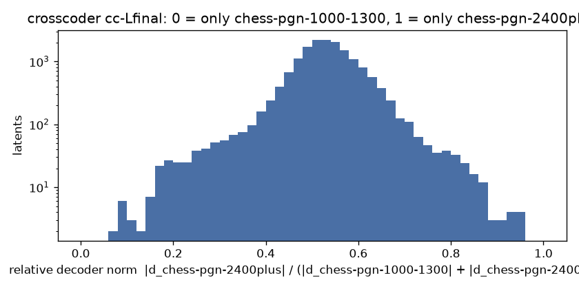

# Crosscoder chess-pgn-1000-1300 vs chess-pgn-2400plus, cc-Lfinal

BatchTopK crosscoder, 16384 latents, k = 64 (held-out L0 65.4), on 1000000 positions from 64312 games (pgn-everything).

| source | held-out FVU |
| --- | --- |
| chess-pgn-1000-1300-Lfinal | 0.062 |
| chess-pgn-2400plus-Lfinal | 0.074 |

Latents firing at least once: 16384 (100.0%). Only chess-pgn-1000-1300: **8**, only chess-pgn-2400plus: **11**, shared: **15744** (median decoder cosine 0.04).

Relative decoder norm, 10 bins from 0 (only chess-pgn-1000-1300) to 1 (only chess-pgn-2400plus): 8 61 180 456 4130 9050 2108 292 88 11

Each example: activation, folder, move and side to move, the last moves, **the move played**, then each model's top move at T = 1 (chess-pgn-1000-1300 / chess-pgn-2400plus).

## Only in chess-pgn-1000-1300 (r < 0.1)

### latent 12641: r = 0.10, cosine 0.05, fires on 0.64% (pgn-everything 0.64%)

- 7.65 | pgn-everything | move 23, black | `Rxe4 20.c3 Rxg4+ 21.Kh2 Qd6+ 22.Kh3 Bf5 23.Nxd4` -> **Rh4+** | Rh4+ 34% / Rh4+ 35% | [board](https://lichess.org/analysis/r5k1/1p3pp1/p1nq1b1p/5b1P/3N2r1/PBP4K/1P1B1P2/R2Q1R2_b_-_-_0_23)
- 7.18 | pgn-everything | move 12, black | `Qb6+ 9.Be3 Ng4+ 10.Kg3 Qxe3 11.Nd5 Qf2+ 12.Kh3` -> **Ne3+** | Ne3+ 77% / Nd4 28% | [board](https://lichess.org/analysis/r1b1k2r/pp3ppp/2n5/3Np3/2P3n1/3P1N1K/PP3qPP/R2Q1B1R_b_kq_-_3_12)
- 7.07 | pgn-everything | move 11, white | `Nd5 8.Bxh7+ Kxh7 9.Ng5+ Kg6 10.Qg4 Rh8 11.` -> **Nxe6+** | Nxf7+ 28% / h4 30% | [board](https://lichess.org/analysis/r1bq3r/pppp1pp1/2n1p1k1/3nP1N1/5PQ1/2P5/PPP3PP/R1B1K2R_w_KQ_-_4_11)
- 6.87 | pgn-everything | move 11, white | `Kxf7 8.Ng5+ Kg6 9.Qxg4 Nf6 10.Qf5+ Kh6 11.` -> **Nf7#** | Nf7# 80% / Nf7# 77% | [board](https://lichess.org/analysis/r2q3r/ppp3pp/1bnp1n1k/4pQN1/3PP3/2P5/PP3PPP/RNB2RK1_w_-_-_3_11)
- 6.83 | pgn-everything | move 11, white | `Bb6 8.Ng5+ Kg6 9.exd5 Qxd5 10.Qc2+ Kh6 11.` -> **Nf7+** | Nf7+ 38% / Nf7+ 25% | [board](https://lichess.org/analysis/r1b4r/ppp3pp/1bn2n1k/3qp1N1/3P4/2P5/PPQ2PPP/RNB1K2R_w_KQ_-_2_11)
- 6.82 | pgn-everything | move 21, white | `gxh6 18.Qxh6 Qxb2 19.Kd2 Nd7 20.Rhg1 f6 21.` -> **Nf5+** | Nf5+ 60% / Nf5+ 41% | [board](https://lichess.org/analysis/r4rk1/pp1nb3/4pp1Q/3p3P/3P4/2N2PN1/PqPK4/R5R1_w_-_-_0_21)
- 6.78 | pgn-everything | move 34, black | `Rh2+ 31.Kg1 Rg2+ 32.Qxg2 hxg2 33.Kxg2 Qh3+ 34.Kf3` -> **Qg4+** | Bg4+ 58% / Bg4+ 42% | [board](https://lichess.org/analysis/2b5/p1p3k1/1p6/8/1P6/P1P2Kbq/8/R4R2_b_-_-_2_34)
- 6.69 | pgn-everything | move 20, white | `g3 17.Bxg6 fxg6 18.exd6 cxd6 19.Rae1+ Kf7 20.` -> **Qf4+** | Ne5+ 37% / Qf4+ 41% | [board](https://lichess.org/analysis/r4b1r/p2b1kp1/1p1p2p1/n2P2B1/8/2N2Np1/PPPQ2P1/4RRK1_w_-_-_2_20)
- 6.60 | pgn-everything | move 26, white | `Rxd8 23.Rxc6+ Kb7 24.Qf3 Ka7 25.Be3+ Kb7 26.` -> **Rb6+** | Rb6+ 18% / Rb6+ 28% | [board](https://lichess.org/analysis/r2r4/1k2b2p/p1R2p2/1p6/8/1B2BQ2/PP3PPP/6K1_w_-_-_5_26)
- 6.58 | pgn-everything | move 23, white | `Qxf3 20.Bxg4 Qxf2 21.Bh6 Qxc2+ 22.Kxc2 Rfe8 23.` -> **Bd7+** | Bd7+ 50% / Bf5+ 43% | [board](https://lichess.org/analysis/r3r1k1/ppp2p2/2nb3B/8/6BP/2P1P3/PPK5/6RR_w_-_-_1_23)
- 6.57 | pgn-everything | move 37, white | `a5 34.Na2 Qe7 35.Rxc8+ Kh7 36.Bc2 b4 37.` -> **Rdc3+** | Ra8 13% / Nc1 19% | [board](https://lichess.org/analysis/2R5/4qppk/4p2p/p2pP3/1p5P/3R2P1/NKB2P2/8_w_-_-_0_37)
- 6.57 | pgn-everything | move 16, white | `Bh8 13.Nh4 b5 14.Qf3 Bb7 15.Qg3 f6 16.` -> **Bxf6+** | Bxf6+ 67% / exf6 57% | [board](https://lichess.org/analysis/r3qrkb/pb1n3p/2p1pp1P/1p1pPpB1/3P3N/2P3Q1/PP3PP1/RN2K2R_w_KQ_-_0_16)

### latent 4724: r = 0.08, cosine -0.05, fires on 2.18% (pgn-everything 2.18%)

- 6.59 | pgn-everything | move 36, black | `a4 33.Nd2 b3 34.Nb1 Rxd1 35.Rxd1 a3 36.Nxa3` -> **Rxa3** | Rxa3 84% / Rxa3 90% | [board](https://lichess.org/analysis/r5k1/6pp/1p3p2/4p3/8/Np2PKP1/8/3R4_b_-_-_0_36)
- 6.30 | pgn-everything | move 33, white | `Qxa2 30.Rxb2 Qxb2 31.Qxb2 Nxb2 32.Ra1 Nd3 33.` -> **Rxa6** | Rxa6 71% / Rxa6 93% | [board](https://lichess.org/analysis/6k1/6p1/p3prpp/3p4/3P4/2Pn1N1P/5PP1/R5K1_w_-_-_2_33)
- 4.94 | pgn-everything | move 27, white | `Rfd8 24.Red1 d4 25.Rd2 d3 26.Rad1 b5 27.` -> **Rxd3** | Rxd3 93% / Rxd3 62% | [board](https://lichess.org/analysis/r2r2k1/1p4pp/5p2/1p6/8/1P1p1PB1/P2R1P1P/3R2K1_w_-_-_0_27)
- 4.64 | pgn-everything | move 7, white | `c5 4.Nd2 cxd4 5.exd4 Nc6 6.c3 d5 7.` -> **f4** | f4 49% / f4 63% | [board](https://lichess.org/analysis/r1bqkb1r/pp3ppp/2n1pn2/3p4/3P4/2PB4/PP1N1PPP/R1BQK1NR_w_KQkq_-_0_7)
- 4.51 | pgn-everything | move 19, black | `Qxa1 16.Na3 Qxa2 17.Qa5 b6 18.Qa4+ Bd7 19.Qxc4` -> **Qxa3** | Qxa3 72% / Qxa3 71% | [board](https://lichess.org/analysis/r3kb2/2pb1p2/pp2p3/6p1/2Q1P3/N1P5/q4P1P/5RK1_b_q_-_0_19)
- 4.41 | pgn-everything | move 18, white | `Bd3 15.Rfe1 Rc8 16.Qf3 Nbd5 17.e4 Nxc3 18.` -> **e5** | Qxd3 66% / e5 43% | [board](https://lichess.org/analysis/2rq1rk1/5ppp/p3pn2/6B1/3PP3/1Bnb1QN1/P4PPP/R3R1K1_w_-_-_0_18)
- 4.24 | pgn-everything | move 26, white | `axb5 23.Qb1 Rb8 24.Rd1 g6 25.g3 Qxd6 26.` -> **Bf1** | Bf1 37% / Bf1 72% | [board](https://lichess.org/analysis/1r4k1/5p1p/3q2p1/1p3p2/2p5/2Pn2PB/5P1P/1Q1R2K1_w_-_-_0_26)
- 4.22 | pgn-everything | move 41, black | `Bxa3 38.f4 Bb2+ 39.Kb1 Bxc3 40.fxe5 Rb8 41.Rb5` -> **Bd4** | Bxe5 37% / Bxe5 30% | [board](https://lichess.org/analysis/1r2k3/5p1p/1B4p1/1R2P1P1/2p1P3/2bn4/8/1K3R2_b_-_-_2_41)
- 4.20 | pgn-everything | move 25, white | `Qd2+ 22.Kb1 Qxd3+ 23.Kb2 Re2+ 24.Ka3 b5 25.` -> **Bf1** | Bxf3 27% / b4 18% | [board](https://lichess.org/analysis/6k1/p4ppp/8/1pp5/8/KPPq1n1P/P3rPBP/R6R_w_-_-_0_25)
- 4.03 | pgn-everything | move 27, black | `Qc2 24.e8=Q Rxe8 25.Rxe8 Kb7 26.Qe7+ Ka6 27.Qxd6` -> **Bg4** | Bb7 31% / Bb7 24% | [board](https://lichess.org/analysis/r1b1R3/p4Bp1/kppQ4/8/8/4KNPp/PPq4P/R1B5_b_-_-_0_27)
- 3.97 | pgn-everything | move 32, black | `b3+ 29.axb3 Rxa1 30.g8=Q Rxc1+ 31.Kxc1 Qxd2+ 32.Kb1` -> **Qxd3+** | Qc1+ 41% / Qc1+ 38% | [board](https://lichess.org/analysis/6Q1/2pkn2Q/2np4/1p2p2p/4P3/1PPPb3/3q4/1K6_b_-_-_1_32)
- 3.93 | pgn-everything | move 71, black | `Kg4 68.Nxg2 h3 69.Ne1+ Kh4 70.Qh2 Kg4 71.Nf3` -> **Kxf3** | Kxf3 52% / Kxf3 55% | [board](https://lichess.org/analysis/8/8/8/2K2p2/p5k1/P4N1p/7Q/8_b_-_-_5_71)

### latent 5683: r = 0.09, cosine -0.04, fires on 1.38% (pgn-everything 1.38%)

- 5.06 | pgn-everything | move 6, white | `Nf6 3.b3 d5 4.Bb2 d4 5.h3 Bf5 6.` -> **Bxb7** | g4 49% / d3 63% | [board](https://lichess.org/analysis/rn1qkb1r/ppp2ppp/5n2/4pb2/3p4/1P4PP/PBPPPPB1/RN1QK1NR_w_KQkq_-_1_6)
- 4.99 | pgn-everything | move 33, white | `Ra8 30.Na3 Rda7 31.Qxg7 Qxd1+ 32.Ka2 Rxa3+ 33.` -> **bxa3** | bxa3 100% / bxa3 100% | [board](https://lichess.org/analysis/r7/4kpQ1/3p3p/3P4/4P3/rP6/KPP5/3q4_w_-_-_0_33)
- 4.45 | pgn-everything | move 19, white | `O-O 16.Nc5 Ne7 17.Nd3 a6 18.Bc4 b5 19.` -> **Nde5** | Bxe6 39% / Bxb5 50% | [board](https://lichess.org/analysis/r1b2rk1/2q1nppp/p3pn2/1p6/2B5/1P1N1N1P/P1P2PP1/R2QR1K1_w_-_-_0_19)
- 4.25 | pgn-everything | move 15, white | `Qe4 12.O-O Qxe2 13.Na3 g6 14.Rae1 b5 15.` -> **Rxe2+** | Qxb5 45% / Nxb5 27% | [board](https://lichess.org/analysis/r3kb1r/p1B2p1p/2n2np1/1p6/Q2P4/N1P3P1/PP2q2P/4RRK1_w_kq_-_0_15)
- 4.20 | pgn-everything | move 19, black | `dxc4 16.Nxc4 Nd5 17.Bd2 Bf4 18.Nfe5 Bxe2 19.Nxd7` -> **Bxd1** | Bxd1 47% / Bxd1 79% | [board](https://lichess.org/analysis/rq2r1k1/pp1N1ppp/2p5/3n4/1PNP1b2/P6P/3BbPP1/2RQR1K1_b_-_-_0_19)
- 3.90 | pgn-everything | move 26, white | `Kf7 23.Qg3 Rhg8 24.Qh4 Qd8 25.Qh5+ g6 26.` -> **Qxh7+** | Qxh7+ 94% / Qxh7+ 94% | [board](https://lichess.org/analysis/r2q2r1/1p3k1p/p3p1p1/4Bp1Q/3Pp3/2P4P/P1P2PP1/4R1K1_w_-_-_0_26)
- 3.74 | pgn-everything | move 7, white | `d6 4.Nf3 h6 5.a3 g5 6.Nh2 h5 7.` -> **Be2** | Be2 51% / Be2 44% | [board](https://lichess.org/analysis/rnbqk1nr/ppp2p2/3p4/2b1p1pp/4P3/P2P3P/1PP2PPN/RNBQKB1R_w_KQkq_-_0_7)
- 3.67 | pgn-everything | move 20, black | `Bd4 17.Bd2 Qa6 18.b4 b5 19.a4 bxa4 20.b5` -> **Bxf2+** | Qb6 54% / Qb7 49% | [board](https://lichess.org/analysis/2kr2nr/p1p3pp/q1n2p2/1P2p3/p1PbN3/3P1N2/R2BQPPP/5RK1_b_-_-_0_20)
- 3.65 | pgn-everything | move 23, white | `Bxf5 20.Qa5+ Kc8 21.Qxd8+ Kxd8 22.Ne4 d5 23.` -> **Nc5** | Bxd5 37% / Ng3 48% | [board](https://lichess.org/analysis/3kn2r/1p4bp/2p5/3ppb2/2B1N3/2PP3P/PP3PP1/2KR3R_w_-_-_0_23)
- 3.59 | pgn-everything | move 15, white | `c6 12.Bb3 Qb6 13.Be3 Qd8 14.Qg4 h5 15.` -> **Qh3** | Qxd7 45% / Qxh5 62% | [board](https://lichess.org/analysis/r2q1rk1/pp1nbpp1/2p5/4p2p/4P1Q1/1B2B3/PPP2PPP/R2R2K1_w_-_-_0_15)
- 3.57 | pgn-everything | move 7, white | `Nxd5 4.Bb5+ c6 5.Ba4 b5 6.Bb3 Nxc3 7.` -> **bxc3** | bxc3 69% / bxc3 86% | [board](https://lichess.org/analysis/rnbqkb1r/p3pppp/2p5/1p6/8/1Bn5/PPPP1PPP/R1BQK1NR_w_KQkq_-_0_7)
- 3.54 | pgn-everything | move 21, white | `Bg5 18.Bxg5 hxg5 19.Rfe1 g4 20.Qf4 g5 21.` -> **Qg3** | Qe3 39% / Qd2 51% | [board](https://lichess.org/analysis/r2qbrk1/8/4p3/pp2Npp1/2pP1Qp1/P1P5/1PB2PPP/R3R1K1_w_-_-_0_21)

### latent 2044: r = 0.09, cosine 0.03, fires on 1.68% (pgn-everything 1.68%)

- 5.04 | pgn-everything | move 11, white | `cxd4 8.Nxd4 Qb6 9.N2b3 Nf6 10.Be3 Bxe4 11.` -> **O-O** | O-O 39% / O-O 73% | [board](https://lichess.org/analysis/rn2kb1r/3p1ppp/1q2pn2/1B6/3Nb3/1N2B3/PP3PPP/R2QK2R_w_KQkq_-_0_11)
- 4.30 | pgn-everything | move 11, black | `d6 8.h3 f5 9.Qc2 f4 10.Bd2 Nxd4 11.Qa4` -> **c5** | Bxc3 40% / c5 38% | [board](https://lichess.org/analysis/r1bq1rk1/ppp1n1pp/3p4/8/Qb1nPp2/2NB3P/PP1B1PP1/R3K1NR_b_KQ_-_1_11)
- 3.98 | pgn-everything | move 23, white | `Qf6 20.Rad1 h5 21.Qh4 Ne7 22.f4 Nf5 23.` -> **Qe1** | Qf2 48% / Qf2 39% | [board](https://lichess.org/analysis/5r1r/pp1k2p1/3bpq2/3p1nNp/1P1PpP1Q/P3P3/1B4PP/3R1RK1_w_-_-_1_23)
- 3.82 | pgn-everything | move 12, white | `Qb6 9.N2b3 Nf6 10.Be3 Bxe4 11.O-O Be7 12.` -> **Rc1** | f3 16% / Nf5 28% | [board](https://lichess.org/analysis/rn2k2r/3pbppp/1q2pn2/1B6/3Nb3/1N2B3/PP3PPP/R2Q1RK1_w_kq_-_2_12)
- 3.73 | pgn-everything | move 49, black | `Ka5 46.Qa3+ Ra4 47.Qc5+ b5 48.Qxa7+ Kb4 49.Qd4+` -> **Ka5** | Ka5 100% / Ka5 100% | [board](https://lichess.org/analysis/8/8/2p5/1p3B2/rk1Q2P1/8/1K6/8_b_-_-_2_49)
- 3.63 | pgn-everything | move 14, white | `c4 11.Bb1 b5 12.a3 Bb7 13.Qc2 Ne4 14.` -> **Ng1** | Nxe4 74% / Nxe4 87% | [board](https://lichess.org/analysis/r3qrk1/pb1n1pp1/3bp2p/1p1p4/2pPn2B/P1P1PN2/1PQN1PPP/1BR1K2R_w_K_-_3_14)
- 3.62 | pgn-everything | move 27, black | `Kxe6 24.Bb3+ Nd5 25.Bxd5+ Kxd5 26.Rd1+ Ke6 27.Qh3+` -> **Kf7** | Kf7 61% / Kf7 52% | [board](https://lichess.org/analysis/r1b3q1/pp6/4k1pp/4P3/5P2/7Q/PP4PP/R1BR2K1_b_-_-_3_27)
- 3.62 | pgn-everything | move 23, white | `Be8 20.Rxf6 Nxf6 21.Qg3 g5 22.h4 Nh5 23.` -> **Qh3** | Qf3 39% / Qf3 59% | [board](https://lichess.org/analysis/r3b2k/1p2q3/p3p2p/3pNppn/3P3P/2N3Q1/PPP2PP1/4R1K1_w_-_-_1_23)
- 3.61 | pgn-everything | move 16, white | `b5 13.Qc2 h6 14.Ne5 Ne4 15.Nxe4 dxe4 16.` -> **Qxe4** | Qxe4 76% / Qxe4 68% | [board](https://lichess.org/analysis/r1bq1rk1/3n1pp1/4p2p/pp2N3/2pPpP2/2P5/PPQ2PPP/1BR1R1K1_w_-_-_0_16)
- 3.54 | pgn-everything | move 45, white | `axb4 42.cxb4 g5 43.a5 Rh2+ 44.Ke3 Ra2 45.` -> **Rb6+** | Rb6+ 51% / Rb6+ 77% | [board](https://lichess.org/analysis/8/8/5k2/PR3pp1/1P6/4K3/r7/8_w_-_-_3_45)
- 3.51 | pgn-everything | move 21, black | `Rf8 18.b4 cxb4 19.Bb2 Rb8 20.e6+ Kg8 21.exf7+` -> **Rxf7** | Rxf7 100% / Rxf7 100% | [board](https://lichess.org/analysis/1rbq1rk1/1p1n1P1p/p2P2p1/P7/1pB1Q3/8/1BP3PP/R4RK1_b_-_-_0_21)
- 3.45 | pgn-everything | move 15, white | `Nxe5 12.Bxe5 Ne4 13.Qf3 g6 14.Qf4 Bg5 15.` -> **Qf3** | Qf3 71% / Qf3 76% | [board](https://lichess.org/analysis/r2q1rk1/1pp2p2/p5pp/2PpBpb1/1P1PnQ2/P3P3/5PPP/RN2K2R_w_KQ_-_2_15)

### latent 4801: r = 0.08, cosine 0.02, fires on 1.98% (pgn-everything 1.98%)

- 4.94 | pgn-everything | move 22, white | `e5 19.Qc1 g5 20.Bxc4 Rxc4 21.Qd2 Rd4 22.` -> **Qe3** | Qe3 38% / Qe3 54% | [board](https://lichess.org/analysis/3q1r2/1b3pkp/p2p4/1p2p1pP/3rP1P1/2N2P2/PPPQ4/1K1R3R_w_-_-_2_22)
- 4.40 | pgn-everything | move 22, black | `c5 19.a4 Rc8 20.Rb5 Qa6 21.Bc4 Qd6 22.Rd1` -> **Qe7** | Qc6 37% / Qe7 61% | [board](https://lichess.org/analysis/2r2rk1/p4pp1/3q1b2/1Rp1p2Q/P1B1P3/4B3/1PP2PPP/3R2K1_b_-_-_6_22)
- 4.37 | pgn-everything | move 19, white | `O-O 16.Qd3 Na6 17.Ra1 Nb4 18.Rxa8 Qxa8 19.` -> **Qa3** | Qb3 43% / Qc4 72% | [board](https://lichess.org/analysis/q4rk1/2p1b1pp/3p1p2/1N1Pp3/1n2P3/3QBN2/1PP2PPP/6K1_w_-_-_0_19)
- 4.29 | pgn-everything | move 12, white | `Bg4 9.Bg2 Nc6 10.Re1 Nd4 11.Qd3 Bf5 12.` -> **Qxd4** | Qxd4 76% / Qxd4 64% | [board](https://lichess.org/analysis/r2q1rk1/ppp1b1pp/5p1n/3p1b2/3n4/3Q1NP1/PPPP1PBP/RNBKR3_w_-_-_9_12)
- 4.16 | pgn-everything | move 14, white | `Bg4 11.h3 Bh5 12.Nbd2 Nf6 13.Qd3 Qd7 14.` -> **Nxe5** | Nxe5 80% / Nxe5 78% | [board](https://lichess.org/analysis/r3kb1r/1p1q1ppp/p4n2/2p1p2b/2PpP3/P2Q1N1P/1PPN1PP1/R1B1K2R_w_KQkq_-_5_14)
- 4.16 | pgn-everything | move 15, black | `hxg4 12.g3 f5 13.f4 e5 14.Nd5 Bc5+ 15.d4` -> **Rxd5** | Bxd4+ 59% / Nxd4 59% | [board](https://lichess.org/analysis/2kr3r/ppq3p1/2n5/2bNpp2/2PP1Pp1/P5P1/1P5P/R1BQ1RK1_b_-_-_0_15)
- 4.15 | pgn-everything | move 7, black | `a6 4.Bxc6 dxc6 5.Nxe5 Qe7 6.d4 c5 7.dxc5` -> **Qxe5** | Qxe5 87% / Qxe5 73% | [board](https://lichess.org/analysis/r1b1kbnr/1pp1qppp/p7/2P1N3/4P3/8/PPP2PPP/RNBQK2R_b_KQkq_-_0_7)
- 4.15 | pgn-everything | move 37, black | `Re8 34.Bf2 Rd8 35.Bg3 Qd7 36.Re6 Nb5 37.Kh2` -> **Qxd4** | Nxd4 68% / Nxd4 64% | [board](https://lichess.org/analysis/1n1r1k2/p2q2b1/1pp1Rp1p/1n3PpP/3P2P1/1B4B1/PP4QK/2R5_b_-_-_8_37)
- 4.11 | pgn-everything | move 16, black | `Bd6 13.h3 h5 14.Nf3 Qb4 15.a3 Qxb2 16.Rfb1` -> **Qxc3** | Qxc3 99% / Qxc3 92% | [board](https://lichess.org/analysis/2kr3r/ppp2pp1/3b1n2/3P3p/4P3/P1N1BN1P/1qP1QPP1/RR4K1_b_-_-_1_16)
- 4.01 | pgn-everything | move 12, black | `Be7 9.b4 cxb4 10.axb4 Qxb4 11.Nb5 Qc5 12.Be3` -> **Qb4+** | Qb4+ 69% / Qc8 59% | [board](https://lichess.org/analysis/rn2k2r/pp1bbpp1/3p1n1p/1NqPp3/2P1P3/4BN2/5PPP/R2QKB1R_b_KQkq_-_3_12)
- 3.99 | pgn-everything | move 22, black | `Qxb2 19.Nb5 Qe5 20.Bd4 Ngxe4+ 21.Bxe4 Nxe4+ 22.Rxe4` -> **Qg5** | Qd5 30% / Qd5 33% | [board](https://lichess.org/analysis/2k1r2r/ppp2ppp/8/1N2q2b/3BR3/P4PP1/2P2KP1/5Q1R_b_-_-_0_22)
- 3.98 | pgn-everything | move 56, white | `Bxe3 53.Rxf6 Rxf6+ 54.Bxf6 Bf4 55.Be7 Kc4 56.` -> **Ke2** | Bd8 21% / Ke2 49% | [board](https://lichess.org/analysis/8/4B3/8/1p2p1p1/2k1PbPp/5K1P/8/8_w_-_-_3_56)

### latent 7797: r = 0.09, cosine -0.09, fires on 1.02% (pgn-everything 1.02%)

- 4.52 | pgn-everything | move 16, black | `Nxe7 13.Nf4 O-O 14.h5 b5 15.h6 cxd4 16.hxg7` -> **Kxg7** | Kxg7 59% / Rf7 64% | [board](https://lichess.org/analysis/r4rk1/3qn1Pp/2b1p3/pp1pPp2/P2p1N2/2P5/1P3PP1/RN1QK2R_b_KQ_-_0_16)
- 4.04 | pgn-everything | move 11, black | `Nf6 8.a3 Bd6 9.O-O Ng4 10.Re1 Bxf3 11.Qxf3` -> **Nxh2** | Nxh2 45% / Nxh2 46% | [board](https://lichess.org/analysis/rn1qk2r/p1pp1ppp/1p1bp3/8/2PP2n1/P1NB1Q2/1P1B1PPP/R3R1K1_b_kq_-_0_11)
- 3.89 | pgn-everything | move 14, black | `O-O 11.e5 dxe5 12.Qxe5 Bd6 13.Qe3 Ng4 14.Qf3` -> **Nxh2** | Nxh2 48% / Bxh2+ 68% | [board](https://lichess.org/analysis/r2q1rk1/pp3ppp/2pbb3/8/6n1/2NB1Q2/PPP2PPP/R1B1R1K1_b_-_-_4_14)
- 3.79 | pgn-everything | move 17, white | `Qb6 14.Kh1 Qxb2 15.Ne4 Nxc2 16.Rb1 Qxa2 17.` -> **Rxb7** | Rxb7 50% / Rxb7 73% | [board](https://lichess.org/analysis/r4rk1/pp3ppp/8/4p3/4N3/3P1B2/q1n3PP/1R1Q1R1K_w_-_-_0_17)
- 3.78 | pgn-everything | move 16, black | `Ne5 13.Qe1 O-O 14.Qg3 exf5 15.Bh6 Bf6 16.Rxf5` -> **Ng6** | d6 42% / Kh8 40% | [board](https://lichess.org/analysis/r1b2rk1/2qp1ppp/p4b1B/2p1nR2/N3P3/6Q1/PPP1B1PP/R5K1_b_-_-_0_16)
- 3.70 | pgn-everything | move 13, black | `c6 10.Nxf6+ Nxf6 11.O-O Nxe4 12.Nxg7 Nxf2 13.Rxf2` -> **Bxf2+** | Bxf2+ 79% / Bxf2+ 61% | [board](https://lichess.org/analysis/r2q1rk1/pp3pNp/2pp4/2b5/8/8/PPP2RPP/R1BQ2K1_b_-_-_0_13)
- 3.68 | pgn-everything | move 11, white | `Bd7 8.b4 Ba7 9.Kh1 Nc6 10.Ng5 Qf6 11.` -> **Nd5** | Bxf7+ 43% / Nd5 25% | [board](https://lichess.org/analysis/r3k2r/bppb1ppp/p1np1q2/4p1N1/1PB1P1n1/P1NP4/2P2PPP/R1BQ1R1K_w_kq_-_5_11)
- 3.64 | pgn-everything | move 11, white | `Bg4 8.O-O Ne5 9.Be2 c4 10.Nxe5 Bxe2 11.` -> **Qxe2** | Qxe2 92% / Qxe2 45% | [board](https://lichess.org/analysis/r3kbnr/pp3p1p/3q2p1/4N3/2p1P3/2P5/PP1Pb1PP/RNBQ1RK1_w_kq_-_0_11)
- 3.63 | pgn-everything | move 17, black | `Nf6 14.Bxa7 Rhd8 15.Be3 Nfg4 16.Bf4 g5 17.Bxe5` -> **Rxd2+** | Nxe5 46% / Rxd2+ 47% | [board](https://lichess.org/analysis/2kr4/1pprbp1p/4b3/4B1p1/6n1/2P5/PP1NNPPP/R2K3R_b_-_-_0_17)
- 3.59 | pgn-everything | move 46, white | `d2 43.h6 d1=Q 44.h7 Qxb3 45.h8=Q Qb2+ 46.` -> **Kh7** | Kg8 37% / Kg8 55% | [board](https://lichess.org/analysis/7Q/6K1/8/2p2k2/1p6/8/1q6/8_w_-_-_1_46)
- 3.48 | pgn-everything | move 7, white | `b6 4.Bc4 a6 5.Nf3 Nf6 6.Ng5 h6 7.` -> **Nf3** | Nxf7 88% / Nxf7 84% | [board](https://lichess.org/analysis/r1bqkb1r/2p1ppp1/ppnp1n1p/6N1/1PB1P3/2P5/P2P1PPP/RNBQK2R_w_KQkq_-_0_7)
- 3.48 | pgn-everything | move 11, black | `Ne4 8.Bxf7+ Kf8 9.Qf3 Ng5 10.Qf4 Bxc3+ 11.Bxc3` -> **Nxf7** | Nxf7 83% / Nxf7 92% | [board](https://lichess.org/analysis/rnbq1k1r/pppp1Bpp/8/4P1n1/5Q2/2B5/P4PPP/R3K1NR_b_KQ_-_0_11)

### latent 4548: r = 0.08, cosine 0.00, fires on 2.11% (pgn-everything 2.11%)

- 3.97 | pgn-everything | move 23, white | `Qb6 20.Nc5 axb4 21.Qxb4 Nxe3 22.Rfe1 Nf5 23.` -> **Kh1** | Qxg4 50% / d4 46% | [board](https://lichess.org/analysis/r3k2r/2p3p1/1q3p1p/1pN1pn2/1Q4b1/P2P1N2/B1P3PP/2R1R1K1_w_kq_-_2_23)
- 3.90 | pgn-everything | move 19, white | `b6 16.Nb5 Na6 17.Nd4 Bg4 18.Nc6 Bh3 19.` -> **Bd3** | Bxh3 27% / O-O-O 19% | [board](https://lichess.org/analysis/r3k2r/2pqpp2/npNp1n2/p2P4/2P5/1Q2P1Pb/PP3P1P/R3KBR1_w_Qkq_-_6_19)
- 3.89 | pgn-everything | move 12, black | `Nge7 9.Re1 Ng6 10.Nbd2 O-O 11.Nf1 Qf6 12.Bg5` -> **Bxf3** | Bxf3 59% / Bxf3 68% | [board](https://lichess.org/analysis/r4rk1/1pp2ppp/2np1qn1/p1b1p1Bb/P1B1P3/2PP1N1P/1P3PP1/R2QRNK1_b_-_-_8_12)
- 3.88 | pgn-everything | move 30, black | `Qxa3 27.Bf4 Qd6 28.Rd1 exf4 29.Rxe8 fxg3 30.fxg3` -> **Qxg3+** | Qxg3+ 79% / Qxg3+ 73% | [board](https://lichess.org/analysis/4R3/1ppr1pbk/p2q2pp/8/8/1PPN2PP/2Q5/3R2K1_b_-_-_0_30)
- 3.78 | pgn-everything | move 48, white | `Ne5+ 45.Kf4 Rh5 46.a5 Nc4 47.a6 Nb6 48.` -> **a7** | a7 56% / a7 53% | [board](https://lichess.org/analysis/8/5k2/Pn6/7r/1P3K2/8/8/8_w_-_-_1_48)
- 3.69 | pgn-everything | move 29, white | `f3 26.Bc4 Bf5 27.Be6 Bxe6 28.Qxe6 Qe8 29.` -> **Bxf6+** | Bxf6+ 40% / Qxe8 36% | [board](https://lichess.org/analysis/r3qr1k/1p5n/pPpPQb1p/2P5/1P2p3/4Pp2/1B3P1P/R3K1R1_w_Q_-_1_29)
- 3.62 | pgn-everything | move 21, black | `Nxf6 18.Be3 d5 19.Ne5 Ne4 20.f3 Nc3 21.Qd3` -> **Na2** | Bxe5 53% / Qb4 26% | [board](https://lichess.org/analysis/2r3k1/1pr2pbp/pq2p1p1/3pN3/P2P4/1PnQBP2/2P3PP/2R1R1K1_b_-_-_2_21)
- 3.52 | pgn-everything | move 16, white | `f5 13.fxe4 fxe4 14.Bxe4 Bxe5 15.d6 Nc6 16.` -> **dxe7** | dxe7 47% / Bxc6+ 46% | [board](https://lichess.org/analysis/r3k2r/pp2p2p/2nP2p1/q1p1b3/2P1B3/8/PPQ1K2P/RNB4R_w_kq_-_1_16)
- 3.52 | pgn-everything | move 34, white | `Qxc6 31.dxc6 Na5 32.bxa5 Bxa5 33.Ne3 Rc8 34.` -> **Nd5** | Nd5 56% / Nd5 63% | [board](https://lichess.org/analysis/2r3k1/7p/2Pp1pp1/b7/P7/4N2P/5P2/B5K1_w_-_-_2_34)
- 3.49 | pgn-everything | move 49, black | `Bd8 46.Nc3 Bc6 47.Ne4 a4 48.Nxc5 a3 49.Nb3` -> **a2** | a2 56% / a2 64% | [board](https://lichess.org/analysis/3b4/1p3pp1/2bP4/7k/5K2/pN4P1/8/8_b_-_-_1_49)
- 3.45 | pgn-everything | move 50, white | `Re1 47.b5 Rb1 48.b6 Kd7 49.Ka6 Kc8 50.` -> **a5** | a5 53% / a5 56% | [board](https://lichess.org/analysis/2k5/5p2/KP2p1p1/3p4/P7/3R4/8/1r6_w_-_-_3_50)
- 3.44 | pgn-everything | move 21, black | `Rc8 18.Rb5 Rc6 19.Rab1 Rgc8 20.Rxa5 cxd4 21.Nxd4` -> **Rxc3** | Rxc3 70% / Rxc3 83% | [board](https://lichess.org/analysis/2r5/1k1nqp2/1prppp1p/R7/P2NP1P1/2P4P/2PKQP2/1R6_b_-_-_0_21)

### latent 4570: r = 0.09, cosine -0.03, fires on 1.34% (pgn-everything 1.34%)

- 3.93 | pgn-everything | move 9, white | `Ne4 6.f3 Qh4+ 7.g3 Nxg3 8.f4 Nxh1+ 9.` -> **Kd2** | Kd2 100% / Kd2 100% | [board](https://lichess.org/analysis/rnb1kb1r/p1p2ppp/1p2p3/2Pp4/1P1P1P1q/8/P3P2P/RNBQKBNn_w_Qkq_-_0_9)
- 3.77 | pgn-everything | move 9, white | `Qf6 6.Bg5 Nxf3+ 7.Qxf3 Qxg5 8.Qg3 Qc1+ 9.` -> **Ke2** | Ke2 100% / Ke2 100% | [board](https://lichess.org/analysis/r1b1kbnr/ppp2ppp/3p4/8/4P3/2P3Q1/PP3PPP/RNq1KB1R_w_KQkq_-_2_9)
- 3.74 | pgn-everything | move 18, white | `Nb4 15.Qb3 Rac8 16.Rfd1 cxd4 17.Nxd4 Nd5 18.` -> **Nc6** | Nc6 24% / Nc6 44% | [board](https://lichess.org/analysis/2r2rk1/p2nqpp1/1p2p2p/3n4/3NN3/1Q2P3/PP3PPP/2RR2K1_w_-_-_1_18)
- 3.69 | pgn-everything | move 48, black | `h6 45.Rf5 Be7 46.Rf7 Rb7 47.Rc1 Bf6 48.Rc8+` -> **Kh7** | Kh7 100% / Kh7 100% | [board](https://lichess.org/analysis/2R4k/qr3Rp1/5b1p/8/1p1p4/pQ6/5PPP/6K1_b_-_-_7_48)
- 3.69 | pgn-everything | move 26, white | `Nxc2 23.Rg3 g6 24.h4 Bc5+ 25.Kh1 Rd1+ 26.` -> **Kh2** | Kh2 100% / Kh2 100% | [board](https://lichess.org/analysis/8/7p/1kp1Ppp1/2b5/5N1P/1P4R1/P1n3P1/3r3K_w_-_-_3_26)
- 3.65 | pgn-everything | move 29, white | `dxe3 26.Re1 Qd4 27.Qe2 Re8 28.Qc2 e2+ 29.` -> **Kh1** | Kh1 100% / Kh1 100% | [board](https://lichess.org/analysis/4r1k1/1b3ppp/p7/1p3P2/3q1P2/3B4/PPQ1p1PP/4R1K1_w_-_-_0_29)
- 3.60 | pgn-everything | move 9, black | `d6 6.h3 h5 7.d3 Ne7 8.Bg5 Qg6 9.Bxe7` -> **Kxe7** | Kxe7 91% / Kxe7 87% | [board](https://lichess.org/analysis/rnb1k2r/pp2Bpp1/2pp2q1/2b1p2p/2B1P3/2NP1N1P/PPP2PP1/R2Q1RK1_b_kq_-_0_9)
- 3.57 | pgn-everything | move 17, white | `Bxf6 14.Rac1 Rac8 15.Na4 Qe7 16.Rfd1 b5 17.` -> **Nc5** | Nc5 50% / Nc5 92% | [board](https://lichess.org/analysis/2r2rk1/4qppp/p3pb2/1p1p1b2/N2P4/1Q2P3/PP2BPPP/2RR2K1_w_-_-_0_17)
- 3.53 | pgn-everything | move 13, white | `dxe5 10.Qxf7 exd4 11.cxd4 Qg3+ 12.Qf2 Bb4+ 13.` -> **Bd2** | Bd2 65% / Nc3 62% | [board](https://lichess.org/analysis/2kr2nr/pp1n2pp/2p5/8/Pb1PP3/6qP/1P3QP1/RNB1KB1R_w_KQ_-_3_13)
- 3.53 | pgn-everything | move 21, white | `Rfc8 18.Nxe4 fxe4 19.Nd2 R4c7 20.Bf1 Bxf1 21.` -> **Qxf1** | Kxf1 59% / Kxf1 58% | [board](https://lichess.org/analysis/2r3k1/2rn2pp/1p1qp3/p2p4/3Pp3/P3P1P1/1P1N1P1P/1RRQ1bK1_w_-_-_0_21)
- 3.47 | pgn-everything | move 28, white | `Qd2 25.Nf3 Qxb2 26.Qg3 Nf4 27.Nxe5 Qxa1+ 28.` -> **Bd1** | Bd1 100% / Bd1 100% | [board](https://lichess.org/analysis/5rk1/1pp2pp1/1p5p/r3N3/5n2/1B4Q1/P4PPP/q5K1_w_-_-_0_28)
- 3.44 | pgn-everything | move 15, black | `cxd6 12.Qxb7 Qh6+ 13.Kb1 Nd7 14.Qxa8+ Nb8 15.Qxb8+` -> **Kd7** | Kd7 100% / Kd7 100% | [board](https://lichess.org/analysis/1Q2kb1r/p3pppp/3p3q/8/8/8/PPP3PP/1K1R1BNR_b_k_-_0_15)

## Only in chess-pgn-2400plus (r > 0.9)

### latent 2145: r = 0.94, cosine -0.01, fires on 2.19% (pgn-everything 2.19%)

- 11.31 | pgn-everything | move 6, white | `exd4 3.Qxd4 Nc6 4.Qa4 Bc5 5.Nf3 d6 6.` -> **c3** | Bb5 32% / Bb5 42% | [board](https://lichess.org/analysis/r1bqk1nr/ppp2ppp/2np4/2b5/Q3P3/5N2/PPP2PPP/RNB1KB1R_w_KQkq_-_0_6)
- 8.93 | pgn-everything | move 6, white | `exd4 3.Qxd4 Nc6 4.Qd5 Nf6 5.Qb3 d5 6.` -> **exd5** | exd5 54% / exd5 75% | [board](https://lichess.org/analysis/r1bqkb1r/ppp2ppp/2n2n2/3p4/4P3/1Q6/PPP2PPP/RNB1KBNR_w_KQkq_-_0_6)
- 8.62 | pgn-everything | move 6, white | `exd4 3.Qxd4 Nc6 4.Qa4 Bc5 5.Nf3 Nf6 6.` -> **Bd3** | Bg5 23% / Bb5 53% | [board](https://lichess.org/analysis/r1bqk2r/pppp1ppp/2n2n2/2b5/Q3P3/5N2/PPP2PPP/RNB1KB1R_w_KQkq_-_5_6)
- 8.49 | pgn-everything | move 8, white | `Nge7 5.Nc3 Nxd4 6.Qxd4 Nc6 7.Qd3 Bb4 8.` -> **a3** | Bd2 61% / Bd2 69% | [board](https://lichess.org/analysis/r1bqk2r/pppp1ppp/2n5/8/1b2P3/2NQ4/PPP2PPP/R1B1KB1R_w_KQkq_-_3_8)
- 7.90 | pgn-everything | move 8, black | `Ng4 5.h3 Nf6 6.a3 d5 7.exd5 cxd5 8.Bb5+` -> **Bd7** | Bd7 67% / Bd7 72% | [board](https://lichess.org/analysis/rnbqkb1r/pp3ppp/5n2/1B1pp3/8/P1N2N1P/1PPP1PP1/R1BQK2R_b_KQkq_-_1_8)
- 7.57 | pgn-everything | move 6, black | `d5 3.e5 c5 4.Nf3 Qb6 5.Nc3 a6 6.Be3` -> **Qxb2** | Qxb2 68% / Qxb2 31% | [board](https://lichess.org/analysis/rnb1kbnr/1p3ppp/pq2p3/2ppP3/3P4/2N1BN2/PPP2PPP/R2QKB1R_b_KQkq_-_1_6)
- 7.41 | pgn-everything | move 6, white | `exd4 3.Qxd4 Nc6 4.Qa4 Nf6 5.Nf3 d5 6.` -> **e5** | e5 36% / Bb5 40% | [board](https://lichess.org/analysis/r1bqkb1r/ppp2ppp/2n2n2/3p4/Q3P3/5N2/PPP2PPP/RNB1KB1R_w_KQkq_-_0_6)
- 7.22 | pgn-everything | move 6, black | `Nf6 3.Bc4 d5 4.exd5 c6 5.Nc3 cxd5 6.Bb5+` -> **Bd7** | Bd7 61% / Bd7 83% | [board](https://lichess.org/analysis/rnbqkb1r/pp3ppp/5n2/1B1pp3/8/2N2N2/PPPP1PPP/R1BQK2R_b_KQkq_-_1_6)
- 7.20 | pgn-everything | move 6, black | `e5 3.Bc4 c6 4.Nf3 d5 5.exd5 cxd5 6.Bb5+` -> **Nc6** | Bd7 68% / Bd7 83% | [board](https://lichess.org/analysis/rnbqkb1r/pp3ppp/5n2/1B1pp3/8/2N2N2/PPPP1PPP/R1BQK2R_b_KQkq_-_1_6)
- 7.03 | pgn-everything | move 6, black | `Nf6 3.Nc3 c6 4.d4 d5 5.exd5 cxd5 6.Bb5+` -> **Bd7** | Bd7 58% / Bd7 81% | [board](https://lichess.org/analysis/rnbqkb1r/pp3ppp/5n2/1B1pp3/3P4/2N5/PPP2PPP/R1BQK1NR_b_KQkq_-_1_6)
- 7.01 | pgn-everything | move 6, black | `Nf6 3.Nc3 c6 4.Nf3 d5 5.exd5 cxd5 6.Be2` -> **d4** | e4 34% / d4 44% | [board](https://lichess.org/analysis/rnbqkb1r/pp3ppp/5n2/3pp3/8/2N2N2/PPPPBPPP/R1BQK2R_b_KQkq_-_1_6)
- 6.97 | pgn-everything | move 6, white | `cxd4 3.Qxd4 Nc6 4.Qa4 d6 5.Nc3 Bd7 6.` -> **Bb5** | Bb5 38% / Nf3 48% | [board](https://lichess.org/analysis/r2qkbnr/pp1bpppp/2np4/8/Q3P3/2N5/PPP2PPP/R1B1KBNR_w_KQkq_-_2_6)

### latent 7335: r = 0.91, cosine -0.01, fires on 0.70% (pgn-everything 0.70%)

- 8.83 | pgn-everything | move 26, black | `Kxf7 23.Rf1+ Kg7 24.d4 Bh2+ 25.Kg2 Bh3+ 26.Kxh2` -> **Bxf1+** | Bxf1+ 87% / Bxf1+ 78% | [board](https://lichess.org/analysis/1r6/p1p3k1/2pp2p1/8/2PP3r/2N1Q2b/PP2P2K/5R2_b_-_-_0_26)
- 8.47 | pgn-everything | move 21, black | `f5 18.O-O fxg4 19.hxg4 f5 20.Bh3 Rhg8 21.gxf5` -> **Bxf5+** | Bxf5+ 94% / Bxf5+ 50% | [board](https://lichess.org/analysis/2kr2r1/1pp4p/p5b1/2qppP2/8/2P1PP1B/PP2Q3/R4RK1_b_-_-_0_21)
- 8.43 | pgn-everything | move 10, white | `Bb6 7.Bxf4 g5 8.Be3 Na5 9.Bxf7+ Kxf7 10.` -> **Nxg5+** | Ne5+ 52% / Ne5+ 65% | [board](https://lichess.org/analysis/r1bq2nr/pppp1k2/1b5p/n5p1/3PP3/4BN2/PPP3PP/RN1Q1RK1_w_-_-_0_10)
- 8.43 | pgn-everything | move 10, white | `d6 7.Bc4 h6 8.O-O Bg4 9.Bxf7+ Kxf7 10.` -> **Qb3+** | Ne5+ 31% / Qb3+ 67% | [board](https://lichess.org/analysis/r2q2nr/ppp2kp1/2np3p/b7/3PPBb1/2P2N2/PP4PP/RN1Q1RK1_w_-_-_0_10)
- 8.23 | pgn-everything | move 11, black | `Qf6 8.Bb5 O-O-O 9.Bxc6 bxc6 10.O-O Bh2+ 11.Kxh2` -> **Rxd1** | Rxd1 100% / Rxd1 100% | [board](https://lichess.org/analysis/2kr2nr/p1p2ppp/2p2q2/8/8/2N2P1P/PPP2PPK/R1BQ1R2_b_-_-_0_11)
- 8.18 | pgn-everything | move 16, white | `Rac8 13.Ng3 Bxg3 14.fxg3 d4 15.Nxd4 cxd4 16.` -> **Rxf6** | Rxf6 98% / Rxf6 98% | [board](https://lichess.org/analysis/2r2rk1/1b3ppp/p1p1pq2/8/2Pp4/1P1PP1P1/P5PP/R2Q1RK1_w_-_-_0_16)
- 8.16 | pgn-everything | move 9, black | `Nc6 6.Bg2 Qe7 7.O-O O-O-O 8.Nc3 Bxg3 9.hxg3` -> **Rxd1** | Rxd1 99% / Rxd1 100% | [board](https://lichess.org/analysis/2kr2nr/ppp1qppp/2n5/8/6b1/2N2NP1/PPP1PPB1/R1BQ1RK1_b_-_-_0_9)
- 8.05 | pgn-everything | move 16, black | `Nc7 13.Re1 d6 14.Ne2 Bg4 15.Ng3 Bxf3 16.Qxf3` -> **Bh4** | Bxd4 32% / Bxd4 73% | [board](https://lichess.org/analysis/r2q1rk1/p1n3pp/1ppp1b2/3p4/3P4/P2BBQN1/1P3PPP/R3R1K1_b_-_-_0_16)
- 8.04 | pgn-everything | move 28, black | `Ne7 25.Qh5 Bf5 26.Bg5 Qxb2 27.Bxe7 Qxf2+ 28.Kxf2` -> **Bg6+** | Bxe4+ 35% / Bg4+ 45% | [board](https://lichess.org/analysis/5r1k/p3B1pp/8/5b1Q/4B3/P5P1/5K1P/3R4_b_-_-_0_28)
- 7.96 | pgn-everything | move 14, white | `d5 11.c5 Ba5 12.Nh3 d4 13.O-O-O dxc3 14.` -> **Rxd8** | Rxd8 95% / Rxd8 97% | [board](https://lichess.org/analysis/r1bq1rk1/ppp3pp/5n2/b1P1pP2/6P1/2p1BP1N/PPP1Q2P/2KR3R_w_-_-_0_14)
- 7.93 | pgn-everything | move 14, white | `O-O 11.O-O-O d5 12.exd5 Nxd5 13.Bxe7 Nxe7 14.` -> **Rxd8** | Rxd8 96% / Rxd8 98% | [board](https://lichess.org/analysis/rn1q1rk1/pp2nppp/2p5/8/2B5/2N2Q1P/PP3PP1/2KR3R_w_-_-_0_14)
- 7.86 | pgn-everything | move 15, white | `Kxh7 12.Ng5+ Kg6 13.O-O Rh8 14.Nxf7 Kxf7 15.` -> **Bxc7+** | Bxc7+ 45% / Qb3+ 28% | [board](https://lichess.org/analysis/r1bq3r/ppp2kp1/2n5/b7/3P1B2/2P5/PP4PP/R2Q1RK1_w_-_-_0_15)

### latent 13403: r = 0.93, cosine -0.14, fires on 1.73% (pgn-everything 1.73%)

- 8.67 | pgn-everything | move 7, white | `Bg7 4.Bf4 Nd7 5.e3 e5 6.dxe5 dxe5 7.` -> **Bg3** | Bg3 96% / Bg3 99% | [board](https://lichess.org/analysis/r1bqk1nr/pppn1pbp/6p1/4p3/2P2B2/2N1P3/PP3PPP/R2QKBNR_w_KQkq_-_0_7)
- 7.08 | pgn-everything | move 7, white | `Nf6 4.d4 exd4 5.Nxd4 d6 6.Bg5 Be7 7.` -> **Bb5** | Bb5 30% / Qd2 35% | [board](https://lichess.org/analysis/r1bqk2r/ppp1bppp/2np1n2/6B1/3NP3/2N5/PPP2PPP/R2QKB1R_w_KQkq_-_2_7)
- 6.14 | pgn-everything | move 6, white | `c6 3.e3 Nd7 4.c3 e5 5.dxe5 dxe5 6.` -> **Bg3** | Bg3 96% / Bg3 99% | [board](https://lichess.org/analysis/r1bqkbnr/pp1n1ppp/2p5/4p3/5B2/2P1P3/PP3PPP/RN1QKBNR_w_KQkq_-_0_6)
- 6.03 | pgn-everything | move 6, white | `Nc6 3.Bb5 a6 4.Ba4 Nf6 5.O-O Nxe4 6.` -> **Re1** | Re1 65% / d4 90% | [board](https://lichess.org/analysis/r1bqkb1r/1ppp1ppp/p1n5/4p3/B3n3/5N2/PPPP1PPP/RNBQ1RK1_w_kq_-_0_6)
- 6.03 | pgn-everything | move 6, white | `Nc6 3.Bb5 a6 4.Ba4 Nf6 5.O-O Nxe4 6.` -> **Bxc6** | Re1 65% / d4 90% | [board](https://lichess.org/analysis/r1bqkb1r/1ppp1ppp/p1n5/4p3/B3n3/5N2/PPPP1PPP/RNBQ1RK1_w_kq_-_0_6)
- 5.98 | pgn-everything | move 8, white | `Nf6 5.e3 Nbd7 6.Nc3 e5 7.dxe5 dxe5 8.` -> **Bg3** | Bg3 65% / Bg3 80% | [board](https://lichess.org/analysis/r2qkb1r/pppn1ppp/5n2/4p3/5B2/2N1PP2/PPP2P1P/R2QKB1R_w_KQkq_-_0_8)
- 5.66 | pgn-everything | move 8, white | `Nd7 5.e3 e5 6.dxe5 dxe5 7.Bg3 Nh6 8.` -> **h3** | Nf3 39% / Nf3 40% | [board](https://lichess.org/analysis/r1bqk2r/pppn1pbp/6pn/4p3/2P5/2N1P1B1/PP3PPP/R2QKBNR_w_KQkq_-_2_8)
- 5.42 | pgn-everything | move 30, black | `Qc7 27.Qa3 Nc8 28.b6 Qe7 29.Qxe7 Nxe7 30.Nxf7` -> **Rh6** | Rh7 93% / Rh7 84% | [board](https://lichess.org/analysis/1k4rr/1p2nN2/1P2p3/p2pPp1p/P1pP1P1P/2P3P1/6K1/R4R2_b_-_-_0_30)
- 5.17 | pgn-everything | move 8, white | `Ne5 5.Bf4 Ng6 6.Bg3 Bc5 7.Ndb5 d6 8.` -> **Ne4** | Nd5 30% / Ne4 46% | [board](https://lichess.org/analysis/r1bqk1nr/ppp2ppp/3p2n1/1Nb5/8/2N3B1/PPP1PPPP/R2QKB1R_w_KQkq_-_0_8)
- 5.01 | pgn-everything | move 6, black | `Nc6 3.c3 d5 4.Qa4 dxe4 5.Nxe5 Bd7 6.Nxd7` -> **Qxd7** | Qxd7 99% / Qxd7 100% | [board](https://lichess.org/analysis/r2qkbnr/pppN1ppp/2n5/8/Q3p3/2P5/PP1P1PPP/RNB1KB1R_b_KQkq_-_0_6)
- 4.95 | pgn-everything | move 7, white | `Bd7 4.Nf3 Qc7 5.c3 e5 6.dxe5 dxe5 7.` -> **Bxe5** | Nxe5 52% / Nxe5 76% | [board](https://lichess.org/analysis/rn2kbnr/ppqb1ppp/2p5/4p3/5B2/2P1PN2/PP3PPP/RN1QKB1R_w_KQkq_-_0_7)
- 4.85 | pgn-everything | move 6, black | `d5 3.d3 dxe4 4.Ng5 exd3 5.Bxd3 Nf6 6.Nxf7` -> **Bg4** | Kxf7 94% / Kxf7 43% | [board](https://lichess.org/analysis/rnbqkb1r/pp2pNpp/2p2n2/8/8/3B4/PPP2PPP/RNBQK2R_b_KQkq_-_0_6)

### latent 13189: r = 0.94, cosine 0.02, fires on 3.52% (pgn-everything 3.52%)

- 8.10 | pgn-everything | move 12, white | `O-O 9.g4 Bd6 10.g5 Nd7 11.Nxc6 bxc6 12.` -> **Bxd6** | Bxd6 96% / Bxd6 100% | [board](https://lichess.org/analysis/r1bq1rk1/p1nn1ppp/2pbp3/3p2P1/3P1B2/2N1P3/PPP2P1P/R2QKB1R_w_KQ_-_0_12)
- 6.44 | pgn-everything | move 7, white | `Bf5 4.Nf3 e6 5.a3 c5 6.c3 Nc6 7.` -> **Bb5** | Bb5 46% / b4 47% | [board](https://lichess.org/analysis/r2qkbnr/pp3ppp/2n1p3/2ppPb2/3P4/P1P2N2/1P3PPP/RNBQKB1R_w_KQkq_-_1_7)
- 6.39 | pgn-everything | move 11, white | `Nf6 8.Bg5 O-O 9.Qd2 h6 10.Bxh6 gxh6 11.` -> **Qxh6** | Qxh6 99% / Qxh6 100% | [board](https://lichess.org/analysis/r1bq1rk1/ppp2p2/2n1pn1p/8/1b6/2NP1N2/PPPQBPPP/R4RK1_w_-_-_0_11)
- 6.12 | pgn-everything | move 7, white | `Nf6 4.Bg5 Be7 5.Bxf6 Bxf6 6.cxd5 exd5 7.` -> **e3** | e3 37% / e3 81% | [board](https://lichess.org/analysis/rnbqk2r/ppp2ppp/5b2/3p4/3P4/2N5/PP2PPPP/R2QKBNR_w_KQkq_-_0_7)
- 6.08 | pgn-everything | move 9, white | `Bg4 6.h3 Bxf3 7.Qxf3 Nf6 8.g4 e6 9.` -> **g5** | g5 38% / g5 86% | [board](https://lichess.org/analysis/rn1qkb1r/pp3ppp/2p1pn2/8/3P2P1/2N2Q1P/PPP5/R1B1KB1R_w_KQkq_-_0_9)
- 5.88 | pgn-everything | move 6, white | `Nc6 3.Bc4 Nf6 4.Nc3 d5 5.exd5 exd5 6.` -> **Bb5** | Bb5 37% / Bb5 50% | [board](https://lichess.org/analysis/r1bqkb1r/ppp2ppp/2n2n2/3p4/2BP4/2N5/PPP2PPP/R1BQK1NR_w_KQkq_-_0_6)
- 5.83 | pgn-everything | move 15, white | `Nf6 12.Ne5 Nd5 13.Bg3 c6 14.Bxh7+ Kxh7 15.` -> **Qh5+** | Qh5+ 97% / Qh5+ 96% | [board](https://lichess.org/analysis/r1bq1r2/pp3ppk/2p1p3/n2nN3/3P4/4P1B1/PP3PPP/R2Q1RK1_w_-_-_0_15)
- 5.68 | pgn-everything | move 7, white | `cxd5 4.d4 Nc6 5.Nf3 Bg4 6.h3 Bxf3 7.` -> **Qxf3** | Qxf3 71% / Qxf3 93% | [board](https://lichess.org/analysis/r2qkbnr/pp2pppp/2n5/3p4/3P1P2/5b1P/PPP3P1/RNBQKB1R_w_KQkq_-_0_7)
- 5.68 | pgn-everything | move 7, white | `cxd5 4.d4 Nc6 5.Nf3 Bg4 6.h3 Bxf3 7.` -> **Qxf3** | Qxf3 71% / Qxf3 93% | [board](https://lichess.org/analysis/r2qkbnr/pp2pppp/2n5/3p4/3P1P2/5b1P/PPP3P1/RNBQKB1R_w_KQkq_-_0_7)
- 5.67 | pgn-everything | move 6, white | `d5 3.c4 Bf5 4.Nc3 e6 5.cxd5 exd5 6.` -> **Qb3** | Bg5 36% / Qb3 49% | [board](https://lichess.org/analysis/rn1qkb1r/ppp2ppp/5n2/3p1b2/3P4/2N2N2/PP2PPPP/R1BQKB1R_w_KQkq_-_0_6)
- 5.65 | pgn-everything | move 12, white | `d5 9.exd5 cxd5 10.Bg5 c6 11.Qf3 Bd6 12.` -> **Bxf6** | Bxf6 55% / h3 55% | [board](https://lichess.org/analysis/r1bq1rk1/p4ppp/2pb1n2/3p2B1/8/2NB1Q2/PPP2PPP/R4RK1_w_-_-_2_12)
- 5.65 | pgn-everything | move 8, white | `exd5 5.Bg5 Be7 6.e3 h6 7.Bxf6 Bxf6 8.` -> **Bd3** | Nf3 45% / Bd3 54% | [board](https://lichess.org/analysis/rnbqk2r/ppp2pp1/5b1p/3p4/3P4/2N1P3/PP3PPP/R2QKBNR_w_KQkq_-_0_8)

### latent 13392: r = 0.94, cosine -0.08, fires on 2.96% (pgn-everything 2.96%)

- 8.05 | pgn-everything | move 7, white | `cxd4 4.Nxd4 Nf6 5.f3 Qb6 6.c4 Bc5 7.` -> **Nb3** | Be3 65% / Nb3 80% | [board](https://lichess.org/analysis/rnb1k2r/pp1p1ppp/1q2pn2/2b5/2PNP3/5P2/PP4PP/RNBQKB1R_w_KQkq_-_1_7)
- 7.67 | pgn-everything | move 6, white | `e6 3.d4 cxd4 4.Nxd4 Qb6 5.Nc3 Bc5 6.` -> **Be3** | Be3 75% / Na4 69% | [board](https://lichess.org/analysis/rnb1k1nr/pp1p1ppp/1q2p3/2b5/3NP3/2N5/PPP2PPP/R1BQKB1R_w_KQkq_-_3_6)
- 7.60 | pgn-everything | move 6, white | `Nc6 3.d4 exd4 4.Nxd4 Ne5 5.Bd3 Bc5 6.` -> **Be3** | Be3 42% / Nb3 49% | [board](https://lichess.org/analysis/r1bqk1nr/pppp1ppp/8/2b1n3/3NP3/3B4/PPP2PPP/RNBQK2R_w_KQkq_-_3_6)
- 7.14 | pgn-everything | move 7, black | `Bg4 4.f3 Bh5 5.Nc3 c6 6.d4 cxd5 7.cxd5` -> **Qa5** | Nxd5 92% / Nxd5 90% | [board](https://lichess.org/analysis/rn1qkb1r/pp2pppp/5n2/3P3b/3P4/2N2P2/PP4PP/R1BQKBNR_b_KQkq_-_0_7)
- 6.94 | pgn-everything | move 6, black | `Nc6 3.Nc3 Nf6 4.d3 d5 5.exd5 Nb4 6.Bg5` -> **e4** | Be7 27% / Nbxd5 68% | [board](https://lichess.org/analysis/r1bqkb1r/ppp2ppp/5n2/3Pp1B1/1n6/2NP1N2/PPP2PPP/R2QKB1R_b_KQkq_-_2_6)
- 6.55 | pgn-everything | move 6, white | `Nc6 3.Bc4 Nd4 4.Nxe5 Qg5 5.Ng4 h5 6.` -> **d3** | d3 55% / Ne3 58% | [board](https://lichess.org/analysis/r1b1kbnr/pppp1pp1/8/6qp/2BnP1N1/8/PPPP1PPP/RNBQK2R_w_KQkq_-_0_6)
- 6.44 | pgn-everything | move 6, white | `exd4 3.Nf3 Nc6 4.Bc4 h6 5.a3 d6 6.` -> **h3** | Nxd4 25% / Nxd4 72% | [board](https://lichess.org/analysis/r1bqkbnr/ppp2pp1/2np3p/8/2BpP3/P4N2/1PP2PPP/RNBQK2R_w_KQkq_-_0_6)
- 6.16 | pgn-everything | move 6, black | `Nc6 3.d4 cxd4 4.Nxd4 g6 5.c4 Nf6 6.Nc3` -> **Nxd4** | Bg7 79% / d6 74% | [board](https://lichess.org/analysis/r1bqkb1r/pp1ppp1p/2n2np1/8/2PNP3/2N5/PP3PPP/R1BQKB1R_b_KQkq_-_2_6)
- 6.06 | pgn-everything | move 8, black | `Nf6 5.Nf3 O-O 6.O-O a6 7.a3 d5 8.cxd5` -> **Nxd5** | Nxd5 99% / Nxd5 100% | [board](https://lichess.org/analysis/r1bq1rk1/1pp1ppbp/p1n2np1/3P4/8/P1N2NP1/1P1PPPBP/R1BQ1RK1_b_-_-_0_8)
- 5.95 | pgn-everything | move 6, white | `Nf6 3.d4 exd4 4.Nf3 Nxe4 5.Qxd4 Nf6 6.` -> **O-O** | O-O 28% / Nc3 70% | [board](https://lichess.org/analysis/rnbqkb1r/pppp1ppp/5n2/8/2BQ4/5N2/PPP2PPP/RNB1K2R_w_KQkq_-_1_6)
- 5.94 | pgn-everything | move 6, black | `g6 3.Nc3 Bg7 4.g3 O-O 5.Bg2 d5 6.cxd5` -> **Nxd5** | Nxd5 98% / Nxd5 100% | [board](https://lichess.org/analysis/rnbq1rk1/ppp1ppbp/5np1/3P4/8/2N2NP1/PP1PPPBP/R1BQK2R_b_KQ_-_0_6)
- 5.85 | pgn-everything | move 6, black | `g6 3.d4 d5 4.Bf4 Bg7 5.e3 O-O 6.cxd5` -> **Nxd5** | Nxd5 93% / Nxd5 98% | [board](https://lichess.org/analysis/rnbq1rk1/ppp1ppbp/5np1/3P4/3P1B2/2N1P3/PP3PPP/R2QKBNR_b_KQ_-_0_6)

### latent 16125: r = 0.94, cosine -0.01, fires on 3.12% (pgn-everything 3.12%)

- 7.59 | pgn-everything | move 8, black | `Nf6 5.d3 O-O 6.O-O d6 7.Bg5 a6 8.d4` -> **exd4** | exd4 80% / Ba7 82% | [board](https://lichess.org/analysis/r1bq1rk1/1pp2ppp/p1np1n2/2b1p1B1/2BPP3/2P2N2/PP3PPP/RN1Q1RK1_b_-_-_0_8)
- 7.55 | pgn-everything | move 7, black | `Bc5 4.Bb5 d6 5.O-O a6 6.Ba4 Nf6 7.d4` -> **exd4** | exd4 81% / exd4 98% | [board](https://lichess.org/analysis/r1bqk2r/1pp2ppp/p1np1n2/2b1p3/B2PP3/2N2N2/PPP2PPP/R1BQ1RK1_b_kq_-_0_7)
- 7.24 | pgn-everything | move 8, black | `b5 5.Bb3 Bc5 6.O-O d6 7.c3 Nf6 8.d4` -> **exd4** | exd4 86% / Bb6 87% | [board](https://lichess.org/analysis/r1bqk2r/2p2ppp/p1np1n2/1pb1p3/3PP3/1BP2N2/PP3PPP/RNBQ1RK1_b_kq_-_0_8)
- 7.22 | pgn-everything | move 8, black | `Bc5 5.c3 a6 6.Ba4 b5 7.Bc2 d6 8.d4` -> **Bb6** | exd4 85% / Bb6 71% | [board](https://lichess.org/analysis/r1bqk2r/2p2ppp/p1np1n2/1pb1p3/3PP3/2P2N2/PPB2PPP/RNBQK2R_b_KQkq_-_0_8)
- 7.20 | pgn-everything | move 7, white | `d4 4.Nb5 Nc6 5.e5 Bc5 6.d3 a6 7.` -> **Na3** | Na3 81% / Na3 99% | [board](https://lichess.org/analysis/r1bqk1nr/1pp2ppp/p1n1p3/1Nb1P3/3p4/3P1N2/PPP2PPP/R1BQKB1R_w_KQkq_-_0_7)
- 7.05 | pgn-everything | move 7, white | `e6 4.c5 g6 5.f4 Bg7 6.Nf3 O-O 7.` -> **Bd3** | Bd3 30% / Bd3 38% | [board](https://lichess.org/analysis/rnbq1rk1/ppp2pbp/4pnp1/2Pp4/3P1P2/4PN2/PP4PP/RNBQKB1R_w_KQ_-_3_7)
- 7.04 | pgn-everything | move 7, white | `e6 4.e4 Ne7 5.e5 d6 6.Nb5 a6 7.` -> **exd6** | Nc3 63% / Nc3 68% | [board](https://lichess.org/analysis/rnbqk2r/1pp1npbp/p2pp1p1/1N2P3/3P4/5N2/PPP2PPP/R1BQKB1R_w_KQkq_-_0_7)
- 7.01 | pgn-everything | move 6, white | `c5 3.Nf3 cxd4 4.Nxd4 e5 5.Nb5 a6 6.` -> **N5c3** | N5c3 56% / N5c3 79% | [board](https://lichess.org/analysis/rnbqkbnr/1p3ppp/p7/1N1pp3/2P5/8/PP2PPPP/RNBQKB1R_w_KQkq_-_0_6)
- 6.92 | pgn-everything | move 6, black | `Bd6 3.d4 Nc6 4.d5 Na5 5.a3 b6 6.b4` -> **Nb7** | Nb7 96% / Nb7 89% | [board](https://lichess.org/analysis/r1bqk1nr/p1pp1ppp/1p1b4/n2Pp3/1P2P3/P4N2/2P2PPP/RNBQKB1R_b_KQkq_-_0_6)
- 6.87 | pgn-everything | move 8, white | `Bd6 5.Ne5 O-O 6.Nd2 c5 7.c3 Nc6 8.` -> **Ndf3** | Ndf3 42% / Bd3 55% | [board](https://lichess.org/analysis/r1bq1rk1/pp3ppp/2nbpn2/2ppN3/3P1B2/2P1P3/PP1N1PPP/R2QKB1R_w_KQ_-_1_8)
- 6.77 | pgn-everything | move 8, white | `Bc5 5.Nf3 d6 6.f5 O-O 7.c3 d5 8.` -> **exd5** | exd5 71% / exd5 86% | [board](https://lichess.org/analysis/r1bq1rk1/ppp2ppp/2n2n2/2bppP2/2B1P3/2PP1N2/PP4PP/RNBQK2R_w_KQ_-_0_8)
- 6.70 | pgn-everything | move 9, black | `d6 6.c3 a6 7.Bxc6+ bxc6 8.Re1 O-O 9.d4` -> **exd4** | exd4 80% / exd4 59% | [board](https://lichess.org/analysis/r1bq1rk1/2p2ppp/p1pp1n2/2b1p3/3PP3/2P2N2/PP3PPP/RNBQR1K1_b_-_-_0_9)

### latent 14681: r = 0.94, cosine -0.05, fires on 1.64% (pgn-everything 1.64%)

- 7.18 | pgn-everything | move 6, white | `d5 3.e5 c5 4.Nf3 Nc6 5.c3 Nge7 6.` -> **d4** | d4 61% / Na3 93% | [board](https://lichess.org/analysis/r1bqkb1r/pp2nppp/2n1p3/2ppP3/5P2/2P2N2/PP1P2PP/RNBQKB1R_w_KQkq_-_1_6)
- 7.18 | pgn-everything | move 6, white | `d5 3.e5 c5 4.Nf3 Nc6 5.c3 Nge7 6.` -> **a3** | d4 61% / Na3 93% | [board](https://lichess.org/analysis/r1bqkb1r/pp2nppp/2n1p3/2ppP3/5P2/2P2N2/PP1P2PP/RNBQKB1R_w_KQkq_-_1_6)
- 7.01 | pgn-everything | move 6, white | `d5 3.e5 d4 4.d3 Ne7 5.c3 c5 6.` -> **cxd4** | cxd4 53% / g3 51% | [board](https://lichess.org/analysis/rnbqkb1r/pp2nppp/4p3/2p1P3/3p4/2PP1N2/PP3PPP/RNBQKB1R_w_KQkq_-_0_6)
- 6.97 | pgn-everything | move 10, white | `Nbd7 7.h3 h6 8.Bf4 c5 9.Ne5 cxd4 10.` -> **exd4** | exd4 87% / exd4 100% | [board](https://lichess.org/analysis/r1bq1rk1/pp1nbpp1/4pn1p/3pN3/3p1B2/2NBP2P/PPP2PP1/R2QK2R_w_KQ_-_0_10)
- 6.97 | pgn-everything | move 7, white | `c5 4.c3 Nc6 5.Nf3 a6 6.Nbd2 cxd4 7.` -> **cxd4** | cxd4 88% / cxd4 99% | [board](https://lichess.org/analysis/r1bqkbnr/1p3ppp/p1n1p3/3pP3/3p4/2P2N2/PP1N1PPP/R1BQKB1R_w_KQkq_-_0_7)
- 6.66 | pgn-everything | move 6, white | `d5 3.e5 c5 4.Nf3 f6 5.c3 Nc6 6.` -> **d4** | d4 62% / d4 74% | [board](https://lichess.org/analysis/r1bqkbnr/pp4pp/2n1pp2/2ppP3/8/2PP1N2/PP3PPP/RNBQKB1R_w_KQkq_-_1_6)
- 6.61 | pgn-everything | move 8, white | `Nc6 5.Nf3 Qb6 6.dxc5 Bxc5 7.Qe2 Nge7 8.` -> **Nbd2** | b4 37% / b4 50% | [board](https://lichess.org/analysis/r1b1k2r/pp2nppp/1qn1p3/2bpP3/8/2P2N2/PP2QPPP/RNB1KB1R_w_KQkq_-_2_8)
- 6.43 | pgn-everything | move 11, black | `O-O 8.dxc5 Bxc5 9.cxd5 exd5 10.Nd4 Qb6 11.Nxc6` -> **bxc6** | bxc6 87% / bxc6 96% | [board](https://lichess.org/analysis/r1b2rk1/pp3ppp/1qN2n2/2bp4/8/2N1P3/PP2BPPP/R1BQ1RK1_b_-_-_0_11)
- 6.28 | pgn-everything | move 8, white | `Bd6 5.Ne5 O-O 6.Bd3 c5 7.a3 cxd4 8.` -> **exd4** | exd4 98% / exd4 99% | [board](https://lichess.org/analysis/rnbq1rk1/pp3ppp/3bpn2/3pN3/3p1B2/P2BP3/1PP2PPP/RN1QK2R_w_KQ_-_0_8)
- 6.22 | pgn-everything | move 9, white | `Qb6 6.Bd3 Bd7 7.dxc5 Bxc5 8.O-O Nh6 9.` -> **Bf4** | Bxh6 31% / b4 79% | [board](https://lichess.org/analysis/r3k2r/pp1b1ppp/1qn1p2n/2bpP3/8/2PB1N2/PP3PPP/RNBQ1RK1_w_kq_-_2_9)
- 6.20 | pgn-everything | move 6, white | `Nf6 3.e3 e6 4.Nd2 c5 5.c3 cxd4 6.` -> **exd4** | cxd4 62% / exd4 89% | [board](https://lichess.org/analysis/rnbqkb1r/pp3ppp/4pn2/3p4/3p1B2/2P1P3/PP1N1PPP/R2QKBNR_w_KQkq_-_0_6)
- 6.02 | pgn-everything | move 7, white | `c5 4.c3 Nc6 5.Nf3 Bd7 6.Bd3 cxd4 7.` -> **cxd4** | cxd4 90% / cxd4 61% | [board](https://lichess.org/analysis/r2qkbnr/pp1b1ppp/2n1p3/3pP3/3p4/2PB1N2/PP3PPP/RNBQK2R_w_KQkq_-_0_7)

### latent 6307: r = 0.93, cosine -0.16, fires on 3.84% (pgn-everything 3.84%)

- 6.31 | pgn-everything | move 10, black | `d5 7.Nxc6 bxc6 8.Be3 dxe4 9.fxe4 Nxe4 10.Nxe4` -> **Qxe4** | Qxe4 99% / Qxe4 99% | [board](https://lichess.org/analysis/r1b1kb1r/p1p1qppp/2p5/8/4N3/4B3/PPP3PP/R2QKB1R_b_KQkq_-_0_10)
- 5.65 | pgn-everything | move 9, black | `d6 6.f4 exf4 7.Bxf4 Ng4 8.Nh3 Ne3 9.Bxe3` -> **Bxe3** | Bxe3 97% / Bxe3 99% | [board](https://lichess.org/analysis/r1bqk2r/ppp2ppp/2np4/2b5/P1P1P3/2NPB2N/1P4PP/R2QKB1R_b_KQkq_-_0_9)
- 5.48 | pgn-everything | move 10, white | `d5 7.exd5 Qxd5 8.Bxc6+ Qxc6 9.Nxe5 Nxe5 10.` -> **Re1** | Re1 81% / Re1 85% | [board](https://lichess.org/analysis/r1b1kb1r/1pp2ppp/p1q5/4n3/8/2P5/PP1P1PPP/RNBQ1RK1_w_kq_-_0_10)
- 5.47 | pgn-everything | move 6, white | `g6 3.h4 Bg7 4.h5 Nxh5 5.Rxh5 gxh5 6.` -> **Qxh5** | Qxh5 88% / Qxh5 98% | [board](https://lichess.org/analysis/rnbqk2r/ppppppbp/8/7p/3P4/4P3/PPP2PP1/RNBQKBN1_w_Qkq_-_0_6)
- 5.42 | pgn-everything | move 6, white | `Qxd5 3.Nc3 Qa5 4.b4 Qxb4 5.Nd5 Qd6 6.` -> **c4** | Bc4 44% / Ne3 38% | [board](https://lichess.org/analysis/rnb1kbnr/ppp1pppp/3q4/3N4/8/8/P1PP1PPP/R1BQKBNR_w_KQkq_-_2_6)
- 5.31 | pgn-everything | move 11, white | `Be7 8.Bxf6 Bxf6 9.Re1+ Be7 10.Nxd4 Nxd4 11.` -> **Qxd4** | Qxd4 98% / Qxd4 100% | [board](https://lichess.org/analysis/r1bqk2r/ppppbppp/8/3B4/3n4/8/PPP2PPP/RN1QR1K1_w_kq_-_0_11)
- 5.15 | pgn-everything | move 6, white | `Nc6 3.a3 e5 4.dxe5 Bg4 5.Nd4 Nxd4 6.` -> **Qxd4** | Qxd4 99% / Qxd4 99% | [board](https://lichess.org/analysis/r2qkbnr/ppp2ppp/8/3pP3/3n2b1/P7/1PP1PPPP/RNBQKB1R_w_KQkq_-_0_6)
- 5.12 | pgn-everything | move 19, white | `b6 16.Rad1 Nd4 17.Bxd4 cxd4 18.Ne4 Nxe4 19.` -> **dxe4** | dxe4 99% / dxe4 100% | [board](https://lichess.org/analysis/3rk2r/2q1bpp1/pp2b2p/4p3/2Ppn3/P2P1N1P/1PQ1BPP1/3R1RK1_w_k_-_0_19)
- 5.00 | pgn-everything | move 19, white | `c5 16.a3 b6 17.Rac1 Ne5 18.Bf6 Bxf6 19.` -> **Rxf6** | Rxf6 97% / Rxf6 95% | [board](https://lichess.org/analysis/r1b1qrk1/5p2/pp1p1bpp/2pPn3/1P2P3/P1NP3P/3QN1P1/2R2RK1_w_-_-_0_19)
- 4.95 | pgn-everything | move 18, white | `Nc5 15.Bxg7+ Kxg7 16.Qe2 Bxe6 17.Bxe6 Nxe6 18.` -> **Qxe6** | Qxe6 85% / Qxe6 100% | [board](https://lichess.org/analysis/r2q1r2/pp2b1kn/2p1n3/8/8/2N2N2/PP2QPPP/R5K1_w_-_-_0_18)
- 4.95 | pgn-everything | move 8, white | `O-O 5.h4 d6 6.h5 Nxh5 7.Rxh5 gxh5 8.` -> **Qxh5** | Qxh5 92% / Qxh5 99% | [board](https://lichess.org/analysis/rnbq1rk1/ppp1ppbp/3p4/7p/3P1B2/4P3/PPPN1PP1/R2QKBN1_w_Q_-_0_8)
- 4.93 | pgn-everything | move 16, white | `Be7 13.Bh6 Ng4 14.Re4 Nxh6 15.Qf3 O-O 16.` -> **Rxe7** | Rxe7 60% / Rxe7 96% | [board](https://lichess.org/analysis/r4rk1/ppp1bp1p/2q3pn/8/4R3/2N2Q2/PPP2PPP/R5K1_w_-_-_2_16)

### latent 1766: r = 0.92, cosine -0.03, fires on 3.20% (pgn-everything 3.20%)

- 5.17 | pgn-everything | move 8, white | `d6 5.Nc3 Be6 6.Nf3 h6 7.b3 g6 8.` -> **Bc4** | Bb2 56% / Bb2 94% | [board](https://lichess.org/analysis/r2qkbnr/ppp2p2/2npb1pp/8/4P3/1PN2N2/P1P2PPP/R1BQKB1R_w_KQkq_-_0_8)
- 5.09 | pgn-everything | move 9, white | `e6 6.Nf3 Nc6 7.Qa4 Qc7 8.Qe4 f5 9.` -> **exf6** | exf6 43% / Qe2 69% | [board](https://lichess.org/analysis/r1b1kb1r/ppqp2pp/2n1p3/3nPp2/4Q3/2P2N2/PP3PPP/RNB1KB1R_w_KQkq_f6_0_9)
- 4.56 | pgn-everything | move 6, white | `Qd6 3.g3 e6 4.Bg2 Bd7 5.b3 Be7 6.` -> **Bb2** | Bb2 79% / Bb2 72% | [board](https://lichess.org/analysis/rn2k1nr/pppbbppp/3qp3/3p4/8/1P3NPP/P1PPPPB1/RNBQK2R_w_KQkq_-_1_6)
- 4.53 | pgn-everything | move 8, white | `exf3 5.Nxf3 Bg4 6.h3 Bxf3 7.Qxf3 c6 8.` -> **Be3** | Be3 35% / g4 71% | [board](https://lichess.org/analysis/rn1qkb1r/pp2pppp/2p2n2/8/3P4/2N2Q1P/PPP3P1/R1B1KB1R_w_KQkq_-_0_8)
- 4.49 | pgn-everything | move 10, white | `Qxd4 7.fxe4 Nxe4 8.Nxe4 Bxe4 9.b3 e6 10.` -> **Nf3** | Rb1 26% / Bb2 62% | [board](https://lichess.org/analysis/rn2kb1r/pp3ppp/2p1p3/8/2Pqb3/1P6/P3Q1PP/R1B1KBNR_w_KQkq_-_0_10)
- 4.42 | pgn-everything | move 8, white | `Nd7 5.e3 e5 6.dxe5 dxe5 7.Bg3 Nh6 8.` -> **h3** | Nf3 39% / Nf3 40% | [board](https://lichess.org/analysis/r1bqk2r/pppn1pbp/6pn/4p3/2P5/2N1P1B1/PP3PPP/R2QKBNR_w_KQkq_-_2_8)
- 4.41 | pgn-everything | move 7, white | `Nc6 4.Bf4 e6 5.Qd3 Bb4 6.e4 dxe4 7.` -> **Qb5** | Qe3 29% / Qb5 60% | [board](https://lichess.org/analysis/r1bqk2r/ppp2ppp/2n1pn2/8/1b1PpB2/2NQ1N2/PPP2PPP/R3KB1R_w_KQkq_-_0_7)
- 4.39 | pgn-everything | move 11, black | `Nf6 8.Rg1 Bxf3 9.Bxf3 Qa5 10.a3 Nbd7 11.Qb3` -> **O-O-O** | Qb6 19% / Qb6 38% | [board](https://lichess.org/analysis/r3kb1r/pp1n1ppp/2p1pn2/q7/8/PQN1PB1P/1P1P1PP1/R1B1K1R1_b_Qkq_-_2_11)
- 4.35 | pgn-everything | move 14, white | `dxe5 11.c4 O-O 12.O-O f5 13.b3 Bf6 14.` -> **Nd2** | Bb2 37% / Bb2 86% | [board](https://lichess.org/analysis/r1bq1rk1/pp4pp/1n3b2/2pPpp2/2P5/1P1B4/P4PPP/RNBQ1RK1_w_-_-_1_14)
- 4.31 | pgn-everything | move 8, white | `Ba7 5.c3 c5 6.b3 Nc6 7.c4 Qf6 8.` -> **Nc3** | Nc3 57% / Nc3 96% | [board](https://lichess.org/analysis/r1b1k1nr/bp1p1ppp/p1n1pq2/2p5/2P4P/1P1BPN2/P2P1PP1/RNBQK2R_w_KQkq_-_1_8)
- 4.30 | pgn-everything | move 8, white | `exf3 5.Nxf3 Bg4 6.h3 Bxf3 7.Qxf3 c6 8.` -> **Bd3** | Be3 32% / g4 60% | [board](https://lichess.org/analysis/rn1qkb1r/pp2pppp/2p2n2/8/3P4/2N2Q1P/PPP3P1/R1B1KB1R_w_KQkq_-_0_8)
- 4.30 | pgn-everything | move 8, white | `exf3 5.Nxf3 Bg4 6.h3 Bxf3 7.Qxf3 c6 8.` -> **Be3** | Be3 32% / g4 60% | [board](https://lichess.org/analysis/rn1qkb1r/pp2pppp/2p2n2/8/3P4/2N2Q1P/PPP3P1/R1B1KB1R_w_KQkq_-_0_8)

### latent 15816: r = 0.91, cosine -0.08, fires on 0.88% (pgn-everything 0.88%)

- 4.54 | pgn-everything | move 6, white | `d5 3.e5 d4 4.Nce2 c5 5.c3 Nc6 6.` -> **f4** | cxd4 65% / cxd4 41% | [board](https://lichess.org/analysis/r1bqkbnr/pp2pppp/2n5/2p1P3/3p4/2P5/PP1PNPPP/R1BQKBNR_w_KQkq_-_1_6)
- 4.44 | pgn-everything | move 7, white | `d6 4.Bc4 Bg4 5.Nxe5 Bxd1 6.Bxf7+ Ke7 7.` -> **Nd5#** | Nd5# 90% / Nd5# 90% | [board](https://lichess.org/analysis/r2q1bnr/ppp1kBpp/2np4/4N3/4P3/2N5/PPPP1PPP/R1BbK2R_w_KQ_-_1_7)
- 4.30 | pgn-everything | move 6, black | `Nc6 3.Bc4 Bb4 4.Nd5 Nge7 5.Nxb4 Nxb4 6.Qh5` -> **O-O** | O-O 50% / O-O 60% | [board](https://lichess.org/analysis/r1bqk2r/ppppnppp/8/4p2Q/1nB1P3/8/PPPP1PPP/R1B1K1NR_b_KQkq_-_1_6)
- 4.17 | pgn-everything | move 7, white | `Bg4 4.Nc3 Nc6 5.Nxe5 Bxd1 6.Bxf7+ Ke7 7.` -> **Nd5#** | Nd5# 92% / Nd5# 87% | [board](https://lichess.org/analysis/r2q1bnr/ppp1kBpp/2np4/4N3/4P3/2N5/PPPP1PPP/R1BbK2R_w_KQ_-_1_7)
- 3.94 | pgn-everything | move 7, white | `a6 4.Bxc6 dxc6 5.Nc3 Nf6 6.Nxe5 Qd4 7.` -> **Nf3** | Nf3 84% / Nf3 98% | [board](https://lichess.org/analysis/r1b1kb1r/1pp2ppp/p1p2n2/4N3/3qP3/2N5/PPPP1PPP/R1BQK2R_w_KQkq_-_1_7)
- 3.80 | pgn-everything | move 13, black | `Nxd4 10.Rxd4 h6 11.Nxd5 Bc5 12.Rd2 exd5 13.e6` -> **O-O** | Nf6 71% / O-O 85% | [board](https://lichess.org/analysis/r1bqk2r/1p1n1pp1/p3P2p/2bp3Q/8/5N2/PPPR1PPP/2K2B1R_b_kq_-_0_13)
- 3.67 | pgn-everything | move 6, white | `Nc6 3.Nc3 Nf6 4.d4 Bb4 5.a3 Nxe4 6.` -> **axb4** | axb4 70% / axb4 100% | [board](https://lichess.org/analysis/r1bqk2r/pppp1ppp/2n5/4p3/1b1Pn3/P1N2N2/1PP2PPP/R1BQKB1R_w_KQkq_-_0_6)
- 3.66 | pgn-everything | move 9, black | `e6 6.Ngf3 Bd6 7.Bg3 Nh5 8.Ne5 Nxe5 9.Qxh5` -> **Nd3+** | Nd3+ 41% / Nd3+ 50% | [board](https://lichess.org/analysis/r2qk2r/ppp2ppp/3bp3/3pnb1Q/3P4/2P1P1B1/PP1N1PPP/R3KB1R_b_KQkq_-_0_9)
- 3.64 | pgn-everything | move 9, white | `Qxd5 6.O-O Nf6 7.d4 exd4 8.Bxc6+ bxc6 9.` -> **Re1+** | cxd4 59% / cxd4 88% | [board](https://lichess.org/analysis/r1b1k2r/p1p2ppp/2p2n2/2bq4/3p4/2P2N2/PP3PPP/RNBQ1RK1_w_kq_-_0_9)
- 3.61 | pgn-everything | move 6, white | `Nc6 3.a3 e6 4.b4 cxb4 5.axb4 Bxb4 6.` -> **c3** | c3 70% / c3 94% | [board](https://lichess.org/analysis/r1bqk1nr/pp1p1ppp/2n1p3/8/1b2P3/5N2/2PP1PPP/RNBQKB1R_w_KQkq_-_0_6)
- 3.57 | pgn-everything | move 8, white | `Nc6 5.Bc4 Bf5 6.Nf3 O-O-O 7.Be3 e5 8.` -> **d5** | d5 48% / d5 94% | [board](https://lichess.org/analysis/2kr1bnr/ppp2ppp/2n5/q3pb2/2BP4/2N1BN2/PPP2PPP/R2QK2R_w_KQ_-_0_8)
- 3.51 | pgn-everything | move 10, white | `Nd5 7.Bc4 Nxc3 8.bxc3 c5 9.Nf3 cxd4 10.` -> **cxd4** | cxd4 86% / cxd4 96% | [board](https://lichess.org/analysis/rnbqkb1r/pp3ppp/4p3/4P3/2Bp4/2P2N2/P4PPP/R1BQK2R_w_KQkq_-_0_10)

### latent 8769: r = 0.90, cosine 0.01, fires on 1.22% (pgn-everything 1.22%)

- 3.57 | pgn-everything | move 8, black | `d6 5.Qd2 O-O 6.O-O-O e5 7.dxe5 dxe5 8.Qxd8` -> **Rxd8** | Rxd8 89% / Rxd8 86% | [board](https://lichess.org/analysis/rnbQ1rk1/ppp2pbp/5np1/4p3/4PB2/2N5/PPP2PPP/2KR1BNR_b_-_-_0_8)
- 3.38 | pgn-everything | move 8, white | `Bh4+ 5.g3 fxg3 6.hxg3 Bxg3+ 7.Ke2 Nc6 8.` -> **d5** | Rg1 23% / Nc3 33% | [board](https://lichess.org/analysis/r1bqk1nr/pppp1ppp/2n5/8/3PP3/5Nb1/PPP1K3/RNBQ1B1R_w_kq_-_2_8)
- 3.11 | pgn-everything | move 23, white | `Nf4+ 20.Kd2 Ng6 21.h4 f6 22.h5 fxe5 23.` -> **Qxg6** | hxg6 86% / hxg6 74% | [board](https://lichess.org/analysis/r1b2rk1/ppq3p1/2p1p1n1/4p1PP/2pP4/2N5/PPQK1P2/6RR_w_-_-_0_23)
- 3.10 | pgn-everything | move 6, white | `e6 3.Nc3 d5 4.Bf4 Nbd7 5.Nb5 c5 6.` -> **Nc7+** | Nc7+ 95% / Nc7+ 74% | [board](https://lichess.org/analysis/r1bqkb1r/pp1n1ppp/4pn2/1Npp4/2PP1B2/8/PP2PPPP/R2QKBNR_w_KQkq_-_0_6)
- 3.09 | pgn-everything | move 26, black | `Nxd4 23.Red2 Bxe5 24.Qxh6 Bg7 25.Qh4 Nf5 26.Rxd8+` -> **Rxd8** | Rxd8 96% / Bf8 54% | [board](https://lichess.org/analysis/2rR2k1/p4pb1/bp2p1p1/5n2/4N2Q/2N5/PP4PP/3R2K1_b_-_-_0_26)
- 3.02 | pgn-everything | move 14, black | `h6 11.g4 c5 12.c3 Ne4 13.g5 hxg5 14.Qh5` -> **Bf6** | f6 25% / Ndf6 41% | [board](https://lichess.org/analysis/r2q1rk1/pb1nbpp1/1p2p3/2ppN1pQ/3PnP2/2PBP2R/PP1N3P/R1B3K1_b_-_-_1_14)
- 3.01 | pgn-everything | move 14, white | `Ke6 11.Nf4+ Kf5 12.Qxf7+ Ke4 13.Bd3+ Qxd3 14.` -> **Nxd3** | Nxd3 96% / Nxd3 37% | [board](https://lichess.org/analysis/r1b5/pppp1Q1p/2n4B/8/3PkN2/3q4/PP3PPP/RN2K2R_w_KQ_-_0_14)
- 3.01 | pgn-everything | move 28, black | `Qxf4 25.Rf1 Qd2 26.Bg4 e3 27.c6 bxc6 28.bxc6` -> **Bxc6** | Bxc6 69% / Bxc6 63% | [board](https://lichess.org/analysis/2kn4/p1pb4/2P1p3/P3P3/3P2Bp/1Q2p1pP/3q2P1/5RK1_b_-_-_0_28)
- 2.93 | pgn-everything | move 17, black | `Bc2 14.Qb7 Bb4+ 15.Nd2 a5 16.Bc7 Qe7 17.Qa8+` -> **Kf7** | Kf7 85% / Kf7 97% | [board](https://lichess.org/analysis/Q3k1nr/2Bnq1p1/4pp2/p2p3p/1b1P3P/8/PPbNPPP1/R3KB1R_b_KQk_-_3_17)
- 2.87 | pgn-everything | move 38, black | `Rc8 35.Rxe5+ Bxe5 36.Qxe5+ Qe7 37.Qf5 Rf8 38.Qxc8+` -> **Kf7** | Kf7 70% / Kf7 98% | [board](https://lichess.org/analysis/2Q1kr2/4q3/p6p/6p1/5n2/2P5/PP3P1P/2KR4_b_-_-_0_38)
- 2.85 | pgn-everything | move 8, white | `Nc6 5.Nb5 Qb6 6.Nc7+ Ke7 7.Nxa8 Qxb2 8.` -> **Nf3** | Nc7 29% / Nf3 24% | [board](https://lichess.org/analysis/N1b2bnr/pp2kppp/2n1p3/2pp4/3P1B2/4P3/PqP2PPP/R2QKBNR_w_KQ_-_0_8)
- 2.85 | pgn-everything | move 16, black | `Nh7 13.Bh5 Qd8 14.Bg4 Bxg4 15.Qxg4 g6 16.Qh4` -> **Bxg5** | Bxg5 53% / Nxg5 42% | [board](https://lichess.org/analysis/r2q1rk1/1pp1bp1n/p1np2p1/4p1P1/1P5Q/P3P3/1BPP1P2/RN2K1NR_b_KQ_-_1_16)

## Shared (0.3 < r < 0.7), the strongest

### latent 1469: r = 0.49, cosine 0.17, fires on 6.08% (pgn-everything 6.08%)

- 16.78 | pgn-everything | move 14, white | `Nf6 11.Nc1 O-O 12.h4 a6 13.h5 f4 14.` -> **Qf2** | Qf2 60% / Qf2 57% | [board](https://lichess.org/analysis/r1bq1rk1/1pp1n2p/p2p1np1/3Pp2P/2P1Pp2/2N1QP2/PP4P1/R1N1KB1R_w_KQ_-_0_14)
- 16.69 | pgn-everything | move 15, white | `g6 12.Nd4 Qc7 13.Nd2 Be7 14.Qg3 h4 15.` -> **Qd3** | Qg4 41% / Qg4 51% | [board](https://lichess.org/analysis/r1b1k2r/1pqpbp2/p3p1p1/3nP3/3N3p/2P3Q1/PP1N1PPP/R1B2RK1_w_kq_-_0_15)
- 16.51 | pgn-everything | move 13, black | `Bxc3+ 10.bxc3 bxc6 11.O-O a5 12.Ba3 Ba6 13.Bd6` -> **Qa7** | Qb6 41% / Qc8 45% | [board](https://lichess.org/analysis/r3k2r/2qp1ppp/b1pBpn2/p7/2P5/2P1P1P1/P4PBP/R2Q1RK1_b_kq_-_3_13)
- 16.13 | pgn-everything | move 23, white | `Nxf4 20.Ne5 Nd5 21.Rfe1 f5 22.Qg3 f4 23.` -> **Qg4** | Qg4 44% / Qf3 55% | [board](https://lichess.org/analysis/r4rk1/ppq3p1/2p4p/3nN3/3P1p2/2P3QP/PP3PP1/R3R1K1_w_-_-_0_23)
- 16.12 | pgn-everything | move 19, white | `Nc5 16.axb5 cxb5 17.Na3 b4 18.Nb1 b3 19.` -> **Qd1** | Qc1 54% / Qd1 74% | [board](https://lichess.org/analysis/2r1r1k1/5pp1/1q1bbn1p/p1npp3/4P3/1pPP1PP1/1PQB1NBP/RN2R1K1_w_-_-_0_19)
- 15.96 | pgn-everything | move 15, black | `Bd7 12.O-O-O O-O 13.h4 Qh5 14.Bf3 Qg6 15.h5` -> **Qxg3** | Qxg3 65% / Qxg3 92% | [board](https://lichess.org/analysis/r4rk1/pppb1ppp/2n1p1q1/3pP2P/3P1P2/2Q2BP1/PPP5/2KR2NR_b_-_-_0_15)
- 15.95 | pgn-everything | move 14, white | `Nb6 11.a4 Na5 12.Qb4 Nac4 13.Nd2 a5 14.` -> **Qb3** | Qb3 38% / Qb1 40% | [board](https://lichess.org/analysis/r1bq1rk1/1pp2ppp/1n6/p2p4/PQnP4/2PBP3/3N1PPP/R1B1K2R_w_KQ_-_0_14)
- 15.89 | pgn-everything | move 17, black | `Qxe5 14.f4 Qe3+ 15.Kh1 Be6 16.Rf3 Qc5 17.b4` -> **Qc4** | Qc4 44% / Qc7 48% | [board](https://lichess.org/analysis/r3k2r/1p3pp1/p3bn1p/2qp4/1P3P2/2P2RP1/P3P1BP/R2Q3K_b_kq_-_0_17)
- 15.85 | pgn-everything | move 22, white | `Nxc3 19.Bxc3 Qa7 20.Bxa5 Qxa5 21.Qb2 Ba3 22.` -> **Qa2** | Qa2 25% / Qb3 39% | [board](https://lichess.org/analysis/3r2k1/5ppp/1p2p3/q3Nb2/3P4/b3P3/1Q2BPPP/5RK1_w_-_-_2_22)
- 15.83 | pgn-everything | move 22, black | `Qd7 19.c4 Bxe3 20.cxd5 Bh6 21.dxc6 Qxc6 22.d5` -> **Qd6** | Qd6 68% / Qd6 69% | [board](https://lichess.org/analysis/r4rk1/pp3p2/2q3pb/3P1p1p/4p3/6P1/PP3PBP/R2Q1RK1_b_-_-_0_22)
- 15.83 | pgn-everything | move 17, black | `O-O 14.Rxe3 Qb4 15.b3 Nc6 16.c4 Qd6 17.c5` -> **Qd8** | Qf6 39% / Qf6 58% | [board](https://lichess.org/analysis/r1b2rk1/ppp2pp1/2nq3p/2P5/3P4/1P1BRN2/P4PPP/R2Q2K1_b_-_-_0_17)
- 15.80 | pgn-everything | move 17, black | `O-O 14.Be3 Qe7 15.Nd4 Nxd4 16.Bxd4 Qb4 17.c3` -> **Qe7** | Qe7 33% / Qe7 54% | [board](https://lichess.org/analysis/r1b2rk1/5ppp/p1p1p3/3pP3/1q1B4/1PP5/P4PPP/R2QR1K1_b_-_-_0_17)

### latent 3109: r = 0.55, cosine 0.06, fires on 2.12% (pgn-everything 2.12%)

- 15.56 | pgn-everything | move 29, white | `axb3 26.axb3 Rf6 27.Nc4 Nb5 28.Ra1 Rxa1 29.` -> **Kxa1** | Kxa1 99% / Kxa1 100% | [board](https://lichess.org/analysis/6k1/6pp/5r2/1np2p2/1pN5/1P1P1P2/1KP3RP/r7_w_-_-_0_29)
- 15.51 | pgn-everything | move 28, white | `Bb5+ 25.Kd2 Rd8 26.Rc8 Rxc8 27.Rc1 Rxc1 28.` -> **Kxc1** | Kxc1 100% / Kxc1 100% | [board](https://lichess.org/analysis/6k1/1n3p1p/4p1p1/1b6/1N1P4/P3P3/1P1K1PPP/2r5_w_-_-_0_28)
- 15.18 | pgn-everything | move 30, black | `Bf5 27.Rf2 h5 28.h4 Kf7 29.g3 Re8 30.Rxe8` -> **Kxe8** | Kxe8 100% / Kxe8 100% | [board](https://lichess.org/analysis/4R3/5k2/p1r2pp1/1p3b1p/3B3P/P1P3P1/2P2R2/6K1_b_-_-_0_30)
- 15.12 | pgn-everything | move 51, white | `Rxb3 48.g7 Rg3 49.Kh7 Kd6 50.g8=Q Rxg8 51.` -> **Kxg8** | Kxg8 100% / Kxg8 100% | [board](https://lichess.org/analysis/6r1/7K/3k4/7P/8/8/1P2R3/8_w_-_-_0_51)
- 14.95 | pgn-everything | move 29, black | `Kxd8 26.Ne2 Qxc4 27.bxc4 Kc7 28.Rd1 Rd8 29.Rxd8` -> **Kxd8** | Kxd8 100% / Kxd8 100% | [board](https://lichess.org/analysis/3R4/ppk2ppp/5n2/8/2P1p3/P6P/2P1NPP1/1K6_b_-_-_0_29)
- 14.73 | pgn-everything | move 26, black | `Rxd6 23.exd6 Rd8 24.c5 Kd7 25.Re1 Re8 26.Rxe8` -> **Kxe8** | Kxe8 100% / Kxe8 100% | [board](https://lichess.org/analysis/4R3/1p1k1pp1/p2P3p/2P5/6n1/1PN5/P5PP/6K1_b_-_-_0_26)
- 14.65 | pgn-everything | move 36, black | `Re8 33.R8d7 Re7 34.Ke3 a5 35.bxa5 Rxa5 36.Rxe7` -> **Kxe7** | Kxe7 98% / Kxe7 97% | [board](https://lichess.org/analysis/5k2/1p2Rbpp/2p2p2/r1P2P2/4P3/4K1P1/3R2BP/8_b_-_-_0_36)
- 14.62 | pgn-everything | move 20, black | `Qa1+ 17.Nb1 Qxb1+ 18.Kd2 Qc2+ 19.Ke3 Nd7 20.Rxd7` -> **Qc5+** | Kxd7 86% / Kxd7 69% | [board](https://lichess.org/analysis/r3k1nr/p2R1ppp/2p5/4P3/8/3bK3/2q2PPP/7R_b_kq_-_0_20)
- 14.62 | pgn-everything | move 29, white | `Rxg4 26.Rhg1 Rg5 27.Rgf1 Kg7 28.Bc2 Bxc2 29.` -> **Kxc2** | Kxc2 99% / Kxc2 100% | [board](https://lichess.org/analysis/8/ppp2pkp/3p1n2/3P2r1/8/6P1/PPb5/2KR1R2_w_-_-_0_29)
- 14.59 | pgn-everything | move 46, white | `Ke3 43.Nb3 Kxf3 44.Nd2+ Kf4 45.Rxb2 Rxb2 46.` -> **Kxb2** | Kxb2 100% / Kxb2 100% | [board](https://lichess.org/analysis/8/8/2p1bp2/2P1p3/4Pk2/2K5/1r1N4/8_w_-_-_0_46)
- 14.49 | pgn-everything | move 20, black | `Bxc6 17.Qxd8 Raxd8 18.Rxe7 Bxf3 19.gxf3 Rf7 20.Rxf7` -> **Kxf7** | Kxf7 100% / Kxf7 100% | [board](https://lichess.org/analysis/3r2k1/pp3Rbp/n4pp1/8/5B2/P1N2P1P/1PP2P2/R5K1_b_-_-_0_20)
- 14.48 | pgn-everything | move 18, white | `Bd7 15.Nbc3 Rf8 16.Bg2 Rf2 17.Be3 Rxg2 18.` -> **Kxg2** | Kxg2 98% / Kxg2 100% | [board](https://lichess.org/analysis/6k1/pp1bn1bp/1qn1p1p1/3pP3/3P2P1/2N1B3/PP2N1rP/R2Q3K_w_-_-_0_18)

### latent 14580: r = 0.53, cosine 0.07, fires on 0.82% (pgn-everything 0.82%)

- 15.44 | pgn-everything | move 8, white | `Nf6 5.Ng5 Ne5 6.Bb3 h6 7.f4 hxg5 8.` -> **fxe5** | fxe5 95% / fxe5 100% | [board](https://lichess.org/analysis/r1bqkb1r/pppp1pp1/5n2/4n1p1/3pPP2/1B6/PPP3PP/RNBQK2R_w_KQkq_-_0_8)
- 14.28 | pgn-everything | move 14, white | `f6 11.d6 Qxd6 12.Nxd6+ Bxd6 13.f4 fxg5 14.` -> **fxe5** | fxe5 89% / fxe5 95% | [board](https://lichess.org/analysis/r1b1k2r/ppp3pp/3b4/4n1p1/5P2/3P4/PPP4P/R2QKB1R_w_KQkq_-_0_14)
- 13.99 | pgn-everything | move 11, white | `Ke7 8.Ng5 h6 9.Bg6 Ne5 10.f4 hxg5 11.` -> **fxe5** | fxe5 92% / fxe5 99% | [board](https://lichess.org/analysis/r1bq1b1r/ppp1k1p1/3p1nB1/4n1p1/4PP2/1Qp5/PP4PP/RNB1K2R_w_KQ_-_0_11)
- 13.41 | pgn-everything | move 12, white | `Ngf6 9.e3 h6 10.Be2 g5 11.c5 Bxe5 12.` -> **fxe5** | fxe5 73% / fxe5 99% | [board](https://lichess.org/analysis/r3k2r/ppqn1p2/2p1pn1p/2Ppbbp1/3P1P2/2N1P1B1/PP2B1PP/R2QK2R_w_KQkq_-_0_12)
- 13.30 | pgn-everything | move 14, white | `a6 11.Nc3 Ngxe5 12.Ng5 Be7 13.f4 Bxg5 14.` -> **fxg5** | fxg5 76% / fxg5 94% | [board](https://lichess.org/analysis/r2k3r/1ppb1ppp/p1n5/4n1b1/5P2/2N1P3/PPP3PP/2KR1B1R_w_-_-_0_14)
- 13.19 | pgn-everything | move 8, white | `Ne5 5.Nxe5 dxe5 6.Nc3 h6 7.f4 g5 8.` -> **fxe5** | fxe5 70% / fxe5 61% | [board](https://lichess.org/analysis/r2qkbnr/pppbpp2/7p/3Pp1p1/4PP2/2N5/PPP3PP/R1BQKB1R_w_KQkq_-_0_8)
- 13.03 | pgn-everything | move 16, black | `d4 13.exd4 Bxd4+ 14.Kh1 Ng4 15.Ne4 f5 16.fxg4` -> **fxe4** | fxe4 89% / fxe4 98% | [board](https://lichess.org/analysis/r4rk1/pbp3pp/1pq5/5p2/2PbN1P1/P2B4/1P4PP/R1BQR2K_b_-_-_0_16)
- 12.78 | pgn-everything | move 24, white | `g5 21.Ne4 Kd7 22.Nxg5 Bh6 23.f4 Bxg5 24.` -> **fxg5** | fxg5 100% / fxg5 99% | [board](https://lichess.org/analysis/7r/1r1k3p/p2p4/1pp1n1b1/3p1P2/8/PPP3PP/2KRR3_w_-_-_0_24)
- 12.77 | pgn-everything | move 7, white | `Nf6 4.d3 h6 5.f4 d6 6.Nf3 g5 7.` -> **fxe5** | fxe5 30% / fxg5 76% | [board](https://lichess.org/analysis/r1bqkb1r/ppp2p2/2np1n1p/4p1p1/2B1PP2/2NP1N2/PPP3PP/R1BQK2R_w_KQkq_-_0_7)
- 12.45 | pgn-everything | move 21, white | `Nxe5 18.dxe5 Nd7 19.f4 f6 20.Rec1 fxe5 21.` -> **Nxd5** | fxe5 66% / fxe5 41% | [board](https://lichess.org/analysis/2r2rk1/1p1n2b1/pq2p2p/3pp1p1/5P2/1PNQP2P/P1R3PB/2R3K1_w_-_-_0_21)
- 12.28 | pgn-everything | move 7, white | `Nf6 4.d3 a6 5.Bxc6 dxc6 6.f4 Bd6 7.` -> **Nf3** | Nf3 49% / fxe5 45% | [board](https://lichess.org/analysis/r1bqk2r/1pp2ppp/p1pb1n2/4p3/4PP2/2NP4/PPP3PP/R1BQK1NR_w_KQkq_-_1_7)
- 12.26 | pgn-everything | move 8, black | `Ne4 5.c3 f6 6.Bd3 d5 7.Nbd2 f5 8.Nxe4` -> **dxe4** | fxe4 69% / fxe4 86% | [board](https://lichess.org/analysis/r1bqkb1r/ppp1p1pp/2n5/3p1p2/3PNB2/2PBPN2/PP3PPP/R2QK2R_b_KQkq_-_0_8)

### latent 6577: r = 0.46, cosine 0.06, fires on 0.43% (pgn-everything 0.43%)

- 14.41 | pgn-everything | move 11, white | `d5 8.exd5 Bxh3 9.dxc6 bxc6 10.Ng5 Bg4 11.` -> **f3** | f3 76% / f3 94% | [board](https://lichess.org/analysis/r2qk2r/p1p2ppp/1bp2n2/4p1N1/6b1/2NP2P1/PPPB1P1P/R2QK2R_w_KQkq_-_2_11)
- 14.20 | pgn-everything | move 12, black | `Be7 9.Bd3 g5 10.Qd2 g4 11.Ng5 Bxg5 12.Bxg5` -> **Qd7** | Qd7 68% / Qd7 71% | [board](https://lichess.org/analysis/rn1qk1nr/pbp4p/1p2p3/3pPpB1/3P2p1/P1NB2P1/1PPQ1P1P/R3K2R_b_KQkq_-_0_12)
- 13.76 | pgn-everything | move 6, black | `Nf6 3.e5 Nfd7 4.d4 g6 5.Bc4 e6 6.Bg5` -> **Be7** | Be7 53% / Be7 100% | [board](https://lichess.org/analysis/rnbqkb1r/pppn1p1p/3pp1p1/4P1B1/2BP4/5N2/PPP2PPP/RN1QK2R_b_KQkq_-_1_6)
- 13.52 | pgn-everything | move 9, black | `Bd6 6.Nh3 Nge7 7.Bd3 Ng6 8.Bxg6 fxg6 9.Bg5` -> **Be7** | Be7 74% / Be7 81% | [board](https://lichess.org/analysis/r1bqk2r/1pp3pp/p1nbp1p1/3p2B1/3P4/P1N1P2N/1PP2PPP/R2QK2R_b_KQkq_-_1_9)
- 13.52 | pgn-everything | move 8, black | `a5 5.Bxf7+ Nxf7 6.Nf3 d6 7.d4 e6 8.Bg5` -> **Nxg5** | Be7 64% / Nxg5 34% | [board](https://lichess.org/analysis/rnbqkb1r/1pp2npp/3pp3/p5B1/3P4/1QP2N2/PP3PPP/RN2K2R_b_KQkq_-_1_8)
- 13.51 | pgn-everything | move 10, black | `e6 7.Ne5 Bd6 8.Qe2 Bxe5 9.dxe5 Nd7 10.Bg5` -> **Qxg5** | Qxg5 52% / Qxg5 90% | [board](https://lichess.org/analysis/r2qk2r/1ppn1ppp/p1n1p3/3pPbB1/8/2PBP3/PP2QPPP/RN2K2R_b_KQkq_-_2_10)
- 13.47 | pgn-everything | move 15, black | `Qd8 12.O-O Be7 13.e5 f5 14.Ng5 Bxg5 15.Bxg5` -> **Qd7** | Qd7 68% / Qd7 59% | [board](https://lichess.org/analysis/rnbqk2r/pp4pp/2p1p3/4PpB1/2BP4/2P5/P2Q1PPP/R4RK1_b_kq_-_0_15)
- 13.46 | pgn-everything | move 11, white | `Bxe6 8.Ng5 Bf5 9.d4 Nf6 10.Bd3 Bg4 11.` -> **Qd2** | Qd2 55% / Be2 60% | [board](https://lichess.org/analysis/rn2kb1r/ppq1pp1p/3p1n2/2p3N1/3P1Pb1/3B4/PPP4P/RNBQK2R_w_KQkq_-_3_11)
- 13.45 | pgn-everything | move 7, black | `Nf6 4.Bb5 Bc5 5.O-O Ng4 6.d4 exd4 7.Bg5` -> **f6** | f6 81% / f6 80% | [board](https://lichess.org/analysis/r1bqk2r/pppp1ppp/2n5/1Bb3B1/3pP1n1/2N2N2/PPP2PPP/R2Q1RK1_b_kq_-_1_7)
- 13.45 | pgn-everything | move 14, black | `g6 11.Qd2 Ne4 12.Ncxe4 dxe4 13.c3 Bxg5 14.Bxg5` -> **Qxg5** | Qxg5 97% / Qxg5 100% | [board](https://lichess.org/analysis/r2qk2r/1ppb3p/p1n1p1p1/5pB1/3Pp3/2P1P3/PP1QBPPP/R3K2R_b_KQkq_-_0_14)
- 13.41 | pgn-everything | move 10, white | `d6 7.Bb2 Ng4 8.h3 Qxg5 9.hxg4 Bxg4 10.` -> **f3** | f3 74% / f3 65% | [board](https://lichess.org/analysis/r4rk1/ppp2ppp/2np4/4p1q1/1bB1P1b1/1PN5/PBPP1PP1/R2QK2R_w_KQ_-_0_10)
- 13.34 | pgn-everything | move 12, black | `Ba5 9.cxd5 Qxd5 10.Qb3 Qd8 11.Bb5 Bd7 12.Bg5` -> **f6** | f6 73% / f6 71% | [board](https://lichess.org/analysis/r2qk2r/pppb1ppp/2n1p3/bB4B1/3P4/1QP1PN2/P4PPP/2R1K2R_b_Kkq_-_5_12)

### latent 9603: r = 0.49, cosine 0.09, fires on 1.81% (pgn-everything 1.81%)

- 14.39 | pgn-everything | move 20, black | `c5 17.Bd3 Kb7 18.Nd2 Rd7 19.b4 d4 20.cxd4` -> **cxb4** | cxd4 84% / cxd4 72% | [board](https://lichess.org/analysis/7r/1k1rbpp1/p3bn1p/2p5/PP1P4/3BB2P/3N1PP1/R4RK1_b_-_-_0_20)
- 14.29 | pgn-everything | move 13, black | `Rc8 10.O-O O-O 11.Rc1 Ne4 12.b4 Nxc3 13.Rxc3` -> **cxb4** | cxb4 61% / cxb4 41% | [board](https://lichess.org/analysis/2rq1rk1/pb1p1ppp/np2p3/2p5/1PPP4/P1R1PN2/4BPPP/3Q1RK1_b_-_-_0_13)
- 13.67 | pgn-everything | move 25, white | `Rxf8 22.Rf1 Qd8 23.Rxf8+ Qxf8 24.c4 b5 25.` -> **cxd5** | cxd5 60% / cxd5 63% | [board](https://lichess.org/analysis/5q1k/p2n2p1/2p4p/1p1pP3/2PPb3/1B2B1Q1/PP4PP/6K1_w_-_-_0_25)
- 13.39 | pgn-everything | move 12, white | `Bb7 9.Rc1 O-O 10.Bd3 a5 11.b5 cxb5 12.` -> **cxb5** | cxb5 97% / cxb5 75% | [board](https://lichess.org/analysis/r2q1rk1/1b1nbppp/1p2pn2/pp1p4/2PP4/P2BPN2/1B1N1PPP/2RQK2R_w_K_-_0_12)
- 13.14 | pgn-everything | move 13, white | `d5 10.exd5 Nxd5 11.Nxd5 Bxd5 12.c4 Bc5 13.` -> **cxd5** | cxd5 88% / cxd5 93% | [board](https://lichess.org/analysis/rn2k2r/2q2ppp/p3p3/1pbb4/2P5/3B1N2/PP3PPP/R1BQR1K1_w_kq_-_1_13)
- 12.73 | pgn-everything | move 8, black | `Nc6 5.Nf3 Bd7 6.Bd3 Qb6 7.Be3 Nh6 8.b4` -> **cxd4** | Nf5 30% / cxd4 58% | [board](https://lichess.org/analysis/r3kb1r/pp1b1ppp/1qn1p2n/2ppP3/1P1P4/2PBBN2/P4PPP/RN1QK2R_b_KQkq_-_0_8)
- 12.66 | pgn-everything | move 6, white | `d5 3.c4 Bxg4 4.Qa4 Bd7 5.Qb3 b5 6.` -> **cxd5** | cxb5 52% / cxd5 85% | [board](https://lichess.org/analysis/rn1qkbnr/p2bpppp/2p5/1p1p4/2P5/1Q6/PP1PPPBP/RNB1K1NR_w_KQkq_-_0_6)
- 12.63 | pgn-everything | move 9, black | `Bd7 6.Be2 Rc8 7.O-O Qb6 8.a3 Nge7 9.b4` -> **cxd4** | cxd4 49% / cxd4 98% | [board](https://lichess.org/analysis/2r1kb1r/pp1bnppp/1qn1p3/2ppP3/1P1P4/P1P2N2/4BPPP/RNBQ1RK1_b_k_-_0_9)
- 12.52 | pgn-everything | move 20, black | `Re8 17.Bg2 b5 18.a3 c5 19.h4 b4 20.axb4` -> **cxb4** | cxb4 90% / cxb4 86% | [board](https://lichess.org/analysis/r2qr1k1/3n1p1p/4pbpB/2pp3b/pP1P3P/2P2N2/1P1NPPB1/R2KQ1R1_b_-_-_0_20)
- 12.52 | pgn-everything | move 13, white | `Nxe4 10.Qf3 Bb7 11.c4 O-O 12.d5 exd5 13.` -> **cxd5** | cxd5 75% / cxd5 48% | [board](https://lichess.org/analysis/rn1q1rk1/1bp2ppp/p7/1p1p4/2P1nB2/PB3Q2/5PPP/R3K1NR_w_KQ_-_0_13)
- 12.46 | pgn-everything | move 9, white | `Ne7 6.c4 Ng6 7.b4 a6 8.b5 axb5 9.` -> **cxb5** | cxb5 92% / cxb5 91% | [board](https://lichess.org/analysis/rn1qkb1r/1p3ppp/2p1p1n1/1p1pPb2/2PP4/P4N2/5PPP/RNBQKB1R_w_KQkq_-_0_9)
- 12.41 | pgn-everything | move 12, white | `d5 9.Nb5 a6 10.Bb4 axb5 11.Bxe7 Kxe7 12.` -> **cxb5** | cxb5 82% / cxd5 47% | [board](https://lichess.org/analysis/rnb4r/1p2kppp/4pn2/1p1p4/2P5/P7/1P2PPPP/R2QKB1R_w_KQ_-_0_12)

### latent 13304: r = 0.42, cosine 0.09, fires on 1.00% (pgn-everything 1.00%)

- 14.27 | pgn-everything | move 17, white | `Ng4 14.Bf4 Qe7 15.Bg5 Qe8 16.a3 Bxc3 17.` -> **bxc3** | bxc3 100% / bxc3 100% | [board](https://lichess.org/analysis/r3qrk1/pb1n2pp/1p1p4/2pP2B1/4P1n1/P1bB1N2/1P2Q1PP/R4RK1_w_-_-_0_17)
- 14.23 | pgn-everything | move 18, black | `Nxa4 15.bxa4 Nc6 16.Rb1 O-O 17.Be4 f5 18.Bxc6` -> **bxc6** | bxc6 100% / bxc6 100% | [board](https://lichess.org/analysis/r1b2rk1/pp4pp/2B1p3/5p2/P7/4PN2/P4PPP/1R2K2R_b_K_-_0_18)
- 14.02 | pgn-everything | move 19, white | `Rxe7 16.Nc3 Rxe1+ 17.Qxe1 Qf6 18.Qe2 Nxc3 19.` -> **bxc3** | bxc3 100% / bxc3 100% | [board](https://lichess.org/analysis/r5k1/pbp2pp1/1p1p1q1p/5P2/3P4/P1nB1N2/1P2Q1PP/R5K1_w_-_-_0_19)
- 13.98 | pgn-everything | move 14, white | `d5 11.cxd5 cxd5 12.exd5 Nxd5 13.Nc3 Nxc3 14.` -> **bxc3** | bxc3 100% / bxc3 100% | [board](https://lichess.org/analysis/r1bq1rk1/pp3pbp/6p1/4p3/8/2nP2PP/PP3PB1/R1BQ1RK1_w_-_-_0_14)
- 13.90 | pgn-everything | move 14, black | `O-O 11.Rae1 h6 12.Bh4 Nd7 13.Bxe7 Qxe7 14.Bxc6` -> **bxc6** | bxc6 100% / bxc6 100% | [board](https://lichess.org/analysis/r4rk1/pp1nqpp1/2B1p2p/3p4/8/2NP1Q1P/PPP2PP1/4RRK1_b_-_-_0_14)
- 13.89 | pgn-everything | move 14, black | `Nc6 11.c3 Nge7 12.Bb5 O-O 13.Rg1 Ng6 14.Bxc6` -> **bxc6** | bxc6 100% / bxc6 100% | [board](https://lichess.org/analysis/r4rk1/1pp2ppp/1pBp2n1/8/3PP3/2P2P2/PP3P1P/R1B1K1R1_b_Q_-_0_14)
- 13.77 | pgn-everything | move 14, white | `Qxf8 11.Nf3 d6 12.cxd6 cxd6 13.Nc3 Nxc3 14.` -> **bxc3** | bxc3 100% / bxc3 100% | [board](https://lichess.org/analysis/r1b2qk1/pp2bp1p/2npp1p1/4P3/3P2Q1/2n2N2/PP3PPP/R3KB1R_w_KQ_-_0_14)
- 13.66 | pgn-everything | move 13, black | `Qxb4+ 10.Qd2 Qxd2+ 11.Kxd2 Nf6 12.Na3 O-O 13.Bxc6` -> **bxc6** | bxc6 100% / bxc6 100% | [board](https://lichess.org/analysis/r4rk1/pp3ppp/2B1pn2/3p1b2/P2P4/N3PP2/1P1K2PP/R5NR_b_-_-_0_13)
- 13.63 | pgn-everything | move 17, white | `Rd8 14.Qe2 Bb4 15.Qb5 Qxb5 16.Bxb5 Bxc3+ 17.` -> **bxc3** | bxc3 99% / bxc3 100% | [board](https://lichess.org/analysis/3rk2r/pp1n1p2/4p2p/1B1pNbp1/3P4/2b3P1/PPP2PP1/R3K2R_w_KQk_-_0_17)
- 13.63 | pgn-everything | move 12, white | `Be7 9.e5 dxe5 10.fxe5 Nd5 11.Nc3 Nxc3 12.` -> **bxc3** | bxc3 100% / bxc3 100% | [board](https://lichess.org/analysis/r1b1k2r/ppq1bppp/2n1p3/4P3/3P4/2nB1N2/PP4PP/R1BQ1RK1_w_kq_-_0_12)
- 13.53 | pgn-everything | move 10, white | `Bd7 7.Qh5+ g6 8.Qf3 Bb4+ 9.Nc3 Bxc3+ 10.` -> **bxc3** | bxc3 100% / bxc3 100% | [board](https://lichess.org/analysis/rn1qk1nr/pppb3p/4ppp1/8/2BP3B/2b1PQ2/PP3PPP/R3K1NR_w_KQkq_-_0_10)
- 13.52 | pgn-everything | move 10, white | `Bg7 7.Nf3 O-O 8.O-O Bg4 9.e4 Nxc3 10.` -> **bxc3** | bxc3 99% / bxc3 100% | [board](https://lichess.org/analysis/rn1q1rk1/pp2ppbp/2p3p1/8/3PP1b1/2n2NP1/PP3PBP/R1BQ1RK1_w_-_-_0_10)

### latent 5949: r = 0.54, cosine 0.12, fires on 1.05% (pgn-everything 1.05%)

- 13.86 | pgn-everything | move 10, white | `d5 7.Qxb4 Nxb4 8.Nd4 c5 9.c3 cxd4 10.` -> **cxb4** | cxb4 95% / cxb4 96% | [board](https://lichess.org/analysis/r1b1kb1r/pp2nppp/8/3pP3/1n1p4/2P5/PP1NPPPP/R1B1KB1R_w_KQkq_-_0_10)
- 13.24 | pgn-everything | move 11, black | `Ngf6 8.f3 c6 9.e4 Bg6 10.c4 b5 11.cxb5` -> **cxd5** | cxb5 55% / cxd5 96% | [board](https://lichess.org/analysis/r2qkb1r/p2n1pp1/2pp1nb1/1P1Pp2p/4P2P/1P3P2/PB1N2P1/R2QKBNR_b_KQkq_-_0_11)
- 12.72 | pgn-everything | move 12, white | `d6 9.h3 Bb7 10.a4 b4 11.d4 exd4 12.` -> **cxd4** | cxd4 97% / cxd4 99% | [board](https://lichess.org/analysis/r2q1rk1/1bp2ppp/p1np1n2/2b5/Pp1pP3/2P2N1P/1PB2PP1/RNBQR1K1_w_-_-_0_12)
- 12.20 | pgn-everything | move 21, white | `Nxe4 18.Nhf5 Nxd2 19.Qxd2 Bf8 20.d4 cxd4 21.` -> **cxd4** | cxd4 78% / cxd4 90% | [board](https://lichess.org/analysis/3qrbk1/p4ppp/br1pn3/4pN2/1p1p4/2P3N1/PPBQ1PPP/1R2R1K1_w_-_-_0_21)
- 11.91 | pgn-everything | move 15, white | `Na5 12.O-O O-O 13.h3 Rb8 14.c3 d4 15.` -> **Bxb7** | cxd4 43% / cxd4 82% | [board](https://lichess.org/analysis/1r1q1rk1/1b2bppp/p3pn2/n1p5/Pp1p1N2/1PPPP1PP/1B1N1PB1/R2Q1RK1_w_-_-_0_15)
- 11.89 | pgn-everything | move 19, black | `f6 16.Bc4+ Kh8 17.e6 a5 18.d5 b5 19.Bxb5` -> **Qe5** | Qb6 15% / Qb6 31% | [board](https://lichess.org/analysis/r1b2r1k/2q3bp/2p1Ppp1/pB1P4/4p3/4P2P/PP1B2P1/2RQ1RK1_b_-_-_0_19)
- 11.71 | pgn-everything | move 11, black | `Nd4 8.Nbc3 c6 9.O-O Nxe2+ 10.Nxe2 d5 11.cxd5` -> **cxd5** | cxd5 99% / cxd5 100% | [board](https://lichess.org/analysis/r1bq1rk1/pp3pbp/2p2np1/3Pp3/4P3/3P2PP/PP2NPB1/R1BQ1RK1_b_-_-_0_11)
- 11.69 | pgn-everything | move 46, black | `g4 43.Rxg4 Rxg4 44.Kxg4 c6 45.Kf5 d5 46.cxd5` -> **cxb5** | cxd5 86% / cxb5 51% | [board](https://lichess.org/analysis/8/1k6/1pp5/1P1P1K2/3P4/8/8/8_b_-_-_0_46)
- 11.68 | pgn-everything | move 14, black | `Qb6+ 11.Kh1 Qxb2 12.Na4 Qa3 13.c4 b5 14.cxb5` -> **cxb5** | cxb5 78% / cxb5 70% | [board](https://lichess.org/analysis/r3kb1r/p4ppp/2pp1nn1/1P1P4/N3P1b1/q4NB1/P3B1PP/R2Q1R1K_b_kq_-_0_14)
- 11.53 | pgn-everything | move 7, white | `Bc5 4.c3 d6 5.d4 exd4 6.Nxd4 Nxd4 7.` -> **cxd4** | cxd4 99% / cxd4 100% | [board](https://lichess.org/analysis/r1bqk1nr/ppp2ppp/3p4/2b5/3nP3/2P4P/PP3PP1/RNBQKB1R_w_KQkq_-_0_7)
- 11.46 | pgn-everything | move 8, white | `Bc5 5.Be2 Ng4 6.O-O O-O 7.d4 exd4 8.` -> **cxd4** | cxd4 90% / cxd4 97% | [board](https://lichess.org/analysis/r1bq1rk1/pppp1ppp/2n5/2b5/3pP1n1/2P2N2/PP2BPPP/RNBQ1RK1_w_-_-_0_8)
- 11.43 | pgn-everything | move 8, white | `d6 5.O-O Nf6 6.d4 exd4 7.Nxd4 Nxd4 8.` -> **cxd4** | cxd4 100% / cxd4 100% | [board](https://lichess.org/analysis/r1bqk2r/ppp2ppp/3p1n2/2b5/2BnP3/2P5/PP3PPP/RNBQ1RK1_w_kq_-_0_8)

### latent 7917: r = 0.54, cosine 0.09, fires on 0.12% (pgn-everything 0.12%)

- 13.79 | pgn-everything | move 14, white | `Bxg5 11.Nxd5 cxd5 12.Nxg5 Qxg5 13.axb5 Qxg2 14.` -> **Rf1** | Rf1 60% / Kd2 42% | [board](https://lichess.org/analysis/rnb2rk1/p4ppp/4p3/1P1p4/3P4/1B6/1PP2PqP/R2QK2R_w_KQ_-_0_14)
- 13.46 | pgn-everything | move 13, black | `Nxe5 10.Qc3 c6 11.Qxe5 cxb5 12.O-O Bd6 13.Qxg7` -> **Rf8** | Rf8 43% / Kd7 40% | [board](https://lichess.org/analysis/r2qk2r/pp3pQp/3bp3/1p1p4/8/4P3/PPP2PPP/R1B2RK1_b_kq_-_0_13)
- 13.40 | pgn-everything | move 13, white | `Qxd5 10.b3 Nd7 11.Bb2 Nf6 12.Bc4 Qxg2 13.` -> **Ke2** | Rf1 55% / Rf1 50% | [board](https://lichess.org/analysis/r4rk1/ppp1bppp/5n2/5p2/2BP4/1P2P3/PB3PqP/R2QK2R_w_KQ_-_0_13)
- 13.20 | pgn-everything | move 10, white | `d6 7.Nd5 Qg6 8.Nxe7 Nxe7 9.Bd3 Qxg2 10.` -> **Qf3** | Rf1 47% / Kd2 34% | [board](https://lichess.org/analysis/r1b1kb1r/ppp1nppp/3p4/8/3NP3/3BB3/PPP2PqP/R2QK2R_w_KQkq_-_0_10)
- 12.93 | pgn-everything | move 18, black | `Qxe7 15.Rab1 b5 16.Rb3 Nxe5 17.Qg3 Nc4 18.Qxg7` -> **O-O-O** | O-O-O 50% / O-O-O 66% | [board](https://lichess.org/analysis/r3k2r/4qpQp/p3p3/1p1p4/1Pn5/PRN5/2P2PPP/5RK1_b_kq_-_0_18)
- 12.92 | pgn-everything | move 11, white | `Nbc6 8.Nxc6 Qxc6 9.b3 Qxe4+ 10.Be3 Qxg2 11.` -> **Rf1** | Rf1 67% / Rf1 89% | [board](https://lichess.org/analysis/r1b1k2r/ppppnppp/8/8/2B5/1P2B3/P4PqP/RN1QK2R_w_KQkq_-_0_11)
- 12.70 | pgn-everything | move 12, black | `d5 9.d4 cxd4 10.Qxd4 Bd6 11.f4 Nc6 12.Qxg7` -> **Qh4+** | Rf8 57% / Rf8 56% | [board](https://lichess.org/analysis/r1bqk2r/pp3pQp/2nbp3/3p4/5P2/1BN4P/PPP3P1/R1B1K2R_b_KQkq_-_0_12)
- 12.61 | pgn-everything | move 10, black | `Bg4 7.Qg3 e6 8.Bxg4 Nxg4 9.Qxg4 Bd6 10.Qxg7` -> **Rf8** | Rf8 52% / Kd7 62% | [board](https://lichess.org/analysis/r2qk2r/ppp2pQp/2nbp3/8/3P4/2P5/PP3PPP/RNB1K1NR_b_KQkq_-_0_10)
- 12.55 | pgn-everything | move 12, black | `Nxe4 9.Bxe4 Be7 10.Bxc6+ bxc6 11.Qxd4 c5 12.Qxg7` -> **Bf6** | Bf6 59% / Bf6 94% | [board](https://lichess.org/analysis/r1bqk2r/p1p1bpQp/8/2p5/8/5N1P/PPP2PP1/R1B2RK1_b_kq_-_0_12)
- 12.33 | pgn-everything | move 13, black | `Bxc6 10.e5 Nd5 11.exd6 Bxd6 12.Nxd5 Bxd5 13.Qxg7` -> **O-O-O** | O-O-O 73% / O-O-O 96% | [board](https://lichess.org/analysis/r3k2r/ppq2pQp/3bp3/3b4/8/5N2/PPP2PPP/R1B2RK1_b_kq_-_0_13)
- 12.20 | pgn-everything | move 9, black | `Ng4 6.d4 Nxd4 7.Nxd4 Bxd4 8.Qxg4 d5 9.Qxg7` -> **Rf8** | Rf8 61% / Rf8 86% | [board](https://lichess.org/analysis/r1bqk2r/ppp2pQp/8/3pp3/2BbP3/2N5/PPP2PPP/R1B2RK1_b_kq_-_0_9)
- 12.15 | pgn-everything | move 11, black | `Nxc3 8.Nxc3 g5 9.Bg3 g4 10.Qxg4 e5 11.Qg7` -> **Rf8** | Rf8 56% / Rf8 94% | [board](https://lichess.org/analysis/r1bqk2r/ppp2pQp/2n5/3pp3/1bPP4/2N1P1B1/PP3PPP/R3KB1R_b_KQkq_-_1_11)

### latent 3095: r = 0.54, cosine 0.12, fires on 0.08% (pgn-everything 0.08%)

- 13.71 | pgn-everything | move 8, black | `Bb4 5.Bd3 Bxc3+ 6.bxc3 Ne7 7.e5 O-O 8.Bxh7+` -> **Kxh7** | Kxh7 94% / Kxh7 94% | [board](https://lichess.org/analysis/rn1q1rk1/pbppnppB/1p2p3/4P3/3P4/2P2N2/P1P2PPP/R1BQK2R_b_KQ_-_0_8)
- 13.58 | pgn-everything | move 8, black | `Bb4 5.Bd3 Bxc3 6.dxc3 O-O 7.e5 Nd5 8.Bxh7+` -> **Kxh7** | Kxh7 95% / Kxh7 93% | [board](https://lichess.org/analysis/r1bq1rk1/pppp1ppB/2n1p3/3nP3/5P2/2P2N2/PPP3PP/R1BQK2R_b_KQ_-_0_8)
- 13.51 | pgn-everything | move 9, black | `Nb6 6.Bd3 Bb4 7.a3 Bxc3+ 8.bxc3 O-O 9.Bxh7+` -> **Kxh7** | Kxh7 94% / Kxh7 95% | [board](https://lichess.org/analysis/rnbq1rk1/ppp2ppB/1n2p3/3pP3/3P4/P1P2N2/2P2PPP/R1BQK2R_b_KQ_-_0_9)
- 13.45 | pgn-everything | move 9, black | `e6 6.Nf3 Bb4 7.Bd3 O-O 8.e5 Ng4 9.Bxh7+` -> **Kxh7** | Kxh7 89% / Kxh7 62% | [board](https://lichess.org/analysis/r1bq1rk1/pp1p1ppB/2n1p3/4P3/1b4n1/2N2N2/PPP2PPP/R1BQK2R_b_KQ_-_0_9)
- 13.39 | pgn-everything | move 10, black | `O-O 7.Bd3 Nc5 8.Nf3 d5 9.Be3 Ncd7 10.Bxh7+` -> **Kxh7** | Kxh7 95% / Kxh7 96% | [board](https://lichess.org/analysis/rnbq1rk1/pppn1ppB/4p3/3pP3/5P2/2P1BNP1/PPP4P/R2QK2R_b_KQ_-_0_10)
- 13.30 | pgn-everything | move 13, black | `cxd4 10.Nexd4 Nc6 11.c3 O-O 12.Bd3 Nc5 13.Bxh7+` -> **Kxh7** | Kxh7 94% / Kxh7 89% | [board](https://lichess.org/analysis/r1b2rk1/1p2qppB/p1n1p3/2npP3/3N1P2/2P2N2/PP4PP/R2QK2R_b_KQ_-_0_13)
- 13.26 | pgn-everything | move 8, black | `Bc5 5.Bd3 Nge7 6.O-O O-O 7.e5 a6 8.Bxh7+` -> **Kxh7** | Kxh7 95% / Kxh7 90% | [board](https://lichess.org/analysis/r1bq1rk1/1pppnppB/p1n5/2b1P3/3p1P2/5N2/PPP3PP/RNBQ1RK1_b_-_-_0_8)
- 13.23 | pgn-everything | move 7, black | `Ba5 4.Bd3 Nf6 5.Nf3 O-O 6.e5 Nd5 7.Bxh7+` -> **Kxh7** | Kxh7 93% / Kxh7 89% | [board](https://lichess.org/analysis/rnbq1rk1/pppp1ppB/4p3/b2nP3/3P4/2P2N2/PP3PPP/RNBQK2R_b_KQ_-_0_7)
- 13.12 | pgn-everything | move 10, black | `Bb4 7.Bd3 O-O 8.O-O b6 9.e5 Nd5 10.Bxh7+` -> **Kxh7** | Kxh7 92% / Kxh7 92% | [board](https://lichess.org/analysis/rnbq1rk1/p1p2ppB/1p2p3/3nP3/1b1P4/2N2N2/PP3PPP/R1BQ1RK1_b_-_-_0_10)
- 12.92 | pgn-everything | move 10, black | `Nc6 7.Nc3 Qc7 8.Qe2 Nge7 9.O-O O-O 10.Bxh7+` -> **Kxh7** | Kxh7 96% / Kxh7 96% | [board](https://lichess.org/analysis/r1b2rk1/ppq1nppB/2n1p3/2bpP3/8/2N2N2/PPP1QPPP/R1B2RK1_b_-_-_0_10)
- 12.90 | pgn-everything | move 8, black | `Be7 5.Bxf6 Bxf6 6.Bd3 O-O 7.h4 Nd7 8.Bxh7+` -> **Kxh7** | Kxh7 98% / Kxh7 82% | [board](https://lichess.org/analysis/r1bq1rk1/pppn1ppB/4pb2/3p4/3P3P/4PN2/PPP2PP1/RN1QK2R_b_KQ_-_0_8)
- 12.86 | pgn-everything | move 12, black | `O-O 9.O-O Nxc3 10.bxc3 Ba5 11.Bd3 Ne7 12.Bxh7+` -> **Kxh7** | Kxh7 95% / Kxh7 92% | [board](https://lichess.org/analysis/r1bq1rk1/ppp1nppB/4p3/b3P3/3P4/2P2N2/P2B1PPP/R2Q1RK1_b_-_-_0_12)

### latent 15750: r = 0.51, cosine -0.01, fires on 0.90% (pgn-everything 0.90%)

- 13.43 | pgn-everything | move 11, white | `c4 8.Ng5 h6 9.Nxe6 fxe6 10.Qa4+ c6 11.` -> **Qxc4** | Qxc4 80% / Qxc4 92% | [board](https://lichess.org/analysis/rn1qk1nr/pp4p1/2p1p2p/4p3/Q1p1P3/2P4P/PP1P1PP1/R1B1KB1R_w_KQkq_-_0_11)
- 13.43 | pgn-everything | move 16, white | `Nxf2 13.Kxf2 Bxf4 14.Qxf4 c4 15.dxc4 dxc4 16.` -> **Bxc4** | Bxc4 81% / Bxc4 78% | [board](https://lichess.org/analysis/r1bq1rk1/1p3ppp/p1n5/8/P1p2Q2/1B3N1P/1PP2KP1/RN5R_w_-_-_0_16)
- 13.43 | pgn-everything | move 18, black | `Bh7 15.Nf3 Bd6 16.Qc1 Nd5 17.dxc5 Nxe3 18.fxe3` -> **Bxc5** | Bxc5 66% / Bxc5 49% | [board](https://lichess.org/analysis/3rk2r/pp3ppb/3bp2p/q1P5/8/2P1PN1P/PP2B1P1/R1Q2RK1_b_k_-_0_18)
- 13.04 | pgn-everything | move 14, black | `Re8 11.O-O-O Bf8 12.Nf3 b6 13.h3 bxc5 14.dxc5` -> **Nxc5** | Nxc5 78% / Nxc5 94% | [board](https://lichess.org/analysis/r1bqrbk1/p2n1pp1/2p2n1p/2Pp4/8/2NB1N1P/PPQB1PP1/2KR3R_b_-_-_0_14)
- 12.92 | pgn-everything | move 11, black | `Ne7 8.c3 c5 9.Qb5 Qc7 10.dxc5 a6 11.Qe2` -> **Nxc5** | Nxc5 54% / Nxc5 79% | [board](https://lichess.org/analysis/r3kb1r/1pqnnppp/p3p3/2PpP3/5P2/2P2N2/PP2Q1PP/RNB1K2R_b_KQkq_-_1_11)
- 12.90 | pgn-everything | move 16, white | `b5 13.Ba2 Nb6 14.h4 Nc4 15.Nxc4 bxc4 16.` -> **Bxc4** | Bxc4 63% / Bxc4 41% | [board](https://lichess.org/analysis/r2q1rk1/1bp1bppp/p3pn2/8/2pP3P/P1N1BP2/BPP1Q1P1/2KR3R_w_-_-_0_16)
- 12.89 | pgn-everything | move 12, black | `Nbd7 9.cxd5 Nxd5 10.O-O c5 11.dxc5 bxc5 12.bxc5` -> **Nxc5** | Bxc5 50% / Nxc5 89% | [board](https://lichess.org/analysis/r2q1rk1/pb1nbppp/4p3/2Pn4/8/P3PN2/1B2BPPP/RN1Q1RK1_b_-_-_0_12)
- 12.81 | pgn-everything | move 12, black | `Bf5 9.e4 Bg6 10.f4 Qb6 11.c5 dxc5 12.dxc5` -> **Bxc5+** | Bxc5+ 64% / Bxc5+ 52% | [board](https://lichess.org/analysis/r3k2r/pp1nbppp/1qp1pnb1/2P5/4PP2/2N5/PP1NB1PP/R1BQ1RK1_b_kq_-_0_12)
- 12.71 | pgn-everything | move 15, white | `f6 12.Nf3 e5 13.fxe5 fxe5 14.Qb3 dxc4 15.` -> **Bxc4+** | Bxc4+ 81% / Bxc4+ 92% | [board](https://lichess.org/analysis/r1bq1rk1/ppnn2bp/2p3p1/4p3/1PpP4/PQN1PN2/4B1PP/R1B2RK1_w_-_-_0_15)
- 12.58 | pgn-everything | move 10, white | `Bxd2+ 7.Nbxd2 Qxd4 8.Nxd4 c5 9.Nb5 Na6 10.` -> **Nxc4** | Bxc4 57% / Nd6+ 39% | [board](https://lichess.org/analysis/r1b1k1nr/pp3ppp/n7/1Np5/2p5/4P3/PP1N1PPP/R3KB1R_w_KQkq_-_2_10)
- 12.56 | pgn-everything | move 11, black | `Nc6 8.Nxc6 bxc6 9.Qxc6+ Kf8 10.dxc5 Ne7 11.Qa4` -> **Bxc5** | Bxc5 95% / Bxc5 96% | [board](https://lichess.org/analysis/r2q1k1r/p3nppp/3bp3/2Pp4/Q7/4P3/PPP2PPP/RNB1K2R_b_KQ_-_2_11)
- 12.48 | pgn-everything | move 8, white | `b5 5.Bb3 c4 6.Bxc4 bxc4 7.Qe2 e6 8.` -> **Qxc4** | Qxc4 96% / Qxc4 80% | [board](https://lichess.org/analysis/r1bqkbnr/3p1ppp/p1n1p3/8/2p1P3/5N2/PPPPQPPP/RNB1K2R_w_KQkq_-_0_8)

## Shared (0.3 < r < 0.7), but the two decoders point different ways (cosine < 0.5)

### latent 1469: r = 0.49, cosine 0.17, fires on 6.08% (pgn-everything 6.08%)

- 16.78 | pgn-everything | move 14, white | `Nf6 11.Nc1 O-O 12.h4 a6 13.h5 f4 14.` -> **Qf2** | Qf2 60% / Qf2 57% | [board](https://lichess.org/analysis/r1bq1rk1/1pp1n2p/p2p1np1/3Pp2P/2P1Pp2/2N1QP2/PP4P1/R1N1KB1R_w_KQ_-_0_14)
- 16.69 | pgn-everything | move 15, white | `g6 12.Nd4 Qc7 13.Nd2 Be7 14.Qg3 h4 15.` -> **Qd3** | Qg4 41% / Qg4 51% | [board](https://lichess.org/analysis/r1b1k2r/1pqpbp2/p3p1p1/3nP3/3N3p/2P3Q1/PP1N1PPP/R1B2RK1_w_kq_-_0_15)
- 16.51 | pgn-everything | move 13, black | `Bxc3+ 10.bxc3 bxc6 11.O-O a5 12.Ba3 Ba6 13.Bd6` -> **Qa7** | Qb6 41% / Qc8 45% | [board](https://lichess.org/analysis/r3k2r/2qp1ppp/b1pBpn2/p7/2P5/2P1P1P1/P4PBP/R2Q1RK1_b_kq_-_3_13)
- 16.13 | pgn-everything | move 23, white | `Nxf4 20.Ne5 Nd5 21.Rfe1 f5 22.Qg3 f4 23.` -> **Qg4** | Qg4 44% / Qf3 55% | [board](https://lichess.org/analysis/r4rk1/ppq3p1/2p4p/3nN3/3P1p2/2P3QP/PP3PP1/R3R1K1_w_-_-_0_23)
- 16.12 | pgn-everything | move 19, white | `Nc5 16.axb5 cxb5 17.Na3 b4 18.Nb1 b3 19.` -> **Qd1** | Qc1 54% / Qd1 74% | [board](https://lichess.org/analysis/2r1r1k1/5pp1/1q1bbn1p/p1npp3/4P3/1pPP1PP1/1PQB1NBP/RN2R1K1_w_-_-_0_19)
- 15.96 | pgn-everything | move 15, black | `Bd7 12.O-O-O O-O 13.h4 Qh5 14.Bf3 Qg6 15.h5` -> **Qxg3** | Qxg3 65% / Qxg3 92% | [board](https://lichess.org/analysis/r4rk1/pppb1ppp/2n1p1q1/3pP2P/3P1P2/2Q2BP1/PPP5/2KR2NR_b_-_-_0_15)
- 15.95 | pgn-everything | move 14, white | `Nb6 11.a4 Na5 12.Qb4 Nac4 13.Nd2 a5 14.` -> **Qb3** | Qb3 38% / Qb1 40% | [board](https://lichess.org/analysis/r1bq1rk1/1pp2ppp/1n6/p2p4/PQnP4/2PBP3/3N1PPP/R1B1K2R_w_KQ_-_0_14)
- 15.89 | pgn-everything | move 17, black | `Qxe5 14.f4 Qe3+ 15.Kh1 Be6 16.Rf3 Qc5 17.b4` -> **Qc4** | Qc4 44% / Qc7 48% | [board](https://lichess.org/analysis/r3k2r/1p3pp1/p3bn1p/2qp4/1P3P2/2P2RP1/P3P1BP/R2Q3K_b_kq_-_0_17)
- 15.85 | pgn-everything | move 22, white | `Nxc3 19.Bxc3 Qa7 20.Bxa5 Qxa5 21.Qb2 Ba3 22.` -> **Qa2** | Qa2 25% / Qb3 39% | [board](https://lichess.org/analysis/3r2k1/5ppp/1p2p3/q3Nb2/3P4/b3P3/1Q2BPPP/5RK1_w_-_-_2_22)
- 15.83 | pgn-everything | move 22, black | `Qd7 19.c4 Bxe3 20.cxd5 Bh6 21.dxc6 Qxc6 22.d5` -> **Qd6** | Qd6 68% / Qd6 69% | [board](https://lichess.org/analysis/r4rk1/pp3p2/2q3pb/3P1p1p/4p3/6P1/PP3PBP/R2Q1RK1_b_-_-_0_22)
- 15.83 | pgn-everything | move 17, black | `O-O 14.Rxe3 Qb4 15.b3 Nc6 16.c4 Qd6 17.c5` -> **Qd8** | Qf6 39% / Qf6 58% | [board](https://lichess.org/analysis/r1b2rk1/ppp2pp1/2nq3p/2P5/3P4/1P1BRN2/P4PPP/R2Q2K1_b_-_-_0_17)
- 15.80 | pgn-everything | move 17, black | `O-O 14.Be3 Qe7 15.Nd4 Nxd4 16.Bxd4 Qb4 17.c3` -> **Qe7** | Qe7 33% / Qe7 54% | [board](https://lichess.org/analysis/r1b2rk1/5ppp/p1p1p3/3pP3/1q1B4/1PP5/P4PPP/R2QR1K1_b_-_-_0_17)

### latent 3109: r = 0.55, cosine 0.06, fires on 2.12% (pgn-everything 2.12%)

- 15.56 | pgn-everything | move 29, white | `axb3 26.axb3 Rf6 27.Nc4 Nb5 28.Ra1 Rxa1 29.` -> **Kxa1** | Kxa1 99% / Kxa1 100% | [board](https://lichess.org/analysis/6k1/6pp/5r2/1np2p2/1pN5/1P1P1P2/1KP3RP/r7_w_-_-_0_29)
- 15.51 | pgn-everything | move 28, white | `Bb5+ 25.Kd2 Rd8 26.Rc8 Rxc8 27.Rc1 Rxc1 28.` -> **Kxc1** | Kxc1 100% / Kxc1 100% | [board](https://lichess.org/analysis/6k1/1n3p1p/4p1p1/1b6/1N1P4/P3P3/1P1K1PPP/2r5_w_-_-_0_28)
- 15.18 | pgn-everything | move 30, black | `Bf5 27.Rf2 h5 28.h4 Kf7 29.g3 Re8 30.Rxe8` -> **Kxe8** | Kxe8 100% / Kxe8 100% | [board](https://lichess.org/analysis/4R3/5k2/p1r2pp1/1p3b1p/3B3P/P1P3P1/2P2R2/6K1_b_-_-_0_30)
- 15.12 | pgn-everything | move 51, white | `Rxb3 48.g7 Rg3 49.Kh7 Kd6 50.g8=Q Rxg8 51.` -> **Kxg8** | Kxg8 100% / Kxg8 100% | [board](https://lichess.org/analysis/6r1/7K/3k4/7P/8/8/1P2R3/8_w_-_-_0_51)
- 14.95 | pgn-everything | move 29, black | `Kxd8 26.Ne2 Qxc4 27.bxc4 Kc7 28.Rd1 Rd8 29.Rxd8` -> **Kxd8** | Kxd8 100% / Kxd8 100% | [board](https://lichess.org/analysis/3R4/ppk2ppp/5n2/8/2P1p3/P6P/2P1NPP1/1K6_b_-_-_0_29)
- 14.73 | pgn-everything | move 26, black | `Rxd6 23.exd6 Rd8 24.c5 Kd7 25.Re1 Re8 26.Rxe8` -> **Kxe8** | Kxe8 100% / Kxe8 100% | [board](https://lichess.org/analysis/4R3/1p1k1pp1/p2P3p/2P5/6n1/1PN5/P5PP/6K1_b_-_-_0_26)
- 14.65 | pgn-everything | move 36, black | `Re8 33.R8d7 Re7 34.Ke3 a5 35.bxa5 Rxa5 36.Rxe7` -> **Kxe7** | Kxe7 98% / Kxe7 97% | [board](https://lichess.org/analysis/5k2/1p2Rbpp/2p2p2/r1P2P2/4P3/4K1P1/3R2BP/8_b_-_-_0_36)
- 14.62 | pgn-everything | move 20, black | `Qa1+ 17.Nb1 Qxb1+ 18.Kd2 Qc2+ 19.Ke3 Nd7 20.Rxd7` -> **Qc5+** | Kxd7 86% / Kxd7 69% | [board](https://lichess.org/analysis/r3k1nr/p2R1ppp/2p5/4P3/8/3bK3/2q2PPP/7R_b_kq_-_0_20)
- 14.62 | pgn-everything | move 29, white | `Rxg4 26.Rhg1 Rg5 27.Rgf1 Kg7 28.Bc2 Bxc2 29.` -> **Kxc2** | Kxc2 99% / Kxc2 100% | [board](https://lichess.org/analysis/8/ppp2pkp/3p1n2/3P2r1/8/6P1/PPb5/2KR1R2_w_-_-_0_29)
- 14.59 | pgn-everything | move 46, white | `Ke3 43.Nb3 Kxf3 44.Nd2+ Kf4 45.Rxb2 Rxb2 46.` -> **Kxb2** | Kxb2 100% / Kxb2 100% | [board](https://lichess.org/analysis/8/8/2p1bp2/2P1p3/4Pk2/2K5/1r1N4/8_w_-_-_0_46)
- 14.49 | pgn-everything | move 20, black | `Bxc6 17.Qxd8 Raxd8 18.Rxe7 Bxf3 19.gxf3 Rf7 20.Rxf7` -> **Kxf7** | Kxf7 100% / Kxf7 100% | [board](https://lichess.org/analysis/3r2k1/pp3Rbp/n4pp1/8/5B2/P1N2P1P/1PP2P2/R5K1_b_-_-_0_20)
- 14.48 | pgn-everything | move 18, white | `Bd7 15.Nbc3 Rf8 16.Bg2 Rf2 17.Be3 Rxg2 18.` -> **Kxg2** | Kxg2 98% / Kxg2 100% | [board](https://lichess.org/analysis/6k1/pp1bn1bp/1qn1p1p1/3pP3/3P2P1/2N1B3/PP2N1rP/R2Q3K_w_-_-_0_18)

### latent 14580: r = 0.53, cosine 0.07, fires on 0.82% (pgn-everything 0.82%)

- 15.44 | pgn-everything | move 8, white | `Nf6 5.Ng5 Ne5 6.Bb3 h6 7.f4 hxg5 8.` -> **fxe5** | fxe5 95% / fxe5 100% | [board](https://lichess.org/analysis/r1bqkb1r/pppp1pp1/5n2/4n1p1/3pPP2/1B6/PPP3PP/RNBQK2R_w_KQkq_-_0_8)
- 14.28 | pgn-everything | move 14, white | `f6 11.d6 Qxd6 12.Nxd6+ Bxd6 13.f4 fxg5 14.` -> **fxe5** | fxe5 89% / fxe5 95% | [board](https://lichess.org/analysis/r1b1k2r/ppp3pp/3b4/4n1p1/5P2/3P4/PPP4P/R2QKB1R_w_KQkq_-_0_14)
- 13.99 | pgn-everything | move 11, white | `Ke7 8.Ng5 h6 9.Bg6 Ne5 10.f4 hxg5 11.` -> **fxe5** | fxe5 92% / fxe5 99% | [board](https://lichess.org/analysis/r1bq1b1r/ppp1k1p1/3p1nB1/4n1p1/4PP2/1Qp5/PP4PP/RNB1K2R_w_KQ_-_0_11)
- 13.41 | pgn-everything | move 12, white | `Ngf6 9.e3 h6 10.Be2 g5 11.c5 Bxe5 12.` -> **fxe5** | fxe5 73% / fxe5 99% | [board](https://lichess.org/analysis/r3k2r/ppqn1p2/2p1pn1p/2Ppbbp1/3P1P2/2N1P1B1/PP2B1PP/R2QK2R_w_KQkq_-_0_12)
- 13.30 | pgn-everything | move 14, white | `a6 11.Nc3 Ngxe5 12.Ng5 Be7 13.f4 Bxg5 14.` -> **fxg5** | fxg5 76% / fxg5 94% | [board](https://lichess.org/analysis/r2k3r/1ppb1ppp/p1n5/4n1b1/5P2/2N1P3/PPP3PP/2KR1B1R_w_-_-_0_14)
- 13.19 | pgn-everything | move 8, white | `Ne5 5.Nxe5 dxe5 6.Nc3 h6 7.f4 g5 8.` -> **fxe5** | fxe5 70% / fxe5 61% | [board](https://lichess.org/analysis/r2qkbnr/pppbpp2/7p/3Pp1p1/4PP2/2N5/PPP3PP/R1BQKB1R_w_KQkq_-_0_8)
- 13.03 | pgn-everything | move 16, black | `d4 13.exd4 Bxd4+ 14.Kh1 Ng4 15.Ne4 f5 16.fxg4` -> **fxe4** | fxe4 89% / fxe4 98% | [board](https://lichess.org/analysis/r4rk1/pbp3pp/1pq5/5p2/2PbN1P1/P2B4/1P4PP/R1BQR2K_b_-_-_0_16)
- 12.78 | pgn-everything | move 24, white | `g5 21.Ne4 Kd7 22.Nxg5 Bh6 23.f4 Bxg5 24.` -> **fxg5** | fxg5 100% / fxg5 99% | [board](https://lichess.org/analysis/7r/1r1k3p/p2p4/1pp1n1b1/3p1P2/8/PPP3PP/2KRR3_w_-_-_0_24)
- 12.77 | pgn-everything | move 7, white | `Nf6 4.d3 h6 5.f4 d6 6.Nf3 g5 7.` -> **fxe5** | fxe5 30% / fxg5 76% | [board](https://lichess.org/analysis/r1bqkb1r/ppp2p2/2np1n1p/4p1p1/2B1PP2/2NP1N2/PPP3PP/R1BQK2R_w_KQkq_-_0_7)
- 12.45 | pgn-everything | move 21, white | `Nxe5 18.dxe5 Nd7 19.f4 f6 20.Rec1 fxe5 21.` -> **Nxd5** | fxe5 66% / fxe5 41% | [board](https://lichess.org/analysis/2r2rk1/1p1n2b1/pq2p2p/3pp1p1/5P2/1PNQP2P/P1R3PB/2R3K1_w_-_-_0_21)
- 12.28 | pgn-everything | move 7, white | `Nf6 4.d3 a6 5.Bxc6 dxc6 6.f4 Bd6 7.` -> **Nf3** | Nf3 49% / fxe5 45% | [board](https://lichess.org/analysis/r1bqk2r/1pp2ppp/p1pb1n2/4p3/4PP2/2NP4/PPP3PP/R1BQK1NR_w_KQkq_-_1_7)
- 12.26 | pgn-everything | move 8, black | `Ne4 5.c3 f6 6.Bd3 d5 7.Nbd2 f5 8.Nxe4` -> **dxe4** | fxe4 69% / fxe4 86% | [board](https://lichess.org/analysis/r1bqkb1r/ppp1p1pp/2n5/3p1p2/3PNB2/2PBPN2/PP3PPP/R2QK2R_b_KQkq_-_0_8)

### latent 6577: r = 0.46, cosine 0.06, fires on 0.43% (pgn-everything 0.43%)

- 14.41 | pgn-everything | move 11, white | `d5 8.exd5 Bxh3 9.dxc6 bxc6 10.Ng5 Bg4 11.` -> **f3** | f3 76% / f3 94% | [board](https://lichess.org/analysis/r2qk2r/p1p2ppp/1bp2n2/4p1N1/6b1/2NP2P1/PPPB1P1P/R2QK2R_w_KQkq_-_2_11)
- 14.20 | pgn-everything | move 12, black | `Be7 9.Bd3 g5 10.Qd2 g4 11.Ng5 Bxg5 12.Bxg5` -> **Qd7** | Qd7 68% / Qd7 71% | [board](https://lichess.org/analysis/rn1qk1nr/pbp4p/1p2p3/3pPpB1/3P2p1/P1NB2P1/1PPQ1P1P/R3K2R_b_KQkq_-_0_12)
- 13.76 | pgn-everything | move 6, black | `Nf6 3.e5 Nfd7 4.d4 g6 5.Bc4 e6 6.Bg5` -> **Be7** | Be7 53% / Be7 100% | [board](https://lichess.org/analysis/rnbqkb1r/pppn1p1p/3pp1p1/4P1B1/2BP4/5N2/PPP2PPP/RN1QK2R_b_KQkq_-_1_6)
- 13.52 | pgn-everything | move 9, black | `Bd6 6.Nh3 Nge7 7.Bd3 Ng6 8.Bxg6 fxg6 9.Bg5` -> **Be7** | Be7 74% / Be7 81% | [board](https://lichess.org/analysis/r1bqk2r/1pp3pp/p1nbp1p1/3p2B1/3P4/P1N1P2N/1PP2PPP/R2QK2R_b_KQkq_-_1_9)
- 13.52 | pgn-everything | move 8, black | `a5 5.Bxf7+ Nxf7 6.Nf3 d6 7.d4 e6 8.Bg5` -> **Nxg5** | Be7 64% / Nxg5 34% | [board](https://lichess.org/analysis/rnbqkb1r/1pp2npp/3pp3/p5B1/3P4/1QP2N2/PP3PPP/RN2K2R_b_KQkq_-_1_8)
- 13.51 | pgn-everything | move 10, black | `e6 7.Ne5 Bd6 8.Qe2 Bxe5 9.dxe5 Nd7 10.Bg5` -> **Qxg5** | Qxg5 52% / Qxg5 90% | [board](https://lichess.org/analysis/r2qk2r/1ppn1ppp/p1n1p3/3pPbB1/8/2PBP3/PP2QPPP/RN2K2R_b_KQkq_-_2_10)
- 13.47 | pgn-everything | move 15, black | `Qd8 12.O-O Be7 13.e5 f5 14.Ng5 Bxg5 15.Bxg5` -> **Qd7** | Qd7 68% / Qd7 59% | [board](https://lichess.org/analysis/rnbqk2r/pp4pp/2p1p3/4PpB1/2BP4/2P5/P2Q1PPP/R4RK1_b_kq_-_0_15)
- 13.46 | pgn-everything | move 11, white | `Bxe6 8.Ng5 Bf5 9.d4 Nf6 10.Bd3 Bg4 11.` -> **Qd2** | Qd2 55% / Be2 60% | [board](https://lichess.org/analysis/rn2kb1r/ppq1pp1p/3p1n2/2p3N1/3P1Pb1/3B4/PPP4P/RNBQK2R_w_KQkq_-_3_11)
- 13.45 | pgn-everything | move 7, black | `Nf6 4.Bb5 Bc5 5.O-O Ng4 6.d4 exd4 7.Bg5` -> **f6** | f6 81% / f6 80% | [board](https://lichess.org/analysis/r1bqk2r/pppp1ppp/2n5/1Bb3B1/3pP1n1/2N2N2/PPP2PPP/R2Q1RK1_b_kq_-_1_7)
- 13.45 | pgn-everything | move 14, black | `g6 11.Qd2 Ne4 12.Ncxe4 dxe4 13.c3 Bxg5 14.Bxg5` -> **Qxg5** | Qxg5 97% / Qxg5 100% | [board](https://lichess.org/analysis/r2qk2r/1ppb3p/p1n1p1p1/5pB1/3Pp3/2P1P3/PP1QBPPP/R3K2R_b_KQkq_-_0_14)
- 13.41 | pgn-everything | move 10, white | `d6 7.Bb2 Ng4 8.h3 Qxg5 9.hxg4 Bxg4 10.` -> **f3** | f3 74% / f3 65% | [board](https://lichess.org/analysis/r4rk1/ppp2ppp/2np4/4p1q1/1bB1P1b1/1PN5/PBPP1PP1/R2QK2R_w_KQ_-_0_10)
- 13.34 | pgn-everything | move 12, black | `Ba5 9.cxd5 Qxd5 10.Qb3 Qd8 11.Bb5 Bd7 12.Bg5` -> **f6** | f6 73% / f6 71% | [board](https://lichess.org/analysis/r2qk2r/pppb1ppp/2n1p3/bB4B1/3P4/1QP1PN2/P4PPP/2R1K2R_b_Kkq_-_5_12)

### latent 9603: r = 0.49, cosine 0.09, fires on 1.81% (pgn-everything 1.81%)

- 14.39 | pgn-everything | move 20, black | `c5 17.Bd3 Kb7 18.Nd2 Rd7 19.b4 d4 20.cxd4` -> **cxb4** | cxd4 84% / cxd4 72% | [board](https://lichess.org/analysis/7r/1k1rbpp1/p3bn1p/2p5/PP1P4/3BB2P/3N1PP1/R4RK1_b_-_-_0_20)
- 14.29 | pgn-everything | move 13, black | `Rc8 10.O-O O-O 11.Rc1 Ne4 12.b4 Nxc3 13.Rxc3` -> **cxb4** | cxb4 61% / cxb4 41% | [board](https://lichess.org/analysis/2rq1rk1/pb1p1ppp/np2p3/2p5/1PPP4/P1R1PN2/4BPPP/3Q1RK1_b_-_-_0_13)
- 13.67 | pgn-everything | move 25, white | `Rxf8 22.Rf1 Qd8 23.Rxf8+ Qxf8 24.c4 b5 25.` -> **cxd5** | cxd5 60% / cxd5 63% | [board](https://lichess.org/analysis/5q1k/p2n2p1/2p4p/1p1pP3/2PPb3/1B2B1Q1/PP4PP/6K1_w_-_-_0_25)
- 13.39 | pgn-everything | move 12, white | `Bb7 9.Rc1 O-O 10.Bd3 a5 11.b5 cxb5 12.` -> **cxb5** | cxb5 97% / cxb5 75% | [board](https://lichess.org/analysis/r2q1rk1/1b1nbppp/1p2pn2/pp1p4/2PP4/P2BPN2/1B1N1PPP/2RQK2R_w_K_-_0_12)
- 13.14 | pgn-everything | move 13, white | `d5 10.exd5 Nxd5 11.Nxd5 Bxd5 12.c4 Bc5 13.` -> **cxd5** | cxd5 88% / cxd5 93% | [board](https://lichess.org/analysis/rn2k2r/2q2ppp/p3p3/1pbb4/2P5/3B1N2/PP3PPP/R1BQR1K1_w_kq_-_1_13)
- 12.73 | pgn-everything | move 8, black | `Nc6 5.Nf3 Bd7 6.Bd3 Qb6 7.Be3 Nh6 8.b4` -> **cxd4** | Nf5 30% / cxd4 58% | [board](https://lichess.org/analysis/r3kb1r/pp1b1ppp/1qn1p2n/2ppP3/1P1P4/2PBBN2/P4PPP/RN1QK2R_b_KQkq_-_0_8)
- 12.66 | pgn-everything | move 6, white | `d5 3.c4 Bxg4 4.Qa4 Bd7 5.Qb3 b5 6.` -> **cxd5** | cxb5 52% / cxd5 85% | [board](https://lichess.org/analysis/rn1qkbnr/p2bpppp/2p5/1p1p4/2P5/1Q6/PP1PPPBP/RNB1K1NR_w_KQkq_-_0_6)
- 12.63 | pgn-everything | move 9, black | `Bd7 6.Be2 Rc8 7.O-O Qb6 8.a3 Nge7 9.b4` -> **cxd4** | cxd4 49% / cxd4 98% | [board](https://lichess.org/analysis/2r1kb1r/pp1bnppp/1qn1p3/2ppP3/1P1P4/P1P2N2/4BPPP/RNBQ1RK1_b_k_-_0_9)
- 12.52 | pgn-everything | move 20, black | `Re8 17.Bg2 b5 18.a3 c5 19.h4 b4 20.axb4` -> **cxb4** | cxb4 90% / cxb4 86% | [board](https://lichess.org/analysis/r2qr1k1/3n1p1p/4pbpB/2pp3b/pP1P3P/2P2N2/1P1NPPB1/R2KQ1R1_b_-_-_0_20)
- 12.52 | pgn-everything | move 13, white | `Nxe4 10.Qf3 Bb7 11.c4 O-O 12.d5 exd5 13.` -> **cxd5** | cxd5 75% / cxd5 48% | [board](https://lichess.org/analysis/rn1q1rk1/1bp2ppp/p7/1p1p4/2P1nB2/PB3Q2/5PPP/R3K1NR_w_KQ_-_0_13)
- 12.46 | pgn-everything | move 9, white | `Ne7 6.c4 Ng6 7.b4 a6 8.b5 axb5 9.` -> **cxb5** | cxb5 92% / cxb5 91% | [board](https://lichess.org/analysis/rn1qkb1r/1p3ppp/2p1p1n1/1p1pPb2/2PP4/P4N2/5PPP/RNBQKB1R_w_KQkq_-_0_9)
- 12.41 | pgn-everything | move 12, white | `d5 9.Nb5 a6 10.Bb4 axb5 11.Bxe7 Kxe7 12.` -> **cxb5** | cxb5 82% / cxd5 47% | [board](https://lichess.org/analysis/rnb4r/1p2kppp/4pn2/1p1p4/2P5/P7/1P2PPPP/R2QKB1R_w_KQ_-_0_12)

### latent 13304: r = 0.42, cosine 0.09, fires on 1.00% (pgn-everything 1.00%)

- 14.27 | pgn-everything | move 17, white | `Ng4 14.Bf4 Qe7 15.Bg5 Qe8 16.a3 Bxc3 17.` -> **bxc3** | bxc3 100% / bxc3 100% | [board](https://lichess.org/analysis/r3qrk1/pb1n2pp/1p1p4/2pP2B1/4P1n1/P1bB1N2/1P2Q1PP/R4RK1_w_-_-_0_17)
- 14.23 | pgn-everything | move 18, black | `Nxa4 15.bxa4 Nc6 16.Rb1 O-O 17.Be4 f5 18.Bxc6` -> **bxc6** | bxc6 100% / bxc6 100% | [board](https://lichess.org/analysis/r1b2rk1/pp4pp/2B1p3/5p2/P7/4PN2/P4PPP/1R2K2R_b_K_-_0_18)
- 14.02 | pgn-everything | move 19, white | `Rxe7 16.Nc3 Rxe1+ 17.Qxe1 Qf6 18.Qe2 Nxc3 19.` -> **bxc3** | bxc3 100% / bxc3 100% | [board](https://lichess.org/analysis/r5k1/pbp2pp1/1p1p1q1p/5P2/3P4/P1nB1N2/1P2Q1PP/R5K1_w_-_-_0_19)
- 13.98 | pgn-everything | move 14, white | `d5 11.cxd5 cxd5 12.exd5 Nxd5 13.Nc3 Nxc3 14.` -> **bxc3** | bxc3 100% / bxc3 100% | [board](https://lichess.org/analysis/r1bq1rk1/pp3pbp/6p1/4p3/8/2nP2PP/PP3PB1/R1BQ1RK1_w_-_-_0_14)
- 13.90 | pgn-everything | move 14, black | `O-O 11.Rae1 h6 12.Bh4 Nd7 13.Bxe7 Qxe7 14.Bxc6` -> **bxc6** | bxc6 100% / bxc6 100% | [board](https://lichess.org/analysis/r4rk1/pp1nqpp1/2B1p2p/3p4/8/2NP1Q1P/PPP2PP1/4RRK1_b_-_-_0_14)
- 13.89 | pgn-everything | move 14, black | `Nc6 11.c3 Nge7 12.Bb5 O-O 13.Rg1 Ng6 14.Bxc6` -> **bxc6** | bxc6 100% / bxc6 100% | [board](https://lichess.org/analysis/r4rk1/1pp2ppp/1pBp2n1/8/3PP3/2P2P2/PP3P1P/R1B1K1R1_b_Q_-_0_14)
- 13.77 | pgn-everything | move 14, white | `Qxf8 11.Nf3 d6 12.cxd6 cxd6 13.Nc3 Nxc3 14.` -> **bxc3** | bxc3 100% / bxc3 100% | [board](https://lichess.org/analysis/r1b2qk1/pp2bp1p/2npp1p1/4P3/3P2Q1/2n2N2/PP3PPP/R3KB1R_w_KQ_-_0_14)
- 13.66 | pgn-everything | move 13, black | `Qxb4+ 10.Qd2 Qxd2+ 11.Kxd2 Nf6 12.Na3 O-O 13.Bxc6` -> **bxc6** | bxc6 100% / bxc6 100% | [board](https://lichess.org/analysis/r4rk1/pp3ppp/2B1pn2/3p1b2/P2P4/N3PP2/1P1K2PP/R5NR_b_-_-_0_13)
- 13.63 | pgn-everything | move 17, white | `Rd8 14.Qe2 Bb4 15.Qb5 Qxb5 16.Bxb5 Bxc3+ 17.` -> **bxc3** | bxc3 99% / bxc3 100% | [board](https://lichess.org/analysis/3rk2r/pp1n1p2/4p2p/1B1pNbp1/3P4/2b3P1/PPP2PP1/R3K2R_w_KQk_-_0_17)
- 13.63 | pgn-everything | move 12, white | `Be7 9.e5 dxe5 10.fxe5 Nd5 11.Nc3 Nxc3 12.` -> **bxc3** | bxc3 100% / bxc3 100% | [board](https://lichess.org/analysis/r1b1k2r/ppq1bppp/2n1p3/4P3/3P4/2nB1N2/PP4PP/R1BQ1RK1_w_kq_-_0_12)
- 13.53 | pgn-everything | move 10, white | `Bd7 7.Qh5+ g6 8.Qf3 Bb4+ 9.Nc3 Bxc3+ 10.` -> **bxc3** | bxc3 100% / bxc3 100% | [board](https://lichess.org/analysis/rn1qk1nr/pppb3p/4ppp1/8/2BP3B/2b1PQ2/PP3PPP/R3K1NR_w_KQkq_-_0_10)
- 13.52 | pgn-everything | move 10, white | `Bg7 7.Nf3 O-O 8.O-O Bg4 9.e4 Nxc3 10.` -> **bxc3** | bxc3 99% / bxc3 100% | [board](https://lichess.org/analysis/rn1q1rk1/pp2ppbp/2p3p1/8/3PP1b1/2n2NP1/PP3PBP/R1BQ1RK1_w_-_-_0_10)

### latent 5949: r = 0.54, cosine 0.12, fires on 1.05% (pgn-everything 1.05%)

- 13.86 | pgn-everything | move 10, white | `d5 7.Qxb4 Nxb4 8.Nd4 c5 9.c3 cxd4 10.` -> **cxb4** | cxb4 95% / cxb4 96% | [board](https://lichess.org/analysis/r1b1kb1r/pp2nppp/8/3pP3/1n1p4/2P5/PP1NPPPP/R1B1KB1R_w_KQkq_-_0_10)
- 13.24 | pgn-everything | move 11, black | `Ngf6 8.f3 c6 9.e4 Bg6 10.c4 b5 11.cxb5` -> **cxd5** | cxb5 55% / cxd5 96% | [board](https://lichess.org/analysis/r2qkb1r/p2n1pp1/2pp1nb1/1P1Pp2p/4P2P/1P3P2/PB1N2P1/R2QKBNR_b_KQkq_-_0_11)
- 12.72 | pgn-everything | move 12, white | `d6 9.h3 Bb7 10.a4 b4 11.d4 exd4 12.` -> **cxd4** | cxd4 97% / cxd4 99% | [board](https://lichess.org/analysis/r2q1rk1/1bp2ppp/p1np1n2/2b5/Pp1pP3/2P2N1P/1PB2PP1/RNBQR1K1_w_-_-_0_12)
- 12.20 | pgn-everything | move 21, white | `Nxe4 18.Nhf5 Nxd2 19.Qxd2 Bf8 20.d4 cxd4 21.` -> **cxd4** | cxd4 78% / cxd4 90% | [board](https://lichess.org/analysis/3qrbk1/p4ppp/br1pn3/4pN2/1p1p4/2P3N1/PPBQ1PPP/1R2R1K1_w_-_-_0_21)
- 11.91 | pgn-everything | move 15, white | `Na5 12.O-O O-O 13.h3 Rb8 14.c3 d4 15.` -> **Bxb7** | cxd4 43% / cxd4 82% | [board](https://lichess.org/analysis/1r1q1rk1/1b2bppp/p3pn2/n1p5/Pp1p1N2/1PPPP1PP/1B1N1PB1/R2Q1RK1_w_-_-_0_15)
- 11.89 | pgn-everything | move 19, black | `f6 16.Bc4+ Kh8 17.e6 a5 18.d5 b5 19.Bxb5` -> **Qe5** | Qb6 15% / Qb6 31% | [board](https://lichess.org/analysis/r1b2r1k/2q3bp/2p1Ppp1/pB1P4/4p3/4P2P/PP1B2P1/2RQ1RK1_b_-_-_0_19)
- 11.71 | pgn-everything | move 11, black | `Nd4 8.Nbc3 c6 9.O-O Nxe2+ 10.Nxe2 d5 11.cxd5` -> **cxd5** | cxd5 99% / cxd5 100% | [board](https://lichess.org/analysis/r1bq1rk1/pp3pbp/2p2np1/3Pp3/4P3/3P2PP/PP2NPB1/R1BQ1RK1_b_-_-_0_11)
- 11.69 | pgn-everything | move 46, black | `g4 43.Rxg4 Rxg4 44.Kxg4 c6 45.Kf5 d5 46.cxd5` -> **cxb5** | cxd5 86% / cxb5 51% | [board](https://lichess.org/analysis/8/1k6/1pp5/1P1P1K2/3P4/8/8/8_b_-_-_0_46)
- 11.68 | pgn-everything | move 14, black | `Qb6+ 11.Kh1 Qxb2 12.Na4 Qa3 13.c4 b5 14.cxb5` -> **cxb5** | cxb5 78% / cxb5 70% | [board](https://lichess.org/analysis/r3kb1r/p4ppp/2pp1nn1/1P1P4/N3P1b1/q4NB1/P3B1PP/R2Q1R1K_b_kq_-_0_14)
- 11.53 | pgn-everything | move 7, white | `Bc5 4.c3 d6 5.d4 exd4 6.Nxd4 Nxd4 7.` -> **cxd4** | cxd4 99% / cxd4 100% | [board](https://lichess.org/analysis/r1bqk1nr/ppp2ppp/3p4/2b5/3nP3/2P4P/PP3PP1/RNBQKB1R_w_KQkq_-_0_7)
- 11.46 | pgn-everything | move 8, white | `Bc5 5.Be2 Ng4 6.O-O O-O 7.d4 exd4 8.` -> **cxd4** | cxd4 90% / cxd4 97% | [board](https://lichess.org/analysis/r1bq1rk1/pppp1ppp/2n5/2b5/3pP1n1/2P2N2/PP2BPPP/RNBQ1RK1_w_-_-_0_8)
- 11.43 | pgn-everything | move 8, white | `d6 5.O-O Nf6 6.d4 exd4 7.Nxd4 Nxd4 8.` -> **cxd4** | cxd4 100% / cxd4 100% | [board](https://lichess.org/analysis/r1bqk2r/ppp2ppp/3p1n2/2b5/2BnP3/2P5/PP3PPP/RNBQ1RK1_w_kq_-_0_8)

### latent 7917: r = 0.54, cosine 0.09, fires on 0.12% (pgn-everything 0.12%)

- 13.79 | pgn-everything | move 14, white | `Bxg5 11.Nxd5 cxd5 12.Nxg5 Qxg5 13.axb5 Qxg2 14.` -> **Rf1** | Rf1 60% / Kd2 42% | [board](https://lichess.org/analysis/rnb2rk1/p4ppp/4p3/1P1p4/3P4/1B6/1PP2PqP/R2QK2R_w_KQ_-_0_14)
- 13.46 | pgn-everything | move 13, black | `Nxe5 10.Qc3 c6 11.Qxe5 cxb5 12.O-O Bd6 13.Qxg7` -> **Rf8** | Rf8 43% / Kd7 40% | [board](https://lichess.org/analysis/r2qk2r/pp3pQp/3bp3/1p1p4/8/4P3/PPP2PPP/R1B2RK1_b_kq_-_0_13)
- 13.40 | pgn-everything | move 13, white | `Qxd5 10.b3 Nd7 11.Bb2 Nf6 12.Bc4 Qxg2 13.` -> **Ke2** | Rf1 55% / Rf1 50% | [board](https://lichess.org/analysis/r4rk1/ppp1bppp/5n2/5p2/2BP4/1P2P3/PB3PqP/R2QK2R_w_KQ_-_0_13)
- 13.20 | pgn-everything | move 10, white | `d6 7.Nd5 Qg6 8.Nxe7 Nxe7 9.Bd3 Qxg2 10.` -> **Qf3** | Rf1 47% / Kd2 34% | [board](https://lichess.org/analysis/r1b1kb1r/ppp1nppp/3p4/8/3NP3/3BB3/PPP2PqP/R2QK2R_w_KQkq_-_0_10)
- 12.93 | pgn-everything | move 18, black | `Qxe7 15.Rab1 b5 16.Rb3 Nxe5 17.Qg3 Nc4 18.Qxg7` -> **O-O-O** | O-O-O 50% / O-O-O 66% | [board](https://lichess.org/analysis/r3k2r/4qpQp/p3p3/1p1p4/1Pn5/PRN5/2P2PPP/5RK1_b_kq_-_0_18)
- 12.92 | pgn-everything | move 11, white | `Nbc6 8.Nxc6 Qxc6 9.b3 Qxe4+ 10.Be3 Qxg2 11.` -> **Rf1** | Rf1 67% / Rf1 89% | [board](https://lichess.org/analysis/r1b1k2r/ppppnppp/8/8/2B5/1P2B3/P4PqP/RN1QK2R_w_KQkq_-_0_11)
- 12.70 | pgn-everything | move 12, black | `d5 9.d4 cxd4 10.Qxd4 Bd6 11.f4 Nc6 12.Qxg7` -> **Qh4+** | Rf8 57% / Rf8 56% | [board](https://lichess.org/analysis/r1bqk2r/pp3pQp/2nbp3/3p4/5P2/1BN4P/PPP3P1/R1B1K2R_b_KQkq_-_0_12)
- 12.61 | pgn-everything | move 10, black | `Bg4 7.Qg3 e6 8.Bxg4 Nxg4 9.Qxg4 Bd6 10.Qxg7` -> **Rf8** | Rf8 52% / Kd7 62% | [board](https://lichess.org/analysis/r2qk2r/ppp2pQp/2nbp3/8/3P4/2P5/PP3PPP/RNB1K1NR_b_KQkq_-_0_10)
- 12.55 | pgn-everything | move 12, black | `Nxe4 9.Bxe4 Be7 10.Bxc6+ bxc6 11.Qxd4 c5 12.Qxg7` -> **Bf6** | Bf6 59% / Bf6 94% | [board](https://lichess.org/analysis/r1bqk2r/p1p1bpQp/8/2p5/8/5N1P/PPP2PP1/R1B2RK1_b_kq_-_0_12)
- 12.33 | pgn-everything | move 13, black | `Bxc6 10.e5 Nd5 11.exd6 Bxd6 12.Nxd5 Bxd5 13.Qxg7` -> **O-O-O** | O-O-O 73% / O-O-O 96% | [board](https://lichess.org/analysis/r3k2r/ppq2pQp/3bp3/3b4/8/5N2/PPP2PPP/R1B2RK1_b_kq_-_0_13)
- 12.20 | pgn-everything | move 9, black | `Ng4 6.d4 Nxd4 7.Nxd4 Bxd4 8.Qxg4 d5 9.Qxg7` -> **Rf8** | Rf8 61% / Rf8 86% | [board](https://lichess.org/analysis/r1bqk2r/ppp2pQp/8/3pp3/2BbP3/2N5/PPP2PPP/R1B2RK1_b_kq_-_0_9)
- 12.15 | pgn-everything | move 11, black | `Nxc3 8.Nxc3 g5 9.Bg3 g4 10.Qxg4 e5 11.Qg7` -> **Rf8** | Rf8 56% / Rf8 94% | [board](https://lichess.org/analysis/r1bqk2r/ppp2pQp/2n5/3pp3/1bPP4/2N1P1B1/PP3PPP/R3KB1R_b_KQkq_-_1_11)

### latent 3095: r = 0.54, cosine 0.12, fires on 0.08% (pgn-everything 0.08%)

- 13.71 | pgn-everything | move 8, black | `Bb4 5.Bd3 Bxc3+ 6.bxc3 Ne7 7.e5 O-O 8.Bxh7+` -> **Kxh7** | Kxh7 94% / Kxh7 94% | [board](https://lichess.org/analysis/rn1q1rk1/pbppnppB/1p2p3/4P3/3P4/2P2N2/P1P2PPP/R1BQK2R_b_KQ_-_0_8)
- 13.58 | pgn-everything | move 8, black | `Bb4 5.Bd3 Bxc3 6.dxc3 O-O 7.e5 Nd5 8.Bxh7+` -> **Kxh7** | Kxh7 95% / Kxh7 93% | [board](https://lichess.org/analysis/r1bq1rk1/pppp1ppB/2n1p3/3nP3/5P2/2P2N2/PPP3PP/R1BQK2R_b_KQ_-_0_8)
- 13.51 | pgn-everything | move 9, black | `Nb6 6.Bd3 Bb4 7.a3 Bxc3+ 8.bxc3 O-O 9.Bxh7+` -> **Kxh7** | Kxh7 94% / Kxh7 95% | [board](https://lichess.org/analysis/rnbq1rk1/ppp2ppB/1n2p3/3pP3/3P4/P1P2N2/2P2PPP/R1BQK2R_b_KQ_-_0_9)
- 13.45 | pgn-everything | move 9, black | `e6 6.Nf3 Bb4 7.Bd3 O-O 8.e5 Ng4 9.Bxh7+` -> **Kxh7** | Kxh7 89% / Kxh7 62% | [board](https://lichess.org/analysis/r1bq1rk1/pp1p1ppB/2n1p3/4P3/1b4n1/2N2N2/PPP2PPP/R1BQK2R_b_KQ_-_0_9)
- 13.39 | pgn-everything | move 10, black | `O-O 7.Bd3 Nc5 8.Nf3 d5 9.Be3 Ncd7 10.Bxh7+` -> **Kxh7** | Kxh7 95% / Kxh7 96% | [board](https://lichess.org/analysis/rnbq1rk1/pppn1ppB/4p3/3pP3/5P2/2P1BNP1/PPP4P/R2QK2R_b_KQ_-_0_10)
- 13.30 | pgn-everything | move 13, black | `cxd4 10.Nexd4 Nc6 11.c3 O-O 12.Bd3 Nc5 13.Bxh7+` -> **Kxh7** | Kxh7 94% / Kxh7 89% | [board](https://lichess.org/analysis/r1b2rk1/1p2qppB/p1n1p3/2npP3/3N1P2/2P2N2/PP4PP/R2QK2R_b_KQ_-_0_13)
- 13.26 | pgn-everything | move 8, black | `Bc5 5.Bd3 Nge7 6.O-O O-O 7.e5 a6 8.Bxh7+` -> **Kxh7** | Kxh7 95% / Kxh7 90% | [board](https://lichess.org/analysis/r1bq1rk1/1pppnppB/p1n5/2b1P3/3p1P2/5N2/PPP3PP/RNBQ1RK1_b_-_-_0_8)
- 13.23 | pgn-everything | move 7, black | `Ba5 4.Bd3 Nf6 5.Nf3 O-O 6.e5 Nd5 7.Bxh7+` -> **Kxh7** | Kxh7 93% / Kxh7 89% | [board](https://lichess.org/analysis/rnbq1rk1/pppp1ppB/4p3/b2nP3/3P4/2P2N2/PP3PPP/RNBQK2R_b_KQ_-_0_7)
- 13.12 | pgn-everything | move 10, black | `Bb4 7.Bd3 O-O 8.O-O b6 9.e5 Nd5 10.Bxh7+` -> **Kxh7** | Kxh7 92% / Kxh7 92% | [board](https://lichess.org/analysis/rnbq1rk1/p1p2ppB/1p2p3/3nP3/1b1P4/2N2N2/PP3PPP/R1BQ1RK1_b_-_-_0_10)
- 12.92 | pgn-everything | move 10, black | `Nc6 7.Nc3 Qc7 8.Qe2 Nge7 9.O-O O-O 10.Bxh7+` -> **Kxh7** | Kxh7 96% / Kxh7 96% | [board](https://lichess.org/analysis/r1b2rk1/ppq1nppB/2n1p3/2bpP3/8/2N2N2/PPP1QPPP/R1B2RK1_b_-_-_0_10)
- 12.90 | pgn-everything | move 8, black | `Be7 5.Bxf6 Bxf6 6.Bd3 O-O 7.h4 Nd7 8.Bxh7+` -> **Kxh7** | Kxh7 98% / Kxh7 82% | [board](https://lichess.org/analysis/r1bq1rk1/pppn1ppB/4pb2/3p4/3P3P/4PN2/PPP2PP1/RN1QK2R_b_KQ_-_0_8)
- 12.86 | pgn-everything | move 12, black | `O-O 9.O-O Nxc3 10.bxc3 Ba5 11.Bd3 Ne7 12.Bxh7+` -> **Kxh7** | Kxh7 95% / Kxh7 92% | [board](https://lichess.org/analysis/r1bq1rk1/ppp1nppB/4p3/b3P3/3P4/2P2N2/P2B1PPP/R2Q1RK1_b_-_-_0_12)

### latent 15750: r = 0.51, cosine -0.01, fires on 0.90% (pgn-everything 0.90%)

- 13.43 | pgn-everything | move 11, white | `c4 8.Ng5 h6 9.Nxe6 fxe6 10.Qa4+ c6 11.` -> **Qxc4** | Qxc4 80% / Qxc4 92% | [board](https://lichess.org/analysis/rn1qk1nr/pp4p1/2p1p2p/4p3/Q1p1P3/2P4P/PP1P1PP1/R1B1KB1R_w_KQkq_-_0_11)
- 13.43 | pgn-everything | move 16, white | `Nxf2 13.Kxf2 Bxf4 14.Qxf4 c4 15.dxc4 dxc4 16.` -> **Bxc4** | Bxc4 81% / Bxc4 78% | [board](https://lichess.org/analysis/r1bq1rk1/1p3ppp/p1n5/8/P1p2Q2/1B3N1P/1PP2KP1/RN5R_w_-_-_0_16)
- 13.43 | pgn-everything | move 18, black | `Bh7 15.Nf3 Bd6 16.Qc1 Nd5 17.dxc5 Nxe3 18.fxe3` -> **Bxc5** | Bxc5 66% / Bxc5 49% | [board](https://lichess.org/analysis/3rk2r/pp3ppb/3bp2p/q1P5/8/2P1PN1P/PP2B1P1/R1Q2RK1_b_k_-_0_18)
- 13.04 | pgn-everything | move 14, black | `Re8 11.O-O-O Bf8 12.Nf3 b6 13.h3 bxc5 14.dxc5` -> **Nxc5** | Nxc5 78% / Nxc5 94% | [board](https://lichess.org/analysis/r1bqrbk1/p2n1pp1/2p2n1p/2Pp4/8/2NB1N1P/PPQB1PP1/2KR3R_b_-_-_0_14)
- 12.92 | pgn-everything | move 11, black | `Ne7 8.c3 c5 9.Qb5 Qc7 10.dxc5 a6 11.Qe2` -> **Nxc5** | Nxc5 54% / Nxc5 79% | [board](https://lichess.org/analysis/r3kb1r/1pqnnppp/p3p3/2PpP3/5P2/2P2N2/PP2Q1PP/RNB1K2R_b_KQkq_-_1_11)
- 12.90 | pgn-everything | move 16, white | `b5 13.Ba2 Nb6 14.h4 Nc4 15.Nxc4 bxc4 16.` -> **Bxc4** | Bxc4 63% / Bxc4 41% | [board](https://lichess.org/analysis/r2q1rk1/1bp1bppp/p3pn2/8/2pP3P/P1N1BP2/BPP1Q1P1/2KR3R_w_-_-_0_16)
- 12.89 | pgn-everything | move 12, black | `Nbd7 9.cxd5 Nxd5 10.O-O c5 11.dxc5 bxc5 12.bxc5` -> **Nxc5** | Bxc5 50% / Nxc5 89% | [board](https://lichess.org/analysis/r2q1rk1/pb1nbppp/4p3/2Pn4/8/P3PN2/1B2BPPP/RN1Q1RK1_b_-_-_0_12)
- 12.81 | pgn-everything | move 12, black | `Bf5 9.e4 Bg6 10.f4 Qb6 11.c5 dxc5 12.dxc5` -> **Bxc5+** | Bxc5+ 64% / Bxc5+ 52% | [board](https://lichess.org/analysis/r3k2r/pp1nbppp/1qp1pnb1/2P5/4PP2/2N5/PP1NB1PP/R1BQ1RK1_b_kq_-_0_12)
- 12.71 | pgn-everything | move 15, white | `f6 12.Nf3 e5 13.fxe5 fxe5 14.Qb3 dxc4 15.` -> **Bxc4+** | Bxc4+ 81% / Bxc4+ 92% | [board](https://lichess.org/analysis/r1bq1rk1/ppnn2bp/2p3p1/4p3/1PpP4/PQN1PN2/4B1PP/R1B2RK1_w_-_-_0_15)
- 12.58 | pgn-everything | move 10, white | `Bxd2+ 7.Nbxd2 Qxd4 8.Nxd4 c5 9.Nb5 Na6 10.` -> **Nxc4** | Bxc4 57% / Nd6+ 39% | [board](https://lichess.org/analysis/r1b1k1nr/pp3ppp/n7/1Np5/2p5/4P3/PP1N1PPP/R3KB1R_w_KQkq_-_2_10)
- 12.56 | pgn-everything | move 11, black | `Nc6 8.Nxc6 bxc6 9.Qxc6+ Kf8 10.dxc5 Ne7 11.Qa4` -> **Bxc5** | Bxc5 95% / Bxc5 96% | [board](https://lichess.org/analysis/r2q1k1r/p3nppp/3bp3/2Pp4/Q7/4P3/PPP2PPP/RNB1K2R_b_KQ_-_2_11)
- 12.48 | pgn-everything | move 8, white | `b5 5.Bb3 c4 6.Bxc4 bxc4 7.Qe2 e6 8.` -> **Qxc4** | Qxc4 96% / Qxc4 80% | [board](https://lichess.org/analysis/r1bqkbnr/3p1ppp/p1n1p3/8/2p1P3/5N2/PPPPQPPP/RNB1K2R_w_KQkq_-_0_8)

### latent 9194: r = 0.53, cosine 0.08, fires on 0.05% (pgn-everything 0.05%)

- 13.42 | pgn-everything | move 24, white | `a4 21.Nxb6 axb3 22.Nxa8 Qxa8 23.axb3 Qa1+ 24.` -> **Kd2** | Kd2 100% / Kd2 100% | [board](https://lichess.org/analysis/4k2r/4npb1/2bpp3/6BP/1p1P4/1P6/1PP1Q1P1/q1KR3R_w_k_-_1_24)
- 13.40 | pgn-everything | move 10, white | `b6 7.O-O-O Ba6 8.Qe1 Qxa2 9.Nxe4 Qa1+ 10.` -> **Kd2** | Kd2 100% / Kd2 100% | [board](https://lichess.org/analysis/rn2kb1r/p3pppp/bpp5/3p4/3PNB2/4PN2/1PP2PPP/q1KRQB1R_w_kq_-_1_10)
- 13.35 | pgn-everything | move 18, white | `Nc6 15.Bxc6 bxc6 16.Qxc6 Qxa2 17.Nf3 Qa1+ 18.` -> **Kc2** | Kc2 94% / Kc2 97% | [board](https://lichess.org/analysis/r3r1k1/p4ppp/2Q5/2b5/5B2/2P2N2/1P4PP/q1KR3R_w_-_-_2_18)
- 13.10 | pgn-everything | move 16, white | `Qb6 13.O-O-O Rfb8 14.b3 Qd4 15.Ne2 Qa1+ 16.` -> **Kd2** | Kd2 100% / Kd2 100% | [board](https://lichess.org/analysis/rr4k1/p3pp1p/2ppbnpQ/8/4P3/1P1B3P/P1P1NPP1/q1KR3R_w_-_-_3_16)
- 13.07 | pgn-everything | move 19, white | `Qd7 16.Rg1 Qa4 17.Qg2 Nh5 18.Be2 Qa1+ 19.` -> **Kd2** | Kd2 100% / Kd2 100% | [board](https://lichess.org/analysis/r4rk1/ppp2pp1/3p3p/4pP1n/4P2P/3PP3/1PP1B1Q1/q1KR2R1_w_-_-_7_19)
- 13.05 | pgn-everything | move 25, white | `axb4 22.Bc4+ Kh8 23.Qh5 Qa5 24.Kc1 Qa1+ 25.` -> **Kd2** | Kd2 100% / Kd2 100% | [board](https://lichess.org/analysis/r1b2r1k/3n2p1/2p4p/4p2Q/1pB1P3/6BP/1PP3P1/q1KR3R_w_-_-_6_25)
- 13.01 | pgn-everything | move 17, black | `Qg6 14.Na4 e6 15.Qxa5 Bd6 16.Qxa7 Qh6 17.Qa8+` -> **Kd7** | Kd7 100% / Kd7 100% | [board](https://lichess.org/analysis/Q1kr3r/1pp2ppp/3bp2q/8/N2P4/4PN2/PP3PPP/R1R3K1_b_-_-_2_17)
- 12.89 | pgn-everything | move 17, white | `Bxg2 14.Nxg8 Qd5 15.Ne2 Qxa2 16.Rhg1 Qa1+ 17.` -> **Kd2** | Kd2 100% / Kd2 100% | [board](https://lichess.org/analysis/r3k1N1/1pp2pb1/p6p/4P2Q/3P3B/8/1PP1NPbP/q1KR2R1_w_q_-_2_17)
- 12.84 | pgn-everything | move 18, white | `Nf5 15.Rhg1 Qe6 16.Ne4 Qxa2 17.Qg4 Qa1+ 18.` -> **Kd2** | Kd2 100% / Kd2 100% | [board](https://lichess.org/analysis/2kr3r/ppp2ppp/2p5/4Pn2/4NPQ1/2Pp4/1P3P1P/q1KR2R1_w_-_-_2_18)
- 12.71 | pgn-everything | move 23, white | `Kf6 20.Nxa7 Be7 21.Ne2 Qxa2 22.f4 Qa1+ 23.` -> **Kd2** | Kd2 100% / Kd2 100% | [board](https://lichess.org/analysis/7r/N3bpp1/2Qp1k1p/p3p3/1p2PP2/7P/1PP1N1P1/q1KR3R_w_-_-_1_23)
- 12.70 | pgn-everything | move 19, white | `Qxd5 16.Qc3 Qxa2 17.Qc5 Rd6 18.d4 Qa1+ 19.` -> **Kd2** | Kd2 100% / Kd2 100% | [board](https://lichess.org/analysis/2k4r/ppp3pp/3r1p2/2Q1p3/3P4/5P1P/1PP2P2/q1KR3R_w_-_-_1_19)
- 12.58 | pgn-everything | move 14, black | `d5 11.Nxd5 Qc5 12.Qe3 Qxc2 13.Qxa7 Bc5 14.Qa8+` -> **Kd7** | Kd7 100% / Kd7 100% | [board](https://lichess.org/analysis/Q1kr2nr/1pp2ppp/8/2bN4/P3P3/8/1Pq2PPP/R1B2RK1_b_-_-_2_14)

### latent 14173: r = 0.49, cosine 0.12, fires on 0.12% (pgn-everything 0.12%)

- 13.30 | pgn-everything | move 28, black | `h6 25.Rxd2 Qxa1+ 26.Kh2 Rxd2 27.Qe8+ Kh7 28.Qe4+` -> **g6** | g6 63% / g6 97% | [board](https://lichess.org/analysis/8/1p3ppk/p6p/8/1P2Q3/P3P2P/3r1PPK/q7_b_-_-_3_28)
- 12.55 | pgn-everything | move 36, white | `Qe1+ 33.Kh2 Re8 34.Qd7 h6 35.Bd5 Qe5+ 36.` -> **g3** | g3 78% / g3 85% | [board](https://lichess.org/analysis/4r1k1/3Q1pp1/6bp/3Bq3/8/7P/5PPK/8_w_-_-_2_36)
- 12.48 | pgn-everything | move 33, black | `Qe1+ 30.Kh2 Qe5+ 31.Kh1 Qa1+ 32.Kh2 Kh7 33.Qe4+` -> **g6** | g6 73% / g6 98% | [board](https://lichess.org/analysis/8/5ppk/p6p/1p6/4Q3/1P5P/6PK/q7_b_-_-_10_33)
- 12.43 | pgn-everything | move 45, white | `Kh7 42.c6 f5 43.c7 Qe1+ 44.Kh2 Qe5+ 45.` -> **g3** | g3 67% / g3 97% | [board](https://lichess.org/analysis/3Q4/2P1N1pk/p6p/4qp2/8/2P4P/5PPK/8_w_-_-_3_45)
- 12.29 | pgn-everything | move 27, black | `Qa7+ 24.Kh1 Qa5 25.Qxe8+ Kh7 26.Rd1 c5 27.Qe4+` -> **g6** | g6 80% / g6 87% | [board](https://lichess.org/analysis/8/5ppk/7p/q1p5/p3Q3/5P2/2P3PP/3R3K_b_-_-_1_27)
- 12.16 | pgn-everything | move 41, black | `Rc8 38.Rd3 Qa1 39.Re8+ Rxe8 40.Qxe8+ Kh7 41.Qe4+` -> **g6** | g6 61% / g6 77% | [board](https://lichess.org/analysis/8/5ppk/5b1p/8/4Q2P/3R2P1/5PK1/q7_b_-_-_2_41)
- 12.11 | pgn-everything | move 37, white | `Nxc7 34.Qxc7 Qa1+ 35.Kh2 a5 36.d6 Qe5+ 37.` -> **g3** | g3 44% / g3 99% | [board](https://lichess.org/analysis/6k1/2Q2pp1/3P3p/p3q3/4P3/5B1P/5PPK/8_w_-_-_1_37)
- 12.06 | pgn-everything | move 20, white | `Qxg5 17.Rf2 O-O 18.Qb3 Qh5 19.Kh2 Qxe5+ 20.` -> **Kg1** | g3 41% / Kg1 49% | [board](https://lichess.org/analysis/r4rk1/pp3ppp/2b5/4q3/8/1QP4P/PP3RPK/R7_w_-_-_0_20)
- 11.99 | pgn-everything | move 44, black | `h6 41.Bc4 Bxc4 42.Qxc4 Rxd2 43.Re8+ Kh7 44.Qe4+` -> **g6** | g6 100% / g6 100% | [board](https://lichess.org/analysis/4R3/q5pk/5b1p/p7/4Q3/7P/3r1PP1/6K1_b_-_-_3_44)
- 11.83 | pgn-everything | move 37, black | `Rd2 34.Rxb5 Rxf2 35.Qc7 Rdd2 36.Qc6 Kh7 37.Qe4+` -> **g6** | g6 71% / g6 62% | [board](https://lichess.org/analysis/8/5ppk/7p/1R6/4Q3/7P/3r1rPK/8_b_-_-_5_37)
- 11.81 | pgn-everything | move 38, black | `c1=Q+ 35.Kg2 Qba1 36.a8=Q+ Qxa8 37.Qxa8+ Kh7 38.Qe4+` -> **g6** | Kh8 53% / Kh8 67% | [board](https://lichess.org/analysis/8/6pk/7p/8/4Q3/6P1/5PKP/2q5_b_-_-_2_38)
- 11.77 | pgn-everything | move 32, black | `Qxa2 29.Re8+ Rxe8 30.Qxe8+ Kh7 31.Qxa8 a5 32.Qe4+` -> **g6** | g6 56% / g6 75% | [board](https://lichess.org/analysis/8/5ppk/7p/p7/4QN2/7P/q4PP1/6K1_b_-_-_1_32)

### latent 4348: r = 0.48, cosine 0.08, fires on 0.69% (pgn-everything 0.69%)

- 13.28 | pgn-everything | move 9, black | `cxd4 6.Nxd4 e6 7.Nxc6 bxc6 8.e5 Nd5 9.exd6` -> **Bxd6** | Bxd6 68% / Bxd6 95% | [board](https://lichess.org/analysis/r1bqkb1r/p4ppp/2pPp3/3n4/2B5/8/PPP2PPP/RNBQ1RK1_b_kq_-_0_9)
- 13.17 | pgn-everything | move 19, black | `Nxe5 16.Qxe5 a6 17.Qxc5 Qc6 18.Qxc6+ bxc6 19.Nd4` -> **Bxd6** | Bxd6 89% / Bxd6 81% | [board](https://lichess.org/analysis/r1b2b1r/3k1ppp/p1pPp3/8/3N4/1P4P1/P6P/R1B1KB2_b_Q_-_1_19)
- 12.98 | pgn-everything | move 26, white | `Kf7 23.f4 Kf6 24.Kf2 Rd4 25.Ke3 Rxc4 26.` -> **Rxd3** | Rxd3 68% / Rxd3 93% | [board](https://lichess.org/analysis/8/p5pp/5k2/2p2p2/2r2P2/3pK2P/PP4P1/3R4_w_-_-_0_26)
- 12.83 | pgn-everything | move 15, white | `Nh6 12.Re1 Be7 13.Nf4 g6 14.Nxd3 exd3 15.` -> **Qxd3** | Qxd3 98% / Qxd3 98% | [board](https://lichess.org/analysis/r2qk2r/p1p1bp1p/2p3pn/2Pp4/3P4/1P1pP2P/PB3PP1/RN1QR1K1_w_kq_-_0_15)
- 12.74 | pgn-everything | move 24, black | `c5 21.Nf3 Bc6 22.e5 Nd5 23.exd6 Qd7 24.Bd2` -> **Bxd6** | Bxd6 68% / Bxd6 77% | [board](https://lichess.org/analysis/1k1r1b1r/1p1q1pp1/p1bP3p/2pn1P2/6P1/3B1N1P/PPPB1Q2/2KRR3_b_-_-_2_24)
- 12.60 | pgn-everything | move 12, white | `d3 9.Bb2 Qf6 10.Ne4 Nxf3+ 11.exf3 Qxb2 12.` -> **Bxd3** | Bxd3 65% / Bxd3 76% | [board](https://lichess.org/analysis/r3kbnr/ppp2ppp/8/8/1PP1N3/P2p1P2/1q3P1P/R2QKB1R_w_KQkq_-_0_12)
- 12.35 | pgn-everything | move 18, black | `O-O 15.Nc3 a6 16.Bxd7 Nxd7 17.Qd1 Qc6 18.h3` -> **Qxd6** | Qxd6 89% / Qxd6 64% | [board](https://lichess.org/analysis/r4rk1/3n1ppp/ppqPp1b1/3p4/2pP4/2N1PN1P/PP3PP1/R2Q1RK1_b_-_-_0_18)
- 11.97 | pgn-everything | move 10, black | `Nc6 7.Nxc6 bxc6 8.O-O a6 9.e5 Nd5 10.exd6` -> **Bxd6** | Bxd6 59% / Bxd6 68% | [board](https://lichess.org/analysis/r1bqkb1r/5ppp/p1pPp3/3n4/2B5/2N5/PPP2PPP/R1BQ1RK1_b_kq_-_0_10)
- 11.86 | pgn-everything | move 12, white | `Bb4+ 9.Bd2 Bxd2+ 10.Qxd2 Nf6 11.f3 O-O 12.` -> **Bxd3** | Bxd3 56% / Bxd3 92% | [board](https://lichess.org/analysis/rnbq1rk1/pp3ppp/5n2/3P4/4P3/3p1P2/P2Q2PP/R3KBNR_w_KQ_-_1_12)
- 11.80 | pgn-everything | move 24, black | `Rfb8 21.Rfe1 c5 22.bxc5 Rxb1 23.cxd6 Rxe1+ 24.Nxe1` -> **Qxd6** | Qxd6 90% / Qxd6 95% | [board](https://lichess.org/analysis/1r4k1/p2nqp2/3P3p/4p1p1/4P3/P1QP3P/2P2PP1/4N1K1_b_-_-_0_24)
- 11.79 | pgn-everything | move 9, black | `h6 6.Nh4 Nf6 7.e5 Nxd5 8.Nxd5 exd5 9.exd6` -> **Qxh4** | Bxd6 53% / Bxd6 37% | [board](https://lichess.org/analysis/rnbqkb1r/1p3pp1/p2P3p/2pp4/7N/8/PPP2PPP/R1BQKB1R_b_KQkq_-_0_9)
- 11.76 | pgn-everything | move 13, black | `Qb6 10.Nd6+ Bxd6 11.exd6 cxd4 12.Bd3 Nd8 13.O-O` -> **Qxd6** | Qxd6 84% / Qxd6 71% | [board](https://lichess.org/analysis/r2nk1nr/pp1b1ppp/1q1Pp3/3p4/3p4/1P1B1N2/P1PB1PPP/R2Q1RK1_b_kq_-_3_13)

### latent 268: r = 0.61, cosine 0.07, fires on 0.79% (pgn-everything 0.79%)

- 13.22 | pgn-everything | move 12, white | `exd4 9.cxd4 Bb6 10.d5 a6 11.Bxc6 bxc6 12.` -> **dxe6** | dxe6 92% / dxe6 98% | [board](https://lichess.org/analysis/r2q1rk1/2p2ppp/pbppbn2/3P4/4P3/5N1P/PP3PP1/RNBQR1K1_w_-_-_0_12)
- 12.78 | pgn-everything | move 8, white | `Nc6 5.Bb5 Be7 6.d5 a6 7.Bxc6+ bxc6 8.` -> **dxe6** | dxc6 85% / dxc6 89% | [board](https://lichess.org/analysis/r1bqk2r/2p1bppp/p1pppn2/3P4/4P3/2N2N2/PPP2PPP/R1BQK2R_w_KQkq_-_0_8)
- 12.63 | pgn-everything | move 9, white | `Nf8 6.d4 Bd7 7.a3 c6 8.d5 Qc7 9.` -> **dxe6** | dxe6 52% / Nc3 48% | [board](https://lichess.org/analysis/r3knnr/ppqbbppp/2ppp3/3P4/2B1PP2/P4N2/1PP3PP/RNBQ1RK1_w_kq_-_1_9)
- 11.84 | pgn-everything | move 11, white | `c6 8.Ba4 Bd7 9.Nf3 Nxf3+ 10.Qxf3 e5 11.` -> **dxc6** | dxc6 30% / dxc6 44% | [board](https://lichess.org/analysis/r2qkb1r/pp1b1ppp/2p2n2/3Pp3/B3P3/2N2Q2/PP3PPP/R1B1K2R_w_KQkq_e6_0_11)
- 11.80 | pgn-everything | move 6, white | `c6 3.d4 b5 4.Bb3 a6 5.d5 Bb7 6.` -> **d6** | dxe6 54% / dxe6 33% | [board](https://lichess.org/analysis/rn1qkbnr/1b1p1ppp/p1p1p3/1p1P4/4P3/1B6/PPP2PPP/RNBQK1NR_w_KQkq_-_1_6)
- 11.63 | pgn-everything | move 9, white | `Nh6 6.d4 Bg7 7.Nc3 Nf7 8.d5 e5 9.` -> **dxe6** | dxe6 37% / dxe6 84% | [board](https://lichess.org/analysis/rnbqk2r/pp3nbp/2pp1pp1/3Pp3/2P5/2N2NP1/PP2PPBP/R1BQ1RK1_w_kq_e6_0_9)
- 11.62 | pgn-everything | move 14, white | `Re8 11.Be3 Be6 12.d4 b5 13.d5 bxa4 14.` -> **dxe6** | dxe6 56% / dxe6 79% | [board](https://lichess.org/analysis/r2qr1k1/2p1bpp1/p1npbn1p/3Pp3/p3P3/P1N1BN1P/1PP2PP1/R2QR1K1_w_-_-_0_14)
- 11.51 | pgn-everything | move 11, black | `O-O 8.h3 d5 9.exd5 cxd5 10.Bb3 d4 11.Nxe5` -> **dxe3** | dxe3 65% / dxe3 79% | [board](https://lichess.org/analysis/rnbq1rk1/pp2bpp1/5n1p/4N3/3p4/1BNPB2P/PPP2PP1/R2Q1RK1_b_-_-_0_11)
- 11.36 | pgn-everything | move 15, white | `Nf6 12.Bg5 e6 13.Bxf6 gxf6 14.d5 Rg8 15.` -> **dxc6** | dxc6 50% / dxc6 42% | [board](https://lichess.org/analysis/r3kbr1/5p1p/p1pppp2/q2P4/4P1b1/2N2N2/PP3PPP/R2Q1RK1_w_q_-_1_15)
- 11.13 | pgn-everything | move 11, white | `Nh6 8.Ng5 e6 9.d5 b5 10.Bb3 O-O 11.` -> **dxe6** | dxe6 65% / dxe6 76% | [board](https://lichess.org/analysis/r1bq1rk1/p2n1pb1/2ppp1pn/1p1P2Np/4PP2/1BN5/PPP3PP/R1BQ1RK1_w_-_-_2_11)
- 11.00 | pgn-everything | move 12, white | `Bxd3 9.Qxd3 d6 10.O-O Be7 11.Re1 Nf6 12.` -> **Bg5** | dxe6 23% / dxe6 37% | [board](https://lichess.org/analysis/rn1qk2r/4bppp/2pppn2/3P4/pp2P3/3Q1N2/PPP1NPPP/R1B1R1K1_w_kq_-_4_12)
- 10.91 | pgn-everything | move 13, black | `O-O 10.g4 d5 11.c5 Ba5 12.Nh3 d4 13.O-O-O` -> **dxc3** | Bxc3 46% / Bxc3 42% | [board](https://lichess.org/analysis/r1bq1rk1/ppp3pp/5n2/b1P1pP2/3p2P1/2N1BP1N/PPP1Q2P/2KR3R_b_-_-_1_13)

### latent 5626: r = 0.41, cosine 0.08, fires on 4.00% (pgn-everything 4.00%)

- 13.22 | pgn-everything | move 13, black | `h6 10.Bd2 Bb6 11.b4 a6 12.a4 d6 13.a5` -> **Ba7** | Ba7 94% / Ba7 99% | [board](https://lichess.org/analysis/r1b1k2r/1pp2pp1/pbnp1q1p/P3p3/1PB1P3/3P1N2/2PB1PPP/R2Q1RK1_b_kq_-_0_13)
- 12.64 | pgn-everything | move 12, black | `Bb4 9.c3 Ba5 10.b4 Bb6 11.a4 a6 12.a5` -> **Ba7** | Ba7 99% / Ba7 100% | [board](https://lichess.org/analysis/rn2k2r/1pp2ppp/pb2pn2/P6b/1P6/2P2N1P/3PBPP1/RNB2RK1_b_kq_-_0_12)
- 12.60 | pgn-everything | move 15, black | `Qd6 12.Re1 O-O-O 13.b4 Bb6 14.a4 a6 15.a5` -> **Ba7** | Ba7 98% / Ba7 100% | [board](https://lichess.org/analysis/2kr3r/1pp2ppp/pb1q1n2/P2p3b/1P6/2P1PN1P/2B2PP1/R1BQR1K1_b_-_-_0_15)
- 12.49 | pgn-everything | move 10, white | `a6 7.Ba4 b5 8.Bb3 a5 9.a3 a4 10.` -> **Ba2** | Ba2 99% / Ba2 100% | [board](https://lichess.org/analysis/rn1qk1nr/2pbbpp1/4p2p/1p1pP3/p2P4/PBN4N/1PP2PPP/R1BQK2R_w_KQkq_-_0_10)
- 12.47 | pgn-everything | move 14, white | `a5 11.O-O Nbd7 12.Bxf6 Bxf6 13.Ne2 a4 14.` -> **Ba2** | Ba2 99% / Ba2 100% | [board](https://lichess.org/analysis/r2q1rk1/3n1ppp/2pp1b2/1p2p3/p3P3/PB1P1Q1P/1PP1NPP1/R4RK1_w_-_-_0_14)
- 12.37 | pgn-everything | move 8, black | `Bc5 5.d3 h6 6.b4 Bb6 7.a4 a6 8.a5` -> **Ba7** | Ba7 99% / Ba7 100% | [board](https://lichess.org/analysis/r1bqk2r/1ppp1pp1/pbn2n1p/P3p3/1P2P3/2PP1Q2/4BPPP/RNB1K1NR_b_KQkq_-_0_8)
- 12.37 | pgn-everything | move 9, black | `Bc5 6.h3 d6 7.b4 Bb6 8.a4 a6 9.a5` -> **Ba7** | Ba7 98% / Ba7 100% | [board](https://lichess.org/analysis/r1bqk2r/1pp2p1p/pbnp1np1/P3p3/1PB1P3/2P2Q1P/3P1PP1/RNB1K1NR_b_KQkq_-_0_9)
- 12.27 | pgn-everything | move 14, black | `Ne7 11.Nxe7+ Qxe7 12.b4 Bb6 13.a4 a6 14.a5` -> **Ba7** | Ba7 99% / Ba7 100% | [board](https://lichess.org/analysis/r1b2rk1/1pp1qpp1/pb1p3p/P3p3/1PB1P3/2PP1N2/5PPP/R2Q1RK1_b_-_-_0_14)
- 12.23 | pgn-everything | move 8, white | `c6 5.d4 b5 6.a3 a5 7.Nc3 a4 8.` -> **Ba2** | Ba2 99% / Ba2 100% | [board](https://lichess.org/analysis/rnbqkbnr/5ppp/2p5/1p1p4/p2P4/PBN5/1PP2PPP/R1BQK1NR_w_KQkq_-_0_8)
- 12.18 | pgn-everything | move 12, black | `Bg6 9.c3 Ba5 10.b4 Bb6 11.a4 a6 12.a5` -> **Ba7** | Ba7 99% / Ba7 100% | [board](https://lichess.org/analysis/r2qk2r/1pp2ppp/pbn2nb1/P2pp3/1P4P1/2P1P2P/1B1PNPB1/RN1QK2R_b_KQkq_-_0_12)
- 12.16 | pgn-everything | move 18, black | `Bb4+ 15.Ke2 O-O 16.Rhd1 Rd8 17.a3 Ba5 18.b4` -> **Bc7** | Bb6 87% / Bb6 65% | [board](https://lichess.org/analysis/r1br2k1/pp3ppp/2p1p3/b3P3/1P6/P2P1N2/1B2KPPP/R2R4_b_-_-_0_18)
- 12.13 | pgn-everything | move 13, white | `Nd4 10.Ba4 a6 11.Ne2 Nxe2+ 12.Qxe2 b5 13.` -> **Bb3** | Bb3 99% / Bb3 100% | [board](https://lichess.org/analysis/r2q1rk1/2p2pp1/p2pbn1p/1pb1p3/B3P3/3P3P/PPP1QPPN/R1B2RK1_w_-_-_0_13)

### latent 11325: r = 0.53, cosine 0.06, fires on 0.90% (pgn-everything 0.90%)

- 13.07 | pgn-everything | move 8, black | `Nd5 5.Bc4 c6 6.Nc3 d6 7.Nxd5 cxd5 8.Bxd5` -> **dxc5** | dxc5 53% / dxe5 58% | [board](https://lichess.org/analysis/rnbqkb1r/pp2pppp/3p4/2PBP3/8/8/PP1P1PPP/R1BQK1NR_b_KQkq_-_0_8)
- 12.92 | pgn-everything | move 8, white | `f5 5.h4 e4 6.Bg5 Qxd5 7.Nc3 Qxc4 8.` -> **Rc1** | dxc4 91% / dxc4 93% | [board](https://lichess.org/analysis/rnb1kbnr/pp4pp/8/2p2pB1/2q1p2P/2NP4/PP3PP1/R2QKBNR_w_KQkq_-_0_8)
- 12.33 | pgn-everything | move 12, black | `Be6 9.O-O a6 10.b4 b5 11.Bxd5 Bxd5 12.bxc5` -> **dxc5** | dxc5 74% / dxc5 73% | [board](https://lichess.org/analysis/rn1q1rk1/4ppbp/p2p2p1/1pPbP3/3P4/2P2N2/P2N1PPP/R1BQ1RK1_b_-_-_0_12)
- 11.92 | pgn-everything | move 8, black | `d6 5.e5 Nd5 6.c4 Nb6 7.c5 Nd5 8.Bc4` -> **Nd7** | dxc5 42% / dxe5 56% | [board](https://lichess.org/analysis/rnbqkb1r/pp3ppp/2ppp3/2PnP3/2BP4/5P2/PP4PP/RNBQK1NR_b_KQkq_-_2_8)
- 11.63 | pgn-everything | move 11, black | `Bc5 8.Nf3 d6 9.e5 Ne7 10.Na4 O-O 11.Nxc5` -> **dxc5** | dxc5 97% / dxc5 99% | [board](https://lichess.org/analysis/rnb2rk1/pp2npp1/2pp3p/2N1P3/2B5/5N2/PPP2PPP/R1B1K2R_b_KQ_-_0_11)
- 11.24 | pgn-everything | move 8, white | `Nf6 5.Nb5 Ne5 6.Qb3 Nxe4 7.d3 Nxc4 8.` -> **Qxc4** | Qxc4 74% / dxc4 54% | [board](https://lichess.org/analysis/r1bqkb1r/pp1p1ppp/4p3/1Np5/2n1n3/1Q1P4/PPP2PPP/R1B1K1NR_w_KQkq_-_0_8)
- 11.22 | pgn-everything | move 12, white | `d5 9.Nxe5 Nxe5 10.f4 Nxc4 11.d3 O-O 12.` -> **dxe4** | dxc4 63% / dxe4 53% | [board](https://lichess.org/analysis/r1bq1rk1/1pp2ppp/1p6/3p4/2n1nP2/2PP4/PP2Q1PP/R1B1K2R_w_KQ_-_1_12)
- 11.19 | pgn-everything | move 10, black | `Be7 7.Bxf6 Bxf6 8.e5 Qe7 9.f4 d6 10.Kd1` -> **dxe5** | dxe5 86% / dxe5 95% | [board](https://lichess.org/analysis/r1b1k2r/ppp1qppp/3p1b2/4P3/3Q1P2/8/PPP3PP/RN1K1B1R_b_kq_-_1_10)
- 11.10 | pgn-everything | move 8, black | `d6 5.Nf3 Bg4 6.h3 Bxf3 7.gxf3 Nc6 8.c5` -> **dxc5** | dxc5 55% / dxc5 79% | [board](https://lichess.org/analysis/r2qkb1r/ppp1pppp/1nnp4/2P1P3/5P2/5P1P/PP1P4/RNBQKB1R_b_KQkq_-_0_8)
- 11.02 | pgn-everything | move 20, white | `Nd4 17.Qe3 Nxc2 18.Qe1 Nxe1 19.Rfxe1 Qxc4 20.` -> **dxc4** | dxc4 88% / dxc4 79% | [board](https://lichess.org/analysis/r3k2r/ppp4p/6p1/5p2/2q1p3/B2P4/P4PPP/R3R1K1_w_kq_-_0_20)
- 10.88 | pgn-everything | move 8, white | `Nxe5 5.Nf3 Nxc4 6.Nc3 f5 7.d3 fxe4 8.` -> **dxe4** | dxc4 64% / dxe4 60% | [board](https://lichess.org/analysis/r1bqkbnr/pp1pp2p/6p1/2p5/2n1p3/2NP1N2/PPP2PPP/R1B1K2R_w_KQkq_-_0_8)
- 10.87 | pgn-everything | move 9, black | `Qb4+ 6.c3 Qa4 7.Nd2 Qc2 8.Ne4 d6 9.Nxc5` -> **dxc5** | dxc5 77% / dxc5 96% | [board](https://lichess.org/analysis/rnb1k2r/ppp2ppp/3p3n/2N1P3/8/2P1PQP1/PPq2P1P/R1B1KBNR_b_KQkq_-_0_9)

### latent 4122: r = 0.42, cosine 0.12, fires on 0.86% (pgn-everything 0.86%)

- 13.02 | pgn-everything | move 12, black | `d6 9.Bxf6 Qxf6 10.Qxf6 gxf6 11.Nf3 f5 12.exf5` -> **exd5** | exf5 58% / exd5 71% | [board](https://lichess.org/analysis/rn3rk1/pbp2p1p/1p1pp3/3P1P2/2B5/2P2N2/P1P2PPP/R3K2R_b_KQ_-_0_12)
- 11.21 | pgn-everything | move 22, black | `Qb6 19.e4 Nc5 20.Bd4 Qb4 21.Bc3 Qa3 22.exd5` -> **exd5** | exd5 49% / exd5 54% | [board](https://lichess.org/analysis/2r2rk1/bp3ppb/p3p2p/2nPPP2/6P1/qPB5/P2N2BP/2RQ1R1K_b_-_-_0_22)
- 11.00 | pgn-everything | move 15, black | `Nxc4 12.Qxc4 O-O 13.f4 Qa5 14.f5 d5 15.exd5` -> **Qxd5** | exd5 54% / exd5 63% | [board](https://lichess.org/analysis/r1b2rk1/pp3ppp/4pn2/q2P1P2/2QN4/2P5/P1P3PP/R4RK1_b_-_-_0_15)
- 10.64 | pgn-everything | move 9, black | `d6 6.Ng5 e6 7.O-O Nf6 8.f5 d5 9.exd5` -> **exd5** | exd5 83% / exd5 90% | [board](https://lichess.org/analysis/r1bqk2r/pp3pbp/2n1pnp1/2pP1PN1/2B5/2P5/PP1P2PP/RNBQ1RK1_b_kq_-_0_9)
- 10.50 | pgn-everything | move 9, black | `Nd7 6.Nc3 c5 7.cxd5 cxd4 8.Nxd4 Nxe5 9.Nxf5` -> **exf5** | exf5 90% / exf5 99% | [board](https://lichess.org/analysis/r2qkbnr/pp3ppp/4p3/3PnN2/8/2N5/PP3PPP/R1BQKB1R_b_KQkq_-_0_9)
- 10.22 | pgn-everything | move 17, black | `Na5 14.e5 Nh7 15.Bxh7 Rxh7 16.Qd3 Rg7 17.f5` -> **O-O-O** | O-O-O 38% / O-O-O 34% | [board](https://lichess.org/analysis/r3k3/pbppqpr1/1p2p3/n2PPP1p/P1P3p1/2PQB3/4N1PP/R4RK1_b_q_-_0_17)
- 10.01 | pgn-everything | move 26, white | `Kh8 23.Rf1 b5 24.Be2 Qc6 25.Rg1 Rxf4 26.` -> **Bxb5** | exf4 83% / exf4 66% | [board](https://lichess.org/analysis/3r3k/p5pp/2q5/1pp1P3/3ppr2/4P2P/PP1QB2P/6RK_w_-_-_0_26)
- 9.94 | pgn-everything | move 19, white | `Nxc5 16.b4 Ne6 17.Rfe1 f5 18.e3 f4 19.` -> **exf4** | exf4 58% / exd4 49% | [board](https://lichess.org/analysis/r1b1k2r/1p2n1q1/2p1n2p/p3p3/1PPp1ppN/P2PP1P1/1BQ2PBP/1R2R1K1_w_kq_-_0_19)
- 9.87 | pgn-everything | move 16, black | `O-O-O 13.Be3 Qa5 14.a3 Bd5 15.Bf5 e6 16.Nxd5` -> **cxd5** | exf5 42% / cxd5 54% | [board](https://lichess.org/analysis/2kr1b1r/pp1n1pp1/2p1pn2/q2N1B1p/8/P3BNQP/1PP3P1/2KRR3_b_-_-_0_16)
- 9.79 | pgn-everything | move 39, black | `Kg7 36.Rca2 Rb6 37.Be4 e6 38.Kf3 f5 39.gxf5` -> **gxf5** | exf5 80% / gxf5 59% | [board](https://lichess.org/analysis/8/6kp/pr1qp1p1/R1pPbP2/2P1B3/4PK1P/R3N3/8_b_-_-_0_39)
- 9.65 | pgn-everything | move 18, black | `Bf6 15.Qe1 Bxc3 16.Qxc3 Qf6 17.f5 Qxc3 18.bxc3` -> **exf5** | exf5 66% / exf5 56% | [board](https://lichess.org/analysis/r4rk1/pp1n1ppp/2p1p3/5P2/4B3/2PP3P/P1P3P1/R4RK1_b_-_-_0_18)
- 9.63 | pgn-everything | move 6, white | `f5 3.Nc3 g5 4.e3 f4 5.d4 exd4 6.` -> **exd4** | exd4 65% / exd4 65% | [board](https://lichess.org/analysis/rnbqkbnr/pppp3p/8/6p1/2Pp1p2/P1N1P3/1P3PPP/R1BQKBNR_w_KQkq_-_0_6)

### latent 13949: r = 0.44, cosine 0.01, fires on 0.06% (pgn-everything 0.06%)

- 12.99 | pgn-everything | move 6, white | `d5 3.h3 Bd6 4.g4 Nf6 5.Bg2 O-O 6.` -> **Qb3** | Nd2 48% / Nd2 37% | [board](https://lichess.org/analysis/rnbq1rk1/ppp2ppp/3b1n2/3pp3/6P1/2PP3P/PP2PPB1/RNBQK1NR_w_KQ_-_3_6)
- 12.84 | pgn-everything | move 7, white | `g6 4.h3 Bg7 5.g4 d6 6.Bg2 Nc6 7.` -> **Nf1** | Nf1 42% / Nf1 83% | [board](https://lichess.org/analysis/r1bqk2r/ppp2pbp/2np1np1/4p3/6P1/2PP3P/PP1NPPB1/R1BQK1NR_w_KQkq_-_2_7)
- 12.80 | pgn-everything | move 7, black | `Nd7 4.Nc3 h6 5.Nf3 g5 6.Bd3 Bg7 7.Be3` -> **Nf8** | Nf8 43% / Nf8 62% | [board](https://lichess.org/analysis/r1bqk1nr/pp1nppb1/2pp3p/6p1/2PPP3/2NBBN2/PP3PPP/R2QK2R_b_KQkq_-_3_7)
- 12.13 | pgn-everything | move 6, black | `d6 3.c4 h6 4.Nc3 g5 5.Bd3 Bg7 6.Nge2` -> **Qb6** | Nd7 36% / Nd7 58% | [board](https://lichess.org/analysis/rnbqk1nr/pp2ppb1/2pp3p/6p1/2PPP3/2NB4/PP2NPPP/R1BQK2R_b_KQkq_-_3_6)
- 11.58 | pgn-everything | move 7, black | `Nd7 4.Nc3 h6 5.h3 g5 6.Bd3 Bg7 7.Nge2` -> **Nf8** | Nf8 48% / Nf8 56% | [board](https://lichess.org/analysis/r1bqk1nr/pp1nppb1/2pp3p/6p1/2PP4/2NBP2P/PP2NPP1/R1BQK2R_b_KQkq_-_3_7)
- 11.35 | pgn-everything | move 6, black | `c6 3.Nc3 h6 4.Bd3 g5 5.Nge2 Bg7 6.Be3` -> **Nd7** | Nd7 42% / Nd7 50% | [board](https://lichess.org/analysis/rnbqk1nr/pp2ppb1/2pp3p/6p1/3PP3/2NBB3/PPP1NPPP/R2QK2R_b_KQkq_-_3_6)
- 11.08 | pgn-everything | move 7, black | `Nd7 4.g3 h6 5.Bg2 g5 6.O-O Bg7 7.e4` -> **Nf8** | Nf8 46% / Nf8 88% | [board](https://lichess.org/analysis/r1bqk1nr/pp1nppb1/2pp3p/6p1/3PP3/2P2NP1/PP3PBP/RNBQ1RK1_b_kq_-_0_7)
- 10.64 | pgn-everything | move 7, white | `g6 4.h3 Bg7 5.g4 O-O 6.Bg2 c6 7.` -> **Nf1** | Nf1 37% / Nf1 80% | [board](https://lichess.org/analysis/rnbq1rk1/pp2ppbp/2p2np1/3p4/6P1/2PP3P/PP1NPPB1/R1BQK1NR_w_KQ_-_0_7)
- 10.48 | pgn-everything | move 8, white | `Bg7 5.g4 d6 6.Bg2 Nc6 7.Nf1 h6 8.` -> **Ng3** | Ng3 75% / Ng3 88% | [board](https://lichess.org/analysis/r1bqk2r/ppp2pb1/2np1npp/4p3/6P1/2PP3P/PP2PPB1/R1BQKNNR_w_KQkq_-_0_8)
- 10.47 | pgn-everything | move 6, black | `d6 3.d4 h6 4.Bf4 g5 5.Bg3 Bg7 6.c3` -> **Qb6** | Qb6 35% / Nd7 40% | [board](https://lichess.org/analysis/rnbqk1nr/pp2ppb1/2pp3p/6p1/3PP3/2P2NB1/PP3PPP/RN1QKB1R_b_KQkq_-_0_6)
- 10.46 | pgn-everything | move 8, black | `h6 5.h3 g5 6.Bd3 Bg7 7.Nge2 Nf8 8.b3` -> **Nf6** | Ng6 38% / Nf6 32% | [board](https://lichess.org/analysis/r1bqknnr/pp2ppb1/2pp3p/6p1/2PP4/1PNBP2P/P3NPP1/R1BQK2R_b_KQkq_-_0_8)
- 10.11 | pgn-everything | move 6, black | `d6 3.e3 Nd7 4.Nf3 h6 5.Nc3 g5 6.Bd3` -> **Bg7** | Bg7 74% / Bg7 97% | [board](https://lichess.org/analysis/r1bqkbnr/pp1npp2/2pp3p/6p1/2PP4/2NBPN2/PP3PPP/R1BQK2R_b_KQkq_-_1_6)

### latent 2818: r = 0.50, cosine 0.13, fires on 0.24% (pgn-everything 0.24%)

- 12.83 | pgn-everything | move 7, black | `dxe4 4.Nxe4 Bf5 5.f3 e6 6.a3 c5 7.Bb5+` -> **Nd7** | Nc6 91% / Nc6 75% | [board](https://lichess.org/analysis/rn1qkbnr/pp3ppp/4p3/1Bp2b2/3PN3/P4P2/1PP3PP/R1BQK1NR_b_KQkq_-_1_7)
- 12.72 | pgn-everything | move 9, white | `cxd4 6.Nxd4 Nc6 7.Nb5 e5 8.Bg5 Bb4+ 9.` -> **Nd2** | N1c3 73% / N1c3 92% | [board](https://lichess.org/analysis/r1bqk2r/pp3p1p/2n2np1/1N1pp1B1/1bP5/4P3/PP3PPP/RN1QKB1R_w_KQkq_-_2_9)
- 12.66 | pgn-everything | move 8, black | `Nf6 5.e3 Nh5 6.Bg3 Nxg3 7.hxg3 c5 8.Bb5+` -> **Nc6** | Nc6 82% / Nc6 90% | [board](https://lichess.org/analysis/rn1qkb1r/pp3ppp/4p3/1Bpp1b2/3P4/2P1PNP1/PP3PP1/RN1QK2R_b_KQkq_-_1_8)
- 12.64 | pgn-everything | move 10, black | `Nc6 7.c4 dxc4 8.Bxc4 Bg4 9.Nbd2 Ne5 10.Bb5+` -> **Nc6** | Nc6 47% / Nc6 65% | [board](https://lichess.org/analysis/r2qkbnr/pp3ppp/8/1B2n3/3p2b1/5N2/PP1N1PPP/R1BQK2R_b_KQkq_-_4_10)
- 12.50 | pgn-everything | move 7, black | `d6 4.O-O Bg4 5.h3 Bh5 6.c3 Ne5 7.Bb5+` -> **Nd7** | Nd7 62% / Nd7 75% | [board](https://lichess.org/analysis/r2qkbnr/pp2pppp/3p4/1Bp1n2b/4P3/2P2N1P/PP1P1PP1/RNBQ1RK1_b_kq_-_2_7)
- 12.24 | pgn-everything | move 13, black | `Bd6 10.Qxg7 Rg8 11.Qh6 Rg6 12.Qh4 c5 13.Bb5+` -> **Nc6** | Nc6 49% / Kf8 53% | [board](https://lichess.org/analysis/r2qk3/pp3p1p/3b1nr1/1Bppn3/7Q/2P1P2P/PP1N1PP1/R1B1K2R_b_KQq_-_1_13)
- 12.17 | pgn-everything | move 18, black | `h5 15.Rf4 Ne5 16.Nf5 Bxf5 17.exf5 f6 18.Bb5+` -> **Kf7** | Nc6 39% / Kf8 56% | [board](https://lichess.org/analysis/r2qk2r/pp6/5p2/1Bp1nP1p/3p1Rp1/6P1/PPP3PP/R2Q2K1_b_kq_-_1_18)
- 12.14 | pgn-everything | move 9, black | `g6 6.Nc3 Bg7 7.h4 Bg4 8.Be3 Ne5 9.Bb5+` -> **Nfd7** | Nfd7 56% / Nfd7 53% | [board](https://lichess.org/analysis/r2qk2r/pp2ppbp/3p1np1/1Bp1n3/4P1bP/P1NPBN2/1PP2PP1/R2QK2R_b_KQkq_-_4_9)
- 12.03 | pgn-everything | move 10, black | `h5 7.h3 Nc6 8.e3 Nb4 9.Rc1 c5 10.Bb5+` -> **Nc6** | Kf7 54% / Kf7 73% | [board](https://lichess.org/analysis/r2qkbnr/pp6/4pp2/1Bpp1bpp/1n1P4/2N1PNBP/PPP2PP1/2RQK2R_b_Kkq_-_1_10)
- 12.03 | pgn-everything | move 13, black | `Nd7 10.exd6 cxd6 11.Qxg7 Rf8 12.Qxh6 Ne5 13.Bb5+` -> **Nc6** | Bd7 92% / Bd7 95% | [board](https://lichess.org/analysis/r1bqkr2/pp2bp2/3p3Q/1B2n3/8/P7/1PP2PPP/RNB2RK1_b_q_-_2_13)
- 11.97 | pgn-everything | move 6, white | `Nf6 3.Bxf6 exf6 4.e3 a6 5.c4 Bb4+ 6.` -> **Nc3** | Nc3 78% / Nc3 98% | [board](https://lichess.org/analysis/rnbqk2r/1pp2ppp/p4p2/3p4/1bPP4/4P3/PP3PPP/RN1QKBNR_w_KQkq_-_1_6)
- 11.92 | pgn-everything | move 17, white | `Bxc2 14.Qxc2 Qxd7 15.h6 g5 16.Bh2 Bb4+ 17.` -> **Kf2** | Kf2 42% / Kf2 95% | [board](https://lichess.org/analysis/r3k2r/pp1q3p/2p1pp1P/3p2p1/1b1P2P1/4PP2/PPQ4B/R3KB1R_w_KQkq_-_2_17)

### latent 15483: r = 0.50, cosine 0.05, fires on 0.14% (pgn-everything 0.14%)

- 12.82 | pgn-everything | move 12, black | `Nc6 9.O-O Qb6 10.Ng5 Nge7 11.Nxe6 fxe6 12.Qh5+` -> **g6** | g6 70% / g6 61% | [board](https://lichess.org/analysis/r3kb1r/1p2n1pp/pqn1p3/3p3Q/3P4/6P1/PP3PBP/RNB2RK1_b_kq_-_1_12)
- 12.50 | pgn-everything | move 17, white | `Re8 14.Nd4 Bg4 15.f3 Bf5 16.Qd2 Qh4+ 17.` -> **g3** | g3 92% / g3 94% | [board](https://lichess.org/analysis/rn2r1k1/pp3p1p/6p1/5b2/2PN3q/2B2P2/P2QB1PP/R3K2R_w_KQ_-_3_17)
- 12.47 | pgn-everything | move 13, black | `fxe5 10.dxe5 Ncxe5 11.Nxe5 Nxe5 12.Re1 b5 13.Qh5+` -> **g6** | g6 94% / g6 52% | [board](https://lichess.org/analysis/r1bqk2r/2pp2pp/p2b4/1p2n2Q/2B2p2/2N5/PPP3PP/R1B1R2K_b_kq_-_1_13)
- 12.35 | pgn-everything | move 15, black | `cxd5 12.Bb5+ Bd7 13.a4 Bxb5 14.axb5 Qd7 15.Qh5+` -> **g6** | g6 81% / g6 83% | [board](https://lichess.org/analysis/r3k2r/pp1qn1pp/5p2/1P1p3Q/3b4/8/1P1N1PPP/R1B2RK1_b_kq_-_2_15)
- 12.33 | pgn-everything | move 13, black | `Nxe5 10.Rxe5 Qf6 11.Re1 d5 12.Nc3 Bd6 13.Qh5+` -> **Qf7** | g6 92% / g6 80% | [board](https://lichess.org/analysis/r1b1k2r/p5pp/2pbpq2/2pp3Q/8/2NP4/PPP2PPP/R1B1R1K1_b_kq_-_3_13)
- 12.06 | pgn-everything | move 19, white | `Nb7 16.Bc7 Rf8 17.Ne4 Qh6 18.f4 Qh4+ 19.` -> **g3** | g3 97% / g3 92% | [board](https://lichess.org/analysis/5rk1/pnB2ppp/4b3/8/Q3NP1q/2PP4/PP4PP/R3KB1R_w_KQ_-_1_19)
- 12.01 | pgn-everything | move 20, black | `Be5 17.Qe2 Nd4 18.Qf2 Nxf3+ 19.Qxf3 f5 20.Qh5+` -> **g6** | g6 94% / g6 91% | [board](https://lichess.org/analysis/r3k2r/1bq3pp/pp2p3/2p1bp1Q/2P1N3/P2P3P/1P4P1/R1B1R1K1_b_kq_-_1_20)
- 11.99 | pgn-everything | move 11, white | `Bxe5 8.Nf3 Bd4 9.Nxd4 cxd4 10.Ne2 Qh4+ 11.` -> **g3** | g3 75% / g3 71% | [board](https://lichess.org/analysis/r1b1k1nr/p2p1ppp/2p5/8/3pP2q/3P4/PPP1N1PP/R1BQK2R_w_KQkq_-_2_11)
- 11.91 | pgn-everything | move 16, black | `Bb7 13.Bb5+ c6 14.Bxc6+ Bxc6 15.f3 f6 16.Qh5+` -> **g6** | g6 98% / g6 99% | [board](https://lichess.org/analysis/r2qk2r/p3b1pp/1pb2p2/2n4Q/3P4/5P2/PPP3PP/R1B1K1NR_b_KQkq_-_1_16)
- 11.80 | pgn-everything | move 11, white | `f5 8.Qe3 d6 9.f3 dxe5 10.fxe4 Qh4+ 11.` -> **g3** | g3 92% / g3 65% | [board](https://lichess.org/analysis/rnb1kb1r/p5p1/2p1p2p/1p2pp2/3PP2q/1B2Q3/PPP3PP/RNB1K2R_w_KQkq_-_1_11)
- 11.77 | pgn-everything | move 13, white | `d6 10.Nxc6 bxc6 11.f3 Ne5 12.Bb3 Qh4+ 13.` -> **Kf1** | g3 93% / g3 95% | [board](https://lichess.org/analysis/r1b1k2r/2p2ppp/1ppp4/4n3/4P2q/1B3P2/PPP3PP/R1BQK2R_w_KQkq_-_3_13)
- 11.71 | pgn-everything | move 12, white | `Bxe5 9.f4 Nc5 10.Qxe5+ Be6 11.f5 Qh4+ 12.` -> **g3** | g3 95% / g3 79% | [board](https://lichess.org/analysis/r3k2r/ppp2ppp/4b3/2n1QP2/7q/8/PPP1B1PP/RNB1K2R_w_KQkq_-_1_12)

### latent 1920: r = 0.67, cosine 0.05, fires on 0.06% (pgn-everything 0.06%)

- 12.68 | pgn-everything | move 6, black | `Nc6 3.Bc4 Bc5 4.Nc3 Nf6 5.d3 Ng4 6.O-O` -> **Bxf2+** | d6 22% / O-O 54% | [board](https://lichess.org/analysis/r1bqk2r/pppp1ppp/2n5/2b1p3/2B1P1n1/2NP1N2/PPP2PPP/R1BQ1RK1_b_kq_-_2_6)
- 12.68 | pgn-everything | move 6, black | `Nc6 3.Bc4 Bc5 4.Nc3 Nf6 5.d3 Ng4 6.O-O` -> **Nxf2** | d6 22% / O-O 54% | [board](https://lichess.org/analysis/r1bqk2r/pppp1ppp/2n5/2b1p3/2B1P1n1/2NP1N2/PPP2PPP/R1BQ1RK1_b_kq_-_2_6)
- 12.29 | pgn-everything | move 6, black | `Nc6 3.Bc4 Nf6 4.d3 Bc5 5.Nc3 Ng4 6.O-O` -> **O-O** | O-O 22% / O-O 55% | [board](https://lichess.org/analysis/r1bqk2r/pppp1ppp/2n5/2b1p3/2B1P1n1/2NP1N2/PPP2PPP/R1BQ1RK1_b_kq_-_4_6)
- 11.86 | pgn-everything | move 6, black | `Nf6 3.Nc3 Bc5 4.Bc4 Nc6 5.d3 Ng4 6.O-O` -> **Qf6** | d6 20% / O-O 45% | [board](https://lichess.org/analysis/r1bqk2r/pppp1ppp/2n5/2b1p3/2B1P1n1/2NP1N2/PPP2PPP/R1BQ1RK1_b_kq_-_2_6)
- 11.72 | pgn-everything | move 6, black | `Nc6 3.Nf3 Nf6 4.Bc4 Bc5 5.d3 Ng4 6.O-O` -> **Bxf2+** | O-O 21% / d6 47% | [board](https://lichess.org/analysis/r1bqk2r/pppp1ppp/2n5/2b1p3/2B1P1n1/2NP1N2/PPP2PPP/R1BQ1RK1_b_kq_-_2_6)
- 11.42 | pgn-everything | move 6, black | `Nf6 3.d3 Nc6 4.Nc3 Bc5 5.Nf3 Ng4 6.O-O` -> **Nxf2** | d6 22% / O-O 43% | [board](https://lichess.org/analysis/r1bqk2r/pppp1ppp/2n5/2b1p3/2B1P1n1/2NP1N2/PPP2PPP/R1BQ1RK1_b_kq_-_6_6)
- 11.03 | pgn-everything | move 6, black | `Nc6 3.Bc4 Bc5 4.a3 Nf6 5.Nc3 Ng4 6.O-O` -> **Qf6** | O-O 22% / O-O 42% | [board](https://lichess.org/analysis/r1bqk2r/pppp1ppp/2n5/2b1p3/2B1P1n1/P1N2N2/1PPP1PPP/R1BQ1RK1_b_kq_-_4_6)
- 10.86 | pgn-everything | move 6, black | `Nc6 3.Bc4 Nf6 4.a3 Bc5 5.Nc3 Ng4 6.O-O` -> **d6** | O-O 23% / d6 41% | [board](https://lichess.org/analysis/r1bqk2r/pppp1ppp/2n5/2b1p3/2B1P1n1/P1N2N2/1PPP1PPP/R1BQ1RK1_b_kq_-_4_6)
- 10.81 | pgn-everything | move 6, white | `Nc6 3.Bc4 Bc5 4.Nc3 Nf6 5.Ng5 O-O 6.` -> **d3** | d3 28% / O-O 46% | [board](https://lichess.org/analysis/r1bq1rk1/pppp1ppp/2n2n2/2b1p1N1/2B1P3/2N5/PPPP1PPP/R1BQK2R_w_KQ_-_8_6)
- 10.81 | pgn-everything | move 6, white | `Nc6 3.Bc4 Bc5 4.Nc3 Nf6 5.Ng5 O-O 6.` -> **O-O** | d3 28% / O-O 46% | [board](https://lichess.org/analysis/r1bq1rk1/pppp1ppp/2n2n2/2b1p1N1/2B1P3/2N5/PPPP1PPP/R1BQK2R_w_KQ_-_8_6)
- 10.81 | pgn-everything | move 6, white | `Nc6 3.Bc4 Bc5 4.Nc3 Nf6 5.Ng5 O-O 6.` -> **Nxf7** | d3 28% / O-O 46% | [board](https://lichess.org/analysis/r1bq1rk1/pppp1ppp/2n2n2/2b1p1N1/2B1P3/2N5/PPPP1PPP/R1BQK2R_w_KQ_-_8_6)
- 10.69 | pgn-everything | move 6, black | `Nc6 3.Nc3 Bc5 4.Bc4 Nh6 5.d3 Ng4 6.O-O` -> **Nd4** | d6 19% / O-O 49% | [board](https://lichess.org/analysis/r1bqk2r/pppp1ppp/2n5/2b1p3/2B1P1n1/2NP1N2/PPP2PPP/R1BQ1RK1_b_kq_-_2_6)

### latent 7490: r = 0.41, cosine 0.11, fires on 3.33% (pgn-everything 3.33%)

- 12.68 | pgn-everything | move 13, black | `O-O 10.Bxf6 Bxf6 11.Qd3 Bb7 12.Ba6 Qc7 13.Bxb7` -> **Qxb7** | Qxb7 100% / Qxb7 100% | [board](https://lichess.org/analysis/r4rk1/pBq1pp1p/2pp1bp1/8/4P3/2NQ4/PPP2PPP/R4RK1_b_-_-_0_13)
- 11.91 | pgn-everything | move 19, black | `Nxd5 16.Nxd5 Bxd5 17.Nc3 Bb7 18.Be4 Nf6 19.Bxb7` -> **Qxb7** | Qxb7 100% / Qxb7 100% | [board](https://lichess.org/analysis/r4rk1/1Bq1bppp/p4n2/1p2pP2/8/P1N1B3/1PP3PP/R3QR1K_b_-_-_0_19)
- 11.51 | pgn-everything | move 11, white | `Nh4 8.Qe2 Nxf3+ 9.Qxf3 Nf6 10.Be3 Bxe3 11.` -> **Qxe3** | Qxe3 100% / Qxe3 100% | [board](https://lichess.org/analysis/r1bqk2r/ppp2ppp/3p1n2/5P2/2B1P3/4bQ2/PPP3PP/RN2K2R_w_KQkq_-_0_11)
- 11.45 | pgn-everything | move 22, black | `a6 19.Qd1 b5 20.Be2 Kf7 21.Bf3 Rh8 22.Bxb7` -> **Qxb7** | Qxb7 100% / Qxb7 100% | [board](https://lichess.org/analysis/3r3r/1Bq1bknp/p2ppnp1/1pp2p2/3P1PP1/2P1P1BP/PP1N3K/R2QN1R1_b_-_-_0_22)
- 11.44 | pgn-everything | move 31, white | `Qc6 28.a5 Rc7 29.Qa2 Rcd7 30.c4 Bxb2 31.` -> **Qxb2** | Qxb2 91% / Qxb2 98% | [board](https://lichess.org/analysis/3r2k1/3r2pp/p1q1p3/Pp3p2/1PP1p3/4P1P1/Qb3P1P/2R2BK1_w_-_-_0_31)
- 11.32 | pgn-everything | move 16, white | `Be7 13.Qc3 Nb6 14.e4 Na4 15.Qc2 Nxb2 16.` -> **Qxb2** | Qxb2 100% / Qxb2 99% | [board](https://lichess.org/analysis/r1br2k1/ppq1bppp/2p1pn2/8/2P1P3/1N1P1NP1/PnQ2PBP/R4RK1_w_-_-_0_16)
- 11.30 | pgn-everything | move 17, white | `Nh7 14.Qe2 Bb4 15.Bd2 a5 16.Nd1 Bxd2 17.` -> **Qxd2** | Qxd2 99% / Qxd2 100% | [board](https://lichess.org/analysis/rn1q1rk1/1bpp1ppn/1p2p2p/p7/3PPP2/6PP/PPPbQ1BK/R2NR1N1_w_-_-_0_17)
- 11.16 | pgn-everything | move 14, black | `Bc7 11.Bd4 O-O 12.Nbd2 Qd6 13.Be5 Qd7 14.Bxc7` -> **Qxc7** | Qxc7 100% / Qxc7 100% | [board](https://lichess.org/analysis/r4rk1/ppBqnppp/2n1p1b1/3p4/8/1B1P1N1P/PPPN1PP1/R2Q1RK1_b_-_-_0_14)
- 11.16 | pgn-everything | move 14, white | `Ng4 11.Bd2 Bg5 12.h3 Nh6 13.Nd5 Bxd2 14.` -> **Qxd2** | Qxd2 100% / Qxd2 100% | [board](https://lichess.org/analysis/r1bq1rk1/1p3ppp/p1np3n/3Np3/2B1P3/N6P/PPPb1PP1/R2Q1RK1_w_-_-_0_14)
- 11.13 | pgn-everything | move 17, white | `Rad8 14.c5 Qc7 15.Qc3 Nh5 16.Qc2 Bxb2 17.` -> **Qxb2** | Qxb2 99% / Qxb2 100% | [board](https://lichess.org/analysis/3r1rk1/1pqnpp1p/p1p3p1/2P4n/PP6/5NP1/1bQ1PPBP/R4RK1_w_-_-_0_17)
- 11.11 | pgn-everything | move 18, white | `Rab8 15.Bg2 Rfc8 16.b3 Bd7 17.Bb2 Bxb2 18.` -> **Qxb2** | Qxb2 92% / Rxb2 85% | [board](https://lichess.org/analysis/1rr3k1/p2bpp1p/3q2p1/2p5/8/1P1PP1P1/PbQ2PBP/1R3RK1_w_-_-_0_18)
- 11.08 | pgn-everything | move 16, black | `Bb7 13.Bf3 Qb6 14.Be3 d4 15.Bd2 Bd6 16.Bxb7` -> **Qxb7** | Qxb7 96% / Qxb7 97% | [board](https://lichess.org/analysis/r4rk1/pB3ppp/1q1b1n2/2p5/3p1P2/8/PPPB1QPP/RN2R1K1_b_-_-_0_16)

### latent 11080: r = 0.50, cosine 0.09, fires on 0.09% (pgn-everything 0.09%)

- 12.65 | pgn-everything | move 11, white | `Nf6 8.d4 Bb6 9.dxe5 Nxe4 10.Re1 Bxf2+ 11.` -> **Kh1** | Kh1 55% / Kf1 52% | [board](https://lichess.org/analysis/r2qk2r/1bpp1ppp/p1n5/1p2P3/4n3/1BP2N2/PP3bPP/RNBQR1K1_w_kq_-_0_11)
- 12.49 | pgn-everything | move 10, white | `O-O 7.Nf3 Nxe4 8.Re1 d5 9.d3 Bxf2+ 10.` -> **Kh1** | Kf1 60% / Kf1 66% | [board](https://lichess.org/analysis/r1bq1rk1/p1p2ppp/2p5/3p4/4n3/3P1N2/PPP2bPP/RNBQR1K1_w_-_-_0_10)
- 12.22 | pgn-everything | move 7, white | `Bc5 4.O-O Nf6 5.h3 Nxe4 6.Re1 Bxf2+ 7.` -> **Kh1** | Kf1 43% / Kf1 39% | [board](https://lichess.org/analysis/r1bqk2r/pppp1ppp/2n5/4p3/2B1n3/5N1P/PPPP1bP1/RNBQR1K1_w_kq_-_0_7)
- 12.22 | pgn-everything | move 11, white | `dxc6 8.Nxe5 Re8 9.Nf3 Nxe4 10.Re1 Bxf2+ 11.` -> **Kf1** | Kh1 50% / Kf1 72% | [board](https://lichess.org/analysis/r1bqr1k1/1pp2ppp/p1p5/8/4n3/2N2N2/PPPP1bPP/R1BQR1K1_w_-_-_0_11)
- 11.38 | pgn-everything | move 8, white | `d5 5.Bb3 f6 6.Re1 Bc5 7.d3 Bxf2+ 8.` -> **Kh1** | Kf1 50% / Kf1 67% | [board](https://lichess.org/analysis/rnbqk2r/ppp3pp/5p2/3pp3/4n3/1B1P1N2/PPP2bPP/RNBQR1K1_w_kq_-_0_8)
- 11.34 | pgn-everything | move 9, white | `Nf6 6.Nc3 O-O 7.Re1 Ng4 8.h3 Bxf2+ 9.` -> **Kf1** | Kf1 59% / Kf1 66% | [board](https://lichess.org/analysis/r1bq1rk1/pppp1pp1/2n4p/4p3/2B1P1n1/2NP1N1P/PPP2bP1/R1BQR1K1_w_-_-_0_9)
- 11.16 | pgn-everything | move 13, white | `Nxe5 10.Qxe5+ Qe7 11.Qxe7+ Kxe7 12.Re1 Bxf2+ 13.` -> **Kh1** | Kf1 81% / Kf1 98% | [board](https://lichess.org/analysis/r1b4r/ppppkppp/8/8/2B1n3/2P2N1P/PP3bP1/RNB1R1K1_w_-_-_0_13)
- 11.10 | pgn-everything | move 8, white | `dxc6 5.Bc4 Bc5 6.O-O Nxe4 7.Re1 Bxf2+ 8.` -> **Kh1** | Kh1 53% / Kh1 62% | [board](https://lichess.org/analysis/r1bqk2r/ppp2ppp/2p5/8/2B1n3/8/PPPP1bPP/RNBQR1K1_w_kq_-_0_8)
- 11.08 | pgn-everything | move 9, white | `O-O 6.a4 d6 7.Re1 Ng4 8.h3 Bxf2+ 9.` -> **Kf1** | Kf1 55% / Kf1 69% | [board](https://lichess.org/analysis/r1bq1rk1/ppp2ppp/2np4/4p3/P1B1P1n1/3P1N1P/1PP2bP1/RNBQR1K1_w_-_-_0_9)
- 10.77 | pgn-everything | move 12, black | `Na5 9.Nxe5 Re8 10.Re1 a6 11.d6 Bxd6 12.Bxf7+` -> **Kh8** | Kf8 62% / Kf8 64% | [board](https://lichess.org/analysis/r1bqr1k1/1pp2Bpp/p2b4/n3N3/8/3P4/PPP2PPP/R1BQR1K1_b_-_-_0_12)
- 10.27 | pgn-everything | move 12, white | `O-O 9.Nxe5 Nxe4 10.Bxd8 Rxd8 11.Re1 Bxf2+ 12.` -> **Kf1** | Kf1 63% / Kf1 58% | [board](https://lichess.org/analysis/r1br2k1/ppp2ppp/2p5/4N3/4n3/3B4/PPP2bPP/RN1QR1K1_w_-_-_0_12)
- 9.54 | pgn-everything | move 23, white | `Nxe5 20.Nxe5 Nxe4 21.Qxd8+ Rxd8 22.Nxf7 Bxf2+ 23.` -> **Kh1** | Kf1 62% / Kf1 60% | [board](https://lichess.org/analysis/3r2k1/1pp2Npp/8/pP6/P3n3/B6P/5bP1/R3R1K1_w_-_-_0_23)

### latent 230: r = 0.59, cosine 0.15, fires on 4.04% (pgn-everything 4.04%)

- 12.54 | pgn-everything | move 30, black | `Nd7 27.Rc7 Rf7 28.Rfc1 Raf8 29.a4 Nc5 30.Rxf7+` -> **Rxf7** | Rxf7 100% / Rxf7 100% | [board](https://lichess.org/analysis/5r2/5R1k/p2p2pP/1pnPp3/P4p2/3B4/5PP1/2R3K1_b_-_-_0_30)
- 12.24 | pgn-everything | move 12, black | `a5 9.Re1 b5 10.Ba2 Re8 11.Be3 Ba7 12.Bxa7` -> **Rxa7** | Rxa7 100% / Rxa7 100% | [board](https://lichess.org/analysis/rnbqr1k1/B4pp1/2pp1n1p/pp2p3/4P3/P1NP1N1P/BPP2PP1/R2QR1K1_b_-_-_0_12)
- 11.99 | pgn-everything | move 17, white | `Nd7 14.e5 Be7 15.b3 Rd8 16.Qe2 Qxe2 17.` -> **Rxe2** | Rxe2 100% / Rxe2 100% | [board](https://lichess.org/analysis/3rk2r/p1pnbppp/4b3/2p1P3/8/NPP2N1P/P3qPP1/R1B1R1K1_w_k_-_0_17)
- 11.95 | pgn-everything | move 11, white | `Nc6 8.g4 Qe7 9.Ne2 Be6 10.Ba2 Bxa2 11.` -> **Rxa2** | Rxa2 100% / Rxa2 99% | [board](https://lichess.org/analysis/r3k2r/1pp1qpp1/2np1n1p/p1b1p3/P3P1P1/2PP1Q1P/bP2NP2/RNB1K2R_w_KQkq_-_0_11)
- 11.82 | pgn-everything | move 27, white | `c4 24.Ra7 Qb4 25.bxc4 Rxc4 26.Qa3 Qxa3 27.` -> **R1xa3** | R1xa3 80% / R1xa3 84% | [board](https://lichess.org/analysis/8/R3p1kp/6p1/3Ppp2/2r1Pn2/q4P2/2P3PP/R5K1_w_-_-_0_27)
- 11.56 | pgn-everything | move 25, black | `h6 22.Qd1 Rb7 23.Rc1 Qc5 24.Rb1 Rab8 25.Rxb7` -> **Rxb7** | Rxb7 100% / Rxb7 100% | [board](https://lichess.org/analysis/1r4k1/1R1p1pp1/2p1p2p/p1q5/8/P1P1P3/5PPP/3Q1RK1_b_-_-_0_25)
- 11.52 | pgn-everything | move 17, white | `Be6 14.Bxe6 Qxe6 15.Nf3 O-O-O 16.Qh3 Qxh3 17.` -> **Rxh3** | Rxh3 100% / Rxh3 100% | [board](https://lichess.org/analysis/2kr1b1r/ppp4p/2np1p1P/4p3/4P3/2PP1N1q/PP6/RNB1K2R_w_KQ_-_0_17)
- 11.50 | pgn-everything | move 29, white | `Re2 26.Ra2 Nxc4 27.Rda1 Nb6 28.Nc4 Rxa2 29.` -> **Rxa2** | Rxa2 91% / Rxa2 89% | [board](https://lichess.org/analysis/1k1r4/1pp3pp/1n3p2/1P1P4/2N2P2/6P1/r6P/R5K1_w_-_-_0_29)
- 11.45 | pgn-everything | move 30, black | `Rg6 27.fxe5 dxe5 28.cxb4 cxb4 29.Qxa7 Qb6+ 30.Qxb6` -> **Rxb6** | Rxb6 100% / Rxb6 100% | [board](https://lichess.org/analysis/1r3b2/5p1k/1Q3nrp/p2PpN2/Pp2P3/7P/1P4P1/RB2R1K1_b_-_-_0_30)
- 11.36 | pgn-everything | move 24, black | `Rc3 21.Qa6 Be8 22.Nf3 R8c6 23.Qa5 Qc7 24.Qxc7` -> **Rxc7** | Rxc7 100% / Rxc7 100% | [board](https://lichess.org/analysis/4b1k1/p1Q2p2/2r1p1p1/3pP2p/7P/2r1PN2/P4PP1/R4RK1_b_-_-_0_24)
- 11.30 | pgn-everything | move 11, white | `Nxe4 8.Bxf7+ Rxf7 9.Nxf7 Qb6+ 10.Kh1 Nf2+ 11.` -> **Rxf2** | Rxf2 90% / Rxf2 100% | [board](https://lichess.org/analysis/rnb3k1/pp1p1Npp/1qp5/8/8/8/PPPP1nPP/RNBQ1R1K_w_-_-_3_11)
- 11.28 | pgn-everything | move 29, white | `Rf6 26.Nh1 Qh5 27.Nf2 Bd4 28.Kh1 Bxf2 29.` -> **Qxf2** | Rexf2 44% / Rexf2 45% | [board](https://lichess.org/analysis/r1b3k1/7p/p2p1r2/1ppP1Ppq/4P3/1P1B1R1P/P3RbP1/4Q2K_w_-_-_0_29)

### latent 15299: r = 0.49, cosine 0.08, fires on 1.20% (pgn-everything 1.20%)

- 12.47 | pgn-everything | move 37, white | `Bf8 34.Rf1+ Ke8 35.Re1+ Kd7 36.b4 Bxd6 37.` -> **b5** | bxa5 46% / bxa5 78% | [board](https://lichess.org/analysis/8/3k4/1p1b3p/p1p5/1P5P/P2P4/2P5/2K1R3_w_-_-_0_37)
- 11.70 | pgn-everything | move 21, white | `Bxd6 18.axb4 Bb7 19.Nf5 c5 20.Nxd6 Qxd6 21.` -> **bxa5** | bxc5 45% / bxc5 49% | [board](https://lichess.org/analysis/r4rk1/1b1p1pp1/3q3p/p1p1p3/1P2P3/1BPP2P1/1P3P1P/R2Q1RK1_w_-_-_0_21)
- 11.39 | pgn-everything | move 28, white | `Rg8 25.Qe5 b6 26.b4 a5 27.a3 bxc5 28.` -> **bxc5** | bxc5 78% / bxc5 90% | [board](https://lichess.org/analysis/6r1/3kqb2/2p1p3/p1ppQ1p1/1P1Pp1B1/P3P1P1/5PP1/2K4R_w_-_-_0_28)
- 11.08 | pgn-everything | move 14, white | `b5 11.a3 a5 12.e4 Rb8 13.b4 c5 14.` -> **dxc5** | dxc5 40% / bxc5 50% | [board](https://lichess.org/analysis/1rbqk2r/3nppb1/3p3p/ppp3p1/1P1PP3/P1PB1NP1/2QN1PP1/R3K2R_w_KQk_-_0_14)
- 10.83 | pgn-everything | move 16, white | `a5 13.c3 O-O 14.Bg3 b6 15.Bd6 bxc5 16.` -> **Bxc5** | bxc5 34% / Bxe7 52% | [board](https://lichess.org/analysis/r2q1rk1/3bbpp1/2nBpn1p/p1pp4/1P6/P1PB4/5PPP/RN1QK1NR_w_KQ_-_0_16)
- 10.79 | pgn-everything | move 10, black | `Bd7 7.Nc3 a6 8.Qd2 c6 9.b4 b5 10.a4` -> **bxc4** | bxc4 53% / bxc4 83% | [board](https://lichess.org/analysis/rn1qk2r/3bbppp/p1ppp1n1/1p6/PPPPP3/2NBBN2/3Q1PPP/R3K2R_b_KQkq_-_0_10)
- 10.72 | pgn-everything | move 18, white | `Bg7 15.O-O b6 16.b4 a5 17.c3 bxc5 18.` -> **bxc5** | bxc5 87% / bxc5 95% | [board](https://lichess.org/analysis/r1bq1rk1/5pbp/3Np1pB/p1pp4/1P6/2P5/P2Q1PPP/R4RK1_w_-_-_0_18)
- 10.56 | pgn-everything | move 19, white | `Rb8 16.b4 Qb6 17.Be3 a5 18.d5 c5 19.` -> **Na4** | Bxc5 54% / Na4 36% | [board](https://lichess.org/analysis/1rb1kb1r/2p3pp/1q2pn2/p1pP4/1P6/P1N1BN1P/2P2PP1/R2QR1K1_w_k_-_0_19)
- 10.48 | pgn-everything | move 20, black | `Bxd5 17.Qxd5 c6 18.Qb3 b5 19.c4 Qe6 20.a4` -> **Nd7** | b4 36% / bxc4 25% | [board](https://lichess.org/analysis/rn3rk1/5pp1/2ppq2p/pp2p3/P1P1P3/1Q1P1N2/1P2RPPP/2KR4_b_-_-_0_20)
- 10.39 | pgn-everything | move 13, black | `Qb4 10.b3 b5 11.c3 Qa5 12.b4 Qxa4 13.Qxa4` -> **bxa4** | bxa4 96% / bxa4 97% | [board](https://lichess.org/analysis/r1b2rk1/p3ppbp/2np1np1/1pp3B1/QPB1P3/2PP1N1P/P4PP1/R4RK1_b_-_-_0_13)
- 10.38 | pgn-everything | move 25, white | `Qe7 22.Rb1 O-O 23.Bf1 g6 24.Rf2 a5 25.` -> **Qd2** | b5 42% / bxa5 43% | [board](https://lichess.org/analysis/1r3rk1/4qp1p/1p4p1/p1p1n3/1PPpP1P1/P2P3P/4QR2/1R3BK1_w_-_-_0_25)
- 10.27 | pgn-everything | move 10, white | `a6 7.c3 Na5 8.Bxa6 bxa6 9.b4 Bxd5 10.` -> **exd5** | exd5 61% / exd5 62% | [board](https://lichess.org/analysis/r2qk1nr/2p2ppp/p2p4/n1bbp3/1P2P3/2PP1N2/P4PPP/R1BQK2R_w_KQkq_-_0_10)

### latent 14291: r = 0.51, cosine 0.09, fires on 0.82% (pgn-everything 0.82%)

- 12.47 | pgn-everything | move 15, white | `c5 12.e5 cxd4 13.exf6 dxc3 14.fxe7 Qxe7 15.` -> **Bxc3** | Bxc3 78% / Bxc3 80% | [board](https://lichess.org/analysis/r4rk1/pb1nqppp/1p2p3/3p4/2P5/1Pp2NP1/P1QB1PBP/R4RK1_w_-_-_0_15)
- 12.06 | pgn-everything | move 22, white | `Nxc3 19.Rbc1 b4 20.Nxc6 Rb3 21.Nxb4 Rxb4 22.` -> **Rxc3** | Rxc3 100% / Rxc3 100% | [board](https://lichess.org/analysis/2b2rk1/5ppp/4p3/3p4/1r1P4/2nBP2P/2R2PP1/2R3K1_w_-_-_0_22)
- 12.01 | pgn-everything | move 39, black | `Bf5 36.a4 Rf8 37.Ke1 Be4 38.Kd2 c6 39.dxc6` -> **Bxc6** | Bxc6 89% / Bxc6 75% | [board](https://lichess.org/analysis/5r2/4k3/ppP5/7p/PPP1b1pP/6P1/3KB3/8_b_-_-_0_39)
- 11.49 | pgn-everything | move 13, black | `b5 10.Bc2 Qc8 11.d5 Na5 12.b3 c6 13.dxc6` -> **Nxc6** | Bxc6 38% / Bxc6 51% | [board](https://lichess.org/analysis/r1q2rk1/3bbppp/p1Pp1n2/np2p3/4P3/1PP2N1P/P1B2PP1/RNBQR1K1_b_-_-_0_13)
- 11.38 | pgn-everything | move 12, black | `Nxc6 9.Nd4 Nf6 10.Be2 Bb7 11.O-O e6 12.Nxc6` -> **Qxc6** | Bxc6 69% / Bxc6 71% | [board](https://lichess.org/analysis/r3kb1r/1b3ppp/pqN1pn2/3p4/8/2B1P3/2PPBPPP/RN1Q1RK1_b_kq_-_0_12)
- 11.15 | pgn-everything | move 21, white | `d5 18.Bh2 d4 19.c3 Bg6 20.Qd2 dxc3 21.` -> **Qxc3** | Qxc3 100% / Qxc3 100% | [board](https://lichess.org/analysis/1r3rk1/p1p1qpp1/1n4bp/2p1P3/8/1Pp2N1P/P2Q1PPB/R3R1K1_w_-_-_0_21)
- 11.02 | pgn-everything | move 19, black | `Qe7 16.Bxf5 d6 17.Bxg6 hxg6 18.O-O c6 19.dxc6` -> **Bxc6** | Bxc6 99% / Bxc6 100% | [board](https://lichess.org/analysis/r4rk1/pb2q1p1/1pPp1np1/8/P1PQ4/4PN2/1B3PPP/R4RK1_b_-_-_0_19)
- 11.00 | pgn-everything | move 17, black | `Nd7 14.Be2 Nc5 15.Nd2 Bf6 16.O-O c6 17.dxc6` -> **Bxc6** | Bxc6 100% / Bxc6 100% | [board](https://lichess.org/analysis/r2q1rk1/pb3ppp/1pPp1b2/2n1p3/4P3/6B1/PP1NBPPP/R2Q1RK1_b_-_-_0_17)
- 10.99 | pgn-everything | move 20, black | `Kb6 17.Nb3 Bb7 18.Be3+ Kc7 19.Na5 Nc6 20.Nxc6` -> **Bxc6** | Bxc6 91% / Bxc6 95% | [board](https://lichess.org/analysis/r6r/1bk1bppp/p1N1pn2/1p6/8/2N1B3/PP3PPP/R2R2K1_b_-_-_0_20)
- 10.90 | pgn-everything | move 53, black | `Kc7 50.Kb5 Bd3 51.Ka5 Bxc4 52.Kb4 Bd5 53.Ka3` -> **Rxc6** | Bxc6 52% / Bxc6 40% | [board](https://lichess.org/analysis/8/2k3p1/2P1p3/3b3p/8/K7/2r5/8_b_-_-_3_53)
- 10.70 | pgn-everything | move 13, black | `Qd7 10.Bxc6 bxc6 11.O-O c5 12.d5 c6 13.dxc6` -> **Qxc6** | Qxc6 100% / Qxc6 100% | [board](https://lichess.org/analysis/r4rk1/p2q1pbp/2Pp1pp1/2p2b2/8/1P2PN2/P1PN1PPP/1R1Q1RK1_b_-_-_0_13)
- 10.54 | pgn-everything | move 10, white | `Qxc3+ 7.Nxc3 Bb4 8.Bd2 Nge7 9.a3 Bxc3 10.` -> **Bxc3** | Bxc3 100% / Bxc3 100% | [board](https://lichess.org/analysis/r1b1k2r/ppppnppp/2n5/4P3/8/P1b2N2/2PBPPPP/R3KB1R_w_KQkq_-_0_10)

### latent 10930: r = 0.53, cosine 0.15, fires on 0.53% (pgn-everything 0.53%)

- 12.38 | pgn-everything | move 19, black | `a6 16.Nd2 Nxd2 17.Qxd2 Ne4 18.Nxe4 dxe4 19.Bxe7` -> **Qxe7** | Qxe7 100% / Qxe7 100% | [board](https://lichess.org/analysis/2rq1rk1/1p2Bpp1/p3p2p/8/3Pp3/P6P/1PPQ1PP1/1R2R1K1_b_-_-_0_19)
- 12.19 | pgn-everything | move 13, black | `Bc5 10.h3 O-O 11.Bg5 Be7 12.e5 Nd5 13.Bxe7` -> **Nxe7** | Nxe7 100% / Nxe7 100% | [board](https://lichess.org/analysis/3r1rk1/1pp1Bppp/p1p1b3/3nP3/8/5N1P/PPP2PP1/RN2R1K1_b_-_-_0_13)
- 12.10 | pgn-everything | move 15, black | `Ng6 12.c3 Qd6 13.Bg5 O-O 14.Rd1 Ne4 15.Bxe7` -> **Qxe7** | Qxe7 59% / Qxe7 74% | [board](https://lichess.org/analysis/r4rk1/pbp1Bppp/1p1qp1n1/8/1P1Pn3/P1PB1N2/4N1PP/3RQRK1_b_-_-_0_15)
- 11.82 | pgn-everything | move 20, black | `Bb7 17.Nfd2 Rfd8 18.Nc3 Nd5 19.Nxd5 Bxd5 20.Bxe7` -> **Qxe7** | Qxe7 98% / Qxe7 100% | [board](https://lichess.org/analysis/1r1r2k1/2q1Bppp/p3p3/2pb4/8/P5P1/1PQN1P1P/R4RK1_b_-_-_0_20)
- 11.63 | pgn-everything | move 16, white | `d6 13.Qxd4 c5 14.Qe3 Bg4 15.Be2 Bxe2 16.` -> **Qxe2** | Qxe2 100% / Qxe2 100% | [board](https://lichess.org/analysis/r2q1rk1/pp3ppp/3p4/2p5/4P3/3PQ3/PPP1bPPP/2KR3R_w_-_-_0_16)
- 11.54 | pgn-everything | move 18, black | `O-O 15.Qe2 Rfd8 16.Bg5 Qe6 17.Rad1 Ne8 18.Bxe7` -> **Qxe7** | Qxe7 100% / Qxe7 100% | [board](https://lichess.org/analysis/r2rn1k1/4Bppp/p2pq3/1p2p3/4P3/P1N5/1PP1QPPP/3R1RK1_b_-_-_0_18)
- 11.52 | pgn-everything | move 19, black | `Bxe1 16.Nxe1 bxc6 17.Bg5 Rb8 18.Nd3 h6 19.Bxe7` -> **Qxe7** | Qxe7 99% / Qxe7 100% | [board](https://lichess.org/analysis/1r1q1rk1/2p1Bpp1/p1p1p1bp/P7/2Q1P3/3N2P1/1P3PBP/R5K1_b_-_-_0_19)
- 11.50 | pgn-everything | move 18, black | `Qd7 15.f4 O-O-O 16.fxe5 fxe5 17.Bg5 Rde8 18.Bxe7` -> **Rxe7** | Rxe7 52% / Qxe7 86% | [board](https://lichess.org/analysis/2k1r2r/bppqB3/p2pp3/4p2p/4P3/P2P3P/1PP3PN/R2Q1R1K_b_-_-_0_18)
- 11.49 | pgn-everything | move 19, black | `Rfe8 16.Rae1 b5 17.Rf3 b4 18.Ne2 Ne4 19.Bxe7` -> **Qxe7** | Rxe7 52% / Qxe7 73% | [board](https://lichess.org/analysis/r3r1k1/3qBppp/p3p3/3p4/1p1Pn3/3Q1R1P/PPP1NPP1/4R1K1_b_-_-_0_19)
- 11.48 | pgn-everything | move 16, black | `b5 13.Bb3 a5 14.a4 b4 15.Nb1 Nh5 16.Bxe7` -> **Qxe7** | Qxe7 52% / Qxe7 95% | [board](https://lichess.org/analysis/r1b2rk1/2q1Bppp/2p3n1/p3p2n/Pp2P3/1B3N1P/1PP1QPP1/1N1R1RK1_b_-_-_0_16)
- 11.48 | pgn-everything | move 10, black | `O-O 7.Ne1 d6 8.e5 Bxg2 9.exf6 Bxf1 10.fxe7` -> **Qxe7** | Qxe7 97% / Qxe7 100% | [board](https://lichess.org/analysis/rn1q1rk1/p1p1Pppp/1p1pp3/8/8/3P2P1/PPP2P1P/RNBQNbK1_b_-_-_0_10)
- 11.39 | pgn-everything | move 16, black | `Rc8 13.Ne5 cxd4 14.exd4 Re8 15.Nxd7 Nxd7 16.Bxe7` -> **Qxe7** | Qxe7 61% / Qxe7 89% | [board](https://lichess.org/analysis/2rqr1k1/1b1nBppp/p3p3/1p6/3P4/2N5/PP3PPP/1BRQ1RK1_b_-_-_0_16)

### latent 8100: r = 0.66, cosine 0.09, fires on 0.89% (pgn-everything 0.89%)

- 12.36 | pgn-everything | move 9, white | `Be6 6.Bb3 Bxb3 7.axb3 Nf6 8.d3 Be7 9.` -> **Bxf4** | Bxf4 88% / Bxf4 93% | [board](https://lichess.org/analysis/r2qk2r/ppp1bppp/2np1n2/8/4Pp2/1P1P1N2/1PP3PP/RNBQ1RK1_w_kq_-_1_9)
- 12.17 | pgn-everything | move 6, white | `c6 3.f4 exf4 4.Nf3 d6 5.d3 Bg4 6.` -> **Bxf4** | Bxf4 67% / Bxf4 99% | [board](https://lichess.org/analysis/rn1qkbnr/pp3ppp/2pp4/8/4Ppb1/2NP1N2/PPP3PP/R1BQKB1R_w_KQkq_-_1_6)
- 12.06 | pgn-everything | move 8, white | `d6 5.Bb5 Qd7 6.Bxc6 Qxc6 7.d3 Bg4 8.` -> **Bxf4** | Bxf4 57% / Bxf4 89% | [board](https://lichess.org/analysis/r3kbnr/ppp2ppp/2qp4/8/4Ppb1/2NP1N2/PPP3PP/R1BQK2R_w_KQkq_-_1_8)
- 11.62 | pgn-everything | move 12, white | `b5 9.Ba2 Bb7 10.Nh2 e5 11.f4 exf4 12.` -> **Bxf4** | Bxf4 79% / Bxf4 99% | [board](https://lichess.org/analysis/r2q1rk1/1bp2pbp/p1np1np1/1p6/4Pp2/P1PP3P/BP4PN/RNBQ1RK1_w_-_-_0_12)
- 11.13 | pgn-everything | move 11, white | `O-O 8.f3 Bh5 9.Ng3 Bg6 10.f4 exf4 11.` -> **Bxf4** | Bxf4 74% / Bxf4 97% | [board](https://lichess.org/analysis/r2q1rk1/ppp1bppp/2np1nb1/8/2B1Pp2/P1NP2N1/1PP3PP/R1BQ1RK1_w_-_-_0_11)
- 10.97 | pgn-everything | move 8, white | `Bg4 5.O-O Bxf3 6.Bxf3 g6 7.d4 c6 8.` -> **c3** | Bxf4 72% / Bxf4 91% | [board](https://lichess.org/analysis/rn1qkbnr/pp3p1p/2pp2p1/8/3PPp2/5B2/PPP3PP/RNBQ1RK1_w_kq_-_0_8)
- 10.96 | pgn-everything | move 9, white | `Nf6 6.Nc3 Be7 7.Qe1 O-O 8.d3 Re8 9.` -> **Bxf4** | Bxf4 81% / Bxf4 85% | [board](https://lichess.org/analysis/rn1qr1k1/ppp1bppp/3p1n2/8/2B1Ppb1/2NP1N2/PPP3PP/R1B1QRK1_w_-_-_1_9)
- 10.93 | pgn-everything | move 9, white | `Bxf3 6.Bxf3 g6 7.d4 c6 8.c3 h5 9.` -> **Bxf4** | Bxf4 84% / Bxf4 90% | [board](https://lichess.org/analysis/rn1qkbnr/pp3p2/2pp2p1/7p/3PPp2/2P2B2/PP4PP/RNBQ1RK1_w_kq_-_0_9)
- 10.91 | pgn-everything | move 7, white | `d6 4.d3 Nf6 5.f4 exf4 6.Nf3 Be7 7.` -> **Bxf4** | Bxf4 56% / Bxf4 93% | [board](https://lichess.org/analysis/r1bqk2r/ppp1bppp/2np1n2/8/2B1Pp2/2NP1N2/PPP3PP/R1BQK2R_w_KQkq_-_2_7)
- 10.82 | pgn-everything | move 8, white | `exf4 5.d4 Nf6 6.Nc3 Be7 7.O-O O-O 8.` -> **Bxf4** | Bxf4 76% / Bxf4 95% | [board](https://lichess.org/analysis/r1bq1rk1/ppp1bppp/2np1n2/8/2BPPp2/2N2N2/PPP3PP/R1BQ1RK1_w_-_-_5_8)
- 10.59 | pgn-everything | move 12, black | `gxf6 9.O-O-O d6 10.h4 Be6 11.Be2 f5 12.exf5` -> **Bxf5** | Bxf5 100% / Bxf5 100% | [board](https://lichess.org/analysis/r4rk1/ppp2p1p/2npb3/4pP2/7P/P1P5/1PP1BPP1/2KR2NR_b_-_-_0_12)
- 10.53 | pgn-everything | move 10, white | `c6 7.Qb3 Qc8 8.Ng5 Ke7 9.f4 exf4 10.` -> **Bxf4** | Bxf4 98% / Bxf4 97% | [board](https://lichess.org/analysis/rnq2b1r/pp2k1pp/2pppn2/6N1/4Pp2/1QPP4/PP4PP/RNB1K2R_w_KQ_-_0_10)

### latent 11951: r = 0.56, cosine 0.15, fires on 1.26% (pgn-everything 1.26%)

- 12.34 | pgn-everything | move 11, white | `bxc6 8.Qa4 Qd7 9.c4 Ne7 10.cxd5 Nxd5 11.` -> **O-O** | Qxe4+ 77% / Qxe4+ 94% | [board](https://lichess.org/analysis/r3kb1r/p1pq1ppp/2p5/3n4/Q3p3/4P3/PP1P1PPP/RNB1K2R_w_KQkq_-_0_11)
- 11.54 | pgn-everything | move 19, white | `Kxd7 16.O-O-O+ Ke7 17.Rd4 f5 18.exf6+ gxf6 19.` -> **Rxe4** | Rxe4 68% / Rxe4 82% | [board](https://lichess.org/analysis/r6r/ppp1k2p/4pp2/8/3Rp3/4P3/PPP2PPP/2K4R_w_-_-_0_19)
- 11.50 | pgn-everything | move 13, white | `a6 10.cxd5 Nxd5 11.Bxc6+ bxc6 12.Qc2 Bd7 13.` -> **Qxe4+** | Qxe4+ 85% / Qxe4+ 49% | [board](https://lichess.org/analysis/r2qk2r/2pb1ppp/p1p5/3n4/3Pp3/PP2P3/1BQ2PPP/R3K1NR_w_KQkq_-_2_13)
- 11.29 | pgn-everything | move 12, white | `O-O 9.Bd3 b6 10.Qc2 Rb8 11.Bxe4 dxe4 12.` -> **Qxe4** | Qxe4 98% / Qxe4 95% | [board](https://lichess.org/analysis/1rbq1rk1/p1p2ppp/1pn1p3/8/3Pp3/2P1PNP1/PPQ2PP1/RN2K2R_w_KQ_-_0_12)
- 11.23 | pgn-everything | move 19, white | `Ne4 16.Bxe4 Rxf1+ 17.Kxf1 dxe4 18.Nxd7 Qxd7 19.` -> **Qxe4** | Qxe4 83% / Qxe4 94% | [board](https://lichess.org/analysis/r5k1/pp1qb1p1/4p2p/8/3Pp3/2P5/PP2Q1PP/R1B2K2_w_-_-_0_19)
- 11.07 | pgn-everything | move 16, white | `Bb5 13.Qc2 c4 14.e4 Nxe4 15.Nxe4 dxe4 16.` -> **Qxe4** | Qxe4 75% / Qxe4 84% | [board](https://lichess.org/analysis/2r1kb1r/p1q2pp1/2p1p2p/1b2N3/2pPpP2/2P5/PPQ3PP/R1B1R1K1_w_k_-_0_16)
- 10.95 | pgn-everything | move 15, white | `cxd4 12.exd4 Nbd7 13.Qc2 Nxe5 14.dxe5 Nd7 15.` -> **Bxe4** | Bxe4 68% / Qxe4 90% | [board](https://lichess.org/analysis/r1q2rk1/pp1nppbp/6p1/4P3/4pBP1/2P4P/PPQ2PB1/R3K2R_w_KQ_-_1_15)
- 10.79 | pgn-everything | move 16, white | `Bd5 13.Bxe4 f5 14.Bxd5+ Qxd5 15.e4 fxe4 16.` -> **Qxe4** | Rxe4 57% / Qxe4 79% | [board](https://lichess.org/analysis/r4rk1/ppp1p1bp/1n4p1/3q4/3Pp2N/2P3P1/PPQ2P1P/R1B1R1K1_w_-_-_0_16)
- 10.74 | pgn-everything | move 20, black | `Bd6 17.Ne2 Bxe5 18.dxe5 Nd7 19.Qg3 Qc7 20.Nf4` -> **Qxe5** | Nxe5 53% / Qxe5 84% | [board](https://lichess.org/analysis/r4rk1/ppqn1ppp/4p3/3pP3/2p2N2/P3P1Q1/1PP2PPP/R4RK1_b_-_-_4_20)
- 10.70 | pgn-everything | move 16, white | `Qe7 13.Qd3+ f5 14.e4 fxe4 15.fxe4 dxe4 16.` -> **Qxe4+** | Qxe4+ 98% / Qxe4+ 98% | [board](https://lichess.org/analysis/r1b2r2/ppp1qp1k/2n1p2p/2P5/3Pp3/P2Q4/1P4PP/R3KBNR_w_KQ_-_0_16)
- 10.65 | pgn-everything | move 21, white | `Ne4 18.Qc2 Bd7 19.g4 Nh4 20.Bxe4 dxe4 21.` -> **Qxe4** | Qxe4 85% / Qxe4 97% | [board](https://lichess.org/analysis/r4r2/ppqb2kp/2p1p1p1/4N3/3Pp1Pn/2P4P/PPQ1NP2/R4RK1_w_-_-_0_21)
- 10.63 | pgn-everything | move 21, black | `dxe4 18.Ne5 Be6 19.Nf4 Nd7 20.Qc2 Nxe5 21.dxe5` -> **Qxe5** | Qxe5 78% / Qxe5 71% | [board](https://lichess.org/analysis/r3r1k1/2q2pp1/2p1b2p/1pP1P3/pP2pN2/P6P/2Q2PP1/R4RK1_b_-_-_0_21)

### latent 2316: r = 0.49, cosine 0.13, fires on 0.08% (pgn-everything 0.08%)

- 12.28 | pgn-everything | move 14, white | `Bxe5 11.dxe5 Ng4 12.Nf4 Qxh2+ 13.Kf1 Qh1+ 14.` -> **Ke2** | Ke2 100% / Ke2 100% | [board](https://lichess.org/analysis/rn2k2r/ppp2ppp/8/4P3/5Nn1/8/PPP2PP1/R1BQRK1q_w_kq_-_2_14)
- 12.07 | pgn-everything | move 16, black | `Kxg7 13.Nb5 c6 14.Nc7 Qxc7 15.Qd4+ Kf8 16.Qh8+` -> **Ke7** | Ke7 100% / Ke7 100% | [board](https://lichess.org/analysis/rnb1rk1Q/ppq4p/2pp2p1/3B1p2/2P1nP2/1P4PP/P3P3/R3K1NR_b_KQ_-_3_16)
- 11.59 | pgn-everything | move 13, white | `Qxg5 10.d4 Qh5 11.Re1 Qxh2+ 12.Kf1 Qh1+ 13.` -> **Ke2** | Ke2 100% / Ke2 100% | [board](https://lichess.org/analysis/rnb2rk1/pppp1ppp/8/2b5/2BPp1n1/1Q6/PPP2PP1/RNB1RK1q_w_-_-_2_13)
- 11.56 | pgn-everything | move 30, white | `Qd6 27.Nxe6+ Kg8 28.Qg4 Qh2+ 29.Kf1 Qh1+ 30.` -> **Ke2** | Ke2 92% / Ke2 84% | [board](https://lichess.org/analysis/4r1kr/8/p3N1p1/1p1p4/3P2Q1/2P5/PP3P2/4RK1q_w_-_-_5_30)
- 11.49 | pgn-everything | move 19, white | `fxe6 16.Ng5 Nf6 17.Nb5 Qxh2+ 18.Kf1 Qh1+ 19.` -> **Ke2** | Ke2 100% / Ke2 100% | [board](https://lichess.org/analysis/rb2k2r/1b1p2pp/4pn2/nN4N1/2p1P3/4B3/BPP2PP1/R2QRK1q_w_kq_-_2_19)
- 11.36 | pgn-everything | move 13, white | `d6 10.Kh1 Ng4 11.Kg1 Qxh2+ 12.Kf1 Qh1+ 13.` -> **Ke2** | Ke2 100% / Ke2 100% | [board](https://lichess.org/analysis/rnb2rk1/pp3ppp/2pp4/8/2B1P1n1/2N5/PPP2PP1/R1BQRK1q_w_-_-_2_13)
- 11.35 | pgn-everything | move 31, black | `Kf8 28.h4 Qd7 29.O-O Bf5 30.Qe5 Re8 31.Qh8+` -> **Ke7** | Ke7 100% / Ke7 100% | [board](https://lichess.org/analysis/4rk1Q/1p1q1p1p/p5p1/P4bP1/1P5P/2P5/4PP2/2R2RK1_b_-_-_6_31)
- 11.30 | pgn-everything | move 18, white | `e6 15.e4 Bd6 16.Re3 Qh2+ 17.Kf1 Qh1+ 18.` -> **Ke2** | Ke2 100% / Ke2 100% | [board](https://lichess.org/analysis/rn4nN/ppk5/2pbppB1/3p3p/3PP3/4R3/PPP2P2/RNBQ1K1q_w_-_-_5_18)
- 11.16 | pgn-everything | move 24, white | `Qf6 21.Nd2 Qf4 22.Re3 Qh2+ 23.Kf1 Qh1+ 24.` -> **Ke2** | Ke2 100% / Ke2 100% | [board](https://lichess.org/analysis/r4rk1/p4pp1/3b2bp/3p4/3P2P1/3PR2P/PP1N1P2/3R1K1q_w_-_-_7_24)
- 11.09 | pgn-everything | move 24, white | `Bxb4 21.Nxf5 Nf3+ 22.Bxf3 Qh2+ 23.Kf1 Qh1+ 24.` -> **Ke2** | Ke2 100% / Ke2 100% | [board](https://lichess.org/analysis/2kr3r/p4pp1/Ppp5/5N1p/1b4n1/2N2B1P/2PB1PP1/R1Q1RK1q_w_-_-_3_24)
- 11.08 | pgn-everything | move 14, black | `Qd6 11.Nc3 Ne4 12.Qh5+ Kf8 13.Qxh7 Bxd4 14.Qh8+` -> **Kf7** | Ke7 56% / Kf7 83% | [board](https://lichess.org/analysis/rnb1rk1Q/ppp3p1/3q4/3P1p2/2Bbn3/2N5/PPP3PP/R1B2K1R_b_-_-_1_14)
- 11.06 | pgn-everything | move 20, white | `Qd6 17.Nxb7 Qh2+ 18.Kf1 g5 19.Nf3 Qh1+ 20.` -> **Ng1** | Ke2 84% / Ke2 59% | [board](https://lichess.org/analysis/r3r1k1/pNb2p1b/2p2n1p/3p2p1/3Pn3/2PBBN1P/PPQ2PP1/R3RK1q_w_-_-_2_20)
