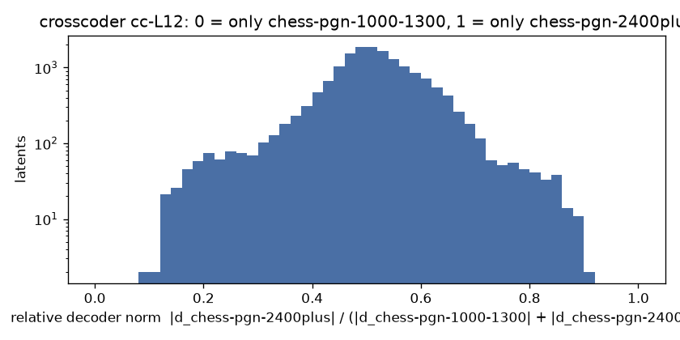

# Crosscoder chess-pgn-1000-1300 vs chess-pgn-2400plus, cc-L12

BatchTopK crosscoder, 16384 latents, k = 64 (held-out L0 64.2), on 3000000 positions from 753032 games (pgn-everything).

| source | held-out FVU |
| --- | --- |
| chess-pgn-1000-1300-L12 | 0.088 |
| chess-pgn-2400plus-L12 | 0.100 |

Latents firing at least once: 16384 (100.0%). Only chess-pgn-1000-1300: **2**, only chess-pgn-2400plus: **2**, shared: **15407** .

Models trained separately share no basis, so the cosine between a latent's two decoder directions says nothing here (it would for a model and its fine-tune); latents.jsonl keeps it anyway.

Relative decoder norm, 10 bins from 0 (only chess-pgn-1000-1300) to 1 (only chess-pgn-2400plus): 2 153 356 954 5608 6712 2133 327 137 2

Each example: activation, folder, move and side to move, the last moves, **the move played**, then each model's top move at T = 1 (chess-pgn-1000-1300 / chess-pgn-2400plus).

## Only in chess-pgn-1000-1300 (r < 0.1)

### latent 14543: r = 0.10, fires on 2.62% (pgn-everything 2.62%)

- 13.57 | pgn-everything | move 14, black | `d5 11.Qe2 Be6 12.Bh6 Qb6 13.Nd2 Nxd2 14.Qxd2` -> **Qxb2** | Qxb2 67% / Qxb2 64% | [board](https://lichess.org/analysis/r3k2r/p4p1p/1qp1bb1B/3p4/8/P7/1PPQ1PPP/R3KB1R_b_KQkq_-_0_14)
- 11.89 | pgn-everything | move 21, black | `Qxa2 18.Qxb4 Bd7 19.Qxb7 Bb5+ 20.Qxb5 Rab8 21.Qd3` -> **Rxb2+** | Qxb2+ 49% / Rxb2+ 81% | [board](https://lichess.org/analysis/1r3rk1/p4ppp/4p3/3pP3/3P4/3Q3N/qP2KP1P/8_b_-_-_2_21)
- 11.75 | pgn-everything | move 29, white | `Rf6 26.Bd3 Rh6 27.Qxa7 Rxh3 28.Ba6 Kd6 29.` -> **Qxb7** | Qxb7 82% / Qxb7 80% | [board](https://lichess.org/analysis/8/Qp1n4/B1pkp3/3p4/8/1PN4r/P1PP4/2KR4_w_-_-_2_29)
- 11.60 | pgn-everything | move 27, black | `Rxd7 24.Rxd7 Rd8 25.Rxe7 Rd1+ 26.Kf2 Rb1 27.Ne6` -> **Rxb2+** | Rxb2+ 78% / Rxb2+ 75% | [board](https://lichess.org/analysis/6k1/p3R1pp/1p2Np2/4p3/2n1P3/2P2N2/PP3KPP/1r6_b_-_-_4_27)
- 11.57 | pgn-everything | move 27, white | `Kc8 24.Qa8+ Nb8 25.Bb6 Rf8 26.Ra7 Kd7 27.` -> **Qxb7+** | Qxb7+ 61% / Qxb7+ 58% | [board](https://lichess.org/analysis/Qn3rnr/Rp1k4/1B1pq1p1/3Np2p/1PP1P3/3P3P/4B1P1/6K1_w_-_-_7_27)
- 11.10 | pgn-everything | move 14, black | `d5 11.Bxe7 Qxe7 12.exd5 cxd5 13.Nxd5 Qb7 14.Nf4` -> **Qxb2** | Qxb2 44% / Qxb2 80% | [board](https://lichess.org/analysis/r1b2rk1/pq3pbp/4p1p1/8/5N2/3B4/PPP1QPPP/R4RK1_b_-_-_2_14)
- 11.08 | pgn-everything | move 23, black | `Qxe5 20.Qxc6 Rd8 21.Rad1 Rb8 22.Qd5+ Qxd5 23.Rxd5` -> **Nb6** | Rxb2 32% / Nb6 49% | [board](https://lichess.org/analysis/nr4k1/p3p2p/5bpB/3R4/6P1/7P/PPP2P2/5RK1_b_-_-_0_23)
- 11.06 | pgn-everything | move 30, black | `f6 27.Qxe4 f5 28.Qe5 Qf6 29.Qd6 Rc2 30.Qxa6` -> **Rxb2** | Rxb2 51% / Rxb2 42% | [board](https://lichess.org/analysis/5rk1/6p1/Q3pq1p/1p3p2/8/PP4RP/1Pr2PP1/R5K1_b_-_-_0_30)
- 11.06 | pgn-everything | move 9, black | `g6 6.Bd2 Bg7 7.Ne4 Qb6 8.Nxf6+ Bxf6 9.Bh6` -> **Bxb2** | Bxb2 43% / Qxb2 54% | [board](https://lichess.org/analysis/rnb1k2r/pp2pp1p/1q1p1bpB/2pP4/8/5P2/PPP1P1PP/R2QKBNR_b_KQkq_-_1_9)
- 10.90 | pgn-everything | move 17, white | `Rde8 14.Qb3 Bc5 15.a5 a6 16.Rb1 Kd8 17.` -> **Qxb7** | Qxb7 71% / Qxb7 57% | [board](https://lichess.org/analysis/3kr2r/1ppq1ppp/p2p1n2/P1b5/2NN4/1Q2P1Pb/5PBP/1RB2RK1_w_-_-_2_17)
- 10.86 | pgn-everything | move 20, black | `Ra7 17.Nb5 Nxb5 18.Bxb5 Rxc7 19.Bxb6 Rxc2 20.Bxa5` -> **Bxb2** | Bxb2 56% / Bxb2 49% | [board](https://lichess.org/analysis/2b2k1r/4p1bp/6p1/BB6/4p3/8/PPr2PPP/R4RK1_b_-_-_0_20)
- 10.86 | pgn-everything | move 15, white | `Bxc6 12.d5 Bxd5 13.Qd3 Bxf3 14.Qxf3 Bf6 15.` -> **Rxb7** | Qxb7 38% / Qxb7 49% | [board](https://lichess.org/analysis/r2qk2r/ppp2ppp/4pb2/8/8/5Q2/P1P2PPP/1R3K1R_w_kq_-_1_15)

### latent 10795: r = 0.09, fires on 2.23% (pgn-everything 2.23%)

- 8.20 | pgn-everything | move 15, white | `Qxb2 12.O-O Qxd4 13.Qa4+ Nd7 14.Rad1 Qxf4 15.` -> **Qxd7#** | Qxd7# 93% / Rxd7 47% | [board](https://lichess.org/analysis/r3kb1r/pp1n1ppp/4p3/2p1N3/Q1P2q2/8/P4PPP/3R1RK1_w_kq_-_0_15)
- 7.90 | pgn-everything | move 18, white | `Ng3+ 15.hxg3 Qxg3 16.Ne5 Qh4+ 17.Kg1 O-O 18.` -> **Nxd7** | Nxd7 78% / Nxd7 64% | [board](https://lichess.org/analysis/r4rk1/pp1n1ppp/4p3/3pN3/Q2P3q/P7/P5P1/R3R1K1_w_-_-_4_18)
- 7.67 | pgn-everything | move 23, white | `c5 20.Nc6 Bb6 21.Rd1 f6 22.Nb8 Kf7 23.` -> **Nd7** | Nd7 43% / Nd7 50% | [board](https://lichess.org/analysis/1N5r/p4kpp/1b2pp2/2p5/4P3/8/PP3PPP/2KR4_w_-_-_2_23)
- 7.21 | pgn-everything | move 28, white | `f6 25.Nxa6 Kf7 26.Nb8 Bb7 27.Bxb5 Bd6 28.` -> **Nd7** | Nd7 68% / Nd7 79% | [board](https://lichess.org/analysis/1N1n4/1b3kp1/3b1p1p/1B2p3/1P2P2P/2P2PP1/1B6/6K1_w_-_-_1_28)
- 7.11 | pgn-everything | move 20, white | `Qxc5+ 17.Kh1 Qb4 18.Qd2 Ba6 19.Bxa6 Rxa6 20.` -> **Qxd7** | Qxd7 79% / Qxd7 84% | [board](https://lichess.org/analysis/5rk1/3p2bp/r1p1p1p1/p3Pp2/Pq3P2/2N5/1P1Q2PP/3R1R1K_w_-_-_0_20)
- 7.11 | pgn-everything | move 27, white | `Bxc8 24.Nxc8 Qc3 25.Rxe6+ fxe6 26.Nb6 Kf7 27.` -> **Qxd7+** | Qxd7+ 62% / Qxd7+ 84% | [board](https://lichess.org/analysis/7r/3n1kbp/1N1Bp1p1/8/Q7/2q3P1/P4P1P/6K1_w_-_-_2_27)
- 7.03 | pgn-everything | move 33, white | `g5 30.Nf5 Qe6 31.Nxe7 Qxe7 32.Rd7 Qxd7 33.` -> **Rxd7+** | Qxd7+ 52% / Rxd7+ 73% | [board](https://lichess.org/analysis/8/2Qq1k1p/5p2/6p1/8/6P1/PP5P/K2R4_w_-_-_0_33)
- 6.89 | pgn-everything | move 28, white | `g6 25.Qg8+ Rd8 26.Qxe6+ Rd7 27.Nf6 Kb8 28.` -> **Nxd7+** | Nxd7+ 43% / Nxd7+ 56% | [board](https://lichess.org/analysis/1k6/1ppr4/p3QNp1/2b1P1q1/5r1p/P6P/1PP2PP1/R4RK1_w_-_-_3_28)
- 6.74 | pgn-everything | move 25, black | `Kd8 22.Qg8+ Kc7 23.Qxa8 Qxb5 24.Qf8 Qb2 25.Nc3` -> **Qxd2** | Nxd2 62% / Nxd2 34% | [board](https://lichess.org/analysis/5Q2/1pk4r/1b5p/3p1pp1/p1n5/P1N1PPP1/1q1P1N1P/R4RK1_b_-_-_3_25)
- 6.74 | pgn-everything | move 30, black | `Kb8 27.Nc6+ Kc8 28.Ne5 Qb5+ 29.Kf2 Qxb2 30.Rc1` -> **Qxd2+** | Qxd2+ 91% / Bxe5 42% | [board](https://lichess.org/analysis/2k5/2p2pp1/4pbp1/4N3/5P2/4PQ2/Pq1B1KPr/2R5_b_-_-_1_30)
- 6.66 | pgn-everything | move 18, white | `Bxg2 15.Kxg2 Nf5 16.c5 bxc5 17.dxc5 Qg5 18.` -> **Ne4** | Nxd7 54% / Nxd7 43% | [board](https://lichess.org/analysis/r4rk1/2pp3p/4p1p1/p1P1Nnq1/Pn6/2N3P1/1P3PKP/R2Q1R2_w_-_-_1_18)
- 6.66 | pgn-everything | move 18, white | `Nd4 15.Qd3 Bxd2+ 16.Rxd2 Nf5 17.Nc5 Qg6 18.` -> **Qxd7+** | Qxd7+ 47% / Qxd7+ 54% | [board](https://lichess.org/analysis/r3k2r/1ppb1ppp/2p3q1/p1N1Pn2/8/1P1Q1P2/P1PR2PP/2K2B1R_w_kq_-_3_18)

## Only in chess-pgn-2400plus (r > 0.9)

### latent 13223: r = 0.91, fires on 2.64% (pgn-everything 2.64%)

- 19.55 | pgn-everything | move 8, black | `f6 5.Bg3 Bd7 6.Nc3 Qe7 7.a3 Nc6 8.Nb5` -> **O-O-O** | O-O-O 62% / Rc8 61% | [board](https://lichess.org/analysis/r3kbnr/pppbq2p/2n1pp2/1N1p2p1/3P4/P3P1B1/1PP2PPP/R2QKBNR_b_KQkq_-_2_8)
- 19.25 | pgn-everything | move 18, white | `dxc5 15.dxe4 Bxe4 16.Qxd7+ Rxd7 17.Nh4 Nb4 18.` -> **Be6** | Be6 23% / Be6 45% | [board](https://lichess.org/analysis/2k3nr/pppr2p1/7p/2p1p1PP/1nB1b2N/4B3/PPP2P2/R3K1R1_w_Q_-_2_18)
- 19.14 | pgn-everything | move 10, black | `Qe6 7.Nc3 Nxe5 8.Bg2 Nf6 9.Nb5 Nxf3+ 10.Bxf3` -> **Qb6** | Qb6 32% / Qb6 51% | [board](https://lichess.org/analysis/r1b1k2r/pppp1pbp/4qnp1/1N4B1/8/5BP1/PPP1PP1P/R2QK2R_b_KQkq_-_0_10)
- 19.05 | pgn-everything | move 9, black | `Qf6 6.Bg5 Qg6 7.h4 h6 8.Bf4 Nf6 9.Nb5` -> **Ra6** | Kd7 26% / Kd8 44% | [board](https://lichess.org/analysis/r1b1kb1r/1pp2pp1/2n1pnqp/pNPp4/3P1B1P/5N2/PP2PPP1/R2QKB1R_b_KQkq_-_3_9)
- 19.03 | pgn-everything | move 10, white | `Na6 7.Bb3 Bxb3 8.axb3 d3 9.Nf3 Nb4 10.` -> **cxd3** | c3 46% / O-O 49% | [board](https://lichess.org/analysis/r2qkbnr/pp3ppp/2p5/4p3/1n2P3/1P1p1NN1/1PPP1PPP/R1BQK2R_w_KQkq_-_2_10)
- 18.70 | pgn-everything | move 6, white | `Qf6 3.e5 Qg6 4.Nc3 Nc6 5.Qe2 Nb4 6.` -> **d3** | d3 28% / d3 79% | [board](https://lichess.org/analysis/r1b1kbnr/pppp1ppp/4p1q1/4P3/1n6/2N2N2/PPPPQPPP/R1B1KB1R_w_KQkq_-_5_6)
- 18.61 | pgn-everything | move 9, black | `Bd7 6.Nc3 g6 7.Bb5 Bg7 8.Bf4 Bxb5 9.Nxb5` -> **Nf6** | Na6 66% / Na6 98% | [board](https://lichess.org/analysis/rn2k1nr/ppp1ppbp/6p1/1N6/4PB2/5P2/PPP3PP/R2K2NR_b_kq_-_0_9)
- 18.55 | pgn-everything | move 17, black | `Nxe5 14.Bxh5 Ng6 15.Qd3 O-O-O 16.Rac1 Nh4 17.Nb5` -> **Qd5** | Kb8 24% / c6 38% | [board](https://lichess.org/analysis/2kr3r/pbpqbp2/1p2p2p/1N4pB/3P3n/P2QP1B1/1P3PPP/2R2RK1_b_-_-_6_17)
- 18.36 | pgn-everything | move 13, black | `e4 10.Qf4 h5 11.Nc3 Bh6 12.Qg3 Nd7 13.Nd5` -> **Qc5** | Qd6 31% / Qe5 29% | [board](https://lichess.org/analysis/r1b1k2r/pppnqp2/6pb/3N3p/4p3/1B2P1Q1/PPP2PPP/R1B1K2R_b_KQkq_-_5_13)
- 18.35 | pgn-everything | move 8, white | `Bf5 5.Bc4 e6 6.Qf3 c6 7.Nge2 Nb4 8.` -> **O-O** | Bb3 47% / Bb3 83% | [board](https://lichess.org/analysis/rn1qkb1r/pp3ppp/2p1p3/5b2/1nBP4/2N2Q2/PPP1NPPP/R1B1K2R_w_KQkq_-_2_8)
- 18.29 | pgn-everything | move 10, black | `N8d7 7.Bf4 Be7 8.Nc3 h6 9.Rc1 Nf6 10.Nb5` -> **c6** | Bd6 50% / Bd6 56% | [board](https://lichess.org/analysis/r1bqk2r/ppp1bpp1/1n2pn1p/1N6/3PPB2/P4N2/1P3PPP/2RQKB1R_b_Kkq_-_3_10)
- 18.29 | pgn-everything | move 11, black | `f6 8.Bh4 g5 9.Bg3 Nd4 10.Nxd4 exd4 11.Nb5` -> **Bb4+** | Bb6 26% / Bb6 60% | [board](https://lichess.org/analysis/r1b1k1nr/pppp3p/4qp2/1Nb3p1/3pP3/3P2B1/PPP1QPPP/R3KB1R_b_KQkq_-_1_11)

### latent 13112: r = 0.90, fires on 0.92% (pgn-everything 0.92%)

- 15.10 | pgn-everything | move 14, black | `d6 11.Be3 dxe5 12.dxe5 Qxd1 13.Rfxd1 c6 14.Na4` -> **b5** | b5 41% / Bd8 32% | [board](https://lichess.org/analysis/rn2nrk1/1b2bpp1/1pp1p2p/p3P3/N1P5/4BNP1/PP3PBP/R2R2K1_b_-_-_1_14)
- 13.10 | pgn-everything | move 22, black | `Nf6 19.Ng5 Nxg5 20.Bxg5 h6 21.Be3 Bc8 22.Qb3` -> **Be6** | Be6 31% / b5 32% | [board](https://lichess.org/analysis/2br2k1/2q1bpp1/ppp2n1p/4p3/2P1P3/PQN1B3/1P2BPPP/5RK1_b_-_-_3_22)
- 12.86 | pgn-everything | move 9, black | `a6 6.Na4 Bf8 7.Nf3 b6 8.Bd3 h6 9.Be3` -> **Bc5** | Bb7 21% / Rb8 50% | [board](https://lichess.org/analysis/r1bqkbnr/3p1pp1/ppn1p2p/8/N3P3/3BBN2/PPP2PPP/R2QK2R_b_KQkq_-_1_9)
- 12.63 | pgn-everything | move 15, white | `Be6 12.Bc5 Qf6 13.e3 Qxb2+ 14.Be2 Qxa2 15.` -> **Nbd4** | Nbd4 44% / Nbd4 83% | [board](https://lichess.org/analysis/r3k2r/ppp2ppp/2n1b3/2B5/8/1N2PN2/q3BKPP/2R4R_w_kq_-_0_15)
- 12.62 | pgn-everything | move 34, black | `Nd5 31.Bd2 Nb6 32.b5 Bxd4 33.Nxd4 Rxd4 34.Be3` -> **Rd6** | Rd1+ 66% / Rd1+ 47% | [board](https://lichess.org/analysis/8/5ppk/1n2p2p/1P6/3r4/P3B2P/2R2PP1/6K1_b_-_-_1_34)
- 12.59 | pgn-everything | move 16, white | `Be7 13.Bxe7 Nxe7 14.Qd2 O-O 15.a4 Bc4 16.` -> **a5** | Nc1 56% / Nc1 60% | [board](https://lichess.org/analysis/r4rk1/p3nppp/1q2p3/2ppP3/P1b5/1NP2N2/1P1Q1PPP/R3K2R_w_KQ_-_1_16)
- 12.53 | pgn-everything | move 31, black | `a5 28.Bf4 Rc3 29.Rb1 Rc6 30.Be5 Ke6 31.Bd4` -> **Rc2** | Kd5 64% / Kd5 25% | [board](https://lichess.org/analysis/8/7p/1pr1k3/p4p2/3B4/P3PK1P/5PP1/1R6_b_-_-_7_31)
- 12.45 | pgn-everything | move 16, black | `b5 13.a3 Qc7 14.Bd3 h4 15.Rhe1 Nb6 16.Qf2` -> **Nc4** | Nc4 32% / Nc4 42% | [board](https://lichess.org/analysis/2r1k2r/2q1bpp1/pn1pbn2/1p2p3/4P2p/PNNBBP1P/1PP2QP1/1K1RR3_b_k_-_3_16)
- 12.41 | pgn-everything | move 13, white | `Na5 10.Bb3 Qb6 11.Nbd2 Nxb3 12.Nxb3 Be6 13.` -> **c4** | Nbd2 49% / Nfd2 52% | [board](https://lichess.org/analysis/r4rk1/1p2ppbp/pq1pbnp1/2p3B1/P3P3/1NPP1N1P/1P3PP1/R2Q1RK1_w_-_-_1_13)
- 12.32 | pgn-everything | move 33, white | `Rc2 30.a4 a6 31.Rd3 Rb2 32.Rc3 Bd5 33.` -> **f4** | b4 18% / f3 22% | [board](https://lichess.org/analysis/8/1p3pkp/p5p1/3b4/P7/1PR1P1KP/1r3P2/8_w_-_-_4_33)
- 12.25 | pgn-everything | move 16, black | `Qxd4 13.Bh6 f5 14.c3 Qf6 15.Bf4 a5 16.Be3` -> **Nd5** | a4 41% / Nd5 45% | [board](https://lichess.org/analysis/r4rk1/1p2bppp/1np2q2/p4p2/8/1BP1B1QP/PP3PP1/R4RK1_b_-_-_1_16)
- 12.04 | pgn-everything | move 19, black | `Bc6 16.Nd4 Bb7 17.Kg1 Rac8 18.Qf2 Qb8 19.Nde2` -> **b5** | Nxd3 19% / Nxd3 42% | [board](https://lichess.org/analysis/1qrr2k1/1b2bppp/pp1ppn2/4n3/2P1P3/1PNBBP2/P3NQPP/2RR2K1_b_-_-_10_19)

## Shared (0.3 < r < 0.7), the strongest

### latent 15029: r = 0.49, fires on 0.84% (pgn-everything 0.84%)

- 26.86 | pgn-everything | move 11, black | `b6 8.Ne5 O-O 9.g4 Nc6 10.g5 Nxe5 11.fxe5` -> **Ne4** | Ne4 45% / Ne4 66% | [board](https://lichess.org/analysis/r2q1rk1/p1pb1ppp/1p2pn2/3pP1P1/3P4/3B4/PPPN1P1P/R2QK2R_b_KQ_-_0_11)
- 26.22 | pgn-everything | move 7, black | `dxc3 4.Nxc3 Bb4 5.Bd2 Bxc3 6.Bxc3 Nf6 7.e5` -> **Ng8** | Ne4 45% / Ne4 48% | [board](https://lichess.org/analysis/rnbqk2r/pppp1ppp/5n2/4P3/8/2B5/PP3PPP/R2QKBNR_b_KQkq_-_0_7)
- 26.21 | pgn-everything | move 7, black | `Nc6 4.Bb5 Bc5 5.Bxc6 dxc6 6.O-O Nf6 7.e5` -> **Nd5** | Nd5 33% / Nd5 77% | [board](https://lichess.org/analysis/r1bqk2r/ppp2ppp/2p2n2/2b1P3/3p4/5N2/PPP2PPP/RNBQ1RK1_b_kq_-_0_7)
- 26.12 | pgn-everything | move 6, black | `h6 3.c3 Nc6 4.d4 cxd4 5.cxd4 Nf6 6.e5` -> **Nd5** | Nd5 67% / Nd5 96% | [board](https://lichess.org/analysis/r1bqkb1r/pp1pppp1/2n2n1p/4P3/3P4/5N2/PP3PPP/RNBQKB1R_b_KQkq_-_0_6)
- 25.88 | pgn-everything | move 6, black | `Nc6 3.Bc4 Nf6 4.O-O g6 5.h3 Bg7 6.e5` -> **Nh5** | Ne4 44% / Ng8 67% | [board](https://lichess.org/analysis/r1bqk2r/pp1pppbp/2n2np1/2p1P3/2B5/5N1P/PPPP1PP1/RNBQ1RK1_b_kq_-_0_6)
- 25.87 | pgn-everything | move 8, black | `dxc3 5.Bc4 cxb2 6.Bxb2 Nf6 7.O-O Be7 8.e5` -> **Ng4** | Ng4 29% / Ng4 31% | [board](https://lichess.org/analysis/rnbqk2r/pp1pbppp/5n2/2p1P3/2B5/5N2/PB3PPP/RN1Q1RK1_b_kq_-_0_8)
- 25.85 | pgn-everything | move 8, black | `dxc3 5.Bc4 e6 6.O-O cxb2 7.Bxb2 Nf6 8.e5` -> **Ng8** | Ng4 52% / Ng4 51% | [board](https://lichess.org/analysis/r1bqkb1r/pp1p1ppp/2n1pn2/4P3/2B5/5N2/PB3PPP/RN1Q1RK1_b_kq_-_0_8)
- 25.78 | pgn-everything | move 13, black | `Qc7 10.Re1 O-O 11.g4 Nxe5 12.dxe5 Be7 13.g5` -> **Ne8** | Ne8 43% / Ne8 51% | [board](https://lichess.org/analysis/r4rk1/ppqbbppp/4pn2/3pP1P1/5B2/2PB4/PP3P1P/RN1QR1K1_b_-_-_0_13)
- 25.73 | pgn-everything | move 6, white | `c6 3.dxc6 e5 4.cxb7 Bxb7 5.Nf3 e4 6.` -> **Ng1** | Ne5 37% / Ne5 38% | [board](https://lichess.org/analysis/rn1qkbnr/pb3ppp/8/8/4p3/5N2/PPPP1PPP/RNBQKB1R_w_KQkq_-_0_6)
- 25.60 | pgn-everything | move 7, black | `Bb4 4.a3 Be7 5.e4 d5 6.cxd5 exd5 7.e5` -> **Ne4** | Ne4 54% / Ne4 79% | [board](https://lichess.org/analysis/rnbqk2r/ppp1bppp/5n2/3pP3/3P4/P1N5/1P3PPP/R1BQKBNR_b_KQkq_-_0_7)
- 25.59 | pgn-everything | move 6, black | `e6 3.b4 cxb4 4.axb4 Bxb4 5.Bb2 Nf6 6.e5` -> **Nd5** | Nd5 80% / Nd5 97% | [board](https://lichess.org/analysis/rnbqk2r/pp1p1ppp/4pn2/4P3/1b6/8/1BPP1PPP/RN1QKBNR_b_KQkq_-_0_6)
- 25.54 | pgn-everything | move 6, black | `Nc6 3.a3 g6 4.Bc4 Bg7 5.O-O Nf6 6.e5` -> **Ng4** | Ng4 67% / Ng4 88% | [board](https://lichess.org/analysis/r1bqk2r/pp1pppbp/2n2np1/2p1P3/2B5/P4N2/1PPP1PPP/RNBQ1RK1_b_kq_-_0_6)

### latent 13230: r = 0.50, fires on 0.64% (pgn-everything 0.64%)

- 23.98 | pgn-everything | move 7, white | `Bc5 4.Be2 Nf6 5.a3 d5 6.d3 d4 7.` -> **Na4** | Nd5 30% / Nb1 86% | [board](https://lichess.org/analysis/r1bqk2r/ppp2ppp/2n2n2/2b1p3/3pP3/P1NP1N2/1PP1BPPP/R1BQK2R_w_KQkq_-_0_7)
- 23.72 | pgn-everything | move 7, black | `Bc5 4.d4 exd4 5.cxd4 Bb4+ 6.Nc3 h6 7.d5` -> **Bxc3+** | Nce7 45% / Nce7 52% | [board](https://lichess.org/analysis/r1bqk1nr/pppp1pp1/2n4p/3P4/1b2P3/2N2N2/PP3PPP/R1BQKB1R_b_KQkq_-_0_7)
- 23.72 | pgn-everything | move 7, black | `Bc5 4.d4 exd4 5.cxd4 Bb4+ 6.Nc3 h6 7.d5` -> **Nce7** | Nce7 45% / Nce7 52% | [board](https://lichess.org/analysis/r1bqk1nr/pppp1pp1/2n4p/3P4/1b2P3/2N2N2/PP3PPP/R1BQKB1R_b_KQkq_-_0_7)
- 23.72 | pgn-everything | move 7, black | `Bc5 4.d4 exd4 5.cxd4 Bb4+ 6.Nc3 h6 7.d5` -> **Nce7** | Nce7 45% / Nce7 52% | [board](https://lichess.org/analysis/r1bqk1nr/pppp1pp1/2n4p/3P4/1b2P3/2N2N2/PP3PPP/R1BQKB1R_b_KQkq_-_0_7)
- 23.59 | pgn-everything | move 6, black | `d6 3.Bc4 Nf6 4.Nc3 Nc6 5.d4 Be7 6.d5` -> **Nb4** | Nd4 37% / Nb8 92% | [board](https://lichess.org/analysis/r1bqk2r/ppp1bppp/2np1n2/3Pp3/2B1P3/2N2N2/PPP2PPP/R1BQK2R_b_KQkq_-_0_6)
- 23.57 | pgn-everything | move 6, white | `Nc6 3.d3 Nf6 4.Be2 d5 5.Nc3 d4 6.` -> **Nb5** | Nd5 49% / Nb1 98% | [board](https://lichess.org/analysis/r1bqkb1r/ppp2ppp/2n2n2/4p3/3pP3/2NP1N2/PPP1BPPP/R1BQK2R_w_KQkq_-_0_6)
- 23.55 | pgn-everything | move 8, white | `Nge7 5.Nf3 d5 6.exd5 exd5 7.Ba2 d4 8.` -> **Ne4** | Ne4 46% / Ne4 92% | [board](https://lichess.org/analysis/r1bqkb1r/pp2nppp/2n5/2p5/3p4/P1N2N2/BPPP1PPP/R1BQK2R_w_KQkq_-_0_8)
- 23.47 | pgn-everything | move 8, black | `exd4 5.cxd4 Bb4+ 6.Nc3 Bxc3+ 7.bxc3 d6 8.d5` -> **Ne5** | Ne5 68% / Ne5 65% | [board](https://lichess.org/analysis/r1bqk1nr/ppp2ppp/2np4/3P4/4P3/2P2N2/P4PPP/R1BQKB1R_b_KQkq_-_0_8)
- 23.47 | pgn-everything | move 8, black | `exd4 5.cxd4 Bb4+ 6.Nc3 Bxc3+ 7.bxc3 d6 8.d5` -> **Ne5** | Ne5 68% / Ne5 65% | [board](https://lichess.org/analysis/r1bqk1nr/ppp2ppp/2np4/3P4/4P3/2P2N2/P4PPP/R1BQKB1R_b_KQkq_-_0_8)
- 23.41 | pgn-everything | move 6, black | `Nc6 3.Bc4 Bc5 4.c3 d6 5.d4 Bb6 6.d5` -> **Na5** | Na5 51% / Nce7 86% | [board](https://lichess.org/analysis/r1bqk1nr/ppp2ppp/1bnp4/3Pp3/2B1P3/2P2N2/PP3PPP/RNBQK2R_b_KQkq_-_0_6)
- 23.41 | pgn-everything | move 6, black | `Nc6 3.Bc4 Bc5 4.c3 d6 5.d4 Bb6 6.d5` -> **Nce7** | Na5 51% / Nce7 86% | [board](https://lichess.org/analysis/r1bqk1nr/ppp2ppp/1bnp4/3Pp3/2B1P3/2P2N2/PP3PPP/RNBQK2R_b_KQkq_-_0_6)
- 23.38 | pgn-everything | move 6, black | `Nc6 3.c3 Be7 4.d4 exd4 5.cxd4 d6 6.d5` -> **Ne5** | Ne5 77% / Ne5 71% | [board](https://lichess.org/analysis/r1bqk1nr/ppp1bppp/2np4/3P4/4P3/5N2/PP3PPP/RNBQKB1R_b_KQkq_-_0_6)

### latent 4564: r = 0.56, fires on 4.65% (pgn-everything 4.65%)

- 23.64 | pgn-everything | move 9, white | `Bxd4 6.Qxd4 Nf6 7.e5 Nc6 8.Qc3 Nd5 9.` -> **Qc4** | Qb3 28% / Qd2 70% | [board](https://lichess.org/analysis/r1bqk2r/pp1ppp1p/2n3p1/3nP3/8/2Q2N2/PPP2PPP/RN2KB1R_w_KQkq_-_3_9)
- 23.26 | pgn-everything | move 9, black | `Bg4 6.d3 e6 7.Be3 Bb4 8.O-O Nf6 9.Nd4` -> **Qd7** | Qd7 26% / Bxe2 65% | [board](https://lichess.org/analysis/rn2k2r/ppp2ppp/2q1pn2/8/1b1N2b1/2NPB3/PPP1BPPP/R2Q1RK1_b_kq_-_5_9)
- 23.24 | pgn-everything | move 8, black | `Nc6 5.Bb5 Qd5 6.Bxc6+ Qxc6 7.Nc3 e4 8.Nd4` -> **Bg4** | Qg6 45% / Qg6 85% | [board](https://lichess.org/analysis/r1b1kbnr/ppp2ppp/2q5/8/3Np3/2N5/PPPP1PPP/R1BQK2R_b_KQkq_-_1_8)
- 23.00 | pgn-everything | move 14, white | `Bd7 11.Be3 b6 12.b5 axb5 13.Bxb5 Na5 14.` -> **Qb2** | Qb2 36% / Qc2 58% | [board](https://lichess.org/analysis/r2q1rk1/2pbbpp1/1p1p1n1p/nB2p3/P3P3/1QPPBN1P/5PP1/RN3RK1_w_-_-_1_14)
- 22.95 | pgn-everything | move 14, white | `O-O 11.Nd4 Ng4 12.h3 Bxd4 13.Qf3 Ne5 14.` -> **Qf1** | Qf4 57% / Qg3 39% | [board](https://lichess.org/analysis/rn1q1rk1/p3pp1p/2p3p1/4nb2/B2b4/2N2Q1P/PPP3P1/R1B1K2R_w_KQ_-_2_14)
- 22.86 | pgn-everything | move 12, black | `Qxd4 9.Nb5 Qc5 10.Be3 Qc6 11.Bf4 Nd5 12.Nd4` -> **Qb6** | Qc5 45% / Qb6 45% | [board](https://lichess.org/analysis/r1b1kb1r/ppp2ppp/2q1p3/3n4/2BN1B2/3P4/PPP2PPP/R2Q1RK1_b_kq_-_7_12)
- 22.79 | pgn-everything | move 10, white | `Nc6 7.Qb3 O-O 8.Bb5 Nd5 9.e4 Na5 10.` -> **Qa4** | Qa4 33% / Qc2 67% | [board](https://lichess.org/analysis/r1bq1rk1/ppp2ppp/4p3/nB1n4/1b2P3/1Q3N2/PP1P1PPP/RNB1K2R_w_KQ_-_1_10)
- 22.57 | pgn-everything | move 7, white | `h6 4.Qb3 Nc6 5.Nf3 Bc5 6.a4 Na5 7.` -> **Qc3** | Qb5 71% / Qc3 55% | [board](https://lichess.org/analysis/r1bqk2r/pppp1pp1/5n1p/n1b1p3/P1P3P1/1Q2PN2/1P1P1P1P/RNB1KB1R_w_KQkq_-_1_7)
- 22.42 | pgn-everything | move 13, black | `Be7 10.O-O Nf6 11.g3 O-O 12.Bf4 Qb6 13.Na4` -> **Qd8** | Qb4 55% / Qa5 48% | [board](https://lichess.org/analysis/rn3rk1/1p2bppp/pq2pn2/3P1b2/N1B2B2/5NP1/PP2QP1P/R4RK1_b_-_-_4_13)
- 22.35 | pgn-everything | move 10, white | `Nb4 7.Qc4 b5 8.Qc3 O-O 9.a3 Nd5 10.` -> **Qd3** | Qd3 40% / Qd3 41% | [board](https://lichess.org/analysis/r1b2rk1/p1ppqppp/7n/1pbnP3/8/P1Q1PN1P/1PP2PP1/RNB1KB1R_w_KQ_-_1_10)
- 22.30 | pgn-everything | move 13, black | `e6 10.Nf3 Be7 11.O-O O-O 12.Nbd2 Nf6 13.Nxc4` -> **Qd8** | Qd8 38% / Qa6 80% | [board](https://lichess.org/analysis/r1b2rk1/pp2bppp/1qn1pn2/8/2NP4/2P1PNB1/P1B2PPP/R2Q1RK1_b_-_-_0_13)
- 22.30 | pgn-everything | move 9, black | `Nxc6 6.Nf3 Qb6 7.Be2 O-O-O 8.O-O Nb4 9.Na4` -> **Qa5** | Qc6 37% / Qc6 48% | [board](https://lichess.org/analysis/2kr1b1r/pp2pppp/1q3n2/5b2/Nn1P4/5N2/PPP1BPPP/R1BQ1RK1_b_-_-_7_9)

### latent 12868: r = 0.54, fires on 2.32% (pgn-everything 2.32%)

- 22.21 | pgn-everything | move 9, black | `O-O 6.Nc3 d6 7.Nd5 Na5 8.Bg5 Nxc4 9.dxc4` -> **c6** | h6 27% / c6 46% | [board](https://lichess.org/analysis/r1bq1rk1/ppp2ppp/3p1n2/2bNp1B1/2P1P3/5N2/PPP2PPP/R2Q1RK1_b_-_-_0_9)
- 21.62 | pgn-everything | move 10, white | `Be7 7.Bg2 Nd4 8.O-O h6 9.Bxf6 Bxf6 10.` -> **h3** | Nd5 54% / Nd5 84% | [board](https://lichess.org/analysis/r2qk2r/ppp2pp1/3p1b1p/4p3/3nP1b1/2NP1NP1/PPP2PBP/R2Q1RK1_w_kq_-_0_10)
- 21.54 | pgn-everything | move 6, black | `Bb7 3.Nc3 g6 4.Bc4 e6 5.d4 Nf6 6.Bg5` -> **Ng4** | Bg7 36% / Be7 57% | [board](https://lichess.org/analysis/rn1qkb1r/pbpp1p1p/1p2pnp1/6B1/2BPP3/2N2N2/PPP2PPP/R2QK2R_b_KQkq_-_2_6)
- 21.39 | pgn-everything | move 7, black | `Bc5 4.d3 g6 5.O-O Nf6 6.Bg5 O-O 7.Nc3` -> **Kg7** | d6 24% / Be7 78% | [board](https://lichess.org/analysis/r1bq1rk1/pppp1p1p/2n2np1/2b1p1B1/2B1P3/2NP1N2/PPP2PPP/R2Q1RK1_b_-_-_5_7)
- 21.30 | pgn-everything | move 6, black | `Nc6 3.Nf3 Bc5 4.d3 Nf6 5.Bg5 O-O 6.Nc3` -> **h6** | h6 42% / h6 51% | [board](https://lichess.org/analysis/r1bq1rk1/pppp1ppp/2n2n2/2b1p1B1/2B1P3/2NP1N2/PPP2PPP/R2QK2R_b_KQ_-_4_6)
- 21.27 | pgn-everything | move 7, black | `Bc5 4.d3 d6 5.h3 Nf6 6.Bg5 O-O 7.Nc3` -> **h6** | h6 50% / Be6 52% | [board](https://lichess.org/analysis/r1bq1rk1/ppp2ppp/2np1n2/2b1p1B1/2B1P3/2NP1N1P/PPP2PP1/R2QK2R_b_KQ_-_4_7)
- 21.27 | pgn-everything | move 7, black | `Bc5 4.d3 d6 5.h3 Nf6 6.Bg5 O-O 7.Nc3` -> **h6** | h6 50% / Be6 52% | [board](https://lichess.org/analysis/r1bq1rk1/ppp2ppp/2np1n2/2b1p1B1/2B1P3/2NP1N1P/PPP2PP1/R2QK2R_b_KQ_-_4_7)
- 21.23 | pgn-everything | move 6, black | `Nc6 3.d3 Bc5 4.Nf3 Nf6 5.Bg5 O-O 6.Nc3` -> **h6** | h6 42% / h6 56% | [board](https://lichess.org/analysis/r1bq1rk1/pppp1ppp/2n2n2/2b1p1B1/2B1P3/2NP1N2/PPP2PPP/R2QK2R_b_KQ_-_6_6)
- 21.17 | pgn-everything | move 6, black | `Nc6 3.Bc4 Bc5 4.d3 Nf6 5.Bg5 O-O 6.Nc3` -> **Nd4** | h6 46% / h6 51% | [board](https://lichess.org/analysis/r1bq1rk1/pppp1ppp/2n2n2/2b1p1B1/2B1P3/2NP1N2/PPP2PPP/R2QK2R_b_KQ_-_4_6)
- 21.17 | pgn-everything | move 6, black | `Nc6 3.Bc4 Bc5 4.d3 Nf6 5.Bg5 O-O 6.Nc3` -> **h6** | h6 46% / h6 51% | [board](https://lichess.org/analysis/r1bq1rk1/pppp1ppp/2n2n2/2b1p1B1/2B1P3/2NP1N2/PPP2PPP/R2QK2R_b_KQ_-_4_6)
- 21.17 | pgn-everything | move 6, black | `Nc6 3.Bc4 Bc5 4.d3 Nf6 5.Bg5 O-O 6.Nc3` -> **d6** | h6 46% / h6 51% | [board](https://lichess.org/analysis/r1bq1rk1/pppp1ppp/2n2n2/2b1p1B1/2B1P3/2NP1N2/PPP2PPP/R2QK2R_b_KQ_-_4_6)
- 21.17 | pgn-everything | move 6, black | `Nc6 3.Bc4 Bc5 4.d3 Nf6 5.Bg5 O-O 6.Nc3` -> **Nd4** | h6 46% / h6 51% | [board](https://lichess.org/analysis/r1bq1rk1/pppp1ppp/2n2n2/2b1p1B1/2B1P3/2NP1N2/PPP2PPP/R2QK2R_b_KQ_-_4_6)

### latent 4464: r = 0.68, fires on 0.90% (pgn-everything 0.90%)

- 22.21 | pgn-everything | move 6, black | `d6 3.d5 Nb8 4.f4 Nf6 5.f5 e6 6.Bd3` -> **exf5** | exf5 50% / exd5 67% | [board](https://lichess.org/analysis/rnbqkb1r/ppp2ppp/3ppn2/3P1P2/4P3/3B4/PPP3PP/RNBQK1NR_b_KQkq_-_1_6)
- 19.11 | pgn-everything | move 14, black | `O-O 11.f4 Bd4+ 12.Kh1 e6 13.f5 cxd5 14.exd5` -> **exf5** | exf5 49% / exf5 48% | [board](https://lichess.org/analysis/rn1q1rk1/pp1b1p1p/3pp1p1/3P1P2/2Bb4/2N4P/PPPB2P1/R2Q1R1K_b_-_-_0_14)
- 18.75 | pgn-everything | move 7, black | `Ne5 4.f4 Ng6 5.Nf3 f5 6.exf5 Nh4 7.Bd3` -> **exd5** | Nxg2+ 45% / Nxf5 37% | [board](https://lichess.org/analysis/r1bqkbnr/pppp2pp/4p3/3P1P2/5P1n/3B1N2/PPP3PP/RNBQK2R_b_KQkq_-_2_7)
- 18.44 | pgn-everything | move 9, black | `Ne7 6.d4 Nd7 7.c3 c6 8.f5 d5 9.exd5` -> **cxd5** | cxd5 73% / exd5 59% | [board](https://lichess.org/analysis/r1bqk2r/pp1nnpbp/2p1p1p1/3P1P2/2BP4/2P2N2/PP4PP/RNBQ1RK1_b_kq_-_0_9)
- 18.25 | pgn-everything | move 16, black | `Nh5 13.Bh2 Nf6 14.f4 d5 15.f5 Nf8 16.exd5` -> **exd5** | exd5 66% / exd5 81% | [board](https://lichess.org/analysis/r1bqrnk1/1p2bpp1/p3pn1p/2pP1P2/P7/2NP3P/BPP1N1PB/R2Q1RK1_b_-_-_0_16)
- 17.54 | pgn-everything | move 8, black | `Bg7 5.Bd3 O-O 6.h3 c5 7.d5 e6 8.O-O` -> **Re8** | exd5 84% / exd5 94% | [board](https://lichess.org/analysis/rnbq1rk1/pp3pbp/3ppnp1/2pP4/4P3/2NB1N1P/PPP2PP1/R1BQ1RK1_b_-_-_1_8)
- 17.49 | pgn-everything | move 12, black | `Ne5 9.f4 Ng6 10.f5 Nh4 11.g4 e6 12.Be3` -> **exf5** | Be7 19% / Be7 50% | [board](https://lichess.org/analysis/r1bqkb1r/ppp2ppp/3pp3/3P1P2/6Pn/4B2P/PPP1Q3/RN2KB1R_b_KQkq_-_1_12)
- 17.22 | pgn-everything | move 18, black | `gxf6 15.h3 Kh8 16.f4 Rd8 17.f5 d5 18.exd5` -> **exd5** | exd5 87% / exd5 89% | [board](https://lichess.org/analysis/r1br3k/pp3p1p/4pp2/2pP1P2/2B5/3P3P/P1P3P1/1R3RK1_b_-_-_0_18)
- 17.17 | pgn-everything | move 13, black | `e6 10.e4 Bxd1 11.exf5 Bxb4 12.Kxd1 Bxc3 13.bxc3` -> **Rxd5+** | Rxd5+ 89% / Rxd5+ 80% | [board](https://lichess.org/analysis/2kr2nr/ppp2ppp/4p3/3P1P2/8/2P5/P4PPP/R1BK1B1R_b_-_-_0_13)
- 17.15 | pgn-everything | move 8, black | `Nf6 5.Nc3 O-O 6.Nf3 c5 7.d5 e6 8.Be2` -> **exd5** | exd5 81% / exd5 93% | [board](https://lichess.org/analysis/rnbq1rk1/pp3pbp/3ppnp1/2pP4/4P3/P1N2N1P/1PP1BPP1/R1BQK2R_b_KQ_-_1_8)
- 17.12 | pgn-everything | move 6, black | `Bb7 3.Qf3 e6 4.d4 f5 5.d5 Nf6 6.exf5` -> **exf5** | exd5 37% / exd5 82% | [board](https://lichess.org/analysis/rn1qkb1r/pbpp2pp/1p2pn2/3P1P2/2B5/5Q2/PPP2PPP/RNB1K1NR_b_KQkq_-_0_6)
- 16.72 | pgn-everything | move 6, black | `Nf6 3.Qc2 d6 4.d4 b6 5.d5 e6 6.Bg5` -> **exd5** | Be7 46% / Be7 54% | [board](https://lichess.org/analysis/rnbqkb1r/p4ppp/1p1ppn2/2pP2B1/4P3/2P5/PPQ2PPP/RN2KBNR_b_KQkq_-_1_6)

### latent 3149: r = 0.41, fires on 3.00% (pgn-everything 3.00%)

- 22.08 | pgn-everything | move 7, white | `d6 4.Bc4 c6 5.d4 d5 6.exd5 c5 7.` -> **dxe5** | dxe5 53% / dxe5 72% | [board](https://lichess.org/analysis/rnbqkbnr/pp4pp/5p2/2pPp3/2BP4/2N2N2/PPP2PPP/R1BQK2R_w_KQkq_-_0_7)
- 21.96 | pgn-everything | move 6, black | `Nf6 3.d3 Nc6 4.Nf3 h6 5.a3 d5 6.h3` -> **dxc4** | dxc4 92% / dxc4 96% | [board](https://lichess.org/analysis/r1bqkb1r/ppp2pp1/2n2n1p/3pp3/2B1P3/P2P1N1P/1PP2PP1/RNBQK2R_b_KQkq_-_0_6)
- 21.74 | pgn-everything | move 10, black | `e6 7.Nbd2 Bb4 8.O-O O-O 9.e4 Bxd2 10.Bxd2` -> **Nxe4** | dxe4 62% / dxe4 63% | [board](https://lichess.org/analysis/r2q1rk1/ppp2ppp/2n1pn2/3p4/2PPP3/3Q1N2/PP1B1PPP/R4RK1_b_-_-_0_10)
- 21.73 | pgn-everything | move 10, white | `g6 7.O-O Bg7 8.Rd1 e5 9.d4 O-O 10.` -> **dxe5** | dxe5 66% / dxe5 66% | [board](https://lichess.org/analysis/r2q1rk1/pp1n1pbp/3p1np1/2p1p3/3PP3/2P2N2/PP2QPPP/RNBR2K1_w_-_-_1_10)
- 21.68 | pgn-everything | move 7, white | `c5 4.c3 h6 5.d4 g6 6.O-O Bg7 7.` -> **dxe5** | dxe5 31% / dxe5 49% | [board](https://lichess.org/analysis/rnbqk1nr/pp3pb1/3p2pp/2p1p3/2BPP3/2P2N2/PP3PPP/RNBQ1RK1_w_kq_-_2_7)
- 21.33 | pgn-everything | move 6, black | `d6 3.Nf3 g6 4.Bc4 d5 5.Bd3 Bg7 6.c4` -> **dxe4** | e6 25% / dxe4 77% | [board](https://lichess.org/analysis/rnbqk1nr/pp2ppbp/2p3p1/3p4/2PPP3/3B1N2/PP3PPP/RNBQK2R_b_KQkq_-_0_6)
- 21.22 | pgn-everything | move 7, black | `e6 4.c4 Ne7 5.Nc3 O-O 6.Be2 d5 7.O-O` -> **b6** | dxe4 49% / dxe4 48% | [board](https://lichess.org/analysis/rnbq1rk1/ppp1npbp/4p1p1/3p4/2PPP3/2N2N2/PP2BPPP/R1BQ1RK1_b_-_-_1_7)
- 21.15 | pgn-everything | move 6, white | `e6 3.e5 d5 4.c3 fxe5 5.Nf3 c5 6.` -> **Nxe5** | Nxe5 67% / Nxe5 90% | [board](https://lichess.org/analysis/rnbqkbnr/pp4pp/4p3/2ppp3/3P4/2P2N2/PP3PPP/RNBQKB1R_w_KQkq_-_0_6)
- 21.02 | pgn-everything | move 6, black | `Nf6 3.Nf3 e6 4.e4 Bb4+ 5.Nc3 Bxc3+ 6.bxc3` -> **dxe4** | Nxe4 46% / Nxe4 76% | [board](https://lichess.org/analysis/rnbqk2r/ppp2ppp/4pn2/3p4/2PPP3/2P2N2/P4PPP/R1BQKB1R_b_KQkq_-_0_6)
- 20.93 | pgn-everything | move 9, black | `Bxd2+ 6.Nbxd2 b6 7.Bg2 Bb7 8.O-O Nbd7 9.e4` -> **O-O** | dxe4 61% / dxe4 66% | [board](https://lichess.org/analysis/r2qk2r/pbpn1ppp/1p2pn2/3p4/2PPP3/5NP1/PP1N1PBP/R2Q1RK1_b_kq_-_0_9)
- 20.88 | pgn-everything | move 6, black | `Bf5 3.Nc3 e6 4.f3 Bb4 5.e4 Bxc3+ 6.bxc3` -> **dxe4** | dxe4 62% / dxe4 77% | [board](https://lichess.org/analysis/rn1qk1nr/ppp2ppp/4p3/3p1b2/2PPP3/2P2P2/P5PP/R1BQKBNR_b_KQkq_-_0_6)
- 20.77 | pgn-everything | move 6, black | `d5 3.c3 Bg4 4.h3 Bh5 5.d3 Nf6 6.c4` -> **e6** | e6 39% / dxe4 64% | [board](https://lichess.org/analysis/rn1qkb1r/pp2pppp/2p2n2/3p3b/2P1P3/3P1N1P/PP3PP1/RNBQKB1R_b_KQkq_-_0_6)

### latent 11134: r = 0.51, fires on 3.51% (pgn-everything 3.51%)

- 21.98 | pgn-everything | move 6, white | `a6 3.e4 d5 4.e5 Ne4 5.Nce2 c5 6.` -> **f3** | c3 36% / f3 91% | [board](https://lichess.org/analysis/rnbqkb1r/1p2pppp/p7/2ppP3/3Pn3/8/PPP1NPPP/R1BQKBNR_w_KQkq_-_0_6)
- 21.35 | pgn-everything | move 6, white | `d5 3.e5 Ne4 4.d4 e6 5.Nce2 c5 6.` -> **c3** | c3 49% / f3 84% | [board](https://lichess.org/analysis/rnbqkb1r/pp3ppp/4p3/2ppP3/3Pn3/8/PPP1NPPP/R1BQKBNR_w_KQkq_-_0_6)
- 20.28 | pgn-everything | move 6, black | `Nf6 3.Nf3 d5 4.Nxe5 Nxe4 5.Nxe4 dxe4 6.c4` -> **Bd6** | Bd6 33% / Qd4 38% | [board](https://lichess.org/analysis/rnbqkb1r/ppp2ppp/8/4N3/2P1p3/8/PP1P1PPP/R1BQKB1R_b_KQkq_-_0_6)
- 20.27 | pgn-everything | move 7, white | `Ne4 4.d4 e6 5.Nce2 c5 6.c3 Nc6 7.` -> **Qd2** | f3 31% / f3 56% | [board](https://lichess.org/analysis/r1bqkb1r/pp3ppp/2n1p3/2ppP3/3Pn3/2P5/PP2NPPP/R1BQKBNR_w_KQkq_-_1_7)
- 20.16 | pgn-everything | move 6, white | `Nf6 3.e4 e6 4.e5 Ne4 5.Nce2 Be7 6.` -> **h4** | f3 48% / f3 62% | [board](https://lichess.org/analysis/rnbqk2r/ppp1bppp/4p3/3pP3/3Pn3/8/PPP1NPPP/R1BQKBNR_w_KQkq_-_3_6)
- 19.69 | pgn-everything | move 8, black | `Bb6 5.Bc4 d5 6.Bxd5 Be6 7.Bxe6 Qxe6 8.O-O` -> **Nc6** | Nf6 42% / Nf6 49% | [board](https://lichess.org/analysis/rn2k1nr/ppp2ppp/1b2q3/4N3/3PP3/8/PPP2PPP/RNBQ1RK1_b_kq_-_1_8)
- 19.64 | pgn-everything | move 9, white | `Bd6 6.d4 Bxe5 7.dxe5 Be6 8.O-O O-O 9.` -> **f4** | Nc3 29% / Nd2 30% | [board](https://lichess.org/analysis/rn1q1rk1/ppp2ppp/4b3/3pP3/4n3/1B6/PPP2PPP/RNBQ1RK1_w_-_-_3_9)
- 19.54 | pgn-everything | move 8, black | `Qf6 5.e5 dxe5 6.Qxe5+ Qxe5+ 7.Nxe5 Be6 8.Nc3` -> **Nf6** | Bd6 28% / Nd7 25% | [board](https://lichess.org/analysis/rn2kbnr/ppp2ppp/4b3/4N3/8/2N5/PPP2PPP/R1B1KB1R_b_KQkq_-_2_8)
- 19.37 | pgn-everything | move 13, white | `Ngf6 10.e4 Nxe4 11.Bc4 Ndf6 12.O-O O-O 13.` -> **Re1** | Re1 41% / Bf4 44% | [board](https://lichess.org/analysis/r1b2rk1/ppp2ppp/5n2/8/2BNn3/8/PP3PPP/R1B2RK1_w_-_-_4_13)
- 19.29 | pgn-everything | move 7, white | `e6 4.e4 exd5 5.e5 Ne4 6.Nxd5 g6 7.` -> **f3** | Qf3 17% / Qe2 40% | [board](https://lichess.org/analysis/rnbqkb1r/pp1p1p1p/6p1/2pNP3/4n3/8/PPP2PPP/R1BQKBNR_w_KQkq_-_0_7)
- 19.26 | pgn-everything | move 8, white | `exd4 5.cxd4 Bb4+ 6.Ke2 O-O 7.Bd2 Bxd2 8.` -> **Nbxd2** | Nbxd2 75% / Nbxd2 92% | [board](https://lichess.org/analysis/rnbq1rk1/pppp1ppp/8/8/3Pn3/5N2/PP1bKPPP/RN1Q1B1R_w_-_-_0_8)
- 19.25 | pgn-everything | move 8, white | `Nxe4 5.dxe5 Bc5 6.Nd4 Nxd4 7.cxd4 Bb6 8.` -> **Bd3** | Bd3 30% / Nc3 34% | [board](https://lichess.org/analysis/r1bqk2r/pppp1ppp/1b6/4P3/3Pn3/8/PP3PPP/RNBQKB1R_w_KQkq_-_1_8)

### latent 13411: r = 0.48, fires on 10.36% (pgn-everything 10.36%)

- 21.60 | pgn-everything | move 7, white | `d5 4.Nf3 dxc4 5.e3 b5 6.a4 Ba6 7.` -> **axb5** | axb5 80% / axb5 92% | [board](https://lichess.org/analysis/rn1qkb1r/p1p1pp1p/b4np1/1p6/P1pP4/2N1PN2/1P3PPP/R1BQKB1R_w_KQkq_-_1_7)
- 19.44 | pgn-everything | move 6, white | `c6 3.Nc3 dxc4 4.e3 b5 5.a4 Nf6 6.` -> **axb5** | axb5 93% / axb5 99% | [board](https://lichess.org/analysis/rnbqkb1r/p3pppp/2p2n2/1p6/P1pP4/2N1P3/1P3PPP/R1BQKBNR_w_KQkq_-_1_6)
- 18.74 | pgn-everything | move 9, white | `c6 6.Bd3 b5 7.O-O Nf6 8.a4 O-O 9.` -> **axb5** | axb5 91% / axb5 91% | [board](https://lichess.org/analysis/rnbq1rk1/p4pbp/2pppnp1/1p6/P2PP3/2NBBN2/1PP2PPP/R2Q1RK1_w_-_-_1_9)
- 18.58 | pgn-everything | move 6, white | `c6 3.Nc3 dxc4 4.e3 b5 5.a4 Bb7 6.` -> **axb5** | axb5 90% / axb5 86% | [board](https://lichess.org/analysis/rn1qkbnr/pb2pppp/2p5/1p6/P1pP4/2N1P3/1P3PPP/R1BQKBNR_w_KQkq_-_1_6)
- 18.51 | pgn-everything | move 6, white | `Nc6 3.Nc3 a6 4.e3 b5 5.a4 Bb7 6.` -> **Ne2** | axb5 91% / axb5 94% | [board](https://lichess.org/analysis/r2qkbnr/1bp1pppp/p1n5/1p1p4/P2P4/2N1PN2/1PP2PPP/R1BQKB1R_w_KQkq_-_1_6)
- 18.38 | pgn-everything | move 6, white | `h6 3.Nc3 c6 4.Nf3 b5 5.a4 a6 6.` -> **axb5** | axb5 91% / axb5 56% | [board](https://lichess.org/analysis/rnbqkbnr/3p1pp1/p1p1p2p/1p6/P2PP3/2N2N2/1PP2PPP/R1BQKB1R_w_KQkq_-_0_6)
- 18.26 | pgn-everything | move 8, white | `Bg7 5.Nc3 a6 6.Be3 b5 7.a4 Bb7 8.` -> **axb5** | axb5 88% / axb5 93% | [board](https://lichess.org/analysis/rn1qk1nr/1b1pppbp/p5p1/1p6/P2NP3/2N1B3/1PP2PPP/R2QKB1R_w_KQkq_-_1_8)
- 18.17 | pgn-everything | move 9, white | `c6 6.Ba4 b5 7.Bb3 Ba6 8.a4 c5 9.` -> **axb5** | axb5 57% / axb5 56% | [board](https://lichess.org/analysis/r2qkb1r/p2nnppp/b2pp3/1pp5/P2PP3/1BN2N2/1PP2PPP/R1BQK2R_w_KQkq_-_0_9)
- 18.08 | pgn-everything | move 6, white | `c6 3.Nc3 dxc4 4.e4 b5 5.a4 g6 6.` -> **axb5** | axb5 84% / axb5 91% | [board](https://lichess.org/analysis/rnbqkbnr/p3pp1p/2p3p1/1p6/P1pPP3/2N5/1P3PPP/R1BQKBNR_w_KQkq_-_0_6)
- 17.97 | pgn-everything | move 6, white | `d5 3.Nc3 dxc4 4.e3 b5 5.a4 a6 6.` -> **axb5** | axb5 93% / axb5 89% | [board](https://lichess.org/analysis/rnbqkbnr/4pppp/p1p5/1p6/P1pP4/2N1P3/1P3PPP/R1BQKBNR_w_KQkq_-_0_6)
- 17.86 | pgn-everything | move 6, white | `dxc4 3.Nc3 a6 4.e3 b5 5.a4 Bb7 6.` -> **Nf3** | axb5 87% / axb5 91% | [board](https://lichess.org/analysis/rn1qkbnr/1bp1pppp/p7/1p6/P1pP4/2N1P3/1P3PPP/R1BQKBNR_w_KQkq_-_1_6)
- 17.83 | pgn-everything | move 8, black | `c5 5.f4 cxd4 6.Qxd4 e6 7.b4 Nc6 8.Qd3` -> **Nxb4** | Nxb4 55% / Bxb4 82% | [board](https://lichess.org/analysis/r1bqkb1r/pp1n1ppp/2n1p3/3pP3/1P3P2/2NQ4/P1P3PP/R1B1KBNR_b_KQkq_-_2_8)

### latent 719: r = 0.47, fires on 7.44% (pgn-everything 7.44%)

- 21.42 | pgn-everything | move 11, black | `f6 8.Nh4 Na6 9.Qh5+ g6 10.Nxg6 hxg6 11.Bxg6+` -> **Kd7** | Kd7 75% / Kd8 37% | [board](https://lichess.org/analysis/r1b1k1nr/pp2b3/nqp1ppB1/3pP2Q/3P1P2/2P5/PP4PP/RNB1K2R_b_KQkq_-_0_11)
- 21.32 | pgn-everything | move 24, white | `O-O-O 21.cxd5 cxd5 22.e4 Nxe4 23.Bxg5 Bxf2+ 24.` -> **Ke2** | Ke2 80% / Ke2 93% | [board](https://lichess.org/analysis/2kr1r2/pp5Q/6p1/3p2B1/4n3/1B5P/PP3b2/R2RK3_w_-_-_0_24)
- 21.31 | pgn-everything | move 9, black | `Qxg5 6.d3 Qxg2 7.Qh5+ g6 8.fxg6 Nf6 9.Bf7+` -> **Ke7** | Kd8 50% / Kd8 95% | [board](https://lichess.org/analysis/r1b1kb1r/pppp1B1p/2n2nP1/7Q/4p3/3P4/PPP2PqP/RNB1K2R_b_KQkq_-_2_9)
- 21.27 | pgn-everything | move 7, white | `Nc6 4.f4 Nxe4 5.Bc4 Bc5 6.Nxf7 Bf2+ 7.` -> **Kf1** | Kf1 76% / Kf1 78% | [board](https://lichess.org/analysis/r1bqk2r/pppp1Npp/2n5/8/2B1nP2/8/PPPP1bPP/RNBQK2R_w_KQkq_-_1_7)
- 21.25 | pgn-everything | move 9, white | `exd4 6.Nxd4 Bc5 7.Nf5 Nxe4 8.Qd5 Bxf2+ 9.` -> **Kf1** | Kf1 60% / Kf1 87% | [board](https://lichess.org/analysis/r1bqk2r/1ppp1ppp/p1n5/3Q1N2/2B1n3/2N5/PPP2bPP/R1B1K2R_w_KQkq_-_0_9)
- 21.25 | pgn-everything | move 14, black | `Bxg4 11.Nxh8 Nc6 12.Rf1 Qh4+ 13.g3 Qxh2 14.Bf7+` -> **Ke7** | Kd7 57% / Kd7 54% | [board](https://lichess.org/analysis/r3k2N/pp3Bpp/2np4/8/4p1b1/6P1/PPPP3q/RNB1KR2_b_q_-_1_14)
- 21.23 | pgn-everything | move 16, black | `c5 13.bxc5 dxc5 14.d6 e4 15.Ne5 Bxd6 16.Bf7+` -> **Ke7** | Ke7 53% / Ke7 60% | [board](https://lichess.org/analysis/r2qk2r/pp3Bpp/3b4/2p1Nb2/4p3/2N1P2P/1PP3P1/R2QK2R_b_KQkq_-_1_16)
- 21.10 | pgn-everything | move 31, black | `a3 28.Ndf3 a2 29.Rh8+ Ng8 30.Rxg8+ Ke7 31.Rg7+` -> **Kf6** | Kf6 41% / Kf8 34% | [board](https://lichess.org/analysis/rnb5/1pp1k1R1/8/4N3/2P1B3/5N2/pq2P2P/6K1_b_-_-_2_31)
- 21.09 | pgn-everything | move 13, black | `Nf6 10.exd5 Qxd5 11.Nxg5 Bh6 12.Bc4 Qxg2 13.Bf7+` -> **Kf8** | Kf8 46% / Ke7 65% | [board](https://lichess.org/analysis/r1b1k2r/ppp2B2/2n2n1b/4p1N1/7p/7P/PPPN1PqB/R2QK2R_b_KQkq_-_1_13)
- 21.08 | pgn-everything | move 13, black | `a6 10.h3 Bd6 11.Ne5 Nd7 12.Bd3 f6 13.Bg6+` -> **Ke7** | Ke7 70% / Ke7 71% | [board](https://lichess.org/analysis/r1bqk2r/1p1n4/p1nbppBp/3pN1p1/3P4/2N1P1BP/PP3PP1/R2QK2R_b_KQkq_-_1_13)
- 21.07 | pgn-everything | move 9, black | `Nf6 6.Bg5 c6 7.Nxe5 Qb6+ 8.Be3 Qxb2 9.Bf7+` -> **Kf8** | Ke7 43% / Ke7 59% | [board](https://lichess.org/analysis/rnb1k2r/pp1p1Bpp/2p2n2/4Np2/4P3/3PB3/PqP2KPP/RN1Q3R_b_kq_-_1_9)
- 21.06 | pgn-everything | move 9, black | `f5 6.Bd3 e6 7.Ne5 Bd6 8.c4 f4 9.Bg6+` -> **Ke7** | Ke7 63% / Kf8 84% | [board](https://lichess.org/analysis/r1bqk1nr/ppp5/2nbp1Bp/3pN1p1/2PP1p2/4P1B1/PP3PPP/RN1QK2R_b_KQkq_-_1_9)

### latent 5859: r = 0.48, fires on 0.96% (pgn-everything 0.96%)

- 21.26 | pgn-everything | move 19, white | `Qb6 16.Be5 O-O 17.Qh3 h6 18.Re3 Rc1+ 19.` -> **Bf1** | Bf1 94% / Bf1 100% | [board](https://lichess.org/analysis/5rk1/3bbpp1/pq2pn1p/1p1pB3/3P4/3BR2Q/PP3PPP/RNr3K1_w_-_-_2_19)
- 20.74 | pgn-everything | move 33, white | `Qxg5 30.Nxd6+ Rxd6 31.Rxd6 Rd4 32.R1xd4 Qc1+ 33.` -> **Rd1** | Rd1 100% / Rd1 100% | [board](https://lichess.org/analysis/4k3/p6p/3R2p1/4p3/3RP3/7Q/PPP2PPP/2q3K1_w_-_-_1_33)
- 20.54 | pgn-everything | move 21, black | `O-O 18.d7 Rd8 19.Qxa7 Nxd7 20.Rxd7 Rxd7 21.Qa8+` -> **Rd8** | Nf8 68% / Nf8 64% | [board](https://lichess.org/analysis/Q5k1/1p1r1ppp/2p1n1b1/8/1q2P3/2N2P2/PP2B1PP/2K4R_b_-_-_1_21)
- 20.49 | pgn-everything | move 28, black | `g6 25.Bxd5 cxd5 26.Rxd5 Rd8 27.Qc7 Rxd5 28.Qb8+` -> **Kg7** | Kg7 74% / Rd8 44% | [board](https://lichess.org/analysis/1Q4k1/p4p1p/5qp1/1p1r1b2/8/8/PP5P/2K1B3_b_-_-_1_28)
- 20.39 | pgn-everything | move 31, white | `Kf7 28.Nxb4 Qf6 29.Ra7+ Kf8 30.Rxh7 Qa1+ 31.` -> **Qd1** | Qd1 100% / Qd1 100% | [board](https://lichess.org/analysis/5k2/7R/8/3p4/1N4Q1/1P1P4/5PPP/q5K1_w_-_-_1_31)
- 20.38 | pgn-everything | move 29, white | `Nxe6 26.Nh6+ Kh8 27.Raa7 Qf4 28.Ng4 Qc1+ 29.` -> **Bd1** | Bd1 70% / Bd1 94% | [board](https://lichess.org/analysis/2r2r1k/R2R2bp/4n1p1/1pp5/2p3NQ/5B2/1PP2PPP/2q3K1_w_-_-_6_29)
- 20.38 | pgn-everything | move 18, white | `Nxd3 15.Rxe7 Nxc1 16.Nf7+ Rxf7 17.Qxf7 Qd1+ 18.` -> **Re1** | Re1 100% / Re1 100% | [board](https://lichess.org/analysis/r6k/ppp1RQpp/5n2/8/8/8/PP3PPP/RNnq2K1_w_-_-_1_18)
- 20.34 | pgn-everything | move 17, white | `Qd7 14.Re1 Qxe6 15.Rxe6 O-O-O 16.Rxe7 Rd1+ 17.` -> **Re1** | Re1 100% / Re1 100% | [board](https://lichess.org/analysis/2k4r/pp2R1pp/5n2/6B1/8/8/PPP2PPP/RN1r2K1_w_-_-_1_17)
- 20.33 | pgn-everything | move 26, white | `Bxd2 23.Nxd2 Qg5 24.Re8+ Kb7 25.Ne4 Qc1+ 26.` -> **Qd1** | Qd1 100% / Qd1 100% | [board](https://lichess.org/analysis/4R3/pkpr3p/1p3pp1/3P4/4N3/1QP5/PP3PPP/2q3K1_w_-_-_5_26)
- 20.29 | pgn-everything | move 23, white | `Qa6 20.Rxc8 Rxc8 21.Ra1 Qxa3 22.Rxa3 Rc1+ 23.` -> **Ne1** | Ne1 100% / Ne1 100% | [board](https://lichess.org/analysis/6k1/pp1b1pp1/4p2p/3pP2Q/1P6/R4N2/5PPP/2r3K1_w_-_-_1_23)
- 20.19 | pgn-everything | move 26, white | `Kb7 23.Qe2 Ng4 24.Qxg4 Qe3 25.Bd4 Qc1+ 26.` -> **Rf1** | Rf1 100% / Rf1 97% | [board](https://lichess.org/analysis/8/pkp4p/1p6/6p1/3B2Q1/3P4/P1P2RPP/2q3K1_w_-_-_3_26)
- 20.16 | pgn-everything | move 28, white | `Nd5 25.Rxe8 Rxe8 26.Rxd5+ Ke7 27.Qh4 Qa1+ 28.` -> **Rd1** | Rd1 100% / Rd1 100% | [board](https://lichess.org/analysis/4r3/pp2kpp1/8/3R2N1/7Q/1P6/5PPP/q5K1_w_-_-_3_28)
