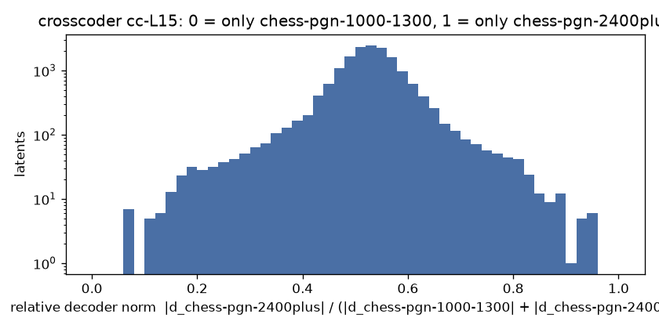

# Crosscoder chess-pgn-1000-1300 vs chess-pgn-2400plus, cc-L15

BatchTopK crosscoder, 16384 latents, k = 64 (held-out L0 64.4), on 3000000 positions from 753032 games (pgn-everything).

| source | held-out FVU |
| --- | --- |
| chess-pgn-1000-1300-L15 | 0.056 |
| chess-pgn-2400plus-L15 | 0.068 |

Latents firing at least once: 16384 (100.0%). Only chess-pgn-1000-1300: **7**, only chess-pgn-2400plus: **12**, shared: **15689** .

Models trained separately share no basis, so the cosine between a latent's two decoder directions says nothing here (it would for a model and its fine-tune); latents.jsonl keeps it anyway.

Relative decoder norm, 10 bins from 0 (only chess-pgn-1000-1300) to 1 (only chess-pgn-2400plus): 7 79 190 536 3971 9649 1533 308 99 12

Each example: activation, folder, move and side to move, the last moves, **the move played**, then each model's top move at T = 1 (chess-pgn-1000-1300 / chess-pgn-2400plus).

## Only in chess-pgn-1000-1300 (r < 0.1)

### latent 6217: r = 0.07, fires on 0.97% (pgn-everything 0.97%)

- 5.92 | pgn-everything | move 11, black | `fxe4 8.Qf4 Rf8 9.d4 d6 10.Nc3 dxe5 11.dxe5` -> **Rxf7** | Rxf7 30% / Qd4+ 32% | [board](https://lichess.org/analysis/rnbq1r2/ppp1kBpp/5n2/4P3/4pQ2/2N5/PPP2KPP/R1B4R_b_-_-_0_11)
- 4.94 | pgn-everything | move 9, white | `g6 6.Bc4 Bg7 7.Qb3 Nh6 8.Bxh6 Bxh6 9.` -> **Bxf7+** | Bxf7+ 96% / Bxf7+ 98% | [board](https://lichess.org/analysis/r1bqk2r/pppp1p1p/2n3pb/8/2B1P3/1QN2N2/PP3PPP/R3K2R_w_KQkq_-_0_9)
- 4.41 | pgn-everything | move 21, black | `Rh8 18.Qg3 Be3 19.Kb1 Bf4 20.Qf2 Rh2 21.Qxa7` -> **Rxg2** | Rxg2 35% / Rxg2 59% | [board](https://lichess.org/analysis/2k5/Qpp2p2/3ppqp1/4n3/4Pb2/2P2P2/PP1NB1Pr/1K1R4_b_-_-_0_21)
- 4.37 | pgn-everything | move 10, white | `Nxd5 7.Bxd5 Bd6 8.Nxf7 Qe7+ 9.Ne2 Nxe2 10.` -> **Qxe2** | Qxe2 67% / Qxe2 68% | [board](https://lichess.org/analysis/r1b1k2r/ppp1qNpp/3b4/3B4/8/8/PPPPnPPP/R1BQK2R_w_KQkq_-_0_10)
- 3.99 | pgn-everything | move 13, white | `a5 10.Nf3 b5 11.Ng5 b4 12.Nxh7 Nxh7 13.` -> **Bxh7+** | Bxh7+ 79% / Bxh7+ 73% | [board](https://lichess.org/analysis/r2q1rk1/2p2ppn/2n1p3/p2p4/1p1P4/2PBP1P1/PP3PP1/RN1QK2R_w_KQ_-_0_13)
- 3.94 | pgn-everything | move 17, black | `Qd7 14.g4 O-O-O 15.d5 Nxe5 16.Kb1 hxg4 17.Qxa7` -> **Qf5** | c6 49% / Qf5 62% | [board](https://lichess.org/analysis/2kr3r/Qppqpp2/3p2pb/3Pn3/5Pp1/2N4P/PPP1B3/1K1R3R_b_-_-_0_17)
- 3.87 | pgn-everything | move 13, black | `e5 10.dxe5 dxe5 11.Bg5 Re8 12.O-O-O e4 13.Bxf6` -> **exd3** | exd3 48% / Bxf6 57% | [board](https://lichess.org/analysis/1rbqr1k1/p1pn1pbp/1pB2Bp1/8/4p2P/2NQPN2/PPP2PP1/2KR3R_b_-_-_0_13)
- 3.83 | pgn-everything | move 15, white | `cxb2 12.Rb1 Bd6 13.f4 O-O 14.fxe5 Ba3 15.` -> **d4** | Bxb7 56% / Bxb7 32% | [board](https://lichess.org/analysis/r4rk1/pppq1ppp/8/4P3/8/b2P2P1/PpP2PBP/1R1QR1K1_w_-_-_1_15)
- 3.77 | pgn-everything | move 9, black | `Bd6 6.Bc4 Nf6 7.O-O c5 8.Qe3 Ng4 9.Qf3` -> **Ne5** | Nxh2 24% / Bxh2+ 37% | [board](https://lichess.org/analysis/r1bqk2r/pp1p1ppp/3b4/2p5/2B1P1n1/5Q2/PPP2PPP/RNB2RK1_b_kq_-_3_9)
- 3.72 | pgn-everything | move 13, black | `Be7 10.Bc4 O-O 11.O-O Ng4 12.Qg3 Bd6 13.Qd3` -> **Bxh2+** | Bxh2+ 40% / Bxh2+ 43% | [board](https://lichess.org/analysis/r2q1rk1/p1pb1ppp/3b4/8/2B3n1/2PQ4/PP1P1PPP/RNB2RK1_b_-_-_10_13)
- 3.56 | pgn-everything | move 40, white | `f5 37.Rg1 Re8 38.Rgf1 Re4 39.Kg2 Re2+ 40.` -> **R1f2** | R1f2 64% / R1f2 80% | [board](https://lichess.org/analysis/2k5/1p6/p2b4/P1pP1p2/2Pp1P1p/5R1P/4r1K1/5R2_w_-_-_6_40)
- 3.55 | pgn-everything | move 12, white | `O-O 9.a3 Re8+ 10.Be2 Bxc3 11.bxc3 Qe7 12.` -> **Ra2** | d5 22% / Kf1 31% | [board](https://lichess.org/analysis/r1b1r1k1/ppppqppp/2n5/8/2PP4/P1P2N2/3QBPPP/R3K2R_w_KQ_-_1_12)

### latent 5453: r = 0.07, fires on 2.40% (pgn-everything 2.40%)

- 5.71 | pgn-everything | move 25, white | `Bc5 22.Kb1 a5 23.g3 Nf3 24.Rd7 Re2 25.` -> **Qf1** | Bc1 23% / Bc2 27% | [board](https://lichess.org/analysis/r6k/1p1R2p1/2p4p/p1b2Bq1/8/1PP2nPQ/PB2rP1P/1K1R4_w_-_-_3_25)
- 5.60 | pgn-everything | move 37, white | `Re3 34.Na4 b5 35.Nb6 Rxb6 36.cxb5 Rxb5 37.` -> **Ka4** | Ka4 86% / Ka4 58% | [board](https://lichess.org/analysis/8/5p2/p2p3k/1rpP4/7P/KP2r1n1/P7/8_w_-_-_0_37)
- 5.37 | pgn-everything | move 11, black | `a4 8.Bxa4 bxa4 9.Be3 a3 10.Nxa3 Qe7 11.c3` -> **h5** | Rxa3 28% / Nf6 41% | [board](https://lichess.org/analysis/rnb1kbnr/4q1pp/2p1p3/3p1p2/4P3/N1PPBN2/PP3PPP/R2Q1RK1_b_kq_-_0_11)
- 5.28 | pgn-everything | move 43, black | `Kg6 40.Qd6+ Kh7 41.Qb4 Nd3 42.Qb3 Qd2+ 43.Kb1` -> **Qc1+** | Qb2+ 34% / Qc1+ 42% | [board](https://lichess.org/analysis/8/5ppk/P7/3p4/2nPp3/PQPnP1P1/3q4/1K6_b_-_-_10_43)
- 5.15 | pgn-everything | move 29, white | `Be4 26.Qh3 Rc2 27.f3 Bd3 28.Rd1 Rxb2 29.` -> **Nc1** | Qc8+ 32% / Qc8+ 31% | [board](https://lichess.org/analysis/6k1/pp3p2/6p1/3q4/8/1N1b1P1Q/Pr4PP/3R2K1_w_-_-_0_29)
- 5.11 | pgn-everything | move 23, white | `Rc8 20.c6 Rxc6 21.Qa7 Qd8 22.a3 bxa3 23.` -> **Rxa3** | Rxa3 85% / Rxa3 87% | [board](https://lichess.org/analysis/3qk1nr/Q2n1pp1/p1r1p1p1/3pP3/5PB1/pPp1B2P/2P3P1/R4RK1_w_k_-_0_23)
- 5.04 | pgn-everything | move 17, white | `Kb8 14.Nb3 hxg3 15.fxg3 Nd3+ 16.Kd2 Qxe4 17.` -> **Ne1** | Kc3 18% / Ne1 21% | [board](https://lichess.org/analysis/1k1r1bnr/pppb4/3p1p2/3P2p1/4q3/QN1n1NP1/PP1K2BP/R1B4R_w_-_-_0_17)
- 4.99 | pgn-everything | move 12, white | `Ncd7 9.c4 dxc3 10.Qc2 h6 11.Bh4 g5 12.` -> **Bxg5** | Bxg5 61% / Bxg5 58% | [board](https://lichess.org/analysis/r1bqk2r/pppn1p2/5n1p/4p1p1/1P5B/2pP2P1/P1Q1PPBP/R3K1NR_w_KQkq_-_0_12)
- 4.97 | pgn-everything | move 23, white | `O-O 20.Nge2 b3 21.O-O Nd5 22.Ba3 Bxa3 23.` -> **Rxa3** | Rxa3 94% / Rxa3 100% | [board](https://lichess.org/analysis/r2q1rk1/5ppp/8/nP1n4/3Np3/bp2P3/4NPPP/RQ3RK1_w_-_-_0_23)
- 4.83 | pgn-everything | move 55, white | `d3 52.Rf1 Re4+ 53.Kh3 Rc2 54.Rd1 Rexc4 55.` -> **Rxd3** | Rxd3 88% / Rxd3 64% | [board](https://lichess.org/analysis/8/4k2p/1p6/2pP4/2r5/3p3K/2r5/3R4_w_-_-_0_55)
- 4.46 | pgn-everything | move 17, black | `Nd3+ 14.Kf1 Rd8 15.Qc2 Bg4 16.h3 Bxe2+ 17.Qxe2` -> **Nxb2** | Bxc3 48% / Nxb2 41% | [board](https://lichess.org/analysis/r2r2k1/ppp1ppbp/1n4p1/8/2q1P3/2NnB1PP/PP2QPB1/R4K1R_b_-_-_0_17)
- 4.39 | pgn-everything | move 43, white | `Kc4 40.Qg6 c5 41.Qf7+ Kc3 42.Qf3+ d3 43.` -> **Qf6+** | Qf6+ 21% / Qc6 35% | [board](https://lichess.org/analysis/8/8/8/1pp5/p7/P1kp1Q1P/5PPK/4r3_w_-_-_0_43)

### latent 8805: r = 0.08, fires on 1.77% (pgn-everything 1.77%)

- 5.41 | pgn-everything | move 13, white | `Ng4 10.g3 e5 11.dxc6 Nxc6 12.Nd5 Qa5 13.` -> **Nc3** | Bxc6+ 29% / b4 38% | [board](https://lichess.org/analysis/r1b1k2r/pp3ppp/2nb4/q2Np3/B5n1/5NP1/PPP2P1P/R1BQ1RK1_w_kq_-_2_13)
- 5.12 | pgn-everything | move 25, white | `Nc5 22.b4 Qxe3+ 23.Kh1 Rd6 24.Qb5+ Rb6 25.` -> **Qxc5** | Qc4 51% / Qc4 73% | [board](https://lichess.org/analysis/1k5r/2p2pp1/1r5p/NQn5/1P6/2P1q3/P5PP/R4R1K_w_-_-_4_25)
- 5.07 | pgn-everything | move 8, black | `Nf6 5.Nh3 Bd6 6.Ng5 O-O 7.Bd3 Na5 8.Qa4` -> **b6** | b6 54% / Nc6 46% | [board](https://lichess.org/analysis/r1bq1rk1/pppp1ppp/3b1n2/n5N1/Q3P3/3B4/PPP2PPP/RNB1K2R_b_KQ_-_10_8)
- 4.88 | pgn-everything | move 11, white | `cxd4 8.Nxd4 Qb6 9.N2b3 Nf6 10.Be3 Bxe4 11.` -> **O-O** | O-O 39% / O-O 73% | [board](https://lichess.org/analysis/rn2kb1r/3p1ppp/1q2pn2/1B6/3Nb3/1N2B3/PP3PPP/R2QK2R_w_KQkq_-_0_11)
- 4.62 | pgn-everything | move 17, black | `Ke7 14.Nbd5+ Kd7 15.Bf4 fxe4 16.fxe4 Ne7 17.Qg4+` -> **Ke8** | Kc6 67% / Kc6 56% | [board](https://lichess.org/analysis/rnbq1b1r/3kn2p/p2p2p1/2pN4/2B1PBQ1/2N5/PPP3PP/R4RK1_b_-_-_2_17)
- 4.46 | pgn-everything | move 6, white | `f6 3.Bb5 Ne7 4.O-O c6 5.Ba4 Qa5 6.` -> **c4** | Nc3 37% / c3 42% | [board](https://lichess.org/analysis/rnb1kb1r/pp1pn1pp/2p2p2/q3p3/B3P3/5N2/PPPP1PPP/RNBQ1RK1_w_kq_-_2_6)
- 4.38 | pgn-everything | move 41, black | `Kf5 38.Qh3+ Ke4 39.Qh7+ f5 40.Qh4+ f4 41.Qh7+` -> **Ke3** | Ke3 100% / Ke3 100% | [board](https://lichess.org/analysis/8/3R3Q/p7/1p2p3/4kp2/8/2q3PP/7K_b_-_-_1_41)
- 4.37 | pgn-everything | move 24, white | `a6 21.Ne5 b5 22.Qb3 b4 23.Be1 Na5 24.` -> **Qxd5** | Qxd5 71% / Qxd5 84% | [board](https://lichess.org/analysis/r1r3k1/5ppp/p2b4/n2pN3/1p1P1P2/1Q6/PPP5/2KRB3_w_-_-_2_24)
- 4.33 | pgn-everything | move 39, white | `fxg4 36.Ne2 Re8 37.Nf4 Kh7 38.Rf1 Kxh6 39.` -> **Ne2** | g3 30% / Nh5 25% | [board](https://lichess.org/analysis/r1b1r3/p7/1pp2p1k/8/1P1p1NpP/P2P4/2P3P1/5RK1_w_-_-_0_39)
- 4.32 | pgn-everything | move 12, white | `Qxd7 9.Re1 f5 10.c3 c4 11.Qxd4 Nc6 12.` -> **Qe3** | Qd1 53% / Qd1 55% | [board](https://lichess.org/analysis/r3kb1r/pp1q2pp/2n5/3p1p2/2pQn3/2P2N2/PP3PPP/RNB1R1K1_w_kq_-_1_12)
- 4.19 | pgn-everything | move 71, white | `Kh4 68.Kg2 Bd4 69.Kf1 Kh3 70.Ke2 g2 71.` -> **Kd3** | Kf3 74% / Kd3 61% | [board](https://lichess.org/analysis/8/8/8/8/3b4/7k/4K1p1/8_w_-_-_0_71)
- 4.14 | pgn-everything | move 17, white | `Qe7 14.Nc3 Bxb4 15.a3 Bxc3 16.Qxc3 Nd5 17.` -> **Qd2** | Qxc4 73% / Qxc4 74% | [board](https://lichess.org/analysis/r4rk1/p1p1qppp/1pb5/3n4/2pPp3/P1Q1P3/1PB2PPP/R4RK1_w_-_-_1_17)

### latent 656: r = 0.08, fires on 1.59% (pgn-everything 1.59%)

- 5.24 | pgn-everything | move 17, white | `Nc4 14.Qb1 Bc5 15.b3 Bxd4 16.Bxd4 Nd2 17.` -> **Qb2** | Qd1 63% / Qb2 65% | [board](https://lichess.org/analysis/2kr2nr/pppq2pp/5p2/8/3B4/1PN5/P1Pn1PPP/RQ2R1K1_w_-_-_1_17)
- 4.60 | pgn-everything | move 26, white | `Bc7 23.Nc3 a6 24.Kd2 b5 25.Na3 b4 26.` -> **Nc2** | Nc4 39% / Nc4 51% | [board](https://lichess.org/analysis/r6r/2b1k2p/p1n1p1p1/5p2/1p1P4/NPN1P3/1P1KP1R1/R7_w_-_-_0_26)
- 4.42 | pgn-everything | move 8, white | `Nf6 5.Ng5 Nxe4 6.Nxe4 Bb6 7.O-O d5 8.` -> **Bxd5** | Bxd5 31% / Bb5 38% | [board](https://lichess.org/analysis/r1bqk2r/ppp2ppp/1bn5/3pp3/2B1N3/3P4/PPP2PPP/RNBQ1RK1_w_kq_-_0_8)
- 4.39 | pgn-everything | move 9, white | `h5 6.e5 dxe5 7.Nxe5 Nxe5 8.fxe5 h4 9.` -> **Bxf7#** | Bxf7# 59% / Bxf7# 30% | [board](https://lichess.org/analysis/r2qkbnr/pp1bppp1/8/2p1P3/2B4p/8/PPPP2PP/RNBQ1RK1_w_kq_-_0_9)
- 4.30 | pgn-everything | move 17, white | `Qe7 14.Bd3 O-O-O 15.Qg4+ Qd7 16.Bf5 h5 17.` -> **Bxd7+** | Bxd7+ 82% / Bxd7+ 80% | [board](https://lichess.org/analysis/2kr3r/pppq2p1/2np4/3p1B1p/3P2QP/4P2R/PPP2P2/R3K3_w_Q_-_0_17)
- 4.13 | pgn-everything | move 15, white | `Qe4 12.O-O Qxe2 13.Na3 g6 14.Rae1 b5 15.` -> **Rxe2+** | Qxb5 45% / Nxb5 27% | [board](https://lichess.org/analysis/r3kb1r/p1B2p1p/2n2np1/1p6/Q2P4/N1P3P1/PP2q2P/4RRK1_w_kq_-_0_15)
- 4.13 | pgn-everything | move 17, white | `b4 14.axb4 Bxb4 15.Na2 Ba3 16.bxa3 Qxa3+ 17.` -> **Kd2** | Kb1 68% / Kb1 59% | [board](https://lichess.org/analysis/r3k2r/2pn1ppp/p3pn2/7b/8/qB1PBP1N/N1P2QPP/2KR3R_w_kq_-_0_17)
- 4.13 | pgn-everything | move 25, white | `Qc3 22.Nxd7 Bxd7 23.e6 Qf6 24.Qd2 Qxg6 25.` -> **Qxd7#** | Qxd7# 41% / Qxd7# 74% | [board](https://lichess.org/analysis/r2k1b1r/1p1bp1p1/2p1P1q1/p6p/8/7P/P2Q1PPB/R3R1K1_w_-_-_0_25)
- 4.01 | pgn-everything | move 6, white | `Nf6 3.Nf3 c6 4.d3 a5 5.Nxe5 b5 6.` -> **Bb3** | Nxf7 50% / Bxf7+ 66% | [board](https://lichess.org/analysis/rnbqkb1r/3p1ppp/2p2n2/pp2N3/2B1P3/3P4/PPP2PPP/RNBQK2R_w_KQkq_-_0_6)
- 3.95 | pgn-everything | move 19, black | `Bxe2 16.Nxe2 g5 17.Nf5 e4 18.Rdg1 Nd7 19.Nxg7` -> **Kxg7** | Kxg7 96% / Kxg7 100% | [board](https://lichess.org/analysis/r2qr1k1/pp1n1nN1/2p2p2/2Pp2p1/3Pp3/1Q2P3/PP1BNP2/2K3RR_b_-_-_0_19)
- 3.92 | pgn-everything | move 14, black | `Nxc4 11.dxc4 Qc5+ 12.Nd4 Ne7 13.Be3 Qa5 14.b4` -> **Qa6** | Qa4 57% / Qh5 40% | [board](https://lichess.org/analysis/r1b1kb1r/ppppn1pp/4pp2/q7/1PPNPP2/2P1B1Q1/P5PP/RN3RK1_b_kq_-_0_14)
- 3.91 | pgn-everything | move 17, black | `Ng4 14.Be3 Nxe3 15.fxe3 Rad8 16.Nxe5 Nxe5 17.d4` -> **Nd3** | Nd3 68% / Nd3 47% | [board](https://lichess.org/analysis/3r1rk1/ppp3p1/4p2p/2b1n3/3P4/2P1P3/PP4PP/RN2R1K1_b_-_-_0_17)

### latent 3169: r = 0.07, fires on 2.10% (pgn-everything 2.10%)

- 4.68 | pgn-everything | move 12, black | `f5 9.g5 h5 10.Be2 g6 11.Bf4 Bg7 12.Nd2` -> **a6** | Nxd4 26% / Nxd4 28% | [board](https://lichess.org/analysis/r1bqk2r/ppp1n1b1/2n1p1p1/3pPpPp/3P1B1P/P1N5/1PPNBP2/R2QK2R_b_KQkq_-_3_12)
- 4.60 | pgn-everything | move 27, white | `Bc4 24.Rd2 Bc5 25.Re1 Rxd2 26.Qxd2 Rd8 27.` -> **Qc2** | Qc2 64% / Qc2 44% | [board](https://lichess.org/analysis/3r2k1/4q1pp/p4p2/1pb1p3/P1b1P1P1/2P4P/3Q1PBN/4R1K1_w_-_-_1_27)
- 4.45 | pgn-everything | move 32, black | `Qg6 29.Rd7 Rh5 30.e4 Rf6 31.e5 Rf5 32.Rxc7` -> **h6** | h6 43% / h6 83% | [board](https://lichess.org/analysis/6k1/p1R2p1p/2p3q1/4PrNr/1PQ2P1P/P5P1/6K1/4R3_b_-_-_0_32)
- 4.38 | pgn-everything | move 14, black | `Nf6 11.Re1 a5 12.d5 c5 13.Nb5 Qd7 14.a4` -> **b6** | b6 40% / Ng6 34% | [board](https://lichess.org/analysis/r1b1k2r/1p1qnpp1/3p1n2/pNpPp3/P1P1P2p/5N1P/1P2BPP1/R2QR1K1_b_kq_-_0_14)
- 4.35 | pgn-everything | move 9, white | `b6 6.Be2 Bb7 7.Nf3 Nd4 8.h3 d5 9.` -> **cxd5** | cxd5 41% / cxd5 43% | [board](https://lichess.org/analysis/r2qkb1r/pb3ppp/1p2pn2/2pp4/2PnP3/P1NP1N1P/1P2BPP1/R1BQK2R_w_KQkq_-_0_9)
- 4.34 | pgn-everything | move 20, black | `hxg4 17.Nxh4 Qf6 18.Qd1 g5 19.Nf5 Nxe4 20.Nxe4` -> **Qxf5** | Qxf5 99% / Qxf5 99% | [board](https://lichess.org/analysis/r4rk1/2p2p2/1p1p1q2/p2PpNp1/P1P1N1p1/4B3/1P2KP2/3Q3R_b_-_-_0_20)
- 4.33 | pgn-everything | move 22, black | `Qd5 19.Bf5 O-O-O 20.Nf4 Qd7 21.d5 cxd5 22.Rxd5` -> **Qc7** | Qc6 40% / Qc6 44% | [board](https://lichess.org/analysis/2kr2nr/pp1qppb1/4n3/3RPB1p/5N2/2B5/PPQ2P2/1K5R_b_-_-_0_22)
- 4.29 | pgn-everything | move 19, white | `fxe6 16.Rxe6 Rf6 17.Rxf6 Qxf6 18.Rd1 Qxd4 19.` -> **Qxd4+** | Qxd4+ 74% / Qxd4+ 64% | [board](https://lichess.org/analysis/r7/pp4k1/2n3pp/3p1p2/3q4/2N5/PPPQ1PPP/3R2K1_w_-_-_0_19)
- 4.29 | pgn-everything | move 11, black | `Bg4 8.h3 Bxf3 9.gxf3 a6 10.d5 Qb6 11.Be3` -> **c5** | Qa5+ 50% / Qa5+ 74% | [board](https://lichess.org/analysis/rn2kbnr/1pp1pppp/pq6/1N1P4/8/4BP1P/P1P2P2/R2QKB1R_b_KQkq_-_2_11)
- 4.26 | pgn-everything | move 34, white | `Ke7 31.Nf5+ Kf6 32.Nd6 Rd8 33.Nf5 Qxc4+ 34.` -> **Ke3** | Ke3 80% / Ke3 57% | [board](https://lichess.org/analysis/3r4/p4p2/5k2/4pN1p/2q1P3/5B2/4KPR1/8_w_-_-_0_34)
- 4.22 | pgn-everything | move 25, white | `Nf4 22.Qf3 Ne7 23.Bc1 Neg6 24.Rg1 a6 25.` -> **Nf1** | Nf1 25% / Bf1 47% | [board](https://lichess.org/analysis/r2q3r/2b2bk1/pp3pn1/2p1p1p1/P1NpPnPp/1P1P1Q1P/2PN1PBK/2B1R1R1_w_-_-_0_25)
- 4.19 | pgn-everything | move 16, black | `e5 13.Qxf7+ Kd7 14.Nc5+ Kd6 15.Qxd5+ Nxd5 16.Bxd5` -> **Kxc5** | Kxd5 61% / Bxg5 41% | [board](https://lichess.org/analysis/2bq3r/2p1b1pp/r2k4/ppNBp1N1/8/8/PPPP1PPP/R1BK3R_b_-_-_0_16)

### latent 7825: r = 0.07, fires on 1.41% (pgn-everything 1.41%)

- 4.48 | pgn-everything | move 8, white | `g4 5.O-O gxf3 6.Qxf3 Qh4 7.d3 Bc5+ 8.` -> **Kh1** | Kh1 83% / Kh1 99% | [board](https://lichess.org/analysis/rnb1k1nr/pppp1p1p/8/2b5/2B1Pp1q/3P1Q2/PPP3PP/RNB2RK1_w_kq_-_1_8)
- 4.09 | pgn-everything | move 21, white | `Qxd3+ 18.Ke1 Bxe4 19.Qh2 Rd8 20.fxe5 Bb4+ 21.` -> **Kf2** | Bd2 61% / Bd2 56% | [board](https://lichess.org/analysis/3rk3/pp3pp1/4p3/4P1P1/Pb2b3/3q4/1P5Q/R1B1K1N1_w_-_-_1_21)
- 4.06 | pgn-everything | move 16, white | `Qf6 13.Rf1 Re8 14.h4 Qg6 15.Rg1 Qg3+ 16.` -> **Ke2** | Kf1 65% / Kf1 61% | [board](https://lichess.org/analysis/N1bkr3/pp1p1ppn/2n5/2b4p/2B1P2P/3P1Nq1/P1PB2P1/R2QK1R1_w_Q_-_3_16)
- 4.01 | pgn-everything | move 12, white | `exd4 9.cxd4 Bxf3 10.Qxf3 Qxd4 11.Rf1 Bb4+ 12.` -> **Nc3** | Nc3 52% / Nc3 81% | [board](https://lichess.org/analysis/r3k1nr/p1p2ppp/2p5/8/1b1qP3/5Q2/PP4PP/RNB1KR2_w_Qkq_-_2_12)
- 3.89 | pgn-everything | move 14, white | `bxc6 11.Nf3 Ne4 12.O-O Bc4 13.Re1 Bb4 14.` -> **Nc3** | Nc3 42% / Nc3 92% | [board](https://lichess.org/analysis/2kr3r/p4ppp/2p5/8/1bb1n3/4PN2/PP3PPP/R1BNR1K1_w_-_-_6_14)
- 3.88 | pgn-everything | move 18, black | `Nc5 15.Be3 a5 16.Qe2 Bd7 17.Qc4 Rf8 18.Bg8` -> **Rc8** | Rxg8 31% / O-O-O 27% | [board](https://lichess.org/analysis/r3krB1/1pqbb1pp/3p1p2/p1n1p3/2Q5/P1N1BNP1/1PP2P1P/R4RK1_b_q_-_5_18)
- 3.83 | pgn-everything | move 27, white | `Qc7 24.g3 Bf6 25.Rc1 Qb6 26.g4 Bd5+ 27.` -> **Rg2** | Rg2 93% / Rg2 98% | [board](https://lichess.org/analysis/r3r1k1/pp3ppp/1q3b2/3b4/5PP1/8/PP5P/2R2QRK_w_-_-_1_27)
- 3.80 | pgn-everything | move 11, black | `a5 8.Bc4 Nh6 9.Qxh5+ Ke7 10.Ng6+ Ke8 11.Nxh8+` -> **Nf7** | Ke7 91% / Ke7 62% | [board](https://lichess.org/analysis/1rbqkb1N/2pp2p1/2n2p1n/pN2p2Q/P1B1P3/6P1/1PPP1P1P/R1B1K2R_b_KQ_-_0_11)
- 3.79 | pgn-everything | move 6, black | `dxe4 3.Ne5 f6 4.Qh5+ g6 5.Nxg6 Bf5 6.Nxh8+` -> **Bg6** | Bg6 56% / Kd7 65% | [board](https://lichess.org/analysis/rn1qkbnN/ppp1p2p/5p2/5b1Q/4p3/8/PPPP1PPP/RNB1KB1R_b_KQq_-_0_6)
- 3.71 | pgn-everything | move 30, white | `Rxa2 27.Re2 Bb5 28.Rde1 Bxe2 29.Rxe2 Ra1+ 30.` -> **Bxa1** | Re1 91% / Re1 62% | [board](https://lichess.org/analysis/4r1k1/1p3pp1/7p/5q2/1p1Bp1n1/1P4Q1/2P1RPPP/r5K1_w_-_-_1_30)
- 3.71 | pgn-everything | move 15, black | `Qf8 12.Qf3 Qxh8 13.Qxc6+ Bd7 14.Qxa8+ Bc8 15.Qxc8+` -> **Kf7** | Kf7 62% / Kf7 53% | [board](https://lichess.org/analysis/2Q1k2q/p5pp/5n2/2b1p3/8/2N5/PPPP1PPP/R1B1K2R_b_KQ_-_0_15)
- 3.69 | pgn-everything | move 20, black | `Qc7 17.Rc1 Qb8 18.Bb6 Bd8 19.Bc5 Nc7 20.Bxf8` -> **Kxf8** | Kxf8 96% / Kxf8 92% | [board](https://lichess.org/analysis/1qrb1Bk1/1pn2ppp/p1b1p3/n3P3/P7/2N2N1P/BP3PP1/2RQR1K1_b_-_-_0_20)

### latent 11190: r = 0.07, fires on 2.24% (pgn-everything 2.24%)

- 4.37 | pgn-everything | move 24, black | `g5 21.a5 b6 22.axb6 axb6 23.Nd3 Qg4 24.f3` -> **Bxf3** | Qxd4+ 37% / Bxf3 51% | [board](https://lichess.org/analysis/2kr3r/8/1pp1p3/3b1ppp/3P2q1/3N1P2/1PQ3PP/R3R1K1_b_-_-_0_24)
- 4.33 | pgn-everything | move 30, white | `Qa5+ 27.Kd3 Qb5+ 28.Kd2 Qxb2 29.Rg1 d3 30.` -> **Rc1** | Kxd3 31% / Kxd3 41% | [board](https://lichess.org/analysis/2b4r/pp3k1p/2n2p2/3Npn2/6R1/3p1BB1/PqPK3P/6R1_w_-_-_0_30)
- 4.24 | pgn-everything | move 67, white | `Bb7 64.b5 Bc8 65.a6 Bd7 66.b6 Bc6 67.` -> **b7** | a7 38% / Kxc6 40% | [board](https://lichess.org/analysis/8/8/PPb1k3/2Kp4/2p5/2P5/8/8_w_-_-_1_67)
- 4.24 | pgn-everything | move 25, white | `Ba5 22.Qe5 Re8 23.Qf4 Bc7 24.Qg5 h6 25.` -> **Qg6** | Qg6 59% / Qg6 68% | [board](https://lichess.org/analysis/r1q1r1k1/2b3p1/2p2n1p/1PPp1pQ1/p3p3/P3P3/1B2BPPP/2R2RK1_w_-_-_0_25)
- 4.21 | pgn-everything | move 18, black | `dxc4 15.Bxh6 Nxh6 16.Ng5 Qxg5 17.f4 Qg4 18.Bf3` -> **Bxf3** | Qxg3+ 72% / Bxf3 58% | [board](https://lichess.org/analysis/r4rk1/pbpn2b1/1p2p1pn/8/2pP1Pq1/2P2BP1/PPQ1P3/R3K2R_b_KQ_-_2_18)
- 4.10 | pgn-everything | move 54, black | `d6 51.exd6 Kd7 52.Be5 Rc8 53.Bc3 f6 54.h4` -> **f5** | Kxd6 29% / Kxd6 32% | [board](https://lichess.org/analysis/2r5/3k4/3Ppppp/3b4/5PPP/1pB5/pK6/8_b_-_-_0_54)
- 4.03 | pgn-everything | move 9, black | `e6 6.Bb5 a6 7.Bxc6+ bxc6 8.Ne5 Qd6 9.Bxf6` -> **gxf6** | gxf6 99% / gxf6 100% | [board](https://lichess.org/analysis/r3kb1r/2p2ppp/p1pqpB2/3pNb2/3P4/2N1P3/PPP2PPP/R2QK2R_b_KQkq_-_0_9)
- 3.87 | pgn-everything | move 23, white | `Qd6 20.Rc5 Nd7 21.Rxb5 Rb8 22.Rc1 Nb6 23.` -> **d3** | Rbc5 17% / a4 24% | [board](https://lichess.org/analysis/1r4k1/1p2b1pp/1n1qp3/1R1p4/1P2p3/PQ2P1PB/3P1P1P/2R3K1_w_-_-_3_23)
- 3.84 | pgn-everything | move 6, white | `c5 3.cxd5 Bf5 4.dxc5 e5 5.d6 Nc6 6.` -> **Nc3** | Nc3 34% / Nc3 69% | [board](https://lichess.org/analysis/r2qkbnr/pp3ppp/2nP4/2P1pb2/8/8/PP2PPPP/RNBQKBNR_w_KQkq_-_1_6)
- 3.82 | pgn-everything | move 28, black | `Kf7 25.g3 Nh6 26.Kg2 Rxa8 27.Rxa8 Bf6 28.f3` -> **Qh5** | Qh5 44% / Qd7 56% | [board](https://lichess.org/analysis/R7/4pk1p/3p1bpn/1PpPp3/2P1P1qP/3B1PP1/2Q3K1/8_b_-_-_0_28)
- 3.80 | pgn-everything | move 20, white | `h6 17.Bf4 Nd5 18.Nxd5 Qxd5 19.f3 Bc5+ 20.` -> **Kh1** | Kh1 80% / Kh1 91% | [board](https://lichess.org/analysis/2kr3r/Q1p2pp1/1pb4p/2bqN3/5B2/5P2/PP4PP/R3R1K1_w_-_-_1_20)
- 3.80 | pgn-everything | move 27, black | `Bc5 24.Qe1 Nf8 25.d6 Ng6 26.Nxg6 fxg6 27.Bf4` -> **Bb4** | Rxf3 29% / Rxf3 41% | [board](https://lichess.org/analysis/2rqk3/1b6/1p1Pp1p1/pPb1Pp2/P4B1p/5NrP/6P1/R3QR1K_b_-_-_1_27)

## Only in chess-pgn-2400plus (r > 0.9)

### latent 5105: r = 0.95, fires on 2.38% (pgn-everything 2.38%)

- 13.32 | pgn-everything | move 6, white | `exd4 3.Qxd4 Nc6 4.Qa4 Bc5 5.Nf3 d6 6.` -> **Bg5** | Bb5 32% / Bb5 42% | [board](https://lichess.org/analysis/r1bqk1nr/ppp2ppp/2np4/2b5/Q3P3/5N2/PPP2PPP/RNB1KB1R_w_KQkq_-_0_6)
- 12.50 | pgn-everything | move 8, white | `Nf6 5.Nc3 Bb4 6.Nxc6 bxc6 7.Qf3 d5 8.` -> **e5** | e5 36% / exd5 25% | [board](https://lichess.org/analysis/r1bqk2r/p1p2ppp/2p2n2/3p4/1b2P3/2N2Q2/PPP2PPP/R1B1KB1R_w_KQkq_-_0_8)
- 10.35 | pgn-everything | move 6, white | `exd4 3.Qxd4 Nc6 4.Qd3 Nf6 5.Nc3 Bb4 6.` -> **Be2** | Bd2 47% / Bd2 89% | [board](https://lichess.org/analysis/r1bqk2r/pppp1ppp/2n2n2/8/1b2P3/2NQ4/PPP2PPP/R1B1KBNR_w_KQkq_-_5_6)
- 10.35 | pgn-everything | move 6, white | `exd4 3.Qxd4 Nc6 4.Qd3 Nf6 5.Nc3 Bb4 6.` -> **Bf4** | Bd2 47% / Bd2 89% | [board](https://lichess.org/analysis/r1bqk2r/pppp1ppp/2n2n2/8/1b2P3/2NQ4/PPP2PPP/R1B1KBNR_w_KQkq_-_5_6)
- 9.93 | pgn-everything | move 6, white | `Nf6 3.d4 exd4 4.Qxd4 Nc6 5.Qd3 d6 6.` -> **Bg5** | Bg5 35% / Nc3 81% | [board](https://lichess.org/analysis/r1bqkb1r/ppp2ppp/2np1n2/8/4P3/3Q1N2/PPP2PPP/RNB1KB1R_w_KQkq_-_0_6)
- 9.44 | pgn-everything | move 6, white | `Nf6 3.d4 exd4 4.Qxd4 Nc6 5.Qd3 Be7 6.` -> **Nc3** | Nc3 28% / Nc3 73% | [board](https://lichess.org/analysis/r1bqk2r/ppppbppp/2n2n2/8/4P3/3Q1N2/PPP2PPP/RNB1KB1R_w_KQkq_-_3_6)
- 8.88 | pgn-everything | move 6, white | `exd4 3.Qxd4 Nc6 4.Qd3 d6 5.Nc3 Nf6 6.` -> **Nf3** | Nf3 38% / Bf4 36% | [board](https://lichess.org/analysis/r1bqkb1r/ppp2ppp/2np1n2/8/4P3/2NQ4/PPP2PPP/R1B1KBNR_w_KQkq_-_2_6)
- 8.82 | pgn-everything | move 8, white | `Nxd4 5.Qxd4 Ne7 6.Be3 Nc6 7.Qd2 Bb4 8.` -> **Nc3** | c3 69% / Nc3 67% | [board](https://lichess.org/analysis/r1bqk2r/pppp1ppp/2n5/8/1b2P3/4B3/PPPQ1PPP/RN2KB1R_w_KQkq_-_5_8)
- 8.49 | pgn-everything | move 6, white | `exd4 3.Qxd4 Nc6 4.Qa4 Bc5 5.Nf3 Nf6 6.` -> **Bd3** | Bg5 23% / Bb5 53% | [board](https://lichess.org/analysis/r1bqk2r/pppp1ppp/2n2n2/2b5/Q3P3/5N2/PPP2PPP/RNB1KB1R_w_KQkq_-_5_6)
- 8.45 | pgn-everything | move 6, white | `exd4 3.Qxd4 Nc6 4.Qa4 Nf6 5.Nf3 Bc5 6.` -> **Nc3** | Bg5 16% / Bb5 82% | [board](https://lichess.org/analysis/r1bqk2r/pppp1ppp/2n2n2/2b5/Q3P3/5N2/PPP2PPP/RNB1KB1R_w_KQkq_-_5_6)
- 8.21 | pgn-everything | move 7, white | `Nc6 4.Qd3 d6 5.Nc3 Be7 6.Nf3 Nf6 7.` -> **h3** | Bg5 36% / Bf4 39% | [board](https://lichess.org/analysis/r1bqk2r/ppp1bppp/2np1n2/8/4P3/2NQ1N2/PPP2PPP/R1B1KB1R_w_KQkq_-_4_7)
- 8.16 | pgn-everything | move 6, white | `exd4 3.Qxd4 Nc6 4.Qa4 Nf6 5.Nf3 d5 6.` -> **e5** | e5 36% / Bb5 40% | [board](https://lichess.org/analysis/r1bqkb1r/ppp2ppp/2n2n2/3p4/Q3P3/5N2/PPP2PPP/RNB1KB1R_w_KQkq_-_0_6)

### latent 7846: r = 0.95, fires on 4.14% (pgn-everything 4.14%)

- 9.00 | pgn-everything | move 6, white | `c5 3.c3 Bf5 4.d4 e6 5.Nf3 Nc6 6.` -> **Bb5** | Bb5 43% / Bd3 35% | [board](https://lichess.org/analysis/r2qkbnr/pp3ppp/2n1p3/2ppPb2/3P4/2P2N2/PP3PPP/RNBQKB1R_w_KQkq_-_2_6)
- 8.13 | pgn-everything | move 6, white | `c5 3.c3 Nc6 4.d4 Bf5 5.Nf3 e6 6.` -> **Bd3** | Bb5 36% / Bd3 30% | [board](https://lichess.org/analysis/r2qkbnr/pp3ppp/2n1p3/2ppPb2/3P4/2P2N2/PP3PPP/RNBQKB1R_w_KQkq_-_0_6)
- 8.06 | pgn-everything | move 6, white | `d5 3.e5 Bf5 4.Nf3 e6 5.d4 Nc6 6.` -> **h3** | Bb5 45% / Bd3 35% | [board](https://lichess.org/analysis/r2qkbnr/pp3ppp/2n1p3/2ppPb2/3P4/2P2N2/PP3PPP/RNBQKB1R_w_KQkq_-_1_6)
- 7.73 | pgn-everything | move 6, white | `Bf5 3.d4 e6 4.Nf3 c5 5.c3 Nc6 6.` -> **Bb5** | Bb5 43% / Bd3 40% | [board](https://lichess.org/analysis/r2qkbnr/pp3ppp/2n1p3/2ppPb2/3P4/2P2N2/PP3PPP/RNBQKB1R_w_KQkq_-_1_6)
- 7.56 | pgn-everything | move 8, white | `Nf6 5.Bd3 Bd7 6.Nge2 e5 7.O-O e4 8.` -> **Bb5** | Bb5 75% / Bb5 70% | [board](https://lichess.org/analysis/r2qkb1r/pppb1ppp/2n2n2/3p4/3Pp3/2NBP3/PPPBNPPP/R2Q1RK1_w_kq_-_0_8)
- 7.44 | pgn-everything | move 6, white | `Nf6 3.d3 c6 4.Qf3 d5 5.exd5 cxd5 6.` -> **Bb3** | Bb3 54% / Bb3 69% | [board](https://lichess.org/analysis/rnbqkb1r/pp3ppp/5n2/3pp3/2B5/3P1Q2/PPP2PPP/RNB1K1NR_w_KQkq_-_0_6)
- 7.13 | pgn-everything | move 6, white | `Bf5 3.Nf3 e6 4.d4 c5 5.c3 Nc6 6.` -> **Bb5** | Bb5 43% / Bd3 41% | [board](https://lichess.org/analysis/r2qkbnr/pp3ppp/2n1p3/2ppPb2/3P4/2P2N2/PP3PPP/RNBQKB1R_w_KQkq_-_1_6)
- 7.11 | pgn-everything | move 11, white | `h6 8.Na3 a6 9.Qg3 d5 10.Bd3 e4 11.` -> **Be2** | Be2 89% / Be2 92% | [board](https://lichess.org/analysis/r1bq1rk1/1pp2pb1/p1n2npp/3p4/4p3/NP1BP1QN/PBPP1PPP/R3K2R_w_KQ_-_0_11)
- 7.02 | pgn-everything | move 6, white | `d5 3.e5 Bf5 4.Nf3 c5 5.c3 e6 6.` -> **Bd3** | Bd3 29% / Be2 51% | [board](https://lichess.org/analysis/rn1qkbnr/pp3ppp/4p3/2ppPb2/3P4/2P2N2/PP3PPP/RNBQKB1R_w_KQkq_-_0_6)
- 7.00 | pgn-everything | move 7, white | `c5 4.c3 Nc6 5.h3 Bf5 6.Nf3 e6 7.` -> **Bd3** | Bb5 33% / Bd3 59% | [board](https://lichess.org/analysis/r2qkbnr/pp3ppp/2n1p3/2ppPb2/3P4/2P2N1P/PP3PP1/RNBQKB1R_w_KQkq_-_0_7)
- 6.90 | pgn-everything | move 6, white | `Nf6 3.Bc4 c6 4.d3 d5 5.exd5 cxd5 6.` -> **Bb3** | Bb3 49% / Bb5+ 54% | [board](https://lichess.org/analysis/rnbqkb1r/pp3ppp/5n2/3pp3/2B5/3P1Q2/PPP2PPP/RNB1K1NR_w_KQkq_-_0_6)
- 6.90 | pgn-everything | move 6, white | `Nf6 3.Bc4 c6 4.d3 d5 5.exd5 cxd5 6.` -> **Bb3** | Bb3 49% / Bb5+ 54% | [board](https://lichess.org/analysis/rnbqkb1r/pp3ppp/5n2/3pp3/2B5/3P1Q2/PPP2PPP/RNB1K1NR_w_KQkq_-_0_6)

### latent 4619: r = 0.94, fires on 1.72% (pgn-everything 1.72%)

- 8.95 | pgn-everything | move 8, white | `c5 5.Bd3 cxd4 6.O-O Bc5 7.a3 a5 8.` -> **b3** | c3 23% / Re1 58% | [board](https://lichess.org/analysis/r1bqk1nr/1p1n1ppp/4p3/p1bpP3/3p4/P2B1N2/1PP2PPP/RNBQ1RK1_w_kq_-_0_8)
- 8.93 | pgn-everything | move 8, white | `Nc6 5.d3 g6 6.c3 Bg7 7.Be2 Nge7 8.` -> **O-O** | O-O 75% / O-O 45% | [board](https://lichess.org/analysis/r1bqk2r/pp2npbp/2n1p1p1/2ppP3/5P2/2PP1N2/PP2B1PP/RNBQK2R_w_KQkq_-_3_8)
- 8.60 | pgn-everything | move 9, white | `Nf6 6.O-O Be7 7.c3 O-O 8.Re1 Re8 9.` -> **Nbd2** | d4 28% / d4 78% | [board](https://lichess.org/analysis/r1bqr1k1/pp2bppp/2nppn2/2p5/4P3/2PP1NP1/PP3PBP/RNBQR1K1_w_-_-_3_9)
- 7.86 | pgn-everything | move 7, white | `c5 4.c3 Nc6 5.dxc5 Bxc5 6.Nf3 Nge7 7.` -> **Ng5** | Bb5 37% / Bd3 70% | [board](https://lichess.org/analysis/r1bqk2r/pp2nppp/2n1p3/2bpP3/8/2P2N2/PP3PPP/RNBQKB1R_w_KQkq_-_2_7)
- 7.84 | pgn-everything | move 7, white | `c5 4.dxc5 Bxc5 5.c3 Nc6 6.Nf3 Nge7 7.` -> **Bb5** | Bb5 37% / Bd3 77% | [board](https://lichess.org/analysis/r1bqk2r/pp2nppp/2n1p3/2bpP3/8/2P2N2/PP3PPP/RNBQKB1R_w_KQkq_-_3_7)
- 7.79 | pgn-everything | move 6, white | `d5 3.e5 c5 4.d3 Nc6 5.c3 Nh6 6.` -> **Nf3** | h3 28% / Nf3 46% | [board](https://lichess.org/analysis/r1bqkb1r/pp3ppp/2n1p2n/2ppP3/5P2/2PP4/PP4PP/RNBQKBNR_w_KQkq_-_1_6)
- 7.67 | pgn-everything | move 7, white | `a6 4.Nf3 c5 5.c3 Nc6 6.Bd3 cxd4 7.` -> **cxd4** | cxd4 89% / cxd4 85% | [board](https://lichess.org/analysis/r1bqkbnr/1p3ppp/p1n1p3/3pP3/3p4/2PB1N2/PP3PPP/RNBQK2R_w_KQkq_-_0_7)
- 7.47 | pgn-everything | move 6, white | `d5 3.e5 c5 4.c3 Nc6 5.Be2 Nge7 6.` -> **O-O** | O-O 52% / O-O 50% | [board](https://lichess.org/analysis/r1bqkb1r/pp2nppp/2n1p3/2ppP3/8/2P2N2/PP1PBPPP/RNBQK2R_w_KQkq_-_3_6)
- 7.45 | pgn-everything | move 7, white | `c5 4.c3 Nc6 5.Nf3 Nge7 6.Bd3 cxd4 7.` -> **cxd4** | cxd4 91% / cxd4 84% | [board](https://lichess.org/analysis/r1bqkb1r/pp2nppp/2n1p3/3pP3/3p4/2PB1N2/PP3PPP/RNBQK2R_w_KQkq_-_0_7)
- 7.45 | pgn-everything | move 7, white | `c5 4.c3 Nc6 5.Nf3 Nge7 6.Bd3 cxd4 7.` -> **cxd4** | cxd4 91% / cxd4 84% | [board](https://lichess.org/analysis/r1bqkb1r/pp2nppp/2n1p3/3pP3/3p4/2PB1N2/PP3PPP/RNBQK2R_w_KQkq_-_0_7)
- 7.45 | pgn-everything | move 7, white | `c5 4.c3 Nc6 5.Nf3 Nge7 6.Bd3 cxd4 7.` -> **cxd4** | cxd4 91% / cxd4 84% | [board](https://lichess.org/analysis/r1bqkb1r/pp2nppp/2n1p3/3pP3/3p4/2PB1N2/PP3PPP/RNBQK2R_w_KQkq_-_0_7)
- 7.36 | pgn-everything | move 8, white | `Be7 5.Ne5 O-O 6.Nd2 c5 7.c3 cxd4 8.` -> **exd4** | cxd4 65% / exd4 97% | [board](https://lichess.org/analysis/rnbq1rk1/pp2bppp/4pn2/3pN3/3p1B2/2P1P3/PP1N1PPP/R2QKB1R_w_KQ_-_0_8)

### latent 15530: r = 0.92, fires on 1.21% (pgn-everything 1.21%)

- 8.68 | pgn-everything | move 28, black | `g6 25.h5 Qxd4 26.hxg6 fxg6 27.Rf3 Qxe5 28.Qf8+` -> **Kh7** | Kh7 100% / Kh7 100% | [board](https://lichess.org/analysis/1r1rbQk1/1p6/4p1p1/p2pq3/P7/1P3R2/5PP1/5RK1_b_-_-_1_28)
- 6.17 | pgn-everything | move 24, black | `Rf8 21.Nf4 Qb5 22.Ne6 Rf7 23.Nxc7 Rxc7 24.Re8+` -> **Qxe8** | Qxe8 100% / Qxe8 100% | [board](https://lichess.org/analysis/4R1k1/ppr3p1/5bQp/1q1p4/3P4/2P4P/PP3PP1/6K1_b_-_-_1_24)
- 6.12 | pgn-everything | move 16, black | `Bxe5 13.dxe5 Nc6 14.Bxc6 Qxc6 15.Bh6 Rf7 16.Qd8+` -> **Rf8** | Rf8 93% / Rf8 74% | [board](https://lichess.org/analysis/r1bQ2k1/ppp2r1p/2q1p1pB/4Pp2/8/6P1/PP2PP1P/R4RK1_b_-_-_3_16)
- 6.00 | pgn-everything | move 29, black | `Qe3+ 26.Kh1 Qxc1+ 27.Ng1 Qc8 28.Qxg6 Qc6 29.Qe8+` -> **Kh7** | Kh7 100% / Kh7 100% | [board](https://lichess.org/analysis/1r1nQ1k1/1b1p2p1/p1q5/1p6/1B6/P5P1/1P4PP/6NK_b_-_-_2_29)
- 5.89 | pgn-everything | move 30, black | `Qxd4+ 27.Kh1 Rc7 28.Ng6 Qc3 29.Rg1 Nd3 30.Qh8+` -> **Kf7** | Kf7 100% / Kf7 100% | [board](https://lichess.org/analysis/6kQ/ppr3p1/4ppN1/3p4/5P2/1Pqn4/P5PP/6RK_b_-_-_7_30)
- 5.86 | pgn-everything | move 33, black | `h4 30.Be5 Qe7 31.Bc3 Nb3 32.Qe5 d6 33.Qh8+` -> **Kf7** | Kf7 100% / Kf7 100% | [board](https://lichess.org/analysis/6kQ/4q3/p2pp3/6p1/7p/PnBB3P/1P4PK/2r1N3_b_-_-_1_33)
- 5.53 | pgn-everything | move 33, white | `Qe5 30.h3 Qe1+ 31.Kh2 Qe5+ 32.Kh1 Rf1+ 33.` -> **Qxf1** | Qxf1 100% / Qxf1 100% | [board](https://lichess.org/analysis/6k1/1p4pp/p5n1/2pNq3/P1P5/3Q3P/1P4P1/5r1K_w_-_-_5_33)
- 5.50 | pgn-everything | move 22, white | `Nxe5 19.f4 Nc4 20.Rxe8+ Qxe8 21.Nxc4 Qe1+ 22.` -> **Kh2** | Kh2 100% / Kh2 100% | [board](https://lichess.org/analysis/1br3k1/pp3p1p/6p1/3p2P1/2N2P2/2P5/PPQ3P1/RB2q1K1_w_-_-_1_22)
- 5.44 | pgn-everything | move 24, black | `Qc5 21.Qc3 b5 22.Rxh7 Kxh7 23.Rh1+ Kg8 24.Qh8+` -> **Kf7** | Kf7 100% / Kf7 100% | [board](https://lichess.org/analysis/2r2rkQ/4p3/p2p2p1/1pq5/2P5/1P3PP1/P3P1K1/7R_b_-_-_3_24)
- 5.32 | pgn-everything | move 35, black | `Kg7 32.Ng4 f5 33.Be5+ Kh7 34.Qh3+ Kg8 35.Qh8+` -> **Kf7** | Kf7 100% / Kf7 100% | [board](https://lichess.org/analysis/r2r2kQ/4q3/p5b1/1p1pBpp1/1P1Pp1N1/8/P5PP/2R2K2_b_-_-_5_35)
- 5.21 | pgn-everything | move 20, black | `Qxb2 17.Raf1 Qxa3 18.Qe5 Qxa2 19.Rxf5 Rxf5 20.Qe8+` -> **Rf8** | Rf8 100% / Rf8 100% | [board](https://lichess.org/analysis/r1b1Q1k1/pp4pp/8/3P1r2/8/8/q5PP/5R1K_b_-_-_1_20)
- 5.18 | pgn-everything | move 27, white | `Qg3 24.Qxe7 Nc4 25.Qb4 Ne3 26.Rf2 Rd1+ 27.` -> **Ne1** | Ne1 60% / Rf1 49% | [board](https://lichess.org/analysis/5rk1/Bp3pbp/6p1/8/BQ6/4nNqP/PPP2RP1/3r2K1_w_-_-_5_27)

### latent 658: r = 0.94, fires on 3.48% (pgn-everything 3.48%)

- 8.47 | pgn-everything | move 9, black | `O-O 6.c3 a6 7.Ba4 b5 8.Bb3 d6 9.d4` -> **exd4** | exd4 83% / Bb6 89% | [board](https://lichess.org/analysis/r1bq1rk1/2p2ppp/p1np1n2/1pb1p3/3PP3/1BP2N2/PP3PPP/RNBQR1K1_b_-_-_0_9)
- 8.44 | pgn-everything | move 6, black | `d5 3.e5 c5 4.Be3 Nc6 5.dxc5 Qa5+ 6.Nc3` -> **Bxc5** | Bxc5 88% / Bxc5 62% | [board](https://lichess.org/analysis/r1b1kbnr/pp3ppp/2n1p3/q1PpP3/8/2N1B3/PPP2PPP/R2QKBNR_b_KQkq_-_2_6)
- 8.37 | pgn-everything | move 6, black | `Nc6 3.Bc4 f6 4.O-O Bc5 5.c3 b6 6.d4` -> **exd4** | exd4 75% / exd4 40% | [board](https://lichess.org/analysis/r1bqk1nr/p1pp2pp/1pn2p2/2b1p3/2BPP3/2P2N2/PP3PPP/RNBQ1RK1_b_kq_-_0_6)
- 8.01 | pgn-everything | move 8, black | `Bc5 5.c3 a6 6.Ba4 b5 7.Bb3 d6 8.d4` -> **exd4** | exd4 82% / Bb6 90% | [board](https://lichess.org/analysis/r1bqk2r/2p2ppp/p1np1n2/1pb1p3/3PP3/1BP2N2/PP3PPP/RNBQ1RK1_b_kq_-_0_8)
- 8.00 | pgn-everything | move 8, white | `Nf6 5.Nf3 O-O 6.Ne5 c5 7.c3 Nc6 8.` -> **Bb5** | Nd2 26% / Nd2 45% | [board](https://lichess.org/analysis/r1bq1rk1/pp3ppp/2nbpn2/2ppN3/3P4/2P1P1B1/PP3PPP/RN1QKB1R_w_KQ_-_1_8)
- 7.76 | pgn-everything | move 10, black | `O-O 7.Nc3 c6 8.a3 b5 9.Ba2 a5 10.d4` -> **exd4** | exd4 72% / exd4 76% | [board](https://lichess.org/analysis/r1bq1rk1/3n1ppp/2pp1n2/ppb1p1B1/3PP3/P1N2N2/BPP2PPP/R2Q1RK1_b_-_-_0_10)
- 7.53 | pgn-everything | move 8, black | `Nf6 5.d3 O-O 6.O-O d6 7.Bg5 a6 8.d4` -> **exd4** | exd4 80% / Ba7 82% | [board](https://lichess.org/analysis/r1bq1rk1/1pp2ppp/p1np1n2/2b1p1B1/2BPP3/2P2N2/PP3PPP/RN1Q1RK1_b_-_-_0_8)
- 7.29 | pgn-everything | move 9, black | `O-O 6.d3 d6 7.Bg5 Be6 8.Qd2 a6 9.d4` -> **Bxc4** | exd4 72% / Nxd4 50% | [board](https://lichess.org/analysis/r2q1rk1/1pp2ppp/p1npbn2/2b1p1B1/2BPP3/2N2N2/PPPQ1PPP/R4RK1_b_-_-_0_9)
- 7.16 | pgn-everything | move 8, black | `b5 5.Bb3 Bc5 6.c3 Nf6 7.O-O d6 8.d4` -> **Ba7** | exd4 83% / Bb6 93% | [board](https://lichess.org/analysis/r1bqk2r/2p2ppp/p1np1n2/1pb1p3/3PP3/1BP2N2/PP3PPP/RNBQ1RK1_b_kq_-_0_8)
- 7.14 | pgn-everything | move 8, white | `c5 5.Nbd2 Bd6 6.Ne5 O-O 7.c3 Nc6 8.` -> **Bd3** | Ndf3 33% / Bd3 65% | [board](https://lichess.org/analysis/r1bq1rk1/pp3ppp/2nbpn2/2ppN3/3P1B2/2P1P3/PP1N1PPP/R2QKB1R_w_KQ_-_1_8)
- 6.96 | pgn-everything | move 9, white | `Ne7 6.Nb5 Nc6 7.Nf3 Be7 8.b3 a6 9.` -> **Na3** | Nd6+ 54% / Nd6+ 93% | [board](https://lichess.org/analysis/r1bqk2r/1p1nbppp/p1n1p3/1NppP3/3P4/1PP2N2/P4PPP/R1BQKB1R_w_KQkq_-_0_9)
- 6.85 | pgn-everything | move 6, white | `cxd4 3.Nb5 Nc6 4.Bf4 e5 5.Bg3 a6 6.` -> **Nd6+** | Na3 86% / Na3 79% | [board](https://lichess.org/analysis/r1bqkbnr/1p1p1ppp/p1n5/1N2p3/3p4/6B1/PPP1PPPP/R2QKBNR_w_KQkq_-_0_6)

### latent 12860: r = 0.92, fires on 0.70% (pgn-everything 0.70%)

- 8.30 | pgn-everything | move 21, black | `gxf5 18.Nd2 Rhg8 19.Kh1 f4 20.Qe4 Qxh3+ 21.Kg1` -> **Bxc3+** | Be5+ 47% / Be5+ 29% | [board](https://lichess.org/analysis/2kr2r1/p1p3bp/1p1p4/8/4Qp2/2P2P1q/PP1N1P2/R3R1K1_b_-_-_1_21)
- 8.27 | pgn-everything | move 14, white | `Nd5 11.Nxd5 exd5 12.h4 Bxh4 13.Bxh7+ Kxh7 14.` -> **Qh5+** | Qh5+ 67% / Qh5+ 48% | [board](https://lichess.org/analysis/r2q1r2/pppb1ppk/2n5/3p4/3P3b/P3BQ2/1PP1N1P1/2KR3R_w_-_-_0_14)
- 8.12 | pgn-everything | move 23, white | `dxe5 20.Rad1 Bd7 21.Be6 Qxe6 22.Qxd7+ Qxd7 23.` -> **Rxd7+** | Rxd7+ 99% / Rxd7+ 100% | [board](https://lichess.org/analysis/r2k4/pp1qp3/8/4p2p/4P3/8/PPP2PPP/3R1RK1_w_-_-_0_23)
- 8.12 | pgn-everything | move 17, black | `Nf6 14.Nd2 O-O 15.Nc4 b5 16.Nxe5 Bxf2+ 17.Kxf2` -> **Nxe4+** | Nxe4+ 67% / Nxe4+ 88% | [board](https://lichess.org/analysis/r4rk1/2p3pp/p1p2n2/1p2N1B1/4P3/3P3P/PPP2K2/R3R3_b_-_-_0_17)
- 8.05 | pgn-everything | move 18, black | `c5 15.f4 Bxa4 16.bxa4 Nxe4 17.Bxe4 Bb2+ 18.Kb1` -> **Qb6** | Bc3+ 59% / Bc3+ 57% | [board](https://lichess.org/analysis/1r2k2r/p1q1pp2/3p2p1/2p3Bp/P3BP1P/8/PbPQ2P1/1K1R3R_b_k_-_2_18)
- 7.97 | pgn-everything | move 30, white | `Bf8 27.Qg4+ Kh8 28.Rg1 Qd8 29.Qg8+ Kxg8 30.` -> **Bxe5+** | Bxe5+ 58% / Bxe5+ 52% | [board](https://lichess.org/analysis/2rq1bk1/r4p1p/p4P2/1p1Bp3/P1p1P2P/2Pn2B1/1P5K/R5R1_w_-_-_0_30)
- 7.90 | pgn-everything | move 23, white | `Rxc5 20.d6 Rd8 21.Rd3 Ne4 22.Bxf7+ Kxf7 23.` -> **Ne5+** | Ne5+ 66% / Ne5+ 57% | [board](https://lichess.org/analysis/3r4/pp3kpp/3P4/2r5/4n1b1/3R1N2/PP4PP/1K3R2_w_-_-_0_23)
- 7.90 | pgn-everything | move 13, white | `Qb6 10.Kh1 exd4 11.e5 Ng4 12.Bxf7+ Kxf7 13.` -> **Ng5+** | Nxd4+ 45% / Ng5+ 74% | [board](https://lichess.org/analysis/r1b4r/pp2bkpp/1qn5/4P3/3p2n1/5N2/PP4PP/RNBQ1R1K_w_-_-_0_13)
- 7.82 | pgn-everything | move 20, white | `Kh8 17.b4 Ne6 18.Qe5 Bb7 19.Bxe4 dxe4 20.` -> **Rxd8** | Rxd8 96% / Rxd8 100% | [board](https://lichess.org/analysis/r2q1r1k/pb3p1p/1p2nn2/4Q3/1P2p3/2N3P1/P1P1PP1P/3R1RK1_w_-_-_0_20)
- 7.82 | pgn-everything | move 11, white | `O-O 8.Ng5 Ng6 9.Nxf7 Rxf7 10.Bxf7+ Kxf7 11.` -> **Bg5+** | Bg5+ 38% / Qh5 40% | [board](https://lichess.org/analysis/rnbq4/ppp2kpp/1b1p2n1/8/3PPB2/8/PPP3PP/RN1Q1RK1_w_-_-_0_11)
- 7.73 | pgn-everything | move 21, white | `Rg8 18.Bf3 Bg7 19.Nd6+ Qxd6 20.Qxf7+ Kxf7 21.` -> **Bxd5+** | Bxd5+ 74% / Bxd5+ 68% | [board](https://lichess.org/analysis/r5r1/pp3kbp/2nqp1p1/3p4/8/1P2PB2/P1P3PP/R4RK1_w_-_-_0_21)
- 7.72 | pgn-everything | move 12, white | `Nxe5 9.Nxe5 dxe5 10.Nc3 Ng4 11.Bxf7+ Kf8 12.` -> **Be6+** | Be6+ 36% / Qf3 28% | [board](https://lichess.org/analysis/r2q1k1r/pppbbBp1/7p/4p3/4P1n1/2NPB3/PPP3PP/R2Q1RK1_w_-_-_1_12)

### latent 6088: r = 0.95, fires on 3.33% (pgn-everything 3.33%)

- 8.07 | pgn-everything | move 7, white | `e6 4.O-O Nf6 5.Re1 d6 6.d4 cxd4 7.` -> **Nxd4** | Nxd4 96% / Nxd4 98% | [board](https://lichess.org/analysis/r1bqkb1r/pp3ppp/2nppn2/8/2BpP3/5N2/PPP2PPP/RNBQR1K1_w_kq_-_0_7)
- 7.54 | pgn-everything | move 6, black | `g6 3.Nc3 d5 4.Bf4 Bg7 5.e3 O-O 6.cxd5` -> **Nxd5** | Nxd5 93% / Nxd5 99% | [board](https://lichess.org/analysis/rnbq1rk1/ppp1ppbp/5np1/3P4/3P1B2/2N1P3/PP3PPP/R2QKBNR_b_KQ_-_0_6)
- 7.19 | pgn-everything | move 8, white | `Nf6 5.Nc3 a6 6.f3 b5 7.a4 b4 8.` -> **Nd5** | Nd5 53% / Nd5 85% | [board](https://lichess.org/analysis/rnbqkb1r/4pppp/p2p1n2/8/Pp1NP3/2N2P2/1PP3PP/R1BQKB1R_w_KQkq_-_0_8)
- 7.14 | pgn-everything | move 8, white | `Qxd5 5.Ngf3 cxd4 6.Bc4 Qd7 7.O-O Nc6 8.` -> **Nb3** | Re1 32% / Nb3 89% | [board](https://lichess.org/analysis/r1b1kbnr/pp1q1ppp/2n1p3/8/2Bp4/5N2/PPPN1PPP/R1BQ1RK1_w_kq_-_4_8)
- 7.01 | pgn-everything | move 6, black | `cxb4 3.d4 d5 4.exd5 Nf6 5.c4 bxc3 6.Nxc3` -> **Nxd5** | Nxd5 81% / Nxd5 93% | [board](https://lichess.org/analysis/rnbqkb1r/pp2pppp/5n2/3P4/3P4/2N5/P4PPP/R1BQKBNR_b_KQkq_-_0_6)
- 6.99 | pgn-everything | move 6, black | `Nc6 3.Nc3 Nf6 4.d3 d5 5.exd5 Nb4 6.Bg5` -> **e4** | Be7 27% / Nbxd5 68% | [board](https://lichess.org/analysis/r1bqkb1r/ppp2ppp/5n2/3Pp1B1/1n6/2NP1N2/PPP2PPP/R2QKB1R_b_KQkq_-_2_6)
- 6.92 | pgn-everything | move 6, white | `d5 3.Nc3 Bb4 4.Ne2 dxe4 5.a3 Ba5 6.` -> **b4** | b4 79% / b4 91% | [board](https://lichess.org/analysis/rnbqk1nr/ppp2ppp/4p3/b7/3Pp3/P1N5/1PP1NPPP/R1BQKB1R_w_KQkq_-_1_6)
- 6.88 | pgn-everything | move 6, white | `d6 3.Bc4 e6 4.O-O Nc6 5.d4 cxd4 6.` -> **Nxd4** | Nxd4 96% / Nxd4 99% | [board](https://lichess.org/analysis/r1bqkbnr/pp3ppp/2npp3/8/2BpP3/5N2/PPP2PPP/RNBQ1RK1_w_kq_-_0_6)
- 6.85 | pgn-everything | move 6, white | `e6 3.d4 cxd4 4.Nxd4 Qb6 5.Nc3 Bc5 6.` -> **Be3** | Be3 75% / Na4 69% | [board](https://lichess.org/analysis/rnb1k1nr/pp1p1ppp/1q2p3/2b5/3NP3/2N5/PPP2PPP/R1BQKB1R_w_KQkq_-_3_6)
- 6.85 | pgn-everything | move 6, white | `e6 3.d4 cxd4 4.Nxd4 Qb6 5.Nc3 Bc5 6.` -> **Be3** | Be3 75% / Na4 69% | [board](https://lichess.org/analysis/rnb1k1nr/pp1p1ppp/1q2p3/2b5/3NP3/2N5/PPP2PPP/R1BQKB1R_w_KQkq_-_3_6)
- 6.85 | pgn-everything | move 6, white | `e6 3.d4 cxd4 4.Nxd4 Qb6 5.Nc3 Bc5 6.` -> **Nce2** | Be3 75% / Na4 69% | [board](https://lichess.org/analysis/rnb1k1nr/pp1p1ppp/1q2p3/2b5/3NP3/2N5/PPP2PPP/R1BQKB1R_w_KQkq_-_3_6)
- 6.80 | pgn-everything | move 7, white | `cxd4 4.Nxd4 Nf6 5.Nc3 a6 6.g3 e5 7.` -> **Nf3** | Nf3 56% / Nde2 56% | [board](https://lichess.org/analysis/rnbqkb1r/1p3ppp/p2p1n2/4p3/3NP3/2N3P1/PPP2P1P/R1BQKB1R_w_KQkq_-_0_7)

### latent 15844: r = 0.93, fires on 4.74% (pgn-everything 4.74%)

- 6.95 | pgn-everything | move 12, black | `O-O 9.Bf3 Qd7 10.Ne2 Bxd2+ 11.Bxd2 Nxd4 12.Nxd4` -> **Qxd4** | Qxd4 90% / Qxd4 99% | [board](https://lichess.org/analysis/r1b2rk1/pppq1ppp/5n2/8/3N4/5B2/PP1B1PPP/R2QK2R_b_KQ_-_0_12)
- 6.80 | pgn-everything | move 7, black | `d5 4.Nc3 Bg7 5.e3 O-O 6.cxd5 Nxd5 7.Nxd5` -> **Qxd5** | Qxd5 100% / Qxd5 100% | [board](https://lichess.org/analysis/rnbq1rk1/ppp1ppbp/6p1/3N4/3P4/4PN2/PP3PPP/R1BQKB1R_b_KQ_-_0_7)
- 6.43 | pgn-everything | move 12, black | `c6 9.Qd2 Nf6 10.Nf3 Qc7 11.e5 Nxe5 12.Nxe5` -> **dxe5** | dxe5 100% / dxe5 100% | [board](https://lichess.org/analysis/r1b1k2r/ppq1bppp/2pp1n2/4N3/8/2NBB3/PPPQ1PPP/R3K2R_b_KQkq_-_0_12)
- 6.29 | pgn-everything | move 7, black | `d5 4.e3 Bg7 5.Nf3 O-O 6.cxd5 Nxd5 7.Nxd5` -> **Qxd5** | Qxd5 100% / Qxd5 100% | [board](https://lichess.org/analysis/rnbq1rk1/ppp1ppbp/6p1/3N4/3P4/4PN2/PP3PPP/R1BQKB1R_b_KQ_-_0_7)
- 6.25 | pgn-everything | move 12, white | `c6 9.Ng5 Bg8 10.Qe2 Qa5 11.Ne6 Bxe6 12.` -> **Qxe6** | Qxe6 100% / Qxe6 98% | [board](https://lichess.org/analysis/rn2kb1r/pp2p1pp/2ppbn2/q7/3P2P1/3B3P/PPP1QP2/RNB2RK1_w_kq_-_0_12)
- 6.21 | pgn-everything | move 10, black | `d5 7.Nxc6 bxc6 8.Be3 dxe4 9.fxe4 Nxe4 10.Nxe4` -> **Qxe4** | Qxe4 99% / Qxe4 99% | [board](https://lichess.org/analysis/r1b1kb1r/p1p1qppp/2p5/8/4N3/4B3/PPP3PP/R2QKB1R_b_KQkq_-_0_10)
- 6.14 | pgn-everything | move 21, black | `c5 18.Rf1 Qd5 19.Nbc3 Qf7 20.Rxf2 Qxf2 21.Nxf2` -> **Bf3+** | Rxf2 88% / Rxf2 91% | [board](https://lichess.org/analysis/r4rk1/pb4pp/8/n1p1p3/3n2Q1/2N3P1/PPPP1N1P/R1BK4_b_-_-_0_21)
- 5.99 | pgn-everything | move 7, black | `Nc6 4.Nf3 Be6 5.Qb5 Nf6 6.Qxb7 Nxd4 7.Nxd4` -> **Rb8** | Qxd4 69% / Qxd4 84% | [board](https://lichess.org/analysis/r2qkb1r/pQp1pppp/4bn2/8/2pN4/8/PP2PPPP/RNB1KB1R_b_KQkq_-_0_7)
- 5.99 | pgn-everything | move 8, black | `Bg7 5.Nf3 O-O 6.e3 Nc6 7.cxd5 Nxd5 8.Nxd5` -> **Qxd5** | Qxd5 99% / Qxd5 99% | [board](https://lichess.org/analysis/r1bq1rk1/ppp1ppbp/2n3p1/3N2B1/3P4/4PN2/PP3PPP/R2QKB1R_b_KQ_-_0_8)
- 5.97 | pgn-everything | move 9, white | `Nxe5 6.Bf4 Bd6 7.Nf3 Nxf3+ 8.gxf3 Bxf4 9.` -> **e3** | e3 51% / Qa4+ 83% | [board](https://lichess.org/analysis/rnbqk2r/ppp2ppp/8/3P4/5b2/2N2P2/PP2PP1P/R2QKB1R_w_KQkq_-_0_9)
- 5.85 | pgn-everything | move 6, black | `dxc4 3.Nf3 Nf6 4.e3 Qd5 5.Nc3 Qc6 6.Ne5` -> **Qa6** | Qe6 48% / Qa6 48% | [board](https://lichess.org/analysis/rnb1kb1r/ppp1pppp/2q2n2/4N3/2pP4/2N1P3/PP3PPP/R1BQKB1R_b_KQkq_-_4_6)
- 5.82 | pgn-everything | move 9, white | `Bxc3+ 6.bxc3 cxd5 7.cxd5 Nxd5 8.Qe4 Nxc3 9.` -> **Qxe5+** | Qxe5+ 96% / Qxe5+ 96% | [board](https://lichess.org/analysis/rnbqk2r/pp1p1ppp/8/4p3/4Q3/2n5/P3PPPP/R1B1KBNR_w_KQkq_-_0_9)

### latent 6192: r = 0.92, fires on 2.75% (pgn-everything 2.75%)

- 6.77 | pgn-everything | move 8, white | `Nd7 5.c3 e5 6.dxe5 dxe5 7.Bg3 Nh6 8.` -> **h3** | Nbd2 19% / e4 41% | [board](https://lichess.org/analysis/r1bqk2r/pppn1pbp/6pn/4p3/8/2P1PNB1/PP3PPP/RN1QKB1R_w_KQkq_-_2_8)
- 5.81 | pgn-everything | move 11, white | `Qxg5 8.Nc3 Bd6 9.Bc1 Qe7 10.g3 Bd7 11.` -> **Bg2** | Bg2 62% / Bg2 82% | [board](https://lichess.org/analysis/r3k2r/pppbqppp/2nbp3/3p4/8/1PNP2P1/P1P1QP1P/R1B1KB1R_w_KQkq_-_1_11)
- 5.67 | pgn-everything | move 8, white | `d6 5.Nc3 Be6 6.Nf3 h6 7.b3 g6 8.` -> **Bc4** | Bb2 56% / Bb2 94% | [board](https://lichess.org/analysis/r2qkbnr/ppp2p2/2npb1pp/8/4P3/1PN2N2/P1P2PPP/R1BQKB1R_w_KQkq_-_0_8)
- 5.41 | pgn-everything | move 7, white | `exd4 4.e5 Qe7 5.cxd4 Nc6 6.Nf3 d5 7.` -> **Be2** | Bb5 47% / Be2 36% | [board](https://lichess.org/analysis/r1b1kb1r/ppp1qppp/2n2n2/3pP3/3P4/5N2/PP3PPP/RNBQKB1R_w_KQkq_-_0_7)
- 5.22 | pgn-everything | move 11, white | `Nf5 8.Qxd8+ Kxd8 9.Nc3 Ke8 10.b3 h5 11.` -> **Bb2** | Bb2 65% / Bb2 81% | [board](https://lichess.org/analysis/r1b1kb1r/ppp2pp1/2p5/4Pn1p/8/1PN2N2/P1P2PPP/R1B2RK1_w_-_-_0_11)
- 5.13 | pgn-everything | move 7, white | `Bb4+ 4.Bd2 Nc6 5.Bxb4 Nxb4 6.g3 O-O 7.` -> **Bg2** | Bg2 90% / Bg2 97% | [board](https://lichess.org/analysis/r1bq1rk1/pppp1ppp/4pn2/8/1nPP4/5NP1/PP2PP1P/RN1QKB1R_w_KQ_-_1_7)
- 5.00 | pgn-everything | move 8, white | `d6 5.c4 g6 6.Nxc6 bxc6 7.b3 Bg7 8.` -> **Nc3** | Nc3 33% / Bb2 49% | [board](https://lichess.org/analysis/r1bqk1nr/p3ppbp/2pp2p1/8/2P1P3/1P6/P4PPP/RNBQKB1R_w_KQkq_-_1_8)
- 4.79 | pgn-everything | move 8, black | `a6 5.c4 Bg7 6.Nc3 O-O 7.Qc2 b6 8.Bd3` -> **Bb7** | Bb7 63% / Bb7 82% | [board](https://lichess.org/analysis/rnbq1rk1/2p1ppbp/pp1p1np1/8/2PP1B2/2NBPN2/PPQ2PPP/R3K2R_b_KQ_-_1_8)
- 4.73 | pgn-everything | move 8, white | `d6 5.Bd3 Nf6 6.Nf3 e6 7.b3 Be7 8.` -> **Bb2** | Bb2 79% / Bb2 92% | [board](https://lichess.org/analysis/r1bqk2r/pp2bppp/2nppn2/8/4P3/1P1BQN2/P1P2PPP/RNB1K2R_w_KQkq_-_1_8)
- 4.71 | pgn-everything | move 8, white | `Nf6 5.d3 Be7 6.Be3 O-O 7.Nbd2 d5 8.` -> **exd5** | exd5 85% / Ba2 33% | [board](https://lichess.org/analysis/r1bq1rk1/pp2bppp/2n1pn2/2pp4/2B1P3/P2PBN2/1PPN1PPP/R2QK2R_w_KQ_-_0_8)
- 4.68 | pgn-everything | move 12, white | `Nxg4 9.h3 Nxe5 10.Nxe5 d6 11.Ng4 Bg7 12.` -> **Nd2** | Nc3 24% / Nc3 56% | [board](https://lichess.org/analysis/rnbqkr2/pp3pbp/3p2p1/2pP4/2P3N1/1P5P/P3PP2/RN1QKB1R_w_KQq_-_2_12)
- 4.67 | pgn-everything | move 8, white | `Nd7 5.e3 e5 6.dxe5 dxe5 7.Bg3 Nh6 8.` -> **Be2** | Bb5 28% / Bc4 41% | [board](https://lichess.org/analysis/r1bqk2r/pppn1pbp/6pn/4p3/8/2N1PNB1/PPP2PPP/R2QKB1R_w_KQkq_-_2_8)

### latent 14587: r = 0.94, fires on 1.59% (pgn-everything 1.59%)

- 6.44 | pgn-everything | move 8, white | `Nd7 5.c3 e5 6.dxe5 dxe5 7.Bg3 Nh6 8.` -> **h3** | Nbd2 19% / e4 41% | [board](https://lichess.org/analysis/r1bqk2r/pppn1pbp/6pn/4p3/8/2P1PNB1/PP3PPP/RN1QKB1R_w_KQkq_-_2_8)
- 6.28 | pgn-everything | move 6, white | `Nc6 3.Bb5 a6 4.Ba4 Nf6 5.O-O Nxe4 6.` -> **Re1** | Re1 65% / d4 90% | [board](https://lichess.org/analysis/r1bqkb1r/1ppp1ppp/p1n5/4p3/B3n3/5N2/PPPP1PPP/RNBQ1RK1_w_kq_-_0_6)
- 6.28 | pgn-everything | move 6, white | `Nc6 3.Bb5 a6 4.Ba4 Nf6 5.O-O Nxe4 6.` -> **Re1** | Re1 65% / d4 90% | [board](https://lichess.org/analysis/r1bqkb1r/1ppp1ppp/p1n5/4p3/B3n3/5N2/PPPP1PPP/RNBQ1RK1_w_kq_-_0_6)
- 6.28 | pgn-everything | move 6, white | `Nc6 3.Bb5 a6 4.Ba4 Nf6 5.O-O Nxe4 6.` -> **d4** | Re1 65% / d4 90% | [board](https://lichess.org/analysis/r1bqkb1r/1ppp1ppp/p1n5/4p3/B3n3/5N2/PPPP1PPP/RNBQ1RK1_w_kq_-_0_6)
- 6.28 | pgn-everything | move 6, white | `Nc6 3.Bb5 a6 4.Ba4 Nf6 5.O-O Nxe4 6.` -> **d4** | Re1 65% / d4 90% | [board](https://lichess.org/analysis/r1bqkb1r/1ppp1ppp/p1n5/4p3/B3n3/5N2/PPPP1PPP/RNBQ1RK1_w_kq_-_0_6)
- 6.28 | pgn-everything | move 6, white | `Nc6 3.Bb5 a6 4.Ba4 Nf6 5.O-O Nxe4 6.` -> **d4** | Re1 65% / d4 90% | [board](https://lichess.org/analysis/r1bqkb1r/1ppp1ppp/p1n5/4p3/B3n3/5N2/PPPP1PPP/RNBQ1RK1_w_kq_-_0_6)
- 6.28 | pgn-everything | move 6, white | `Nc6 3.Bb5 a6 4.Ba4 Nf6 5.O-O Nxe4 6.` -> **Re1** | Re1 65% / d4 90% | [board](https://lichess.org/analysis/r1bqkb1r/1ppp1ppp/p1n5/4p3/B3n3/5N2/PPPP1PPP/RNBQ1RK1_w_kq_-_0_6)
- 6.28 | pgn-everything | move 6, white | `Nc6 3.Bb5 a6 4.Ba4 Nf6 5.O-O Nxe4 6.` -> **d4** | Re1 65% / d4 90% | [board](https://lichess.org/analysis/r1bqkb1r/1ppp1ppp/p1n5/4p3/B3n3/5N2/PPPP1PPP/RNBQ1RK1_w_kq_-_0_6)
- 6.28 | pgn-everything | move 6, white | `Nc6 3.Bb5 a6 4.Ba4 Nf6 5.O-O Nxe4 6.` -> **d4** | Re1 65% / d4 90% | [board](https://lichess.org/analysis/r1bqkb1r/1ppp1ppp/p1n5/4p3/B3n3/5N2/PPPP1PPP/RNBQ1RK1_w_kq_-_0_6)
- 6.28 | pgn-everything | move 6, white | `Nc6 3.Bb5 a6 4.Ba4 Nf6 5.O-O Nxe4 6.` -> **Re1** | Re1 65% / d4 90% | [board](https://lichess.org/analysis/r1bqkb1r/1ppp1ppp/p1n5/4p3/B3n3/5N2/PPPP1PPP/RNBQ1RK1_w_kq_-_0_6)
- 6.28 | pgn-everything | move 6, white | `Nc6 3.Bb5 a6 4.Ba4 Nf6 5.O-O Nxe4 6.` -> **Re1** | Re1 65% / d4 90% | [board](https://lichess.org/analysis/r1bqkb1r/1ppp1ppp/p1n5/4p3/B3n3/5N2/PPPP1PPP/RNBQ1RK1_w_kq_-_0_6)
- 6.28 | pgn-everything | move 6, white | `Nc6 3.Bb5 a6 4.Ba4 Nf6 5.O-O Nxe4 6.` -> **d4** | Re1 65% / d4 90% | [board](https://lichess.org/analysis/r1bqkb1r/1ppp1ppp/p1n5/4p3/B3n3/5N2/PPPP1PPP/RNBQ1RK1_w_kq_-_0_6)

### latent 9199: r = 0.92, fires on 0.92% (pgn-everything 0.92%)

- 5.32 | pgn-everything | move 8, white | `Nd5 5.Nf3 Nc6 6.Bc4 e6 7.O-O d6 8.` -> **Re1** | cxd4 35% / cxd4 56% | [board](https://lichess.org/analysis/r1bqkb1r/pp3ppp/2npp3/3nP3/2Bp4/2P2N2/PP3PPP/RNBQ1RK1_w_kq_-_0_8)
- 5.15 | pgn-everything | move 7, black | `Nc6 4.Qa4 Bc5 5.Nc3 Nf6 6.Bf4 d5 7.O-O-O` -> **dxe4** | d4 30% / d4 55% | [board](https://lichess.org/analysis/r1bqk2r/ppp2ppp/2n2n2/2bp4/Q3PB2/2N5/PPP2PPP/2KR1BNR_b_kq_-_1_7)
- 4.24 | pgn-everything | move 6, white | `d5 3.e5 d4 4.Nce2 c5 5.c3 Nc6 6.` -> **f4** | cxd4 65% / cxd4 41% | [board](https://lichess.org/analysis/r1bqkbnr/pp2pppp/2n5/2p1P3/3p4/2P5/PP1PNPPP/R1BQKBNR_w_KQkq_-_1_6)
- 4.19 | pgn-everything | move 7, white | `Nxc3 4.dxc3 d6 5.Bc4 Nc6 6.Nf3 e6 7.` -> **exd6** | O-O 40% / Bf4 39% | [board](https://lichess.org/analysis/r1bqkb1r/ppp2ppp/2npp3/4P3/2B5/2P2N2/PPP2PPP/R1BQK2R_w_KQkq_-_0_7)
- 3.91 | pgn-everything | move 7, white | `Nf6 4.Ng5 Nxe4 5.Bxf7+ Ke7 6.Qf3 Nxg5 7.` -> **Qf5** | Qf5 33% / Bd5 26% | [board](https://lichess.org/analysis/r1bq1b1r/ppppkBpp/2n5/4p1n1/8/5Q2/PPPP1PPP/RNB1K2R_w_KQ_-_0_7)
- 3.89 | pgn-everything | move 8, black | `Nc6 5.Qd2 Ne5 6.e4 Nf6 7.Nc3 g6 8.f4` -> **Bh6** | Neg4 37% / Ned7 70% | [board](https://lichess.org/analysis/r1bqkb1r/pp2pp1p/5np1/3Pn3/4PP2/2N5/PP1Q2PP/R1B1KBNR_b_KQkq_-_0_8)
- 3.81 | pgn-everything | move 32, black | `Rg2 29.Rf2 Qg7 30.Qe2 Qg4 31.Rxg2 Qxg2 32.Qxg2` -> **Nxe3+** | Nxe3+ 86% / Nxe3+ 100% | [board](https://lichess.org/analysis/k1b5/8/pp1p3p/2pPbn1P/2P1N3/1P2B3/P1KN2Q1/8_b_-_-_0_32)
- 3.78 | pgn-everything | move 6, black | `Nc6 3.Nf3 Nf6 4.d4 Nxe4 5.dxe5 f6 6.exf6` -> **Nxf6** | Qxf6 49% / Nxf6 51% | [board](https://lichess.org/analysis/r1bqkb1r/pppp2pp/2n2P2/8/2B1n3/5N2/PPP2PPP/RNBQK2R_b_KQkq_-_0_6)
- 3.50 | pgn-everything | move 7, black | `Qd8 4.d4 e6 5.Bf4 Bd7 6.Nb5 Bxb5 7.Nf3` -> **Bxf1** | Bxf1 63% / Bxf1 60% | [board](https://lichess.org/analysis/rn1qkbnr/ppp2ppp/4p3/1b6/3P1B2/5N2/PPP2PPP/R2QKB1R_b_KQkq_-_1_7)
- 3.47 | pgn-everything | move 8, white | `cxd4 5.Nxd4 a6 6.a3 Nf6 7.Nc3 Nxe4 8.` -> **Nxe4** | Nxe4 98% / Nxe4 97% | [board](https://lichess.org/analysis/rnbqkb1r/1p3ppp/p2pp3/8/2BNn3/P1N5/1PP2PPP/R1BQK2R_w_KQkq_-_0_8)
- 3.43 | pgn-everything | move 6, white | `Nf6 3.Nf3 d5 4.Nxe5 dxe4 5.d3 exd3 6.` -> **cxd3** | Bxd3 36% / Bxd3 91% | [board](https://lichess.org/analysis/rnbqkb1r/ppp2ppp/5n2/4N3/8/2Np4/PPP2PPP/R1BQKB1R_w_KQkq_-_0_6)
- 3.40 | pgn-everything | move 8, white | `cxd5 5.Bb3 e4 6.Ne5 Qf6 7.d4 exd3 8.` -> **Nxd3** | Nxd3 62% / O-O 57% | [board](https://lichess.org/analysis/rnb1kbnr/pp3ppp/5q2/3pN3/8/1B1p4/PPP2PPP/RNBQK2R_w_KQkq_-_0_8)

### latent 7797: r = 0.91, fires on 1.88% (pgn-everything 1.88%)

- 4.03 | pgn-everything | move 37, black | `Be3 34.c3 Rg6 35.c4 Rf6 36.cxd5 cxd5 37.b5` -> **d4** | axb5 33% / Rfxf2 43% | [board](https://lichess.org/analysis/5k2/5p2/p4r2/PP1p4/8/4b1Pb/4rR1P/5RK1_b_-_-_0_37)
- 3.83 | pgn-everything | move 36, black | `Ba7 33.b4 Be3 34.c3 Rg6 35.c4 Rf6 36.cxd5` -> **cxd5** | Bxf2+ 41% / Rfxf2 64% | [board](https://lichess.org/analysis/5k2/5p2/p1p2r2/P2P4/1P6/4b1Pb/4rR1P/5RK1_b_-_-_0_36)
- 3.74 | pgn-everything | move 29, black | `Nh5 26.bxc6 bxc6 27.Be4 Qc5 28.Qxc5 Kb8 29.Qxc6` -> **Nxg3** | Rc8 49% / Rxd4 40% | [board](https://lichess.org/analysis/1k1r3r/p4p2/2Q5/7n/P2NB1p1/R3P1P1/7P/5RK1_b_-_-_0_29)
- 3.57 | pgn-everything | move 26, black | `Bh6 23.Qa4 Ne3 24.Nbd4+ Kc7 25.Qc6+ Kd8 26.a8=Q+` -> **Bc8** | Bc8 100% / Bc8 100% | [board](https://lichess.org/analysis/Q2k3r/4qp1p/2Qp1n1b/2p2bp1/3N4/4nN2/1P2P1PP/R3KB1R_b_KQ_-_0_26)
- 3.52 | pgn-everything | move 17, white | `Bxh1 14.Qc5+ Ke8 15.d6 Bxf3 16.Ng5 Qxh2 17.` -> **dxc7** | Qxc7 26% / Bxf7+ 23% | [board](https://lichess.org/analysis/r3k1nr/ppp2ppp/3P4/2Q3N1/2B5/2P2b2/PP3P1q/R1B1K3_w_Q_-_0_17)
- 3.51 | pgn-everything | move 35, black | `Re8 32.Bxc7 Re1 33.Rxb6+ Kxc7 34.Qc6+ Kd8 35.Rb8+` -> **Ke7** | Ke7 100% / Ke7 100% | [board](https://lichess.org/analysis/1R1k4/8/2Q5/p7/3P2P1/2P5/PP3PK1/3qr3_b_-_-_3_35)
- 3.49 | pgn-everything | move 14, white | `Kxg7 11.h4 b4 12.axb4 a3 13.h5 a2 14.` -> **hxg6** | Nxa2 80% / hxg6 43% | [board](https://lichess.org/analysis/rnbq1r2/4ppkp/2pp1np1/7P/1P1PP3/2NB4/pPPQ1PP1/2KR2NR_w_-_-_0_14)
- 3.45 | pgn-everything | move 38, white | `Rbb2 35.Ng3 Ra2+ 36.Kb1 Rcb2+ 37.Kc1 Ba3 38.` -> **Kd1** | Kd1 29% / Kd1 22% | [board](https://lichess.org/analysis/6k1/3n1ppp/4p3/B7/P2P3P/b3PPN1/rr4P1/2K4R_w_-_-_9_38)
- 3.41 | pgn-everything | move 39, black | `d5 36.Ba7+ Kc8 37.Rc5+ Kd8 38.Bb6+ Ke8 39.Ra8+` -> **Kf7** | Kf7 55% / Kf7 84% | [board](https://lichess.org/analysis/R3k2r/1p1r2pp/1B6/2Rp4/4p3/8/5PPP/6K1_b_-_-_7_39)
- 3.39 | pgn-everything | move 53, black | `Nf5+ 50.Kh7 Rf8 51.Rxc4+ Kd6 52.Ra4 Ke5 53.h5` -> **Rb6** | Kxf6 38% / Kxf6 62% | [board](https://lichess.org/analysis/5r2/5p1K/p4P2/4kn1P/R4N2/Pr3b2/8/8_b_-_-_0_53)
- 3.38 | pgn-everything | move 17, black | `e5 14.Rxa7 Bg4 15.f3 Be6 16.Rfa1 Kc8 17.Nb5` -> **Kd7** | Kd7 44% / c6 32% | [board](https://lichess.org/analysis/2kr3r/Rpp1qpbp/3pbnp1/1N2p3/4P3/1P1PBPN1/1PP1Q1PP/R5K1_b_-_-_4_17)
- 3.36 | pgn-everything | move 25, black | `Qe1+ 22.Kf3 Nd7 23.Bh6 g6 24.Bxg6 fxg6 25.Qd6` -> **Ne5+** | Rf8+ 27% / Ne5+ 56% | [board](https://lichess.org/analysis/r1br2k1/pp1n3p/2pQ2pB/b7/8/P4K2/5PPP/4q1NR_b_-_-_1_25)

## Shared (0.3 < r < 0.7), the strongest

### latent 12704: r = 0.49, fires on 19.42% (pgn-everything 19.42%)

- 16.44 | pgn-everything | move 59, white | `Kb7 56.Qh7 Ka6 57.Qh8 Kb5 58.Qh7 Kc6 59.` -> **Qg7** | Qh6 32% / Qh8 37% | [board](https://lichess.org/analysis/8/2p4Q/1pkr4/p7/8/5KP1/PP5P/8_w_-_-_14_59)
- 16.22 | pgn-everything | move 62, white | `Kc6 59.Qg7 Kb7 60.Qg6 Kc8 61.Qg5 Kd7 62.` -> **Qf5+** | Qg7+ 23% / Qg4+ 45% | [board](https://lichess.org/analysis/8/2pk4/1p1r4/p5Q1/8/5KP1/PP5P/8_w_-_-_20_62)
- 15.88 | pgn-everything | move 48, black | `Qc8 45.Nxc8 Kxc8 46.Rc2+ Kd7 47.Rd2+ Ke6 48.Rb2` -> **Be7** | Kf7 19% / Kf7 61% | [board](https://lichess.org/analysis/5b1r/8/4kp1p/1n2p2P/6P1/5P2/1R5K/8_b_-_-_5_48)
- 15.69 | pgn-everything | move 68, black | `Qd5 65.f4 c5 66.Kg6 c4 67.Kg7 Qd6 68.Re6` -> **Qxe6** | Qxe6 57% / Qxe6 42% | [board](https://lichess.org/analysis/6b1/6K1/3qR3/1k3p2/2p2P2/6P1/8/8_b_-_-_3_68)
- 15.16 | pgn-everything | move 58, white | `Bh5 55.Ng3 Bxf3 56.Ne6 Bxe4 57.Nd4 Bd5 58.` -> **Nc2** | Ndf5 29% / Nf3 21% | [board](https://lichess.org/analysis/8/1p4pk/p4p2/3b4/3N4/1P4Np/P4K1P/8_w_-_-_2_58)
- 14.98 | pgn-everything | move 43, white | `Ng6 40.Qe7+ Kg8 41.Qf6 Nf8 42.Qxf5 Ne6 43.` -> **Qf6** | Qxe6+ 45% / Qxe6+ 51% | [board](https://lichess.org/analysis/6k1/8/1p2n2p/5Qp1/3N4/7P/PP3PP1/3R2K1_w_-_-_1_43)
- 14.83 | pgn-everything | move 49, white | `Kb6 46.Qc2 Ka7 47.Qd3 Kb7 48.Qd8 Qb6 49.` -> **Qd3** | Qd7+ 41% / Qd7+ 36% | [board](https://lichess.org/analysis/3Q4/1k4p1/pq6/4pp2/8/p5P1/P4P1P/4K3_w_-_-_12_49)
- 14.59 | pgn-everything | move 48, black | `Qxf6 45.Rxe5 Bh7 46.Re1 Bg8 47.Bxg8 Rxg8 48.Re5` -> **Qg6** | Nd3 18% / Rf8 24% | [board](https://lichess.org/analysis/6rk/2p3p1/1p3q1p/p3R3/5n2/P1P2N1P/1P4PK/8_b_-_-_1_48)
- 14.57 | pgn-everything | move 62, black | `Bc3 59.Kb1 Qd2 60.Ka2 Qd1 61.Kb3 Qd2 62.Bd1` -> **Qc2+** | Qb2+ 52% / Qb2+ 41% | [board](https://lichess.org/analysis/2Q5/p4p2/5k2/4p3/1P6/1KbP4/3q4/3B4_b_-_-_12_62)
- 14.48 | pgn-everything | move 55, black | `a1=Q+ 52.Qxa1 Qxa1+ 53.Kxf2 Qf6+ 54.Nf3 Qg5 55.Kg1` -> **Qc1+** | Qc1+ 35% / Qc1+ 33% | [board](https://lichess.org/analysis/8/5pk1/p7/6q1/1PB5/5N1P/6P1/6K1_b_-_-_4_55)
- 14.46 | pgn-everything | move 46, white | `Kg7 43.Qd5 Qf7 44.Qd4+ Kg8 45.Qf2 Qf8 46.` -> **Qxf8+** | Qxd2 34% / Qxd2 22% | [board](https://lichess.org/analysis/5qk1/p6p/3p2p1/P7/2p5/8/3b1QPP/6K1_w_-_-_8_46)
- 14.28 | pgn-everything | move 40, white | `Nb4 37.Qc4 Ka5 38.Qe6 a6 39.Qe8 Kb5 40.` -> **a3** | Qb8+ 21% / Qe2+ 11% | [board](https://lichess.org/analysis/4Q3/7p/p1p5/1kb5/1n6/8/PP1K2PP/8_w_-_-_2_40)

### latent 11167: r = 0.51, fires on 6.74% (pgn-everything 6.74%)

- 16.10 | pgn-everything | move 16, black | `Nc4 13.Bxc4 Qxb4 14.Nd2 d6 15.Rb1 Qa3 16.Rb3` -> **Qxa2** | Qxa2 65% / Qxa2 49% | [board](https://lichess.org/analysis/r1b1k2r/ppp2pp1/3p1n2/3Pp1N1/2B1P3/qR6/P2N1PPP/3Q1RK1_b_kq_-_3_16)
- 15.57 | pgn-everything | move 32, black | `Qc8 29.Qxf6 Qc5+ 30.Qf2 Qb5 31.c4 Qb4 32.a3` -> **Qa4** | Qa4 54% / Qa4 39% | [board](https://lichess.org/analysis/5rk1/5p1p/1p4p1/p2Bp3/1qP5/P7/1P3QPP/2NR2K1_b_-_-_0_32)
- 15.56 | pgn-everything | move 19, black | `Bd7 16.Bxa8 e5 17.Bxe5 Bc5 18.Re1 O-O 19.Be4` -> **Qe6** | Qxe5 49% / Qh3 46% | [board](https://lichess.org/analysis/5rk1/p1pb1pp1/8/2b1Bq2/3pB2p/6P1/PPP2P1P/R2QR1K1_b_-_-_4_19)
- 15.36 | pgn-everything | move 13, black | `Nf6 10.Bd3 O-O 11.Nge2 c6 12.Rb1 Qa3 13.Rb3` -> **Qa5** | Qe7 39% / Qa5 36% | [board](https://lichess.org/analysis/rn3rk1/pb1p1ppp/1pp2n2/3P4/2P5/qRNB4/P3NPPP/3QK2R_b_K_-_3_13)
- 15.33 | pgn-everything | move 30, black | `axb6 27.a4 Re8 28.Qd2 Rad8 29.Qc2 Re7 30.Bb5` -> **Qb7** | Qe6 26% / Qb7 35% | [board](https://lichess.org/analysis/3r2k1/4rpbp/1pq3p1/1B6/P3Nn2/1PP2N1n/2Q2P1R/4R2K_b_-_-_6_30)
- 15.32 | pgn-everything | move 10, black | `Bg4 7.Be2 Nd7 8.Bg5 Qe6 9.Bxh6 gxh6 10.d5` -> **Qg6** | Qf6 37% / Qg6 55% | [board](https://lichess.org/analysis/r3kb1r/pppn1p1p/3pq2p/3P4/2P3b1/2N2N2/PP2BPPP/R2QK2R_b_KQkq_-_0_10)
- 15.22 | pgn-everything | move 18, white | `Bxe4 15.Qd3 d5 16.Qc3 Qb8 17.b3 Bb4 18.` -> **Qe3** | Qe3 57% / Qe3 83% | [board](https://lichess.org/analysis/rq3rk1/p1p2pp1/7p/3p4/1b1Pb3/1PQ2N1P/P4PP1/R1B2RK1_w_-_-_1_18)
- 15.21 | pgn-everything | move 18, white | `Bxe5 15.Rad1 Bf6 16.Qf3 d5 17.Qf4 Bg5 18.` -> **Qg4** | Qf3 27% / Qf3 26% | [board](https://lichess.org/analysis/r2q1rk1/pp3ppn/2p4p/3p1Pb1/5Q2/1BN5/PPP2PPP/3RR1K1_w_-_-_2_18)
- 15.17 | pgn-everything | move 16, white | `h5 13.g5 Nd7 14.Bf4 O-O 15.Qd4 Bc5 16.` -> **Qc4** | Qc4 55% / Qd2 77% | [board](https://lichess.org/analysis/r2q1rk1/1ppn1pp1/6b1/p1bP2Pp/P2Q1B1P/2N2B2/1PP2P2/R3K2R_w_KQ_-_5_16)
- 15.14 | pgn-everything | move 30, white | `Rbg8 27.g3 Nb6 28.Rc6 Nd5 29.Nf3 R5g6 30.` -> **Qh5** | Qd2 31% / Qd2 51% | [board](https://lichess.org/analysis/6rk/4qp1p/2RbpprQ/3n4/1P1P4/5NP1/P4P1P/4R1K1_w_-_-_5_30)
- 15.13 | pgn-everything | move 19, white | `fxe4 16.dxe4 Rg8 17.Nc3 c6 18.Rad1 Rg6 19.` -> **Qh5** | Qh5 65% / Qh5 64% | [board](https://lichess.org/analysis/r1bq3k/pp5p/2pp2rQ/2b1p3/4P3/1PN2N1P/PP3PP1/3R1RK1_w_-_-_2_19)
- 15.13 | pgn-everything | move 24, black | `Qe6 21.Rd6 Qe7 22.Rhd1 a5 23.Rd7 Qe6 24.R1d6` -> **Rb4** | Qe8 76% / Qe8 96% | [board](https://lichess.org/analysis/rr4k1/3R1pp1/3Rq2p/p3P3/4Q1P1/1P6/P1P4P/1K6_b_-_-_3_24)

### latent 3109: r = 0.54, fires on 2.06% (pgn-everything 2.06%)

- 15.05 | pgn-everything | move 48, black | `Kf3 45.c7 Kg2 46.Rc1 Rc8 47.Kd6 h1=Q 48.Rxh1` -> **Kxh1** | Kxh1 100% / Kxh1 100% | [board](https://lichess.org/analysis/2r5/2P2p2/3K4/5p2/8/8/5Pk1/7R_b_-_-_0_48)
- 14.83 | pgn-everything | move 69, white | `Ra3 66.Kb6 Kd5 67.Kb7 Kxd4 68.a8=Q Rxa8 69.` -> **Kxa8** | Kxa8 99% / Kxa8 99% | [board](https://lichess.org/analysis/r7/1K6/8/4P3/1P1k4/8/6p1/6R1_w_-_-_0_69)
- 14.83 | pgn-everything | move 69, white | `h4 66.Rh3 Kg4 67.Rxh4+ Kxh4 68.c8=Q Rxc8 69.` -> **Kxc8** | Kxc8 100% / Kxc8 100% | [board](https://lichess.org/analysis/2r5/1K6/1P6/8/7k/8/5P2/8_w_-_-_0_69)
- 14.79 | pgn-everything | move 33, black | `hxg2 30.Kxg2 Qxc3 31.Rxf5 b6 32.Rf8+ Kb7 33.Rxa8` -> **Kxa8** | Kxa8 93% / Kxa8 80% | [board](https://lichess.org/analysis/R7/1kp1p3/pp2P3/3P4/PP6/2q5/6KP/5Q2_b_-_-_0_33)
- 14.69 | pgn-everything | move 37, black | `Be4 34.g4 Rxh3 35.e7 Rxa3 36.Rd8 Kf7 37.Rxe8` -> **Kxe8** | Kxe8 99% / Kxe8 96% | [board](https://lichess.org/analysis/4R3/4Pkpp/p4p2/1p3P2/1P2b1P1/r7/7B/3R2K1_b_-_-_0_37)
- 14.65 | pgn-everything | move 47, black | `Kg2 44.a6 h2 45.a7 Rg8 46.Kb3 h1=Q 47.Rxh1` -> **Kxh1** | Kxh1 100% / Kxh1 100% | [board](https://lichess.org/analysis/6r1/P7/2p5/8/8/1KP5/2P3k1/7R_b_-_-_0_47)
- 14.58 | pgn-everything | move 55, black | `Kf3 52.Rf8+ Kg2 53.Kb3 h2 54.Rh8 h1=Q 55.Rxh1` -> **Kxh1** | Kxh1 100% / Kxh1 100% | [board](https://lichess.org/analysis/8/p1r5/Pp6/8/1P4p1/1K6/6k1/7R_b_-_-_0_55)
- 14.57 | pgn-everything | move 58, black | `Kc4 55.g4 Kb3 56.g5 Kb2 57.Rf1 c1=Q 58.Rxc1` -> **Kxc1** | Kxc1 99% / Kxc1 99% | [board](https://lichess.org/analysis/8/7p/6p1/2p2pP1/7P/7K/1k1r4/2R5_b_-_-_0_58)
- 14.55 | pgn-everything | move 35, white | `Rg7 32.Bd5 Bg5 33.Rg1 Bf4+ 34.Bxf4 Rxg1 35.` -> **Kxg1** | Kxg1 98% / Kxg1 91% | [board](https://lichess.org/analysis/1k6/p7/1p1p4/3Bp3/1P2PB1p/7P/5P1K/6r1_w_-_-_0_35)
- 14.55 | pgn-everything | move 27, black | `Kh7 24.Rg1 Rg8 25.Rxg8 Rxg8 26.Rg1 Ne7 27.Rxg8` -> **Kxg8** | Nxg8 61% / Kxg8 76% | [board](https://lichess.org/analysis/6R1/4np1k/p3p2p/1p1p3P/1P1P4/P1NP1N2/8/7K_b_-_-_0_27)
- 14.54 | pgn-everything | move 37, black | `Rxc4 34.e6 f6 35.e7 Re8 36.Rd8 Kf7 37.Rxe8` -> **Kxe8** | Kxe8 99% / Kxe8 98% | [board](https://lichess.org/analysis/4R3/1p2Pkp1/2p2p1p/p4P2/P1r5/4P2K/8/5R2_b_-_-_0_37)
- 14.43 | pgn-everything | move 48, white | `Kc5 45.Kg7 b5 46.h7 a5 47.h8=Q Rxh8 48.` -> **Kxh8** | Kxh8 100% / Kxh8 100% | [board](https://lichess.org/analysis/7r/6K1/8/ppk5/8/8/PP1R4/8_w_-_-_0_48)

### latent 6577: r = 0.51, fires on 0.44% (pgn-everything 0.44%)

- 14.45 | pgn-everything | move 12, black | `Nc6 9.f3 Bh5 10.d3 Nd7 11.Nh3 Bxf3 12.Bg5` -> **Be7** | Be7 44% / Be7 60% | [board](https://lichess.org/analysis/r2qkb1r/pppn1p1p/2np2p1/4p1B1/Q1B1P3/2PP1b1N/PP5P/RN2K2R_b_KQkq_-_1_12)
- 14.10 | pgn-everything | move 10, black | `Nc6 7.c3 Bd6 8.Bb5 Bd7 9.Ba4 Ng4 10.Bg5` -> **Be7** | f6 66% / f6 48% | [board](https://lichess.org/analysis/r2qk2r/pppb1ppp/2nbp3/6B1/B2P2n1/2P2N2/PP1N2PP/R2QK2R_b_KQkq_-_6_10)
- 14.06 | pgn-everything | move 11, black | `O-O 8.Nxd5 exd5 9.c3 Nc6 10.Bf4 Bd6 11.Bg5` -> **Qd7** | f6 66% / Qd7 49% | [board](https://lichess.org/analysis/r2q1rk1/ppp2ppp/2nb4/3p2B1/3P2b1/2P2N2/PP2BPPP/R2Q1RK1_b_-_-_4_11)
- 14.06 | pgn-everything | move 11, white | `d5 8.exd5 Bxh3 9.dxc6 bxc6 10.Ng5 Bg4 11.` -> **f3** | f3 76% / f3 94% | [board](https://lichess.org/analysis/r2qk2r/p1p2ppp/1bp2n2/4p1N1/6b1/2NP2P1/PPPB1P1P/R2QK2R_w_KQkq_-_2_11)
- 14.04 | pgn-everything | move 16, black | `exf4 13.Bxf4 Nc6 14.Qd2 Bf6 15.e5 Bxg5 16.Bxg5` -> **f6** | f6 79% / Qc8 64% | [board](https://lichess.org/analysis/r2qk2r/pppb1pp1/2np4/4P1B1/3P3P/2N3P1/PPPQ4/R3K2R_b_KQkq_-_0_16)
- 14.03 | pgn-everything | move 12, black | `Ng4 9.h4 f6 10.d4 exd4 11.exd4 fxg5 12.Bxg5` -> **Be7** | Be7 70% / Be7 94% | [board](https://lichess.org/analysis/1rbqkb1r/ppp3pp/2np4/6B1/2PP2nP/2N5/PP3PB1/R2QK1NR_b_KQk_-_0_12)
- 13.91 | pgn-everything | move 10, black | `Bg6 7.c3 f5 8.gxf5 Bxf5 9.Nb3 Be4 10.Bg5` -> **Be7** | Be7 60% / Qd7 59% | [board](https://lichess.org/analysis/r2qkbnr/ppp3pp/2np4/4P1B1/4b3/1NP2N1P/PP2PP2/R2QKB1R_b_KQkq_-_3_10)
- 13.85 | pgn-everything | move 12, black | `Bxc3+ 9.bxc3 O-O 10.Bb5 f6 11.O-O fxe5 12.Bg5` -> **Nf6** | Qd6 54% / Qd6 62% | [board](https://lichess.org/analysis/r1bq1rk1/ppp3pp/2n5/1B1pp1B1/3P2n1/P1P2N2/5PPP/R2Q1RK1_b_-_-_1_12)
- 13.76 | pgn-everything | move 7, white | `d6 4.Ng5 f6 5.Nf7 Nh6 6.Nxd8 Bg4 7.` -> **Nxc6** | f3 77% / f3 60% | [board](https://lichess.org/analysis/r2Nkb1r/pp2p1pp/2np1p1n/2p5/2B1P1b1/8/PPPP1PPP/RNBQK2R_w_KQkq_-_1_7)
- 13.75 | pgn-everything | move 10, white | `Qd7 7.exd6 Bxd6 8.Bb5 O-O-O 9.Nd4 Bg4 10.` -> **Be2** | f3 74% / f3 53% | [board](https://lichess.org/analysis/2kr2nr/pppq2pp/2nb4/1B6/3N2b1/2N5/PPP2PPP/R1BQK2R_w_KQ_-_4_10)
- 13.74 | pgn-everything | move 10, white | `bxc6 7.Bd3 O-O 8.O-O d5 9.exd5 Bg4 10.` -> **Ne2** | f3 58% / f3 58% | [board](https://lichess.org/analysis/r2q1rk1/p1p2ppp/2p2n2/3P4/1b4b1/2NB4/PPP2PPP/R1BQ1RK1_w_-_-_1_10)
- 13.74 | pgn-everything | move 10, black | `Bc5 7.dxc5 Bxd3 8.exd3 O-O 9.Nxd5 Nxd5 10.Bg5` -> **f6** | f6 48% / f6 69% | [board](https://lichess.org/analysis/r2q1rk1/ppp2ppp/2n1p3/2Pn2B1/8/3P1N2/PPP2PPP/2KR1B1R_b_-_-_1_10)

### latent 13304: r = 0.47, fires on 0.81% (pgn-everything 0.81%)

- 14.21 | pgn-everything | move 13, white | `axb6 10.Nf3 h6 11.Bh4 c5 12.O-O Bxc3 13.` -> **bxc3** | bxc3 100% / bxc3 100% | [board](https://lichess.org/analysis/r1bq1rk1/3n1pp1/1p2pn1p/2pp4/3P1P1B/2bBPN2/PP4PP/R2Q1RK1_w_-_-_0_13)
- 14.10 | pgn-everything | move 15, black | `O-O 12.Nxe6 fxe6 13.Nf3 Re8 14.O-O e5 15.Bxc6` -> **bxc6** | bxc6 99% / bxc6 100% | [board](https://lichess.org/analysis/r2qr1k1/pp4pp/2B5/2b1p3/8/5N2/PPP1QPPP/R4RK1_b_-_-_0_15)
- 13.92 | pgn-everything | move 13, white | `Bf5 10.Ng3 Bd7 11.d5 c6 12.Bg5 Bxc3 13.` -> **bxc3** | bxc3 97% / bxc3 99% | [board](https://lichess.org/analysis/rn1q1rk1/pp1b1ppp/2p2n2/3P2B1/2B5/2b2PN1/PP4PP/R2Q1RK1_w_-_-_0_13)
- 13.88 | pgn-everything | move 19, black | `O-O 16.f4 Bf5 17.g4 Be4 18.Bg3 a6 19.Bxc6` -> **bxc6** | bxc6 100% / bxc6 100% | [board](https://lichess.org/analysis/r4rk1/1p3ppp/p1B5/2bpP3/2p1bPP1/2P3BP/P1P4K/R4R2_b_-_-_0_19)
- 13.80 | pgn-everything | move 15, white | `c6 12.Bxb8 Rxb8 13.Qxb4 a5 14.Qa4 Nxc3 15.` -> **bxc3** | bxc3 99% / bxc3 96% | [board](https://lichess.org/analysis/1r1qk2r/1p6/2p1pp1p/p5p1/Q1BP2b1/2n1PN2/PP3PPP/R3K2R_w_KQk_-_0_15)
- 13.71 | pgn-everything | move 13, black | `a6 10.Nbxd4 Nf6 11.Bf4 O-O 12.Rc1 Bg4 13.Nxc6` -> **bxc6** | bxc6 97% / bxc6 100% | [board](https://lichess.org/analysis/r2q1rk1/1p3pbp/p1N2np1/3p4/5Bb1/5NP1/PP2PPBP/2RQ1RK1_b_-_-_0_13)
- 13.68 | pgn-everything | move 15, white | `Qg4 12.exf6 Qxd1 13.Raxd1 gxf6 14.Bh6 Bxc3 15.` -> **bxc3** | bxc3 99% / bxc3 99% | [board](https://lichess.org/analysis/r1b1k2r/pppp1p1p/5p1B/8/3P4/2bB4/PP3PPP/3R1RK1_w_kq_-_0_15)
- 13.68 | pgn-everything | move 12, white | `Nbd7 9.Nxc4 Nb6 10.Ne5 Nbd5 11.e4 Nxc3 12.` -> **bxc3** | bxc3 98% / bxc3 100% | [board](https://lichess.org/analysis/r1bq1rk1/pp2ppbp/2p2np1/4N3/3PP3/2n3P1/PP3PBP/R1BQ1RK1_w_-_-_0_12)
- 13.60 | pgn-everything | move 14, white | `O-O 11.O-O Be6 12.Nbc3 Nc6 13.Nf4 Nxc3 14.` -> **bxc3** | bxc3 98% / bxc3 100% | [board](https://lichess.org/analysis/r4rk1/pp2qppp/2n1b3/3p4/3P1N2/1Bn5/PP3PPP/R2Q1RK1_w_-_-_0_14)
- 13.60 | pgn-everything | move 13, black | `Bg4 10.h3 Bh5 11.Bf4 Bd6 12.Ne5 Bxd1 13.Nxc6` -> **bxc6** | bxc6 94% / bxc6 97% | [board](https://lichess.org/analysis/r2q1rk1/ppp2ppp/2Nb1n2/3p4/3P1B2/2NB3P/PPP2PP1/R2bR1K1_b_-_-_0_13)
- 13.50 | pgn-everything | move 8, white | `e5 5.d3 d5 6.cxd5 Nxd5 7.Bg2 Nxc3 8.` -> **bxc3** | bxc3 100% / bxc3 100% | [board](https://lichess.org/analysis/r1bqkb1r/pp3ppp/2n5/2p1p3/8/2nP1NP1/PP2PPBP/R1BQK2R_w_KQkq_-_0_8)
- 13.43 | pgn-everything | move 11, white | `Qc7 8.Be2 cxd4 9.cxd4 Bb4+ 10.Nc3 Bxc3+ 11.` -> **bxc3** | bxc3 100% / bxc3 100% | [board](https://lichess.org/analysis/r1b1k2r/ppq2ppp/2n1p3/3pPnB1/3P4/2b2N2/PP2BPPP/R2QK2R_w_KQkq_-_0_11)

### latent 856: r = 0.48, fires on 1.89% (pgn-everything 1.89%)

- 13.85 | pgn-everything | move 8, white | `a6 5.c4 b5 6.Nc3 d5 7.exd5 cxd5 8.` -> **cxd5** | cxb5 43% / cxb5 58% | [board](https://lichess.org/analysis/rnbqkbnr/5pp1/p3p2p/1p1p4/2PP1P2/2N2N2/PP4PP/R1BQKB1R_w_KQkq_-_0_8)
- 13.57 | pgn-everything | move 11, black | `c6 8.b4 Ne7 9.Bb2 O-O 10.Rc1 c5 11.Qc2` -> **Nd7** | cxd4 40% / cxd4 52% | [board](https://lichess.org/analysis/rn1q1rk1/pb2npbp/1p2p1p1/2pp4/1PPP4/P3PN2/1BQNBPPP/2R1K2R_b_K_-_1_11)
- 13.30 | pgn-everything | move 15, black | `Nc6 12.Rfe1 d5 13.b4 Nb8 14.Ne5 c5 15.Re3` -> **cxd4** | cxd4 38% / cxd4 39% | [board](https://lichess.org/analysis/rn1q1rk1/p3bppp/1p2p3/2ppN3/1P1P4/P1N1R2P/2PQ1PP1/R5K1_b_-_-_1_15)
- 13.25 | pgn-everything | move 7, black | `b5 4.c4 bxc4 5.Bxc4 c5 6.Nc3 Nc6 7.b4` -> **cxb4** | cxb4 49% / cxb4 73% | [board](https://lichess.org/analysis/r1bqkbnr/3p1ppp/p1n1p3/2p5/1PBP4/P1N1P3/5PPP/R1BQK1NR_b_KQkq_-_0_7)
- 13.11 | pgn-everything | move 14, white | `Qa5 11.Ne2 b5 12.c4 Bb7 13.Nf4 h5 14.` -> **cxd5** | cxd5 19% / cxd5 71% | [board](https://lichess.org/analysis/r3k2r/1b1nbpp1/p3p3/qpppP2p/2PP1N2/1P1B1N2/P4PPP/R2Q1RK1_w_kq_-_0_14)
- 12.78 | pgn-everything | move 13, black | `O-O 10.c4 Nbd7 11.a4 c5 12.Be3 b6 13.b4` -> **cxb4** | cxb4 39% / cxb4 43% | [board](https://lichess.org/analysis/r2q1rk1/p2n1ppp/1p1bpn2/2p5/PPPP4/3BBN2/5PPP/R2Q1RK1_b_-_-_0_13)
- 12.74 | pgn-everything | move 6, black | `d5 3.e5 Bg4 4.d4 e6 5.c3 c5 6.b4` -> **c4** | cxd4 49% / cxd4 47% | [board](https://lichess.org/analysis/rn1qkbnr/pp3ppp/4p3/2ppP3/1P1P2b1/2P2N2/P4PPP/RNBQKB1R_b_KQkq_-_0_6)
- 12.66 | pgn-everything | move 9, black | `b6 6.d4 d6 7.f3 Nbd7 8.Bd3 c5 9.Ne2` -> **cxd4** | cxd4 44% / cxd4 47% | [board](https://lichess.org/analysis/r1bq1rk1/p2nppbp/1p1p1np1/2p5/1PPPP3/P2B1P2/1B2N1PP/RN1QK2R_b_KQ_-_1_9)
- 12.59 | pgn-everything | move 12, white | `Bd7 9.Qb3 a6 10.Be2 O-O 11.O-O b5 12.` -> **c5** | c5 35% / cxd5 64% | [board](https://lichess.org/analysis/r2q1rk1/2pbb1pp/p1n1pn2/1p1p1p2/1PPP4/PQN1PN2/4BPPP/R1B2RK1_w_-_-_0_12)
- 12.59 | pgn-everything | move 6, black | `Bg7 3.Nf3 b6 4.b4 Bb7 5.Nc3 c5 6.Ba3` -> **cxd4** | cxd4 54% / cxd4 79% | [board](https://lichess.org/analysis/rn1qk1nr/pb1pppbp/1p4p1/2p5/1P1PP3/B1N2N2/P1P2PPP/R2QKB1R_b_KQkq_-_1_6)
- 12.55 | pgn-everything | move 10, black | `Ng6 7.Bg5 Be7 8.Bxe7 Qxe7 9.Na3 a6 10.b4` -> **cxb4** | cxb4 39% / cxb4 56% | [board](https://lichess.org/analysis/r1b1k2r/1p2qppp/p1n1p1n1/2ppP3/1P1P4/N1PB1N2/P4PPP/R2QK2R_b_KQkq_-_0_10)
- 12.54 | pgn-everything | move 9, white | `b5 6.d4 a6 7.b3 Nc6 8.c4 Qb6 9.` -> **cxd5** | cxd5 32% / cxd5 50% | [board](https://lichess.org/analysis/r3kbnr/3b1ppp/pqn1p3/1pppP3/2PP4/1P3N2/P3BPPP/RNBQ1RK1_w_kq_-_1_9)

### latent 11340: r = 0.41, fires on 0.82% (pgn-everything 0.82%)

- 13.56 | pgn-everything | move 19, black | `Kf8 16.Qh8+ Ke7 17.Nxd5+ cxd5 18.Qh4+ Kf8 19.Qxd8` -> **Rexd8** | Raxd8 81% / Raxd8 92% | [board](https://lichess.org/analysis/r2Qrk2/ppp2pp1/4b3/3pP3/8/3B4/PPPP2PP/R1B2RK1_b_-_-_0_19)
- 12.89 | pgn-everything | move 18, white | `Nc6 15.Ne2 Ndxe5 16.dxe5 Bxe3+ 17.Kh1 Qxd1 18.` -> **Raxd1** | Raxd1 60% / Raxd1 69% | [board](https://lichess.org/analysis/r3k2r/1pp2pp1/p1n1p1p1/4P3/1PB5/P3bP2/4N1PP/R2q1R1K_w_kq_-_0_18)
- 12.89 | pgn-everything | move 17, white | `bxc6 14.Bxd4 Rd8 15.c3 Qxc5 16.Bxc5 Rxd1 17.` -> **Rfxd1** | Rfxd1 57% / Rfxd1 88% | [board](https://lichess.org/analysis/4k1nr/p4ppp/2p1p3/2B5/8/2P5/P4PPP/R2r1RK1_w_k_-_0_17)
- 12.89 | pgn-everything | move 17, black | `Bf5 14.Rd1 Ne4 15.Rff1 Nc5 16.Bxc5 dxc5 17.Rxd8` -> **Raxd8** | Raxd8 76% / Raxd8 89% | [board](https://lichess.org/analysis/r2R1rk1/ppp2p1p/2n3p1/2p2b2/5P2/N1P3P1/PP2P1BP/5RK1_b_-_-_0_17)
- 12.87 | pgn-everything | move 24, black | `Bxg3 21.Qxg4+ Kf8 22.Qxg3 Ke7 23.Qg5+ Kf7 24.Qxd8` -> **Raxd8** | Raxd8 94% / Raxd8 99% | [board](https://lichess.org/analysis/r2Q3r/pp1b1k2/4p3/3pP3/8/2N5/PPP2PP1/R4RK1_b_-_-_0_24)
- 12.87 | pgn-everything | move 17, white | `bxc6 14.Bd4 Ne4 15.Bxa7 Bxh2+ 16.Kxh2 Rxd1 17.` -> **Raxd1** | Rfxd1 66% / Raxd1 83% | [board](https://lichess.org/analysis/2k4r/B1p1qpp1/2p5/7p/2P1n3/1P2P3/P4PPK/R2r1R2_w_-_-_0_17)
- 12.82 | pgn-everything | move 21, white | `Bxe4 18.Bxd3 Rad8 19.Ke3 Rfe8 20.Bxe4 Rxd1 21.` -> **Raxd1** | Raxd1 67% / Raxd1 61% | [board](https://lichess.org/analysis/4r1k1/ppp2ppp/8/8/4B3/4K3/PP4PP/R2r3R_w_-_-_0_21)
- 12.79 | pgn-everything | move 17, black | `Bxe4 14.Bxe4 Nxe4 15.dxe4 dxe3 16.Qxd8 exf2+ 17.Kxf2` -> **Raxd8** | Raxd8 80% / Raxd8 62% | [board](https://lichess.org/analysis/r2Q1rk1/pp3pbp/2p3p1/4p3/4P3/1P4P1/P1P1NK1P/1R5R_b_-_-_0_17)
- 12.78 | pgn-everything | move 20, black | `c6 17.Qf4 a5 18.Ne4 Nd5 19.Qh4 Nxe5 20.Qxd8` -> **Raxd8** | Raxd8 79% / Rfxd8 61% | [board](https://lichess.org/analysis/r2Q1rk1/1b3ppp/2p1p3/pp1nn3/3PN3/P4PP1/BPP3P1/R3R1K1_b_-_-_0_20)
- 12.70 | pgn-everything | move 18, black | `Bxf3 15.Bxf3 Nxd4 16.Qxd4 e6 17.Nf6+ Nxf6 18.Qxd8` -> **Raxd8** | Raxd8 75% / Rfxd8 55% | [board](https://lichess.org/analysis/r2Q1rk1/pp3pbp/4pnp1/4P3/2P5/1P3B2/P5PP/R4RK1_b_-_-_0_18)
- 12.69 | pgn-everything | move 18, black | `Na6 15.Bd3 Nc5 16.Bb5 c6 17.dxc6 dxc6 18.Qxd8` -> **Raxd8** | Raxd8 85% / Raxd8 73% | [board](https://lichess.org/analysis/r2Q1rk1/pb3ppp/1pp3n1/1Bn5/4P3/P1N2N2/2P3PP/R4RK1_b_-_-_0_18)
- 12.66 | pgn-everything | move 25, white | `Red8 22.Nb6 Rc6 23.Na4 Be5 24.dxe5 Rxd1 25.` -> **Rfxd1** | Rfxd1 68% / Rfxd1 59% | [board](https://lichess.org/analysis/6k1/1p4pp/2r1pp2/p3P3/N3p3/4B2P/1Pn2PP1/1R1r1RK1_w_-_-_0_25)

### latent 4217: r = 0.54, fires on 0.45% (pgn-everything 0.45%)

- 13.27 | pgn-everything | move 19, black | `Kg8 16.Nf3 Rc6 17.Qd3 Ng4 18.Bg5 f6 19.Qd5+` -> **Kh8** | Kh8 71% / Kh8 79% | [board](https://lichess.org/analysis/3qr1k1/pp1p2bp/2r2pp1/2pQ2B1/2P3nP/5N2/PPP3P1/R4RK1_b_-_-_1_19)
- 13.26 | pgn-everything | move 20, black | `Qh3 17.f5 Nh4 18.gxh4 Qxh4 19.Ne5 f6 20.Qd5+` -> **Rf7** | Kh8 69% / Kf8 69% | [board](https://lichess.org/analysis/r5k1/p1p1r1pp/3b1p2/3QNP2/3P3q/2P5/PP5P/RNB2RK1_b_-_-_1_20)
- 13.24 | pgn-everything | move 28, white | `Bg4 25.Rxd8 Rxd8 26.Re1 Qd6 27.Bg6 Qd4+ 28.` -> **Kh1** | Kh1 69% / Kh1 95% | [board](https://lichess.org/analysis/3r2k1/1p4p1/p1p2pBp/Q7/2Pq1Pb1/1P6/P5PP/4R1K1_w_-_-_4_28)
- 12.96 | pgn-everything | move 29, white | `Qxf6 26.Nd6 Nxd6 27.Bb3 Ne4 28.f3 Qxd4+ 29.` -> **Kh1** | Kh1 79% / Kh1 77% | [board](https://lichess.org/analysis/2r3k1/1p5p/4b1pQ/p2p4/P2qn3/1B3P2/1P4PP/R5K1_w_-_-_0_29)
- 12.76 | pgn-everything | move 11, white | `Bxf2+ 8.Ke2 Bg4+ 9.Kxf2 Qxd1 10.Kg1 Qd4+ 11.` -> **Be3** | Be3 100% / Be3 100% | [board](https://lichess.org/analysis/r3k2r/ppp2ppp/2p5/6B1/3qP1b1/8/PPP3PP/RN3BKR_w_kq_-_2_11)
- 12.71 | pgn-everything | move 8, white | `d5 5.Bb3 Qf6 6.O-O Qxe5 7.f3 Qd4+ 8.` -> **Kh1** | Kh1 94% / Kh1 100% | [board](https://lichess.org/analysis/rnb1kb1r/ppp2ppp/8/3p4/3qn3/1B3P2/PPPP2PP/RNBQ1RK1_w_kq_-_1_8)
- 12.54 | pgn-everything | move 8, black | `Nf6 5.Ng5 Be7 6.Nxe4 Nxe4 7.Qxe4 O-O 8.Qd5+` -> **Kh8** | Kh8 92% / Kh8 99% | [board](https://lichess.org/analysis/rnbq1rk1/ppppb1pp/8/3Q1P2/8/8/PPPP1PPP/RNB1KB1R_b_KQ_-_2_8)
- 12.52 | pgn-everything | move 9, black | `Nf6 6.Bg5 Be7 7.Bxf6 Bxf6 8.Nc3 O-O 9.Qd5+` -> **Kh8** | Kh8 90% / Kh8 100% | [board](https://lichess.org/analysis/r1bq1rk1/pppp2pp/2n2b2/1B1Qp3/4P3/2N2N2/PPP2PPP/R3K2R_b_KQ_-_3_9)
- 12.50 | pgn-everything | move 23, black | `f6 20.Bf4 Re8 21.d7 Bxd7 22.Bxe5 Bf5 23.Qd5+` -> **Kh8** | Be6 51% / Be6 42% | [board](https://lichess.org/analysis/r2br1k1/pp4pp/5p2/2PQBb2/1P2R3/P7/5PPP/R5K1_b_-_-_2_23)
- 12.49 | pgn-everything | move 9, black | `Bxf2+ 6.Kf1 O-O 7.Qxe4 Bxg1 8.Bd3 f5 9.Qd5+` -> **Kh8** | Kh8 85% / Kh8 100% | [board](https://lichess.org/analysis/rnbq1rk1/pppp2pp/8/3QPp2/8/3B4/PPP3PP/RNB2KbR_b_-_-_1_9)
- 12.46 | pgn-everything | move 30, white | `Rc8 27.Qxa5 Bxc2 28.Re1 Qd7 29.f4 Qd4+ 30.` -> **Kh1** | Kh1 84% / Kh1 98% | [board](https://lichess.org/analysis/2r3k1/1p3pp1/5n1p/Q7/P2q1P2/BP4P1/2b3BP/4R1K1_w_-_-_1_30)
- 12.44 | pgn-everything | move 27, white | `Rxe8 24.Qxe8+ Kh7 25.Re1 Rxa2 26.Qf8 Qd4+ 27.` -> **Kh1** | Kh1 69% / Kh1 87% | [board](https://lichess.org/analysis/5Q2/1p3ppk/3p3p/1Bp2b2/2Pq1n2/5P2/r5PP/4R1K1_w_-_-_2_27)

### latent 9272: r = 0.56, fires on 1.06% (pgn-everything 1.06%)

- 13.23 | pgn-everything | move 12, black | `d6 9.Bd5 Nxd5 10.exd5 Ne7 11.c4 c6 12.b5` -> **cxb5** | cxd5 56% / cxd5 78% | [board](https://lichess.org/analysis/r1bq1rk1/pp2npp1/2pp3p/1P1Pp3/2P5/5N2/P1P2PPP/R1BQ1RK1_b_-_-_0_12)
- 12.67 | pgn-everything | move 7, white | `Nf6 4.Ng5 d5 5.exd5 Nd4 6.c3 Bb4 7.` -> **cxb4** | cxb4 57% / cxb4 73% | [board](https://lichess.org/analysis/r1bqk2r/ppp2ppp/5n2/3Pp1N1/1bBn4/2P5/PP1P1PPP/RNBQK2R_w_KQkq_-_1_7)
- 12.23 | pgn-everything | move 15, black | `Na6 12.Qe2 O-O-O 13.Be3 Kb8 14.b4 c6 15.b5` -> **cxd5** | cxd5 76% / cxd5 54% | [board](https://lichess.org/analysis/1k1r2nr/pp3pp1/n1p1q2p/1P1Np3/4P3/4BN2/P1P1Q1PP/R4RK1_b_-_-_0_15)
- 12.15 | pgn-everything | move 19, black | `Be6 16.d5 Bg4 17.c4 Bxf3 18.Qxf3 c6 19.cxb5` -> **cxb5** | cxb5 70% / cxb5 69% | [board](https://lichess.org/analysis/r3k2r/1p2qp2/2pp1n1p/PP1Pp1p1/1P2P3/5Q2/3N1PPP/R4RK1_b_kq_-_0_19)
- 12.12 | pgn-everything | move 15, black | `Nc5 12.b3 a5 13.Bb5 c6 14.Ba4 b5 15.Bxb5` -> **cxb5** | cxb5 100% / cxb5 99% | [board](https://lichess.org/analysis/r2qr3/3b1pkp/2pp1np1/pBnPp3/4P3/1PN2P2/P1PQ2PP/2KR2NR_b_-_-_0_15)
- 11.98 | pgn-everything | move 21, white | `b4 18.Na4 Be7 19.c3 Bg5+ 20.Kb1 Bxh6 21.` -> **cxd4** | cxd4 71% / cxd4 94% | [board](https://lichess.org/analysis/2kr3r/p1p4p/4p2b/4p2N/Np1nP3/2PP4/PP4PP/1K1R4_w_-_-_0_21)
- 11.77 | pgn-everything | move 24, white | `d4 21.Bf2 Nbd7 22.c3 Nc5 23.Qc4 Bb6 24.` -> **cxd4** | cxd4 44% / cxd4 36% | [board](https://lichess.org/analysis/r2q1r1k/6p1/1bp2npp/p1n1p3/PpQpP1P1/2PP2NP/1P2KB2/R4B1R_w_-_-_3_24)
- 11.71 | pgn-everything | move 12, white | `Qe7 9.Ng4 Nxg4 10.Qxg4 Qe5 11.d4 cxd4 12.` -> **cxb4** | cxb4 75% / cxb4 77% | [board](https://lichess.org/analysis/r1b1k2r/p1pp1pp1/7p/4q3/1b1pP1Q1/2P5/PP1B1PPP/RN2K2R_w_KQkq_-_0_12)
- 11.68 | pgn-everything | move 17, black | `Na5 14.Bb5 e5 15.d5 Bg4 16.b4 c6 17.bxa5` -> **cxb5** | cxb5 84% / cxb5 89% | [board](https://lichess.org/analysis/r4r1k/pp2q1pp/2p2b2/PB1Pp3/4N1b1/2PQ4/P3N1PP/R4RK1_b_-_-_0_17)
- 11.67 | pgn-everything | move 11, black | `Bb6 8.b5 Ba5 9.bxc6 bxc6 10.Nb5 d5 11.exd5` -> **cxb5** | cxd5 93% / cxb5 49% | [board](https://lichess.org/analysis/r1bq1rk1/p1p2ppp/2p2n2/bN1Pp3/2B5/P4N2/2PP1PPP/R1BQ1RK1_b_-_-_0_11)
- 11.62 | pgn-everything | move 6, white | `Nc6 3.Bc4 Bb4 4.c3 Nd4 5.Nxd4 exd4 6.` -> **Qf3** | cxb4 82% / cxb4 44% | [board](https://lichess.org/analysis/r1bqk1nr/pppp1ppp/8/8/1bBpP3/2P5/PP1P1PPP/RNBQK2R_w_KQkq_-_0_6)
- 11.53 | pgn-everything | move 10, black | `Nce7 7.Bd3 Nf6 8.O-O c6 9.c4 b5 10.cxb5` -> **cxd5** | cxd5 43% / cxd5 97% | [board](https://lichess.org/analysis/r1bqk2r/p3nppp/2pp1n2/1P1Pp3/4P3/3B1N2/P1P2PPP/R1BQ1RK1_b_kq_-_0_10)

### latent 1098: r = 0.54, fires on 0.09% (pgn-everything 0.09%)

- 13.15 | pgn-everything | move 13, black | `Nxe5 10.Qc3 c6 11.Qxe5 cxb5 12.O-O Bd6 13.Qxg7` -> **Rf8** | Rf8 43% / Kd7 40% | [board](https://lichess.org/analysis/r2qk2r/pp3pQp/3bp3/1p1p4/8/4P3/PPP2PPP/R1B2RK1_b_kq_-_0_13)
- 12.85 | pgn-everything | move 13, white | `Qxd5 10.b3 Nd7 11.Bb2 Nf6 12.Bc4 Qxg2 13.` -> **Ke2** | Rf1 55% / Rf1 50% | [board](https://lichess.org/analysis/r4rk1/ppp1bppp/5n2/5p2/2BP4/1P2P3/PB3PqP/R2QK2R_w_KQ_-_0_13)
- 12.66 | pgn-everything | move 16, black | `Nxc3 13.bxc3 d6 14.Qe4 Na5 15.Qg4 Nc4 16.Qxg7` -> **Rf8** | Rf8 53% / Rf8 55% | [board](https://lichess.org/analysis/r2qk2r/1b2bpQp/p2pp3/1p2P3/2nP3P/2P2NP1/P4PB1/R1B2RK1_b_kq_-_0_16)
- 12.64 | pgn-everything | move 10, white | `Qg6 7.Nc3 d6 8.Bc4 Be6 9.Bd3 Qxg2 10.` -> **Rf1** | Rf1 73% / Rf1 61% | [board](https://lichess.org/analysis/r3kbnr/ppp2ppp/3pb3/8/3BP3/2NB4/PPP2PqP/R2QK2R_w_KQkq_-_0_10)
- 12.59 | pgn-everything | move 12, white | `dxc4 9.Bxc4 Qg5 10.a3 Bxc3 11.Bxc3 Qxg2 12.` -> **Rf1** | Rf1 52% / Ke2 35% | [board](https://lichess.org/analysis/r1b1k1nr/p4ppp/2p1p3/8/2B5/P1B1P3/1P3PqP/R2QK2R_w_KQkq_-_0_12)
- 12.46 | pgn-everything | move 10, black | `Bg4 7.Qg3 e6 8.Bxg4 Nxg4 9.Qxg4 Bd6 10.Qxg7` -> **Rf8** | Rf8 52% / Kd7 62% | [board](https://lichess.org/analysis/r2qk2r/ppp2pQp/2nbp3/8/3P4/2P5/PP3PPP/RNB1K1NR_b_KQkq_-_0_10)
- 12.36 | pgn-everything | move 13, black | `Nxd5 10.Nxd5 cxd5 11.d3 Bd6 12.Qg3 e4 13.Qxg7` -> **Rf8** | Rf8 48% / Kd7 47% | [board](https://lichess.org/analysis/r2qk2r/p1p2pQp/3b4/3p4/4p3/3P4/PPP2PPP/R1B2RK1_b_kq_-_0_13)
- 12.36 | pgn-everything | move 13, black | `h5 10.h3 Bf5 11.Nf3 Ne4 12.Bxe4 dxe4 13.Qxg7` -> **Kd7** | Rf8 53% / Rf8 68% | [board](https://lichess.org/analysis/r2qk2r/ppp2pQ1/2nb4/5b1p/4pP2/4PN1P/PPPB2P1/RN2K2R_b_KQkq_-_0_13)
- 12.26 | pgn-everything | move 12, black | `Nxd5 9.cxd5 d6 10.Qa4+ Bd7 11.Qxd4 Bf5 12.Qxg7` -> **Rf8** | Rf8 66% / Rf8 61% | [board](https://lichess.org/analysis/r2qk2r/ppp2pQp/3p4/3P1b2/4p3/8/PP1PBPPP/R1B1K2R_b_KQkq_-_0_12)
- 11.89 | pgn-everything | move 12, black | `Bd6 9.Be3 Nge7 10.Qg4 Nf5 11.Bxf5 exf5 12.Qxg7` -> **Ke7** | Rf8 52% / Kd7 48% | [board](https://lichess.org/analysis/r2qk2r/pp3pQp/2nb4/3p1p2/3P4/2P1B2P/PP3PP1/RN2K2R_b_KQkq_-_0_12)
- 11.87 | pgn-everything | move 10, white | `g5 7.Bg3 h5 8.Nxg5 Qxg5 9.Bf4 Qxg2 10.` -> **Rf1** | Rf1 48% / Qf3 48% | [board](https://lichess.org/analysis/r1b1kbnr/1pp2p2/p1n1p3/3p3p/3P1B2/3BP3/PPPN1PqP/R2QK2R_w_KQkq_-_0_10)
- 11.86 | pgn-everything | move 15, black | `Ne5 12.Qe2 Nxc4 13.Qxc4 Ba6 14.Qd4 Bxf1 15.Qxg7` -> **Rf8** | Rf8 62% / Kd7 48% | [board](https://lichess.org/analysis/r2qk2r/2p2pQp/1ppp4/8/4P3/2N5/PPP2PPP/R4bK1_b_kq_-_0_15)
