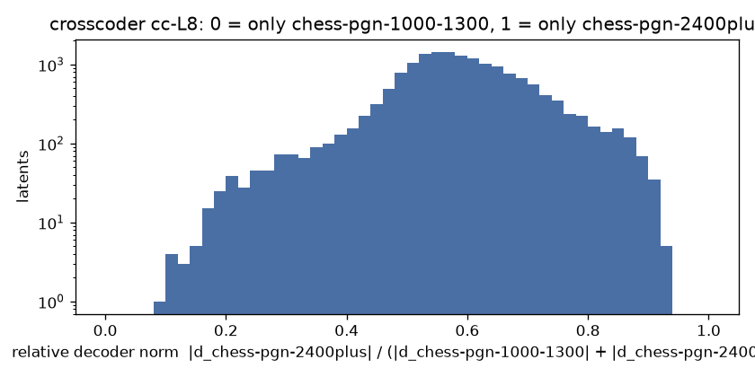

# Crosscoder chess-pgn-1000-1300 vs chess-pgn-2400plus, cc-L8

BatchTopK crosscoder, 16384 latents, k = 64 (held-out L0 64.1), on 3000000 positions from 753032 games (pgn-everything).

| source | held-out FVU |
| --- | --- |
| chess-pgn-1000-1300-L8 | 0.025 |
| chess-pgn-2400plus-L8 | 0.030 |

Latents firing at least once: 16382 (100.0%). Only chess-pgn-1000-1300: **1**, only chess-pgn-2400plus: **40**, shared: **13624** .

Models trained separately share no basis, so the cosine between a latent's two decoder directions says nothing here (it would for a model and its fine-tune); latents.jsonl keeps it anyway.

Relative decoder norm, 10 bins from 0 (only chess-pgn-1000-1300) to 1 (only chess-pgn-2400plus): 1 52 229 459 1977 6583 4605 1790 646 40

Each example: activation, folder, move and side to move, the last moves, **the move played**, then each model's top move at T = 1 (chess-pgn-1000-1300 / chess-pgn-2400plus).

## Only in chess-pgn-1000-1300 (r < 0.1)

### latent 2046: r = 0.08, fires on 0.76% (pgn-everything 0.76%)

- 4.72 | pgn-everything | move 38, black | `Kf6 35.Kf2 Nc6 36.Rd2 Nb4 37.d7 Nc6 38.d8=Q+` -> **Nxd8** | Nxd8 99% / Nxd8 99% | [board](https://lichess.org/analysis/3Q4/p7/1pn2kp1/5pN1/2P2P2/8/PP1R1KPP/8_b_-_-_0_38)
- 4.62 | pgn-everything | move 6, black | `Nxe4 3.d3 Nf6 4.Ne5 Nc6 5.Nc4 d5 6.Na5` -> **Nxa5** | Nxa5 85% / Nxa5 74% | [board](https://lichess.org/analysis/r1bqkb1r/ppp1pppp/2n2n2/N2p4/8/3P4/PPP2PPP/RNBQKB1R_b_KQkq_-_1_6)
- 4.54 | pgn-everything | move 8, white | `Qb4+ 5.Bd2 Qxb2 6.Nc3 Nd4 7.Nxd4 Qxa2 8.` -> **Rxa2** | Nxa2 52% / Rxa2 63% | [board](https://lichess.org/analysis/r1b1kbnr/pppp1ppp/8/4P3/3N4/2N5/q1PBPPPP/R2QKB1R_w_KQkq_-_0_8)
- 4.52 | pgn-everything | move 10, black | `dxc4 7.Nxc4 O-O 8.Ne2 Nc6 9.O-O b5 10.Na5` -> **Nxa5** | Nxa5 72% / Nxa5 92% | [board](https://lichess.org/analysis/r1bq1rk1/2p1bppp/p1n1pn2/Np6/3P4/4P1P1/PP2NPBP/R1BQ1RK1_b_-_-_1_10)
- 4.47 | pgn-everything | move 6, white | `Nf6 3.Bf4 Nc6 4.Qd2 Bf5 5.a3 Ne4 6.` -> **Nxe4** | Nxe4 90% / Nxe4 97% | [board](https://lichess.org/analysis/r2qkb1r/ppp1pppp/2np4/5b2/3PnB2/P1N5/1PPQPPPP/R3KBNR_w_KQkq_-_1_6)
- 4.43 | pgn-everything | move 9, white | `dxc4 6.Bxc4 c6 7.Nf3 O-O 8.O-O Nd5 9.` -> **Bxe7** | Bxe7 52% / Bxe7 94% | [board](https://lichess.org/analysis/rnbq1rk1/pp2bppp/2p1p3/3n2B1/2BP4/2N1PN2/PP3PPP/R2Q1RK1_w_-_-_4_9)
- 4.38 | pgn-everything | move 6, white | `Nf6 3.d4 g6 4.Bg5 Bg7 5.e3 Ne4 6.` -> **Bh4** | Nxe4 69% / Nxe4 71% | [board](https://lichess.org/analysis/rnbqk2r/ppp1ppbp/6p1/3p2B1/3Pn3/2N1PN2/PPP2PPP/R2QKB1R_w_KQkq_-_1_6)
- 4.37 | pgn-everything | move 8, white | `Be7 5.dxe6 Bxe6 6.Nc3 Nc6 7.d4 Nd5 8.` -> **Bb5** | Nxd5 49% / e4 33% | [board](https://lichess.org/analysis/r2qk2r/ppp1bppp/2n1b3/3n4/3P4/2N1PN2/PP3PPP/R1BQKB1R_w_KQkq_-_1_8)
- 4.35 | pgn-everything | move 35, white | `Qb5 32.Nc3 a3 33.Nxb5 axb2 34.Nc3 b1=Q+ 35.` -> **Nxb1** | Nxb1 98% / Nxb1 99% | [board](https://lichess.org/analysis/5rk1/6p1/2p1p1bp/2PpP3/1P1P1PPP/2N1Q3/4p3/1q4K1_w_-_-_0_35)
- 4.34 | pgn-everything | move 6, white | `g6 3.Nc3 Bg7 4.Bg5 O-O 5.Qd2 Ne4 6.` -> **Nxe4** | Nxe4 91% / Nxe4 96% | [board](https://lichess.org/analysis/rnbq1rk1/ppppppbp/6p1/6B1/3Pn3/2N2N2/PPPQPPPP/R3KB1R_w_KQ_-_6_6)
- 4.31 | pgn-everything | move 7, white | `dxc4 4.Bf4 e6 5.a3 Nf6 6.e3 Nd5 7.` -> **Bxc4** | Bxc4 44% / Bxc4 45% | [board](https://lichess.org/analysis/rnbqkb1r/pp3ppp/2p1p3/3n4/2pP1B2/P1N1P3/1P3PPP/R2QKBNR_w_KQkq_-_1_7)
- 4.29 | pgn-everything | move 8, white | `e6 5.Nc3 Ne7 6.a3 dxc4 7.Bxc4 Nd5 8.` -> **Nge2** | Nf3 29% / Nge2 86% | [board](https://lichess.org/analysis/rn1qkb1r/pp3ppp/2p1p3/3nPb2/2BP4/P1N5/1P3PPP/R1BQK1NR_w_KQkq_-_1_8)

## Only in chess-pgn-2400plus (r > 0.9)

### latent 14125: r = 0.91, fires on 4.48% (pgn-everything 4.48%)

- 14.20 | pgn-everything | move 6, white | `d5 3.Nc3 Nf6 4.cxd5 cxd5 5.Bd2 e6 6.` -> **a3** | e3 39% / e3 43% | [board](https://lichess.org/analysis/rnbqkb1r/pp3ppp/4pn2/3p4/3P4/2N5/PP1BPPPP/R2QKBNR_w_KQkq_-_0_6)
- 13.59 | pgn-everything | move 6, white | `d5 3.exd5 cxd5 4.d4 e6 5.Bd2 Be7 6.` -> **Bb5+** | Nf3 37% / Nf3 56% | [board](https://lichess.org/analysis/rnbqk1nr/pp2bppp/4p3/3p4/3P4/2N5/PPPB1PPP/R2QKBNR_w_KQkq_-_2_6)
- 13.56 | pgn-everything | move 6, white | `Nf6 3.Nf3 e5 4.d3 g6 5.Bd2 Bg7 6.` -> **Be2** | Be2 56% / Qc1 43% | [board](https://lichess.org/analysis/rnbqk2r/ppp2pbp/3p1np1/4p3/4P3/2NP1N2/PPPB1PPP/R2QKB1R_w_KQkq_-_2_6)
- 13.41 | pgn-everything | move 7, white | `cxd5 4.e3 Nf6 5.Nf3 e6 6.Bd2 Be7 7.` -> **Bb5+** | Nc3 33% / Bd3 41% | [board](https://lichess.org/analysis/rnbqk2r/pp2bppp/4pn2/3p4/3P4/4PN2/PP1B1PPP/RN1QKB1R_w_KQkq_-_2_7)
- 13.41 | pgn-everything | move 6, white | `d6 3.Nc3 Nc6 4.d3 Bd7 5.Bd2 Nf6 6.` -> **Be2** | Be2 58% / Be2 27% | [board](https://lichess.org/analysis/r2qkb1r/pppb1ppp/2np1n2/4p3/4P3/2NP1N2/PPPB1PPP/R2QKB1R_w_KQkq_-_3_6)
- 13.40 | pgn-everything | move 6, white | `Nf6 3.cxd5 Nxd5 4.Nc3 c6 5.Bd2 Bf5 6.` -> **g3** | e4 55% / f3 51% | [board](https://lichess.org/analysis/rn1qkb1r/pp2pppp/2p5/3n1b2/3P4/2N5/PP1BPPPP/R2QKBNR_w_KQkq_-_2_6)
- 13.35 | pgn-everything | move 6, white | `Bg7 3.Nf3 d6 4.d3 Nf6 5.Bd2 O-O 6.` -> **Be2** | Be2 61% / Qc1 39% | [board](https://lichess.org/analysis/rnbq1rk1/ppp1ppbp/3p1np1/8/4P3/2NP1N2/PPPB1PPP/R2QKB1R_w_KQ_-_3_6)
- 13.34 | pgn-everything | move 7, white | `d5 4.cxd5 cxd5 5.Nc3 a6 6.Bd2 Bf5 7.` -> **Nf3** | Nf3 39% / Nf3 52% | [board](https://lichess.org/analysis/rn1qkb1r/1p2pppp/p4n2/3p1b2/3P4/2N1P3/PP1B1PPP/R2QKBNR_w_KQkq_-_2_7)
- 13.30 | pgn-everything | move 6, white | `Bg7 3.d3 d6 4.Nc3 Nd7 5.Bd2 Ngf6 6.` -> **Qe2** | Be2 58% / Be2 32% | [board](https://lichess.org/analysis/r1bqk2r/pppnppbp/3p1np1/8/4P3/2NP1N2/PPPB1PPP/R2QKB1R_w_KQkq_-_4_6)
- 13.26 | pgn-everything | move 6, white | `Nc6 3.d3 d6 4.Nf3 Nf6 5.Bd2 Be7 6.` -> **Be2** | Be2 59% / Be2 48% | [board](https://lichess.org/analysis/r1bqk2r/ppp1bppp/2np1n2/4p3/4P3/2NP1N2/PPPB1PPP/R2QKB1R_w_KQkq_-_4_6)
- 13.24 | pgn-everything | move 6, white | `d5 3.Bd2 Nf6 4.cxd5 exd5 5.f3 c6 6.` -> **e4** | e4 30% / e4 43% | [board](https://lichess.org/analysis/rnbqkb1r/pp3ppp/2p2n2/3p4/8/3P1P2/PP1BP1PP/RN1QKBNR_w_KQkq_-_0_6)
- 13.21 | pgn-everything | move 6, white | `Bg7 3.Nc3 d6 4.d3 Nf6 5.Bd2 O-O 6.` -> **Qe2** | Be2 61% / Qc1 37% | [board](https://lichess.org/analysis/rnbq1rk1/ppp1ppbp/3p1np1/8/4P3/2NP1N2/PPPB1PPP/R2QKB1R_w_KQ_-_3_6)

### latent 10525: r = 0.92, fires on 5.63% (pgn-everything 5.63%)

- 13.27 | pgn-everything | move 6, white | `d5 3.exd5 exd5 4.Nc3 Nf6 5.Be3 Bd6 6.` -> **Bd3** | Nf3 28% / Qd2 30% | [board](https://lichess.org/analysis/rnbqk2r/ppp2ppp/3b1n2/3p4/3P4/2N1B3/PPP2PPP/R2QKBNR_w_KQkq_-_4_6)
- 13.27 | pgn-everything | move 6, white | `d5 3.exd5 exd5 4.Nc3 Nf6 5.Be3 Bd6 6.` -> **f3** | Nf3 28% / Qd2 30% | [board](https://lichess.org/analysis/rnbqk2r/ppp2ppp/3b1n2/3p4/3P4/2N1B3/PPP2PPP/R2QKBNR_w_KQkq_-_4_6)
- 13.21 | pgn-everything | move 6, white | `d5 3.exd5 cxd5 4.Nc3 Nc6 5.Be3 Nf6 6.` -> **Nf3** | Bb5 36% / h3 23% | [board](https://lichess.org/analysis/r1bqkb1r/pp2pppp/2n2n2/3p4/3P4/2N1B3/PPP2PPP/R2QKBNR_w_KQkq_-_4_6)
- 13.21 | pgn-everything | move 6, white | `d5 3.exd5 exd5 4.Nc3 a6 5.Be3 Nf6 6.` -> **Bd3** | Bd3 32% / Qd2 33% | [board](https://lichess.org/analysis/rnbqkb1r/1pp2ppp/p4n2/3p4/3P4/2N1B3/PPP2PPP/R2QKBNR_w_KQkq_-_2_6)
- 13.04 | pgn-everything | move 6, white | `d5 3.exd5 exd5 4.Nf3 Nf6 5.Be3 Bd6 6.` -> **Bd3** | Nc3 28% / c4 49% | [board](https://lichess.org/analysis/rnbqk2r/ppp2ppp/3b1n2/3p4/3P4/4BN2/PPP2PPP/RN1QKB1R_w_KQkq_-_4_6)
- 13.04 | pgn-everything | move 6, white | `d5 3.exd5 exd5 4.Nf3 Nf6 5.Be3 Bd6 6.` -> **Nbd2** | Nc3 28% / c4 49% | [board](https://lichess.org/analysis/rnbqk2r/ppp2ppp/3b1n2/3p4/3P4/4BN2/PPP2PPP/RN1QKB1R_w_KQkq_-_4_6)
- 13.03 | pgn-everything | move 6, white | `d5 3.exd5 exd5 4.d4 Bd6 5.Be3 Nf6 6.` -> **Nbd2** | Nc3 29% / Bd3 32% | [board](https://lichess.org/analysis/rnbqk2r/ppp2ppp/3b1n2/3p4/3P4/4BN2/PPP2PPP/RN1QKB1R_w_KQkq_-_3_6)
- 13.02 | pgn-everything | move 6, white | `d5 3.exd5 exd5 4.d4 g6 5.Be3 Bg7 6.` -> **Nc3** | Nc3 34% / Bd3 26% | [board](https://lichess.org/analysis/rnbqk1nr/ppp2pbp/6p1/3p4/3P4/4BN2/PPP2PPP/RN1QKB1R_w_KQkq_-_2_6)
- 13.01 | pgn-everything | move 6, white | `d5 3.exd5 exd5 4.d4 Nf6 5.Be3 Bd6 6.` -> **Nf3** | Nf3 28% / Qd2 28% | [board](https://lichess.org/analysis/rnbqk2r/ppp2ppp/3b1n2/3p4/3P4/2N1B3/PPP2PPP/R2QKBNR_w_KQkq_-_3_6)
- 13.00 | pgn-everything | move 6, white | `d5 3.exd5 cxd5 4.Nc3 Nf6 5.Be3 e6 6.` -> **Bd3** | Nf3 25% / Nf3 35% | [board](https://lichess.org/analysis/rnbqkb1r/pp3ppp/4pn2/3p4/3P4/2N1B3/PPP2PPP/R2QKBNR_w_KQkq_-_0_6)
- 12.89 | pgn-everything | move 6, white | `d5 3.exd5 exd5 4.d4 Nc6 5.Be3 Nf6 6.` -> **Qe2** | Bb5 31% / Nf3 22% | [board](https://lichess.org/analysis/r1bqkb1r/ppp2ppp/2n2n2/3p4/3P4/2N1B3/PPP2PPP/R2QKBNR_w_KQkq_-_3_6)
- 12.89 | pgn-everything | move 6, white | `d5 3.exd5 exd5 4.Nc3 c6 5.Be3 Bd6 6.` -> **Bd3** | Bd3 34% / Qd2 52% | [board](https://lichess.org/analysis/rnbqk1nr/pp3ppp/2pb4/3p4/3P4/2N1B3/PPP2PPP/R2QKBNR_w_KQkq_-_2_6)

### latent 12319: r = 0.90, fires on 4.77% (pgn-everything 4.77%)

- 12.34 | pgn-everything | move 7, white | `cxd4 4.Nxd4 Nf6 5.Nc3 g6 6.Bf4 Bg7 7.` -> **e5** | e5 23% / Nxc6 42% | [board](https://lichess.org/analysis/r1bqk2r/pp1pppbp/2n2np1/8/3NPB2/2N5/PPP2PPP/R2QKB1R_w_KQkq_-_2_7)
- 11.98 | pgn-everything | move 6, white | `e6 3.c4 d5 4.Nc3 c6 5.Bf4 Nbd7 6.` -> **c5** | e3 76% / e3 85% | [board](https://lichess.org/analysis/r1bqkb1r/pp1n1ppp/2p1pn2/3p4/2PP1B2/2N2N2/PP2PPPP/R2QKB1R_w_KQkq_-_2_6)
- 11.81 | pgn-everything | move 6, white | `Bg7 3.Nf3 d6 4.Nc3 Nd7 5.Bf4 Ngf6 6.` -> **Bc4** | e5 39% / Qd2 68% | [board](https://lichess.org/analysis/r1bqk2r/pppnppbp/3p1np1/8/3PPB2/2N2N2/PPP2PPP/R2QKB1R_w_KQkq_-_4_6)
- 11.76 | pgn-everything | move 6, white | `c6 3.Nc3 Nf6 4.Nf3 e6 5.Bf4 Nbd7 6.` -> **e3** | e3 75% / e3 85% | [board](https://lichess.org/analysis/r1bqkb1r/pp1n1ppp/2p1pn2/3p4/2PP1B2/2N2N2/PP2PPPP/R2QKB1R_w_KQkq_-_2_6)
- 11.71 | pgn-everything | move 6, white | `Bg7 3.Nf3 d6 4.Nc3 Nd7 5.Bf4 Ngf6 6.` -> **Qd2** | e3 60% / e3 49% | [board](https://lichess.org/analysis/r1bqk2r/pppnppbp/3p1np1/8/2PP1B2/2N2N2/PP2PPPP/R2QKB1R_w_KQkq_-_4_6)
- 11.70 | pgn-everything | move 6, white | `e6 3.Nc3 c6 4.Nf3 Nd7 5.Bf4 Ngf6 6.` -> **e3** | e3 75% / e3 92% | [board](https://lichess.org/analysis/r1bqkb1r/pp1n1ppp/2p1pn2/3p4/2PP1B2/2N2N2/PP2PPPP/R2QKB1R_w_KQkq_-_4_6)
- 11.68 | pgn-everything | move 6, white | `c6 3.Nc3 e6 4.Nf3 Nf6 5.Bf4 Nbd7 6.` -> **e3** | e3 75% / e3 86% | [board](https://lichess.org/analysis/r1bqkb1r/pp1n1ppp/2p1pn2/3p4/2PP1B2/2N2N2/PP2PPPP/R2QKB1R_w_KQkq_-_4_6)
- 11.68 | pgn-everything | move 6, white | `c6 3.Nc3 e6 4.Nf3 Nf6 5.Bf4 Nbd7 6.` -> **c5** | e3 75% / e3 86% | [board](https://lichess.org/analysis/r1bqkb1r/pp1n1ppp/2p1pn2/3p4/2PP1B2/2N2N2/PP2PPPP/R2QKB1R_w_KQkq_-_4_6)
- 11.64 | pgn-everything | move 7, white | `exd4 4.Nxd4 Nf6 5.Nc3 c6 6.Bf4 Be7 7.` -> **h3** | e5 24% / Qd2 81% | [board](https://lichess.org/analysis/rnbqk2r/pp2bppp/2pp1n2/8/3NPB2/2N5/PPP2PPP/R2QKB1R_w_KQkq_-_2_7)
- 11.64 | pgn-everything | move 7, white | `cxd4 4.cxd4 Nf6 5.Nc3 g6 6.Bf4 Bg7 7.` -> **e3** | e3 61% / h3 49% | [board](https://lichess.org/analysis/rnbqk2r/pp2ppbp/3p1np1/8/3P1B2/2N2N2/PP2PPPP/R2QKB1R_w_KQkq_-_2_7)
- 11.63 | pgn-everything | move 7, black | `d6 4.Bg2 Bg7 5.Nf3 O-O 6.O-O Bf5 7.Nc3` -> **Ne4** | Nbd7 33% / Ne4 95% | [board](https://lichess.org/analysis/rn1q1rk1/ppp1ppbp/3p1np1/5b2/2PP4/2N2NP1/PP2PPBP/R1BQ1RK1_b_-_-_7_7)
- 11.55 | pgn-everything | move 6, white | `d6 3.Nc3 Nf6 4.Nf3 Bg4 5.Bf4 Nbd7 6.` -> **e3** | e3 56% / e3 62% | [board](https://lichess.org/analysis/r2qkb1r/pp1npppp/2pp1n2/8/2PP1Bb1/2N2N2/PP2PPPP/R2QKB1R_w_KQkq_-_6_6)

### latent 11701: r = 0.91, fires on 0.95% (pgn-everything 0.95%)

- 9.94 | pgn-everything | move 6, black | `g6 3.Nf3 Bg7 4.Nc3 O-O 5.e4 Re8 6.e5` -> **Ng4** | Ng4 48% / Nh5 81% | [board](https://lichess.org/analysis/rnbqr1k1/ppppppbp/5np1/4P3/2PP4/2N2N2/PP3PPP/R1BQKB1R_b_KQ_-_0_6)
- 9.87 | pgn-everything | move 6, black | `e6 3.a3 Be7 4.Nc3 c6 5.e4 d5 6.e5` -> **Ne4** | Nfd7 57% / Nfd7 79% | [board](https://lichess.org/analysis/rnbqk2r/pp2bppp/2p1pn2/3pP3/2PP4/P1N5/1P3PPP/R1BQKBNR_b_KQkq_-_0_6)
- 9.80 | pgn-everything | move 6, black | `e6 3.Nc3 Be7 4.d4 b6 5.e4 Bb7 6.e5` -> **Ng8** | Ne4 61% / Ne4 90% | [board](https://lichess.org/analysis/rn1qk2r/pbppbppp/1p2pn2/4P3/2PP4/2N2N2/PP3PPP/R1BQKB1R_b_KQkq_-_0_6)
- 9.76 | pgn-everything | move 6, black | `Nf6 3.c4 Be7 4.Nc3 O-O 5.e4 d5 6.e5` -> **Nfd7** | Ne4 43% / Ne4 92% | [board](https://lichess.org/analysis/rnbq1rk1/ppp1bppp/4pn2/3pP3/2PP4/2N2N2/PP3PPP/R1BQKB1R_b_KQ_-_0_6)
- 9.65 | pgn-everything | move 6, black | `e6 3.Nc3 Bb4 4.Bg5 O-O 5.e4 c5 6.e5` -> **Bxc3+** | cxd4 39% / cxd4 71% | [board](https://lichess.org/analysis/rnbq1rk1/pp1p1ppp/4pn2/2p1P1B1/1bPP4/2N5/PP3PPP/R2QKBNR_b_KQ_-_0_6)
- 9.60 | pgn-everything | move 6, black | `Nc6 3.d4 cxd4 4.cxd4 Nf6 5.Nc3 e6 6.e5` -> **Nd5** | Nd5 85% / Nd5 62% | [board](https://lichess.org/analysis/r1bqkb1r/pp1p1ppp/2n1pn2/4P3/3P4/2N5/PP3PPP/R1BQKBNR_b_KQkq_-_0_6)
- 9.32 | pgn-everything | move 7, black | `Bb4 4.Qc2 O-O 5.a3 Be7 6.e4 d5 7.e5` -> **Ne4** | Nfd7 44% / Ne8 39% | [board](https://lichess.org/analysis/rnbq1rk1/ppp1bppp/4pn2/3pP3/2PP4/P1N5/1PQ2PPP/R1B1KBNR_b_KQ_-_0_7)
- 9.31 | pgn-everything | move 6, black | `e6 3.Nc3 Bb4 4.Qc2 O-O 5.e4 d5 6.e5` -> **Ne4** | Ne4 76% / Ne4 99% | [board](https://lichess.org/analysis/rnbq1rk1/ppp2ppp/4pn2/3pP3/1bPP4/2N5/PPQ2PPP/R1B1KBNR_b_KQ_-_0_6)
- 9.29 | pgn-everything | move 6, black | `e6 3.Nc3 c6 4.e4 Nf6 5.cxd5 cxd5 6.e5` -> **Nfd7** | Nfd7 47% / Nfd7 77% | [board](https://lichess.org/analysis/rnbqkb1r/pp3ppp/4pn2/3pP3/3P4/2N5/PP3PPP/R1BQKBNR_b_KQkq_-_0_6)
- 9.29 | pgn-everything | move 6, black | `e6 3.Nc3 Bb4 4.Bg5 b6 5.e4 h6 6.e5` -> **hxg5** | hxg5 90% / hxg5 96% | [board](https://lichess.org/analysis/rnbqk2r/p1pp1pp1/1p2pn1p/4P1B1/1bPP4/2N5/PP3PPP/R2QKBNR_b_KQkq_-_0_6)
- 9.21 | pgn-everything | move 6, black | `Nc6 3.c4 dxc4 4.Nc3 Nf6 5.e4 e6 6.e5` -> **Nd5** | Nd5 76% / Nd5 98% | [board](https://lichess.org/analysis/r1bqkb1r/ppp2ppp/2n1pn2/4P3/2pP4/2N2N2/PP3PPP/R1BQKB1R_b_KQkq_-_0_6)
- 9.20 | pgn-everything | move 6, black | `Be7 3.Nf3 Nf6 4.Nc3 O-O 5.e4 d5 6.e5` -> **Nfd7** | Ne4 46% / Ne4 94% | [board](https://lichess.org/analysis/rnbq1rk1/ppp1bppp/4pn2/3pP3/2PP4/2N2N2/PP3PPP/R1BQKB1R_b_KQ_-_0_6)

### latent 2772: r = 0.90, fires on 1.15% (pgn-everything 1.15%)

- 9.07 | pgn-everything | move 10, black | `Qa5+ 7.Nbc3 Be6 8.Bd2 b4 9.Nb1 cxb3 10.a4` -> **b2** | bxa3 21% / b2 31% | [board](https://lichess.org/analysis/rn2kb1r/p3pppp/2p1bn2/q7/Pp1PP3/1p3P2/3BN1PP/RN1QKB1R_b_KQkq_a3_0_10)
- 8.59 | pgn-everything | move 7, white | `Bf8 4.b4 d5 5.a4 b6 6.a5 b5 7.` -> **Bxb5+** | Bxb5+ 61% / Bxb5+ 58% | [board](https://lichess.org/analysis/rnbqkbnr/p1p2ppp/4p3/Pp1p4/1P1P4/2P1P3/5PPP/RNBQKBNR_w_KQkq_-_0_7)
- 8.25 | pgn-everything | move 8, black | `e6 5.a3 b5 6.Ba2 a5 7.Nc3 a4 8.b4` -> **Na6** | axb3 43% / axb3 69% | [board](https://lichess.org/analysis/rnbqkbnr/3p3p/2p1pp2/1p4p1/pP2P3/P1NP1N2/B1P2PPP/R1BQK2R_b_KQkq_b3_0_8)
- 8.15 | pgn-everything | move 6, white | `Nc6 3.b4 a6 4.a4 Nf6 5.a5 b5 6.` -> **axb6** | axb6 29% / axb6 84% | [board](https://lichess.org/analysis/r1bqkb1r/2pp1ppp/p1n2n2/Pp2p3/1P2P3/2P5/3P1PPP/RNBQKBNR_w_KQkq_b6_0_6)
- 8.12 | pgn-everything | move 7, black | `a6 4.g3 Nc6 5.Bg2 h5 6.d3 h4 7.g4` -> **h3** | h3 35% / h3 53% | [board](https://lichess.org/analysis/r1bqkbnr/1p1p1pp1/p1n1p3/2p5/4PPPp/2NP4/PPP3BP/R1BQK1NR_b_KQkq_-_0_7)
- 8.07 | pgn-everything | move 9, black | `g5 6.a3 a5 7.Bd2 b6 8.b4 axb4 9.a4` -> **b5** | Nd4 23% / Nd4 25% | [board](https://lichess.org/analysis/r1bqk2r/2pp1p1p/1pn2n2/2b1p1p1/PpP1P1P1/3P3P/3B1P2/RN1QKBNR_b_KQkq_-_0_9)
- 8.07 | pgn-everything | move 12, black | `Nc6 9.Ne2 h6 10.b3 a5 11.Ra2 a4 12.b4` -> **b5** | b5 58% / Ne7 33% | [board](https://lichess.org/analysis/r1bq1rk1/1pp2pp1/2n2n1p/3p4/pP1Pp3/P3P1PP/R1PNNP2/3QKB1R_b_K_-_0_12)
- 8.01 | pgn-everything | move 9, white | `Ne7 6.Nd2 d5 7.h4 h6 8.h5 g5 9.` -> **f4** | Ngf3 24% / f4 69% | [board](https://lichess.org/analysis/rnbqk2r/p1p1npb1/1p2p2p/3p2pP/3PP3/2PBB3/PP1N1PP1/R2QK1NR_w_KQkq_-_0_9)
- 7.99 | pgn-everything | move 7, white | `f6 4.h4 Nf7 5.Bc4 e6 6.h5 g5 7.` -> **f4** | f4 26% / h6 30% | [board](https://lichess.org/analysis/rnbqkb1r/pppp1n1p/4pp2/6pP/2BPP1P1/8/PPP2P2/RNBQK1NR_w_KQkq_-_0_7)
- 7.97 | pgn-everything | move 9, white | `d6 6.Nf3 Nd7 7.a4 a6 8.a5 b5 9.` -> **Ne2** | b4 46% / O-O 39% | [board](https://lichess.org/analysis/r2qk1nr/1bpnbppp/p2pp3/Pp6/3PP3/2NBBN2/1PP2PPP/R2QK2R_w_KQkq_-_0_9)
- 7.95 | pgn-everything | move 10, white | `Nd7 7.Bd3 e6 8.h4 Qe7 9.h5 g5 10.` -> **Nh3** | h6 21% / h6 41% | [board](https://lichess.org/analysis/r3k1nr/pbpnqpbp/1p1pp3/6pP/2PPP3/2NBBP2/PP4P1/R2QK1NR_w_KQkq_-_0_10)
- 7.86 | pgn-everything | move 12, black | `cxd4 9.exf6 dxc3 10.Qe2+ Be6 11.Rd1 Qa5 12.b3` -> **Qxa2** | Qxa2 42% / gxf6 43% | [board](https://lichess.org/analysis/r3kb1r/1p3ppp/p1n1bP2/q7/5B2/1Pp5/P1P1QPPP/3RKBNR_b_Kkq_-_0_12)

### latent 6997: r = 0.91, fires on 0.60% (pgn-everything 0.60%)

- 8.41 | pgn-everything | move 10, black | `Bxg3 7.hxg3 h6 8.g4 Nbd7 9.g5 Ng8 10.g6` -> **f5** | fxg6 43% / f5 56% | [board](https://lichess.org/analysis/r1bqk1nr/pp1n1pp1/2p1p1Pp/3p4/3P4/3BP3/PPPN1PP1/R2QK1NR_b_KQkq_-_0_10)
- 8.02 | pgn-everything | move 7, black | `Be7 4.h4 Nc6 5.a3 Bf5 6.Nf3 h6 7.g6` -> **fxg6** | Bxg6 57% / Bxg6 68% | [board](https://lichess.org/analysis/r2qk1nr/ppp1bpp1/2n3Pp/3ppb2/7P/P2P1N2/1PP1PP2/RNBQKB1R_b_KQkq_-_0_7)
- 7.89 | pgn-everything | move 8, white | `g5 5.d3 g4 6.Ne5 h5 7.h3 g3 8.` -> **fxg3** | fxg3 69% / fxg3 77% | [board](https://lichess.org/analysis/rnbqkbnr/pp1p1p2/4p3/2p1N2p/2B1P3/2NP2pP/PPP2PP1/R1BQK2R_w_KQkq_-_0_8)
- 7.88 | pgn-everything | move 6, black | `Nc6 3.dxe5 Nxe5 4.f4 Nc6 5.e5 d5 6.e6` -> **fxe6** | Bxe6 66% / Bxe6 73% | [board](https://lichess.org/analysis/r1bqkbnr/ppp2ppp/2n1P3/3p4/5P2/8/PPP3PP/RNBQKBNR_b_KQkq_-_0_6)
- 7.80 | pgn-everything | move 7, white | `d5 4.Nb3 dxe4 5.Nc3 Nf6 6.h3 g3 7.` -> **fxg3** | fxg3 83% / fxg3 84% | [board](https://lichess.org/analysis/rnbqkb1r/ppp1pp1p/5n2/8/4p3/1NN3pP/PPPP1PP1/R1BQKB1R_w_KQkq_-_0_7)
- 7.80 | pgn-everything | move 6, black | `Nc6 3.Bf4 Nf6 4.Nb5 e5 5.dxe5 Nd7 6.e6` -> **a6** | Nde5 44% / Nde5 47% | [board](https://lichess.org/analysis/r1bqkb1r/pppn1ppp/2n1P3/1N1p4/5B2/8/PPP1PPPP/R2QKBNR_b_KQkq_-_0_6)
- 7.80 | pgn-everything | move 8, white | `d6 5.d4 f5 6.dxc5 fxe4 7.Ng5 e3 8.` -> **Bxe3** | Bxe3 37% / Bxe3 73% | [board](https://lichess.org/analysis/r1bqk1nr/ppp3pp/2np4/2P1p1N1/2B5/2P1p3/PP3PPP/RNBQK2R_w_KQkq_-_0_8)
- 7.78 | pgn-everything | move 7, white | `h6 4.Be2 g5 5.h4 g4 6.Ng1 g3 7.` -> **fxg3** | fxg3 65% / fxg3 90% | [board](https://lichess.org/analysis/r1bqkbnr/pppp1p2/2n4p/4p3/4P2P/3P2p1/PPP1BPP1/RNBQK1NR_w_KQkq_-_0_7)
- 7.77 | pgn-everything | move 6, black | `Nc6 3.Nc3 Nf6 4.Nb5 e5 5.dxe5 Nd7 6.e6` -> **fxe6** | Nde5 46% / fxe6 49% | [board](https://lichess.org/analysis/r1bqkb1r/pppn1ppp/2n1P3/1N1p4/5B2/8/PPP1PPPP/R2QKBNR_b_KQkq_-_0_6)
- 7.77 | pgn-everything | move 6, black | `Nc6 3.Nc3 Nf6 4.Nb5 e5 5.dxe5 Nd7 6.e6` -> **Nde5** | Nde5 46% / fxe6 49% | [board](https://lichess.org/analysis/r1bqkb1r/pppn1ppp/2n1P3/1N1p4/5B2/8/PPP1PPPP/R2QKBNR_b_KQkq_-_0_6)
- 7.77 | pgn-everything | move 6, black | `Nc6 3.Nc3 Nf6 4.Nb5 e5 5.dxe5 Nd7 6.e6` -> **Nde5** | Nde5 46% / fxe6 49% | [board](https://lichess.org/analysis/r1bqkb1r/pppn1ppp/2n1P3/1N1p4/5B2/8/PPP1PPPP/R2QKBNR_b_KQkq_-_0_6)
- 7.77 | pgn-everything | move 7, black | `dxc3 4.e5 cxb2 5.Bxb2 Nc6 6.Bd3 d5 7.e6` -> **Bxe6** | Bxe6 61% / Bxe6 85% | [board](https://lichess.org/analysis/r1bqkbnr/ppp2ppp/2n1P3/3p4/8/3B4/PB3PPP/RN1QK1NR_b_KQkq_-_0_7)

### latent 6721: r = 0.93, fires on 1.58% (pgn-everything 1.58%)

- 7.52 | pgn-everything | move 6, white | `e6 3.a3 Nf6 4.f3 c5 5.b4 cxb4 6.` -> **axb4** | axb4 65% / c5 37% | [board](https://lichess.org/analysis/rnbqkb1r/pp3ppp/4pn2/3p4/1pPP4/P4P2/4P1PP/RNBQKBNR_w_KQkq_-_0_6)
- 7.10 | pgn-everything | move 6, black | `Nc6 3.Bc4 e6 4.Nc3 a6 5.d3 b5 6.Nxb5` -> **axb5** | axb5 98% / axb5 97% | [board](https://lichess.org/analysis/r1bqkbnr/3p1ppp/p1n1p3/1Np5/2B1P3/3P1N2/PPP2PPP/R1BQK2R_b_KQkq_-_0_6)
- 7.10 | pgn-everything | move 6, black | `e6 3.Nc3 Nc6 4.f4 a6 5.Nf3 b5 6.Nxb5` -> **axb5** | axb5 99% / axb5 93% | [board](https://lichess.org/analysis/r1bqkbnr/3p1ppp/p1n1p3/1Np5/2B1PP2/5N2/PPPP2PP/R1BQK2R_b_KQkq_-_0_6)
- 7.08 | pgn-everything | move 8, white | `a5 5.Nc3 e6 6.c5 Nbd7 7.b4 axb4 8.` -> **axb4** | axb4 30% / Na4 61% | [board](https://lichess.org/analysis/r1bqkb1r/1p1n1ppp/2p1pn2/2Pp4/1p1P4/P1N1P3/5PPP/R1BQKBNR_w_KQkq_-_0_8)
- 7.06 | pgn-everything | move 8, white | `Bb4 5.Qd3 Nf6 6.a3 Ba5 7.b4 Nxb4 8.` -> **axb4** | axb4 94% / axb4 95% | [board](https://lichess.org/analysis/r1bqk2r/ppp2ppp/4pn2/b2p4/1n1P1B2/P1NQ1N2/2P1PPPP/R3KB1R_w_KQkq_-_0_8)
- 7.06 | pgn-everything | move 8, white | `Nc6 5.a3 Bg4 6.Nbd2 Bf5 7.b4 Nxb4 8.` -> **axb4** | axb4 94% / axb4 85% | [board](https://lichess.org/analysis/r2qkbnr/ppp2ppp/8/4Pb2/1nPp4/P4N2/3NPPPP/R1BQKB1R_w_KQkq_-_0_8)
- 7.03 | pgn-everything | move 7, white | `Bc5 4.Nf3 Nc6 5.a3 d6 6.b4 Nxb4 7.` -> **axb4** | axb4 98% / axb4 96% | [board](https://lichess.org/analysis/r1bqk2r/ppp2ppp/3p1n2/2b1p3/1nP5/P1N1PN2/3P1PPP/R1BQKB1R_w_KQkq_-_0_7)
- 7.01 | pgn-everything | move 6, white | `Nf6 3.Nc3 e6 4.a3 d6 5.b4 cxb4 6.` -> **axb4** | axb4 98% / axb4 99% | [board](https://lichess.org/analysis/rnbqkb1r/pp3ppp/3ppn2/8/1p2P3/P1N2P2/2PP2PP/R1BQKBNR_w_KQkq_-_0_6)
- 7.00 | pgn-everything | move 6, white | `Ne7 3.Nf3 f6 4.b3 a5 5.Bc4 a4 6.` -> **Nxa4** | bxa4 24% / Nxa4 39% | [board](https://lichess.org/analysis/rnbqkb1r/1pppn1pp/5p2/4p3/p1B1P3/1PN2N2/P1PP1PPP/R1BQK2R_w_KQkq_-_0_6)
- 6.99 | pgn-everything | move 7, white | `Bb4+ 4.Nc3 Nc6 5.a3 Ba5 6.b4 Nxb4 7.` -> **axb4** | axb4 99% / axb4 98% | [board](https://lichess.org/analysis/r1bqk1nr/ppp2ppp/4p3/b2p4/1nPP4/P1N2N2/4PPPP/R1BQKB1R_w_KQkq_-_0_7)
- 6.98 | pgn-everything | move 41, white | `g5 38.Ke3 Nc4+ 39.Kd3 h5 40.g4 hxg4 41.` -> **hxg4** | hxg4 79% / hxg4 80% | [board](https://lichess.org/analysis/8/5p2/4pk2/3p2p1/2nN2p1/3K1P1P/8/8_w_-_-_0_41)
- 6.96 | pgn-everything | move 6, white | `e6 3.a3 d5 4.e5 Nc6 5.b4 cxb4 6.` -> **d4** | axb4 75% / d4 61% | [board](https://lichess.org/analysis/r1bqkbnr/pp3ppp/2n1p3/3pP3/1p6/P4N2/2PP1PPP/RNBQKB1R_w_KQkq_-_0_6)

### latent 8042: r = 0.90, fires on 0.91% (pgn-everything 0.91%)

- 6.94 | pgn-everything | move 16, white | `a4 13.Qb4 fxe4 14.O-O Bxb5 15.d3 Bf8 16.` -> **Qd4** | Qd4 33% / Qc3 48% | [board](https://lichess.org/analysis/rn2kbnr/2pq3p/1p2p1p1/1b1p4/pQ2p3/3PN3/PPP2PPP/RNB2RK1_w_kq_-_1_16)
- 6.91 | pgn-everything | move 11, black | `Ba4 8.Qxa4 Qxa4 9.b3 Qb5 10.Ngf3 c6 11.Bf1` -> **Qa5** | Qa5 83% / Qa5 99% | [board](https://lichess.org/analysis/rn2kbnr/p4ppp/1pp1p3/1q1p4/3P4/1PP1PNP1/P2N1P1P/R1B1KB1R_b_KQkq_-_1_11)
- 6.91 | pgn-everything | move 28, black | `Qxb6 25.Na5 Bf5 26.Qa4 Qb5 27.Qa3 Rab8 28.Bf1` -> **Nd2** | Qxb2 52% / Qxb2 70% | [board](https://lichess.org/analysis/1r3rk1/5pp1/p1p4p/Nq1p1b2/3PnP2/Q1P1P2P/1P6/R3RBK1_b_-_-_7_28)
- 6.86 | pgn-everything | move 14, black | `Qc7 11.O-O Nbd7 12.Re1 Qa5 13.Bd2 Qa6 14.Bf1` -> **Qc8** | Qb7 49% / Qa3 65% | [board](https://lichess.org/analysis/r4rk1/p2nbppp/q1p1pn2/2Pp1b2/3P4/2N1PNP1/P2B1P1P/R2QRBK1_b_-_-_8_14)
- 6.70 | pgn-everything | move 18, black | `Bc4 15.Re1 Bd5 16.f3 Ng8 17.Qd4 Qa6 18.Bf1` -> **Qc8** | Qb7 55% / Qa7 33% | [board](https://lichess.org/analysis/r3k1nr/3p1ppp/q1pBp3/p1Pb4/3Q4/2P1PPP1/P6P/R3RBK1_b_kq_-_4_18)
- 6.60 | pgn-everything | move 19, black | `Bxf1 16.Kxf1 Qb5+ 17.Kg1 Na6 18.Qa7 Ne4 19.Bf1` -> **Qa4** | Qb6 41% / Qb3 28% | [board](https://lichess.org/analysis/5rk1/Q4ppp/n1p1p3/1q1p4/3PnN2/P5P1/1P1P1P1P/R1B2BK1_b_-_-_6_19)
- 6.53 | pgn-everything | move 11, black | `h6 8.d4 d5 9.c5 Qb4+ 10.Bc3 Qb5 11.Bf1` -> **Qxf1+** | Qxf1+ 42% / Qxf1+ 69% | [board](https://lichess.org/analysis/rnb1kb1r/1p3pp1/p1p1pn1p/1qPp4/3P1P2/1PB1P1P1/P6P/RN1QKBNR_b_KQkq_-_4_11)
- 6.40 | pgn-everything | move 20, white | `Re8 17.Nxe4 Nxe4 18.Rd3 e6 19.Rf3 Bf8 20.` -> **Bh6** | Qxf8+ 35% / Qxb6 45% | [board](https://lichess.org/analysis/r2qrbk1/1p5p/1np1p1p1/3pN3/pQ1PnBP1/2P2R1P/PP2P3/2K2BR1_w_-_-_2_20)
- 6.40 | pgn-everything | move 22, black | `Bf5 19.c3 Qc5 20.Rc1 Rc7 21.b4 Qc4 22.Bf1` -> **Qg4** | Qg4 31% / Qa2 58% | [board](https://lichess.org/analysis/1r6/1pr1ppkp/p2p2p1/3P1b2/PPq5/2P3P1/5P1P/2RQRBK1_b_-_-_2_22)
- 6.36 | pgn-everything | move 23, white | `e6 20.Qc5 Qc7 21.Bd4 Rb7 22.b3 Bf8 23.` -> **Nb5** | Qa5 48% / Qa5 82% | [board](https://lichess.org/analysis/4rbk1/prq2p2/2p1p1p1/2QpP2p/3B1PbP/1PN5/P1P3P1/1K3R1R_w_-_-_1_23)
- 6.36 | pgn-everything | move 12, black | `Nd3+ 9.Kf1 Qa6 10.Kg1 Nxb2 11.Qb3 Na4 12.Bf1` -> **b5** | Qb6 47% / b5 75% | [board](https://lichess.org/analysis/rnb1kb1r/pp3ppp/q1p1p3/8/n2PP3/1Q3NP1/P2B1P1P/RN3BKR_b_kq_-_3_12)
- 6.33 | pgn-everything | move 16, black | `gxf6 13.Nc5 Bc8 14.Rfd1 Qb5 15.d4 b6 16.Bf1` -> **Qb4** | Qa5 32% / Qa5 81% | [board](https://lichess.org/analysis/rnb1kb1r/p4p1p/1pp1pp2/1qN5/3P4/1P3NP1/2Q2P1P/R2R1BK1_b_kq_-_1_16)

### latent 183: r = 0.91, fires on 0.28% (pgn-everything 0.28%)

- 6.74 | pgn-everything | move 6, black | `c6 3.c5 b6 4.b4 a5 5.cxb6 axb4 6.b7` -> **Bxb7** | Bxb7 96% / Bxb7 100% | [board](https://lichess.org/analysis/rnbqkbnr/1P2pppp/2p5/3p4/1p1P4/8/P3PPPP/RNBQKBNR_b_KQkq_-_0_6)
- 6.30 | pgn-everything | move 12, white | `Bb6 9.b5 Na5 10.d3 c6 11.a4 Nb3 12.` -> **Ra3** | Ra3 61% / Ra3 49% | [board](https://lichess.org/analysis/r1bq1rk1/pp3ppp/1bp2n2/1P2p3/P3P3/1nPP1Q1P/4N1P1/RNB1KB1R_w_KQ_-_1_12)
- 6.23 | pgn-everything | move 9, white | `Nc6 6.d5 Na5 7.b4 Bxf3 8.a3 Nb3 9.` -> **Qxb3** | Qxb3 86% / Qxb3 80% | [board](https://lichess.org/analysis/r2qkbnr/ppp3pp/3p1p2/3Pp3/1P2P3/PnP2b2/4BPPP/RNBQK2R_w_KQkq_-_1_9)
- 6.18 | pgn-everything | move 12, white | `Na5 9.Qd1 d6 10.Be2 Be6 11.O-O Nb3 12.` -> **Ra2** | Ra2 75% / Ra2 36% | [board](https://lichess.org/analysis/r2qkbnr/1pp3p1/3pbp1p/4p3/4P3/PnPP1N1P/4BPP1/RNBQ1RK1_w_kq_-_4_12)
- 6.09 | pgn-everything | move 12, white | `Kb8 9.b4 Be7 10.b5 Na5 11.a4 Nb3 12.` -> **Ra3** | Ra3 70% / Ra3 89% | [board](https://lichess.org/analysis/1k1r2nr/pp1qbppp/3pb3/1Pp1p3/P3P3/1nPP2PP/4NPB1/RNBQK2R_w_KQ_-_1_12)
- 5.88 | pgn-everything | move 13, white | `Bb6 10.b5 Bxe3 11.dxe3 Na5 12.Bd3 Nb3 13.` -> **Ra3** | Ra3 70% / Ra3 68% | [board](https://lichess.org/analysis/r1b1k1nr/1ppp1p2/p4qpp/1P2p3/P3P3/1nPBPN2/5PPP/RNB1K2R_w_KQkq_-_3_13)
- 5.87 | pgn-everything | move 11, white | `d5 8.O-O Bd6 9.Qe2 Na5 10.b4 Nb3 11.` -> **Ra2** | Ra2 79% / Ra2 79% | [board](https://lichess.org/analysis/r1b1k2r/pp3ppp/1q1bpn2/3p4/1P1P4/PnPB1N2/4QPPP/RNB2RK1_w_kq_-_1_11)
- 5.79 | pgn-everything | move 13, black | `Ba5 10.Na4 b5 11.b4 Bc7 12.dxc6 bxc4 13.cxd7` -> **Bxd7** | Bxd7 62% / Bxd7 69% | [board](https://lichess.org/analysis/rnb2rk1/p1bPnpp1/5q1p/4p3/NPp1P3/P3BN2/2P2PPP/R2Q1RK1_b_-_-_0_13)
- 5.69 | pgn-everything | move 13, white | `Nge7 10.Nh4 Na5 11.Qd1 Be6 12.b4 Nb3 13.` -> **Ra2** | Ra3 56% / Ra3 61% | [board](https://lichess.org/analysis/r2q1b1r/1pk1n1p1/p2pb1Bp/2p1p3/PP2P2N/1nPP4/5PPP/RNBQK2R_w_KQ_-_1_13)
- 5.67 | pgn-everything | move 8, white | `c6 5.axb5 cxb5 6.Qf3 c3 7.Qxa8 cxb2 8.` -> **Bxb2** | Bxb2 95% / Bxb2 97% | [board](https://lichess.org/analysis/Qnbqkbnr/p3pppp/8/1p6/3P4/4P3/1p3PPP/RNB1KBNR_w_KQk_-_0_8)
- 5.66 | pgn-everything | move 7, white | `Nc6 4.Qc4 dxc4 5.Kd2 c3+ 6.Kd3 cxb2 7.` -> **Kc4** | Bxb2 46% / Kc3 19% | [board](https://lichess.org/analysis/r1bqkbnr/ppp1p1pp/2n5/5p2/3P1P2/3K4/PpP1P1PP/RNB2BNR_w_kq_-_0_7)
- 5.65 | pgn-everything | move 15, black | `Nxf3+ 12.Qxf3 Qb6 13.Qf2 d6 14.exd6 Nf5 15.d7` -> **Bd4** | Bd4 32% / Bd4 40% | [board](https://lichess.org/analysis/1rb2rk1/1p1P1pbp/pq2p1p1/2N2n2/P1B2P2/3P4/1PP2QPP/R1B2RK1_b_-_-_0_15)

### latent 10644: r = 0.91, fires on 1.42% (pgn-everything 1.42%)

- 6.17 | pgn-everything | move 49, white | `Kh5 46.Ke6 Re8+ 47.Re7 Qc4+ 48.Kd7 Qc8+ 49.` -> **Kd6** | Kd6 100% / Kd6 100% | [board](https://lichess.org/analysis/2q1r3/3KR2p/5Q2/1p2p1pk/8/7P/7P/8_w_-_-_7_49)
- 6.07 | pgn-everything | move 58, white | `Qc3+ 55.Ke4 Qc2+ 56.Ke5 Qc5+ 57.Kf6 Qf8+ 58.` -> **Kg6** | Kg6 65% / Kg6 86% | [board](https://lichess.org/analysis/5q2/1k6/5K2/6R1/5PPP/8/8/8_w_-_-_10_58)
- 5.98 | pgn-everything | move 19, white | `Qf6 16.Nc3 Be6+ 17.Kb5 a6+ 18.Kb6 Qd8+ 19.` -> **Kxb7** | Kxb7 100% / Kxb7 100% | [board](https://lichess.org/analysis/r2q1rk1/1p4pp/pK1pb3/2p1p3/3bP3/2NP2Q1/PP3PPP/n1B4R_w_-_-_2_19)
- 5.91 | pgn-everything | move 58, white | `Qa3+ 55.Ke5 Qe3+ 56.Be4 Qg5+ 57.Kd6 Qd8+ 58.` -> **Ke5** | Ke5 83% / Ke5 61% | [board](https://lichess.org/analysis/3q4/7k/3KP1p1/7p/3RB3/7P/6P1/8_w_-_-_11_58)
- 5.86 | pgn-everything | move 48, black | `Ka3 45.Rxc3+ Qxc3 46.Qxb7 Qb4 47.Qf3+ Ka2 48.Qe2+` -> **Qb2** | Qb2 44% / Qb2 68% | [board](https://lichess.org/analysis/8/6p1/3p3p/8/rq6/7P/k3QPP1/6K1_b_-_-_4_48)
- 5.83 | pgn-everything | move 13, white | `Bg4 10.Kf4 d5+ 11.Kg5 h5 12.Kxf6 Qe7+ 13.` -> **Kg7** | Kg7 100% / Kg7 100% | [board](https://lichess.org/analysis/rn2k2r/pp2qp2/2p2Kp1/2bp3p/3pP1b1/8/PPP2PPP/RNBQ1BNR_w_kq_-_1_13)
- 5.75 | pgn-everything | move 50, black | `Kg1 47.Rh8 h2 48.b8=Q h1=Q 49.Qg3+ Qg2 50.Qe1+` -> **Qf1** | Qf1 100% / Qf1 100% | [board](https://lichess.org/analysis/7R/N4p2/4p1p1/3p4/3P4/2K5/6q1/4Q1k1_b_-_-_3_50)
- 5.71 | pgn-everything | move 60, black | `Kxf2 57.e7 g3 58.e8=Q g2 59.Qe3+ Kf1 60.Qc1+` -> **Kf2** | Kf2 97% / Kf2 87% | [board](https://lichess.org/analysis/8/8/8/8/5K2/8/6pn/2Q2k2_b_-_-_3_60)
- 5.70 | pgn-everything | move 68, black | `Rg1 65.Re3 Rg8 66.Rc3 Rg1 67.Rc2 Rg8 68.Rc1+` -> **Rg1** | Rg1 100% / Rg1 100% | [board](https://lichess.org/analysis/6r1/8/8/8/8/8/5K1p/2R4k_b_-_-_14_68)
- 5.64 | pgn-everything | move 39, white | `Qa5+ 36.Kd6 Nf7+ 37.Kxe6 Re1+ 38.Kxf7 Qc7+ 39.` -> **Kf6** | Kf6 91% / Kf6 80% | [board](https://lichess.org/analysis/8/1pq2K1k/p6p/5p2/5R1R/2P4P/6rP/4r3_w_-_-_1_39)
- 5.64 | pgn-everything | move 74, white | `Rg2 71.Kf7 Rf2 72.Kf8 Ra2 73.Re6 Ra8+ 74.` -> **Re8** | Re8 58% / Re8 69% | [board](https://lichess.org/analysis/r4K2/7k/4R2p/5P1P/6P1/8/8/8_w_-_-_7_74)
- 5.63 | pgn-everything | move 48, white | `Qd2+ 45.Ke5 Qg5+ 46.Ke6 Qf6+ 47.Kd7 Qe7+ 48.` -> **Kc6** | Kc6 84% / Kc6 75% | [board](https://lichess.org/analysis/5k2/3Kq1p1/8/3Q4/3P4/1p5P/PP4P1/8_w_-_-_19_48)

### latent 5518: r = 0.92, fires on 1.49% (pgn-everything 1.49%)

- 5.93 | pgn-everything | move 12, white | `O-O-O 9.O-O Bxh3 10.gxh3 Qxh3 11.Ng5 Qh6 12.` -> **Bg4+** | Nxf7 94% / Nxf7 76% | [board](https://lichess.org/analysis/2kr1b1r/ppp1pppp/2n2n1q/6N1/3P4/2N5/PPP1BP2/R1BQ1RK1_w_-_-_2_12)
- 5.75 | pgn-everything | move 8, black | `Nf6 5.O-O d6 6.Nh4 Nxe4 7.Qg4 f5 8.Nxf5` -> **Nf6** | Bxf5 46% / Nf6 34% | [board](https://lichess.org/analysis/r1bqkb1r/ppp3p1/2np3p/4pN2/2B1n1Q1/3P4/PPP2PPP/RNB2RK1_b_kq_-_0_8)
- 5.73 | pgn-everything | move 7, white | `Qe7 4.d4 Nxe4 5.Bd3 Qh4 6.g3 Qh6 7.` -> **Bxh6** | Bxh6 63% / Bxh6 49% | [board](https://lichess.org/analysis/rnb1kb1r/pppp1ppp/7q/4N3/3Pn3/3B2P1/PPP2P1P/RNBQK2R_w_KQkq_-_1_7)
- 5.72 | pgn-everything | move 11, white | `Qh5 8.Be2 Nge7 9.Ng5 Qh4 10.g3 Qh6 11.` -> **Nxf7** | Nxf7 69% / Nxe6 25% | [board](https://lichess.org/analysis/r1b1k2r/ppppnpbp/2n1p1pq/4P1N1/2PP4/2N1B1P1/PP2BP1P/R2QK2R_w_KQkq_-_1_11)
- 5.65 | pgn-everything | move 8, white | `d5 5.exd5 Nxd5 6.O-O Qxg5 7.d4 Nf4 8.` -> **dxe5** | g3 28% / Qf3 45% | [board](https://lichess.org/analysis/r1b1kb1r/ppp2ppp/2n5/4p1q1/2BP1n2/8/PPP2PPP/RNBQ1RK1_w_kq_-_1_8)
- 5.64 | pgn-everything | move 13, white | `Nxd5 10.Nxe4 Qg6 11.d3 Qh6 12.d4 Nxf4 13.` -> **dxc5** | Bxf4 30% / O-O 34% | [board](https://lichess.org/analysis/rn2kb1r/pp3ppp/7q/2p1N3/3PNnB1/8/PPP3PP/R1BQK2R_w_KQkq_-_0_13)
- 5.53 | pgn-everything | move 17, black | `Ne7 14.Nb3 g6 15.Nc5+ Kc6 16.Qh3 b6 17.Nxe6` -> **Qg8** | Bxe6 90% / Bxe6 33% | [board](https://lichess.org/analysis/r1bq3r/2p1n3/ppk1N1pp/3pP3/P2Pp3/2P1P2Q/1P4PP/R1B2RK1_b_-_-_0_17)
- 5.45 | pgn-everything | move 11, black | `a6 8.Nd4 Nxd4 9.exd4 Nd5 10.Qg4 d6 11.Nf5` -> **Nf6** | g6 34% / Bf6 41% | [board](https://lichess.org/analysis/r1bq1rk1/1pp1bppp/p2p4/3n1N2/3Pp1Q1/6PB/PPPP1P1P/R1B1K2R_b_KQ_-_1_11)
- 5.34 | pgn-everything | move 12, white | `e5 9.h3 Bxh3 10.gxh3 Qxh3 11.Ng5 Qh6 12.` -> **Bg4+** | Nxf7 83% / Nxf7 52% | [board](https://lichess.org/analysis/2kr1bnr/1pp2ppp/p1n4q/4p1N1/3P4/2P1B3/PP2BP2/RN1Q1RK1_w_-_-_2_12)
- 5.28 | pgn-everything | move 19, black | `Qxb2 16.Rd1 Qxc3+ 17.Qd2 Qd4 18.Qg2 Nc6 19.Qh3` -> **Bxh3** | Bxh3 63% / Bxh3 78% | [board](https://lichess.org/analysis/r1b2rk1/p1p2ppp/2n5/4p2n/3qP3/3P1PPQ/P1P4P/3RKB1R_b_K_-_5_19)
- 5.21 | pgn-everything | move 6, white | `Qxd5 3.Nc3 Qd8 4.d4 g6 5.Be3 Bh6 6.` -> **Bxh6** | Qd2 37% / Qd2 55% | [board](https://lichess.org/analysis/rnbqk1nr/ppp1pp1p/6pb/8/3P4/2N1B3/PPP2PPP/R2QKBNR_w_KQkq_-_2_6)
- 5.20 | pgn-everything | move 9, black | `O-O 6.Nf3 h6 7.Bxh6 gxh6 8.Qxh6 Ng4 9.Qh3` -> **d6** | d6 56% / d5 76% | [board](https://lichess.org/analysis/r1bq1rk1/ppppbp2/2n5/4p3/4P1n1/3P1N1Q/PPP2PPP/RN2KB1R_b_KQ_-_2_9)

### latent 7340: r = 0.92, fires on 1.70% (pgn-everything 1.70%)

- 5.93 | pgn-everything | move 6, white | `Nc6 3.d5 Nb8 4.h4 c6 5.Bg5 Be7 6.` -> **Bxe7** | Bxe7 36% / Nf3 51% | [board](https://lichess.org/analysis/rnbqk1nr/pp1pbppp/2p5/3Pp1B1/4P2P/8/PPP2PP1/RN1QKBNR_w_KQkq_-_2_6)
- 4.79 | pgn-everything | move 7, white | `f5 4.Ng5 f4 5.Qh5+ g6 6.Qh4 Be7 7.` -> **Bf7+** | Bf7+ 48% / Nf7 45% | [board](https://lichess.org/analysis/r1bqk1nr/ppppb2p/2n3p1/4p1N1/2B1Pp1Q/8/PPPP1PPP/RNB1K2R_w_KQkq_-_2_7)
- 4.79 | pgn-everything | move 7, black | `g5 4.Be5 f6 5.Bg3 h5 6.h4 Bg4 7.Be2` -> **Bxe2** | Bxe2 46% / Bxe2 46% | [board](https://lichess.org/analysis/rn1qkbnr/ppp1p3/5p2/3p2pp/3P2bP/4P1B1/PPP1BPP1/RN1QK1NR_b_KQkq_-_2_7)
- 4.76 | pgn-everything | move 11, black | `Qxg2 8.Rg1 Qxh3 9.Bf1 Qh5 10.Rxg7 d6 11.Be2` -> **Bb6** | Bg4 51% / Bg4 28% | [board](https://lichess.org/analysis/rnb1k1nr/ppp2pRp/3p4/b3p2q/3P4/2P1BN2/PP2BP2/RN1QK3_b_Qkq_-_1_11)
- 4.70 | pgn-everything | move 8, white | `Nf6 5.Bg5 Nxd4 6.Qxd4 Be7 7.e5 Ng8 8.` -> **Bxe7** | Bxe7 76% / Bxe7 40% | [board](https://lichess.org/analysis/r1bqk1nr/ppppbppp/8/4P1B1/3Q4/8/PPP2PPP/RN2KB1R_w_KQkq_-_1_8)
- 4.67 | pgn-everything | move 7, black | `Qf6 4.Ng4 Qf4 5.Nc3 h5 6.g3 Qxg4 7.Be2` -> **Qh3** | Qh3 45% / Qh3 39% | [board](https://lichess.org/analysis/rnb1k1nr/pppp1pp1/8/2b4p/4P1q1/2N3P1/PPPPBP1P/R1BQK2R_b_KQkq_-_1_7)
- 4.65 | pgn-everything | move 6, white | `d6 3.h4 h5 4.Be2 g6 5.Bg5 Be7 6.` -> **Bc1** | Bxe7 41% / Nf3 43% | [board](https://lichess.org/analysis/rnbqk1nr/ppp1bp2/3p2p1/4p1Bp/4P2P/3P4/PPP1BPP1/RN1QK1NR_w_KQkq_-_2_6)
- 4.60 | pgn-everything | move 9, white | `Be7 6.e4 h6 7.Bh4 a6 8.f4 Nh7 9.` -> **Bxe7** | Bxe7 45% / Bxe7 45% | [board](https://lichess.org/analysis/rnbqk2r/1p2bppn/p2pp2p/2pP4/2P1PP1B/2N5/PP4PP/R2QKBNR_w_KQkq_-_1_9)
- 4.58 | pgn-everything | move 11, white | `Nf6 8.e5 Nc6 9.Qh4 Ng8 10.Bg5 Be7 11.` -> **Nc3** | Bxe7 61% / Nc3 34% | [board](https://lichess.org/analysis/r2qk1nr/1b1pbppp/p1n1p3/1p2P1B1/7Q/P4N2/BPP2PPP/RN2K2R_w_KQkq_-_5_11)
- 4.58 | pgn-everything | move 7, white | `Nf6 4.Nxe5 Nxe5 5.d4 Ng6 6.Bg5 Be7 7.` -> **Bc4** | e5 61% / e5 68% | [board](https://lichess.org/analysis/r1bqk2r/ppppbppp/5nn1/6B1/3PP3/2N5/PPP2PPP/R2QKB1R_w_KQkq_-_3_7)
- 4.57 | pgn-everything | move 8, white | `h5 5.c4 e6 6.Nc3 Nd7 7.Bg5 Be7 8.` -> **Qd2** | Bxe7 38% / Qd2 28% | [board](https://lichess.org/analysis/r2qk1nr/pp1nbpp1/2p1p3/3pPbBp/2PP3P/2N5/PP3PP1/R2QKBNR_w_KQkq_-_4_8)
- 4.55 | pgn-everything | move 6, black | `Nf6 3.Bf4 Nc6 4.e3 Nh5 5.Bg5 f6 6.Be2` -> **fxg5** | fxg5 57% / g6 84% | [board](https://lichess.org/analysis/r1bqkb1r/ppp1p1pp/2n2p2/3p2Bn/3P4/2N1P3/PPP1BPPP/R2QK1NR_b_KQkq_-_1_6)

### latent 8864: r = 0.91, fires on 6.75% (pgn-everything 6.75%)

- 5.84 | pgn-everything | move 6, black | `d5 3.exd5 cxd5 4.d4 Nf6 5.c3 e6 6.Be2` -> **Be7** | Bd6 47% / Bd6 58% | [board](https://lichess.org/analysis/rnbqkb1r/pp3ppp/4pn2/3p4/3P4/2P2N2/PP2BPPP/RNBQK2R_b_KQkq_-_1_6)
- 5.78 | pgn-everything | move 6, white | `c6 3.e3 a6 4.cxd5 cxd5 5.Nc3 Nc6 6.` -> **Nf3** | Nf3 42% / Nf3 47% | [board](https://lichess.org/analysis/r1bqkbnr/1p2pppp/p1n5/3p4/3P4/2N1P3/PP3PPP/R1BQKBNR_w_KQkq_-_2_6)
- 5.78 | pgn-everything | move 6, black | `d5 3.exd5 cxd5 4.d4 e6 5.Bd3 Nf6 6.c4` -> **a6** | Bb4+ 23% / dxc4 47% | [board](https://lichess.org/analysis/rnbqkb1r/pp3ppp/4pn2/3p4/2PP4/3B1N2/PP3PPP/RNBQK2R_b_KQkq_-_0_6)
- 5.77 | pgn-everything | move 6, black | `e6 3.Nf3 c6 4.Nc3 Nf6 5.cxd5 cxd5 6.d4` -> **Bb4** | Bb4 39% / Nc6 59% | [board](https://lichess.org/analysis/rnbqkb1r/pp3ppp/4pn2/3p4/3P4/2N1PN2/PP3PPP/R1BQKB1R_b_KQkq_-_0_6)
- 5.73 | pgn-everything | move 7, black | `cxd5 4.d4 Nf6 5.Bd3 Nc6 6.h3 e6 7.O-O` -> **h6** | Bd6 62% / Bd6 68% | [board](https://lichess.org/analysis/r1bqkb1r/pp3ppp/2n1pn2/3p4/3P4/3B1N1P/PPP2PP1/RNBQ1RK1_b_kq_-_1_7)
- 5.70 | pgn-everything | move 6, black | `d5 3.e3 Nf6 4.Nc3 c6 5.cxd5 cxd5 6.Bd3` -> **Bd6** | Bb4 37% / Nc6 59% | [board](https://lichess.org/analysis/rnbqkb1r/pp3ppp/4pn2/3p4/3P4/2NBP3/PP3PPP/R1BQK1NR_b_KQkq_-_1_6)
- 5.68 | pgn-everything | move 6, white | `d5 3.Nf3 c5 4.dxc5 Bxc5 5.Nc3 Nc6 6.` -> **a3** | Bb5 55% / Bd3 43% | [board](https://lichess.org/analysis/r1bqk1nr/pp3ppp/2n1p3/2bp4/8/2N1PN2/PPP2PPP/R1BQKB1R_w_KQkq_-_2_6)
- 5.68 | pgn-everything | move 6, black | `d5 3.exd5 cxd5 4.Nf3 Nf6 5.Bd3 e6 6.O-O` -> **Nc6** | Bd6 50% / Be7 37% | [board](https://lichess.org/analysis/rnbqkb1r/pp3ppp/4pn2/3p4/3P4/3B1N2/PPP2PPP/RNBQ1RK1_b_kq_-_1_6)
- 5.67 | pgn-everything | move 6, white | `Nc6 3.c4 e6 4.cxd5 exd5 5.Nc3 Nf6 6.` -> **Nf3** | Nf3 38% / Nf3 38% | [board](https://lichess.org/analysis/r1bqkb1r/ppp2ppp/2n2n2/3p4/3P4/2N1P3/PP3PPP/R1BQKBNR_w_KQkq_-_2_6)
- 5.65 | pgn-everything | move 6, white | `d5 3.Nf3 c5 4.dxc5 Bxc5 5.Nc3 Nf6 6.` -> **Bd2** | Bb5+ 45% / Bd3 60% | [board](https://lichess.org/analysis/rnbqk2r/pp3ppp/4pn2/2bp4/8/2N1PN2/PPP2PPP/R1BQKB1R_w_KQkq_-_2_6)
- 5.64 | pgn-everything | move 6, black | `d5 3.d3 e6 4.Be2 Nf6 5.exd5 cxd5 6.O-O` -> **Bd6** | Bd6 34% / Nc6 70% | [board](https://lichess.org/analysis/rnbqkb1r/pp3ppp/4pn2/3p4/8/3P1N2/PPP1BPPP/RNBQ1RK1_b_kq_-_1_6)
- 5.63 | pgn-everything | move 6, white | `e6 3.c4 Nc6 4.cxd5 exd5 5.Nc3 Nf6 6.` -> **Nge2** | Nf3 37% / Nf3 38% | [board](https://lichess.org/analysis/r1bqkb1r/ppp2ppp/2n2n2/3p4/3P4/2N1P3/PP3PPP/R1BQKBNR_w_KQkq_-_2_6)

### latent 7302: r = 0.91, fires on 1.19% (pgn-everything 1.19%)

- 5.75 | pgn-everything | move 8, white | `Nc6 5.O-O Be7 6.b3 Ne4 7.d3 Bf6 8.` -> **dxe4** | dxe4 60% / dxe4 83% | [board](https://lichess.org/analysis/r1bqk2r/pp1p1ppp/2n1pb2/2p5/2P1n3/1P1P1NP1/P3PPBP/RNBQ1RK1_w_kq_-_1_8)
- 5.74 | pgn-everything | move 6, white | `e4 3.c4 d6 4.b4 Be7 5.e3 Bf6 6.` -> **Qd4** | Nd2 24% / Nc3 73% | [board](https://lichess.org/analysis/rnbqk1nr/ppp2ppp/3p1b2/3P4/1PP1p3/4P3/P4PPP/RNBQKBNR_w_KQkq_-_1_6)
- 4.88 | pgn-everything | move 8, black | `g6 5.O-O Bg7 6.d4 cxd4 7.Nxd4 b5 8.Bf3` -> **Bb7** | Bb7 59% / Bb7 70% | [board](https://lichess.org/analysis/rnbqk1nr/4ppbp/p2p2p1/1p6/3NP3/2N2B2/PPP2PPP/R1BQ1RK1_b_kq_-_1_8)
- 4.55 | pgn-everything | move 7, black | `Be6 4.e3 dxc4 5.Nc3 b5 6.Nd2 a6 7.Qf3` -> **c6** | c6 34% / c6 54% | [board](https://lichess.org/analysis/rn1qkb1r/2p1pppp/p3bn2/1p6/2pP4/2N1PQ2/PP1N1PPP/R1B1KB1R_b_KQkq_-_1_7)
- 4.54 | pgn-everything | move 9, black | `g6 6.Be3 a6 7.Be2 b5 8.e5 dxe5 9.Bf3` -> **Ra7** | Ra7 57% / exd4 41% | [board](https://lichess.org/analysis/rnbqkb1r/4pp1p/p4np1/1p2p3/3N4/2N1BB2/PPP2PPP/R2QK2R_b_KQkq_-_1_9)
- 4.52 | pgn-everything | move 7, black | `b5 4.Nc3 e5 5.Nxb5 exd4 6.Nxd4 c5 7.Qf3` -> **cxd4** | cxd4 72% / cxd4 88% | [board](https://lichess.org/analysis/rnbqkbnr/p4ppp/8/2p5/2pN4/4PQ2/PP3PPP/R1B1KBNR_b_KQkq_-_1_7)
- 4.43 | pgn-everything | move 9, black | `Bd7 6.Ne5 b5 7.e3 e6 8.axb5 cxb5 9.Qf3` -> **Nd5** | Bb4 26% / Nd5 34% | [board](https://lichess.org/analysis/rn1qkb1r/p2b1ppp/4pn2/1p2N3/2pP4/2N1PQ2/1P3PPP/R1B1KB1R_b_KQkq_-_1_9)
- 4.43 | pgn-everything | move 8, white | `d6 5.exd6 Bxd6 6.e3 O-O 7.b3 Qf6 8.` -> **Qd4** | Nd4 37% / Qd4 88% | [board](https://lichess.org/analysis/rnb2rk1/ppp2ppp/3b1q2/8/2P3n1/1P2PN2/P4PPP/RNBQKB1R_w_KQ_-_1_8)
- 4.33 | pgn-everything | move 9, black | `a6 6.Bg5 e6 7.Be2 Be7 8.O-O b5 9.Bf3` -> **Bb7** | Bb7 67% / Ra7 87% | [board](https://lichess.org/analysis/rnbqk2r/4bppp/p2ppn2/1p4B1/3NP3/2N2B2/PPP2PPP/R2Q1RK1_b_kq_-_1_9)
- 4.29 | pgn-everything | move 7, white | `Qb6 4.b3 Ne4 5.Be3 g6 6.f3 Bg7 7.` -> **Nd2** | c3 54% / fxe4 72% | [board](https://lichess.org/analysis/rnb1k2r/pp1pppbp/1q4p1/2pP4/4n3/1P2BP2/P1P1P1PP/RN1QKBNR_w_KQkq_-_1_7)
- 4.25 | pgn-everything | move 6, black | `b6 3.cxd5 Qxd5 4.Nc3 Qd8 5.e3 Bf5 6.Qf3` -> **c6** | e6 39% / c6 42% | [board](https://lichess.org/analysis/rn1qkbnr/p1p1pppp/1p6/5b2/3P4/2N1PQ2/PP3PPP/R1B1KBNR_b_KQkq_-_2_6)
- 4.21 | pgn-everything | move 7, black | `b6 4.e3 cxd4 5.Nxd4 e6 6.Be2 Bb7 7.Bf3` -> **Bxf3** | Bxf3 41% / Nc6 34% | [board](https://lichess.org/analysis/rn1qkb1r/pb1p1ppp/1p2pn2/8/2PN4/4PB2/PP3PPP/RNBQK2R_b_KQkq_-_3_7)

### latent 637: r = 0.91, fires on 0.74% (pgn-everything 0.74%)

- 5.47 | pgn-everything | move 6, black | `Nc6 3.Bb5 d6 4.O-O Nf6 5.c3 Nxe4 6.d4` -> **exd4** | exd4 36% / Bd7 46% | [board](https://lichess.org/analysis/r1bqkb1r/ppp2ppp/2np4/1B2p3/3Pn3/2P2N2/PP3PPP/RNBQ1RK1_b_kq_-_0_6)
- 5.29 | pgn-everything | move 6, black | `Nc6 3.Bb5 d6 4.O-O Nf6 5.h3 Nxe4 6.d4` -> **exd4** | exd4 34% / Bd7 40% | [board](https://lichess.org/analysis/r1bqkb1r/ppp2ppp/2np4/1B2p3/3Pn3/5N1P/PPP2PP1/RNBQ1RK1_b_kq_-_0_6)
- 4.97 | pgn-everything | move 6, black | `Nc6 3.Bb5 Bc5 4.O-O d6 5.c3 Nf6 6.d4` -> **a6** | exd4 79% / exd4 76% | [board](https://lichess.org/analysis/r1bqk2r/ppp2ppp/2np1n2/1Bb1p3/3PP3/2P2N2/PP3PPP/RNBQ1RK1_b_kq_-_0_6)
- 4.97 | pgn-everything | move 6, black | `Nc6 3.Bb5 Bc5 4.O-O d6 5.c3 Nf6 6.d4` -> **exd4** | exd4 79% / exd4 76% | [board](https://lichess.org/analysis/r1bqk2r/ppp2ppp/2np1n2/1Bb1p3/3PP3/2P2N2/PP3PPP/RNBQ1RK1_b_kq_-_0_6)
- 4.92 | pgn-everything | move 6, black | `e5 3.Bb5 Bc5 4.d3 Nf6 5.O-O d6 6.c4` -> **O-O** | Bg4 27% / O-O 54% | [board](https://lichess.org/analysis/r1bqk2r/ppp2ppp/2np1n2/1Bb1p3/2P1P3/3P1N2/PP3PPP/RNBQ1RK1_b_kq_-_0_6)
- 4.86 | pgn-everything | move 6, black | `d5 3.d4 Nf6 4.exd5 cxd5 5.Bb5+ Nc6 6.c4` -> **Bd7** | a6 34% / e6 32% | [board](https://lichess.org/analysis/r1bqkb1r/pp2pppp/2n2n2/1B1p4/2PP4/5N2/PP3PPP/RNBQK2R_b_KQkq_-_0_6)
- 4.81 | pgn-everything | move 6, black | `Nc6 3.Bb5 Bc5 4.O-O Nf6 5.c3 d6 6.d4` -> **exd4** | exd4 72% / exd4 74% | [board](https://lichess.org/analysis/r1bqk2r/ppp2ppp/2np1n2/1Bb1p3/3PP3/2P2N2/PP3PPP/RNBQ1RK1_b_kq_-_0_6)
- 4.80 | pgn-everything | move 6, black | `Nc6 3.Bb5 Bc5 4.c3 Nf6 5.O-O d6 6.d4` -> **exd4** | exd4 75% / exd4 69% | [board](https://lichess.org/analysis/r1bqk2r/ppp2ppp/2np1n2/1Bb1p3/3PP3/2P2N2/PP3PPP/RNBQ1RK1_b_kq_-_0_6)
- 4.77 | pgn-everything | move 6, black | `Nc6 3.Bb5 Bc5 4.O-O d6 5.h3 Nf6 6.Re1` -> **Bd7** | O-O 57% / O-O 77% | [board](https://lichess.org/analysis/r1bqk2r/ppp2ppp/2np1n2/1Bb1p3/4P3/5N1P/PPPP1PP1/RNBQR1K1_b_kq_-_2_6)
- 4.77 | pgn-everything | move 6, black | `Nc6 3.Bb5 Bc5 4.O-O d6 5.h3 Nf6 6.Re1` -> **Bd7** | O-O 57% / O-O 77% | [board](https://lichess.org/analysis/r1bqk2r/ppp2ppp/2np1n2/1Bb1p3/4P3/5N1P/PPPP1PP1/RNBQR1K1_b_kq_-_2_6)
- 4.71 | pgn-everything | move 6, black | `Nc6 3.Bb5 Bc5 4.O-O Nf6 5.d3 d6 6.d4` -> **exd4** | exd4 74% / exd4 99% | [board](https://lichess.org/analysis/r1bqk2r/ppp2ppp/2np1n2/1Bb1p3/3PP3/5N2/PPP2PPP/RNBQ1RK1_b_kq_-_0_6)
- 4.70 | pgn-everything | move 6, black | `Nc6 3.Bb5 a6 4.Ba4 d6 5.O-O Nf6 6.Re1` -> **Be7** | Be7 34% / Be7 42% | [board](https://lichess.org/analysis/r1bqkb1r/1pp2ppp/p1np1n2/4p3/B3P3/5N2/PPPP1PPP/RNBQR1K1_b_kq_-_3_6)

### latent 558: r = 0.90, fires on 1.48% (pgn-everything 1.48%)

- 4.98 | pgn-everything | move 6, white | `Nc6 3.e3 Nf6 4.c4 dxc4 5.Bxc4 Be6 6.` -> **Bxe6** | Bxe6 45% / Bxe6 62% | [board](https://lichess.org/analysis/r2qkb1r/ppp1pppp/2n1bn2/8/2BP4/4PN2/PP3PPP/RNBQK2R_w_KQkq_-_1_6)
- 4.90 | pgn-everything | move 6, white | `Nf6 3.Nf3 Nc6 4.c4 dxc4 5.Bxc4 Be6 6.` -> **Bb5** | Bxe6 50% / Bxe6 63% | [board](https://lichess.org/analysis/r2qkb1r/ppp1pppp/2n1bn2/8/2BP4/4PN2/PP3PPP/RNBQK2R_w_KQkq_-_1_6)
- 4.65 | pgn-everything | move 10, white | `Nf6 7.Bc4 a5 8.Ba2 b6 9.Qb3 Be6 10.` -> **Qb5** | Qb5 44% / Qc2 58% | [board](https://lichess.org/analysis/r2qkb1r/2p2pp1/1pnpbn1p/p3p3/P3P3/1QPP1N2/BP3PPP/RNB1K2R_w_KQkq_-_2_10)
- 4.56 | pgn-everything | move 6, white | `Nf6 3.c3 Nc6 4.d4 d6 5.h3 Be6 6.` -> **d5** | d5 34% / Bxe6 53% | [board](https://lichess.org/analysis/r2qkb1r/ppp2ppp/2npbn2/4p3/2BPP3/2P4P/PP3PP1/RNBQK1NR_w_KQkq_-_1_6)
- 4.55 | pgn-everything | move 6, white | `Nc6 3.cxd5 Nb4 4.Qb3 Nxd5 5.Nc3 Be6 6.` -> **Nf3** | Nxd5 35% / Qxb7 40% | [board](https://lichess.org/analysis/r2qkbnr/ppp1pppp/4b3/3n4/3P4/1QN5/PP2PPPP/R1B1KBNR_w_KQkq_-_2_6)
- 4.55 | pgn-everything | move 6, black | `Bc5 3.Nf3 d6 4.Nc3 b5 5.Nxb5 h6 6.Be3` -> **Qd7** | Bxe3 31% / Bxe3 70% | [board](https://lichess.org/analysis/rnbqk1nr/p1p2pp1/3p3p/1Nb1P3/8/4BN2/PPP1PPPP/R2QKB1R_b_KQkq_-_1_6)
- 4.53 | pgn-everything | move 6, white | `d6 3.e3 Nc6 4.Bc4 Nf6 5.Qb3 Be6 6.` -> **Bxe6** | Bxe6 64% / Bxe6 85% | [board](https://lichess.org/analysis/r2qkb1r/ppp2ppp/2npbn2/4p3/2BP4/1QP1P3/PP3PPP/RNB1K1NR_w_KQkq_-_5_6)
- 4.49 | pgn-everything | move 6, white | `d5 3.cxd5 Nxd5 4.Qb3 Nxc3 5.bxc3 Be6 6.` -> **Qxb7** | Qxb7 76% / Qxb7 90% | [board](https://lichess.org/analysis/rn1qkb1r/ppp1pppp/4b3/8/8/1QP5/P2PPPPP/R1B1KBNR_w_KQkq_-_1_6)
- 4.44 | pgn-everything | move 6, white | `Nf6 3.Nc3 dxc4 4.e4 g6 5.Bxc4 Be6 6.` -> **d5** | Bxe6 41% / Bxe6 79% | [board](https://lichess.org/analysis/rn1qkb1r/ppp1pp1p/4bnp1/8/2BPP3/2N5/PP3PPP/R1BQK1NR_w_KQkq_-_1_6)
- 4.44 | pgn-everything | move 7, white | `Nf6 4.Bxc4 Bf5 5.Nf3 h6 6.Qb3 Be6 7.` -> **Bxe6** | Bxe6 71% / Bxe6 95% | [board](https://lichess.org/analysis/rn1qkb1r/ppp1ppp1/4bn1p/8/2BP4/1Q2PN2/PP3PPP/RNB1K2R_w_KQkq_-_2_7)
- 4.44 | pgn-everything | move 8, white | `Nf6 5.c3 d6 6.Qb3 O-O 7.d4 Be6 8.` -> **Qxb7** | Qxb7 58% / Qxb7 66% | [board](https://lichess.org/analysis/rn1q1rk1/pp2ppbp/2ppbnp1/8/3P4/1QP2NP1/PP2PPBP/RNB2RK1_w_-_-_1_8)
- 4.43 | pgn-everything | move 16, black | `O-O-O 13.Bg5 Kb8 14.Kc2 h6 15.Bh4 g5 16.Bf2` -> **Qa5** | Qa5 39% / Qa5 94% | [board](https://lichess.org/analysis/1k1r3r/1ppn1p2/p2b1n1p/2qPpQp1/2B5/N1PP4/PPK2BPP/R4R2_b_-_-_1_16)

### latent 4173: r = 0.91, fires on 0.54% (pgn-everything 0.54%)

- 4.85 | pgn-everything | move 7, black | `Nf6 4.Nf3 Qd6 5.O-O Nc6 6.b3 h6 7.Ba3` -> **Qd7** | Qe6 43% / Qe6 63% | [board](https://lichess.org/analysis/r1b1kb1r/ppp2pp1/2nq1n1p/3pp3/8/BP1P1NP1/P1P1PPBP/RN1Q1RK1_b_kq_-_1_7)
- 4.54 | pgn-everything | move 7, white | `Bf5 4.Bd3 Bxd3 5.Qxd3 Qa5+ 6.c3 Qa6 7.` -> **Bg5** | Qxa6 53% / Qxa6 28% | [board](https://lichess.org/analysis/rn2kbnr/pp2pppp/q1p5/3pP3/3P4/2PQ4/PP3PPP/RNB1K1NR_w_KQkq_-_1_7)
- 4.50 | pgn-everything | move 9, black | `Nbd7 6.Nf3 Qe7 7.O-O g6 8.b3 Bg7 9.Ba3` -> **c5** | c5 43% / c5 70% | [board](https://lichess.org/analysis/r1b1k2r/pppnqpbp/5np1/4p3/4PP2/BP1B1N2/P1P3PP/RN1Q1RK1_b_kq_-_2_9)
- 4.47 | pgn-everything | move 9, black | `Nxc3 6.bxc3 Nc6 7.Qe2 Qe7 8.a4 g6 9.Ba3` -> **Bd7** | Qe6 56% / Qf6 68% | [board](https://lichess.org/analysis/r1b1kb1r/ppp1qp1p/2n3p1/4p3/P7/B1PP1N2/2P1QPPP/R3KB1R_b_KQkq_-_1_9)
- 4.38 | pgn-everything | move 6, black | `Nc6 3.f4 Bf5 4.Nf3 Qd6 5.b3 O-O-O 6.Ba3` -> **Qg6** | Qe6 30% / Qh6 34% | [board](https://lichess.org/analysis/2kr1bnr/ppp1pppp/2nq4/3p1b2/3P1P2/BP2PN2/P1P3PP/RN1QKB1R_b_KQ_-_2_6)
- 4.36 | pgn-everything | move 7, black | `e5 4.Bb5 Qe7 5.a4 Bd7 6.b3 Nf6 7.Ba3` -> **g6** | Qe6 69% / Qe6 96% | [board](https://lichess.org/analysis/r3kb1r/pppbqppp/2n2n2/1B1pp3/P7/BP2PN1P/2PP1PP1/RN1QK2R_b_KQkq_-_2_7)
- 4.31 | pgn-everything | move 6, black | `Nc6 3.Bc4 Qe7 4.c3 Nf6 5.b3 a6 6.Ba3` -> **d6** | d6 51% / d6 97% | [board](https://lichess.org/analysis/r1b1kb1r/1pppqppp/p1n2n2/4p3/2B1P3/BPP2Q2/P2P1PPP/RN2K1NR_b_KQkq_-_1_6)
- 4.22 | pgn-everything | move 6, black | `Bf5 3.Bd3 Be6 4.g3 Qd6 5.b3 a6 6.Ba3` -> **Qc6** | Qd7 35% / Qd7 33% | [board](https://lichess.org/analysis/rn2kbnr/1pp1pppp/p2qb3/3p4/3P4/BP1BP1P1/P1P2P1P/RN1QK1NR_b_KQkq_-_1_6)
- 4.15 | pgn-everything | move 6, black | `d5 3.exd5 Nf6 4.Bc4 Qd6 5.b3 Be7 6.Ba3` -> **Qd7** | Qd7 34% / Qd8 41% | [board](https://lichess.org/analysis/rnb1k2r/ppp1bppp/3q1n2/3Pp3/2B5/BP3Q2/P1PP1PPP/RN2K1NR_b_KQkq_-_2_6)
- 4.15 | pgn-everything | move 9, white | `b6 6.Bg5 Bb7 7.Qd3 c5 8.d5 Ba6 9.` -> **Qd2** | Qd2 43% / Qe3 53% | [board](https://lichess.org/analysis/rn1qk2r/p3ppbp/bp1p1np1/2pP2B1/4P3/2NQ1N2/PPP1BPPP/R3K2R_w_KQkq_-_1_9)
- 4.12 | pgn-everything | move 14, white | `a5 11.a4 b6 12.dxe5 dxe5 13.h3 Ba6 14.` -> **Bc4** | Qe3 48% / Bc4 68% | [board](https://lichess.org/analysis/r4rk1/2qnbpp1/bpp2n1p/p3p3/P3P3/1BN2N1P/1PP1QPP1/R1BR2K1_w_-_-_1_14)
- 4.11 | pgn-everything | move 6, black | `Qe7 3.Bc4 g6 4.Qf3 Nf6 5.b3 c6 6.Ba3` -> **b5** | d6 45% / d6 93% | [board](https://lichess.org/analysis/rnb1kb1r/pp1pqp1p/2p2np1/4p3/2B1P3/BP3Q2/P1PP1PPP/RN2K1NR_b_KQkq_-_1_6)

### latent 8526: r = 0.91, fires on 0.79% (pgn-everything 0.79%)

- 4.81 | pgn-everything | move 6, white | `e6 3.Nc3 g6 4.Bg5 Bg7 5.e4 d6 6.` -> **e5** | e5 37% / f4 34% | [board](https://lichess.org/analysis/rnbqk2r/ppp2pbp/3ppnp1/6B1/2PPP3/2N5/PP3PPP/R2QKBNR_w_KQkq_-_0_6)
- 4.81 | pgn-everything | move 6, white | `e6 3.Nc3 g6 4.Bg5 Bg7 5.e4 d6 6.` -> **e5** | e5 37% / f4 34% | [board](https://lichess.org/analysis/rnbqk2r/ppp2pbp/3ppnp1/6B1/2PPP3/2N5/PP3PPP/R2QKBNR_w_KQkq_-_0_6)
- 4.71 | pgn-everything | move 6, white | `g6 3.Nc3 Bg7 4.Bg5 O-O 5.e4 d6 6.` -> **Nf3** | Nf3 34% / Be2 27% | [board](https://lichess.org/analysis/rnbq1rk1/ppp1ppbp/3p1np1/6B1/2PPP3/2N5/PP3PPP/R2QKBNR_w_KQ_-_0_6)
- 4.71 | pgn-everything | move 6, white | `g6 3.Nc3 Bg7 4.Bg5 O-O 5.e4 d6 6.` -> **Qc2** | Nf3 34% / Be2 27% | [board](https://lichess.org/analysis/rnbq1rk1/ppp1ppbp/3p1np1/6B1/2PPP3/2N5/PP3PPP/R2QKBNR_w_KQ_-_0_6)
- 4.68 | pgn-everything | move 6, white | `g6 3.Nc3 Nf6 4.Bg5 Bg7 5.e4 d6 6.` -> **d5** | e5 43% / f4 32% | [board](https://lichess.org/analysis/rnbqk2r/ppp2pbp/3ppnp1/6B1/2PPP3/2N5/PP3PPP/R2QKBNR_w_KQkq_-_0_6)
- 4.65 | pgn-everything | move 7, white | `cxd4 4.Nxd4 Nf6 5.Nc3 a6 6.Bg5 e5 7.` -> **Nf5** | Nf3 34% / Nf5 48% | [board](https://lichess.org/analysis/rnbqkb1r/1p3ppp/p2p1n2/4p1B1/3NP3/2N5/PPP2PPP/R2QKB1R_w_KQkq_-_0_7)
- 4.65 | pgn-everything | move 7, white | `cxd4 4.Nxd4 Nf6 5.Nc3 a6 6.Bg5 e5 7.` -> **Nf5** | Nf3 34% / Nf5 48% | [board](https://lichess.org/analysis/rnbqkb1r/1p3ppp/p2p1n2/4p1B1/3NP3/2N5/PPP2PPP/R2QKB1R_w_KQkq_-_0_7)
- 4.65 | pgn-everything | move 7, white | `cxd4 4.Nxd4 Nf6 5.Nc3 a6 6.Bg5 e5 7.` -> **Nb3** | Nf3 34% / Nf5 48% | [board](https://lichess.org/analysis/rnbqkb1r/1p3ppp/p2p1n2/4p1B1/3NP3/2N5/PPP2PPP/R2QKB1R_w_KQkq_-_0_7)
- 4.61 | pgn-everything | move 8, white | `Nf6 5.Nc3 a6 6.Bg5 h6 7.Bh4 e6 8.` -> **f4** | Bd3 31% / f4 67% | [board](https://lichess.org/analysis/rnbqkb1r/1p3pp1/p2ppn1p/8/3NP2B/2N5/PPP2PPP/R2QKB1R_w_KQkq_-_0_8)
- 4.43 | pgn-everything | move 9, white | `Nf6 6.Nd2 O-O 7.e4 Nc6 8.Be2 d6 9.` -> **f3** | O-O 56% / O-O 92% | [board](https://lichess.org/analysis/r1bq1rk1/pp2ppbp/2np1np1/6B1/3NP3/2P5/PP1NBPPP/R2QK2R_w_KQ_-_0_9)
- 4.38 | pgn-everything | move 6, white | `Nf6 3.Nc3 g6 4.Bg5 Bg7 5.e4 c6 6.` -> **Nf3** | Nf3 36% / Be2 23% | [board](https://lichess.org/analysis/rnbqk2r/pp2ppbp/2pp1np1/6B1/2PPP3/2N5/PP3PPP/R2QKBNR_w_KQkq_-_0_6)
- 4.38 | pgn-everything | move 7, white | `cxd4 4.Nxd4 Nf6 5.Nc3 g6 6.Bg5 Bg7 7.` -> **Qd2** | Bc4 19% / Qd2 43% | [board](https://lichess.org/analysis/rnbqk2r/pp2ppbp/3p1np1/6B1/3NP3/2N5/PPP2PPP/R2QKB1R_w_KQkq_-_2_7)

### latent 7255: r = 0.90, fires on 0.67% (pgn-everything 0.67%)

- 4.68 | pgn-everything | move 6, white | `Nf6 3.c4 Bf5 4.Nc3 e6 5.Qb3 Na6 6.` -> **Qxb7** | Qxb7 87% / Qxb7 59% | [board](https://lichess.org/analysis/r2qkb1r/ppp2ppp/n3pn2/3P1b2/2P5/1QN5/PP1P1PPP/R1B1KBNR_w_KQkq_-_2_6)
- 4.13 | pgn-everything | move 8, white | `O-O 5.Nd5 Nxd5 6.Qxd5 c6 7.Qd3 Na6 8.` -> **Nf3** | Nf3 23% / c3 38% | [board](https://lichess.org/analysis/r1bq1rk1/pp1pbppp/n1p5/8/4P3/3Q4/PPPP1PPP/R1B1KBNR_w_KQ_-_2_8)
- 3.91 | pgn-everything | move 9, white | `O-O 6.d4 exd4 7.Qxd4 Nf5 8.Qd3 Na6 9.` -> **Bd2** | Nge2 17% / a3 63% | [board](https://lichess.org/analysis/r1bq1rk1/ppp2ppp/n2b4/3P1n2/8/2NQ2P1/PPP2PBP/R1B1K1NR_w_KQ_-_3_9)
- 3.81 | pgn-everything | move 6, black | `d4 3.c3 dxe3 4.Bxe3 Nc6 5.Nf3 Qd6 6.Na3` -> **Bg4** | Bg4 25% / a6 39% | [board](https://lichess.org/analysis/r1b1kbnr/ppp1pppp/2nq4/8/8/N1PPBN2/PP3PPP/R2QKB1R_b_KQkq_-_4_6)
- 3.72 | pgn-everything | move 8, white | `Bd6 5.g4 O-O 6.g5 Nfd7 7.Nh3 Na6 8.` -> **O-O** | d3 20% / Nc3 39% | [board](https://lichess.org/analysis/r1bq1rk1/pppn1ppp/n2b4/3Pp1P1/2B5/5Q1N/PPPP1P1P/RNB1K2R_w_KQ_-_3_8)
- 3.70 | pgn-everything | move 9, white | `h6 6.Nc3 c6 7.Be3 Nf6 8.Qd3 Nbd7 9.` -> **O-O-O** | O-O-O 73% / O-O-O 79% | [board](https://lichess.org/analysis/r1b1kb1r/pp1nqpp1/2p2n1p/4p3/2B1P3/2NQBN2/PPP2PPP/R3K2R_w_KQkq_-_4_9)
- 3.66 | pgn-everything | move 8, black | `e5 5.Nb5 Qa5+ 6.N1c3 Bb4 7.Bd2 a6 8.Na3` -> **Bxa3** | Bxa3 43% / Bxa3 35% | [board](https://lichess.org/analysis/r1b1k1nr/1p1p1ppp/p1n5/q3p3/1b2P3/N1N5/PPPB1PPP/R2QKB1R_b_KQkq_-_1_8)
- 3.64 | pgn-everything | move 6, black | `e6 3.d4 cxd4 4.Nxd4 Bc5 5.Be3 Qb6 6.Nd2` -> **Qxb2** | Qxb2 40% / Bxd4 52% | [board](https://lichess.org/analysis/rnb1k1nr/pp1p1ppp/1q2p3/2b5/3NP3/4B3/PPPN1PPP/R2QKB1R_b_KQkq_-_4_6)
- 3.59 | pgn-everything | move 9, black | `Bb6 6.dxe5 dxe5 7.Bg5 Qc6 8.Bd5 Qd6 9.Na3` -> **f6** | c6 39% / c6 31% | [board](https://lichess.org/analysis/rnb1k1nr/ppp2ppp/1b1q4/3Bp1B1/4P3/N1P2N2/PP3PPP/R2QK2R_b_KQkq_-_5_9)
- 3.59 | pgn-everything | move 7, black | `c6 4.c3 Bd6 5.Nc4 Qf6 6.Nxd6+ Qxd6 7.Na3` -> **Qe5** | Nf6 40% / Nf6 27% | [board](https://lichess.org/analysis/rnb1k1nr/pp1p1ppp/2pq4/8/4P3/N1P5/PP1P1PPP/R1BQKB1R_b_KQkq_-_1_7)
- 3.57 | pgn-everything | move 6, white | `Nf6 3.Qf3 Bg4 4.Qb3 b6 5.g3 Na6 6.` -> **Bxa6** | Bg2 46% / Bg2 50% | [board](https://lichess.org/analysis/r2qkb1r/p1p1pppp/np1p1n2/8/4P1b1/1Q4P1/PPPP1P1P/RNB1KBNR_w_KQkq_-_1_6)
- 3.43 | pgn-everything | move 7, white | `Nf6 4.Bc4 b6 5.a4 Bb7 6.Qf3 Nbd7 7.` -> **d3** | Nge2 28% / Nge2 28% | [board](https://lichess.org/analysis/r2qkb1r/pb1npppp/1p3n2/2pP4/P1B5/2N2Q2/1PPP1PPP/R1B1K1NR_w_KQkq_-_3_7)

### latent 5459: r = 0.91, fires on 1.37% (pgn-everything 1.37%)

- 4.62 | pgn-everything | move 9, black | `e5 6.d3 Bb4 7.Bd2 O-O 8.Nf3 Nc6 9.a3` -> **Bxc3** | Bxc3 74% / Bxc3 76% | [board](https://lichess.org/analysis/r1b2rk1/ppp2ppp/2n2n2/q3p3/1b6/P1NP1NP1/1P1BPPBP/R2QK2R_b_KQ_-_0_9)
- 4.61 | pgn-everything | move 9, black | `e6 6.Be2 Nc6 7.Nf3 Bb4 8.O-O e5 9.a3` -> **Bxc3** | Bxc3 65% / Bxc3 93% | [board](https://lichess.org/analysis/r1b1k2r/ppp2ppp/2n2n2/q3p3/1b6/P1NP1N2/1PPBBPPP/R2Q1RK1_b_kq_-_0_9)
- 4.53 | pgn-everything | move 10, white | `Be7 7.Bg5 O-O 8.h4 d6 9.Bc4 a6 10.` -> **Bxa6** | Qb3 28% / Bxf6 31% | [board](https://lichess.org/analysis/r1bq1rk1/1p2bppp/p1np1n2/4p1B1/Q1B1P2P/2N2N2/PPP2PP1/R3K2R_w_KQ_-_0_10)
- 4.51 | pgn-everything | move 9, black | `Nc6 6.Be2 Nf6 7.O-O Be6 8.d3 O-O-O 9.Bd2` -> **Qb6** | Qb6 42% / Qc5 40% | [board](https://lichess.org/analysis/2kr1b1r/ppp2ppp/2n1bn2/q3p3/8/P1NP1N2/1PPBBPPP/R2Q1RK1_b_-_-_2_9)
- 4.46 | pgn-everything | move 8, black | `Nf6 5.Nf3 Bf5 6.Bc4 e6 7.O-O Be7 8.Bd2` -> **Qb6** | c6 48% / Qb6 56% | [board](https://lichess.org/analysis/rn2k2r/ppp1bppp/4pn2/q4b2/2BP4/2N2N2/PPPB1PPP/R2Q1RK1_b_kq_-_3_8)
- 4.39 | pgn-everything | move 9, black | `Nf6 6.Bd2 Bg4 7.Be2 e6 8.O-O O-O-O 9.a3` -> **Bxf3** | Nxd4 34% / Bxf3 84% | [board](https://lichess.org/analysis/2kr1b1r/ppp2ppp/2n1pn2/q7/3P2b1/P1N2N2/1PPBBPPP/R2Q1RK1_b_-_-_0_9)
- 4.38 | pgn-everything | move 6, white | `Nc6 3.c3 Be7 4.Qa4 Nf6 5.Bd3 a6 6.` -> **Na3** | O-O 34% / O-O 48% | [board](https://lichess.org/analysis/r1bqk2r/1pppbppp/p1n2n2/4p3/Q3P3/2PB1N2/PP1P1PPP/RNB1K2R_w_KQkq_-_0_6)
- 4.32 | pgn-everything | move 9, black | `Qxe5+ 6.Be2 Nf6 7.Nf3 Qa5 8.O-O Bc5 9.a3` -> **Qb6** | O-O 48% / c6 48% | [board](https://lichess.org/analysis/rnb1k2r/ppp2ppp/5n2/q1b5/8/P1N2N2/1PP1BPPP/R1BQ1RK1_b_kq_-_0_9)
- 4.28 | pgn-everything | move 8, white | `Nc6 5.Qa4 d6 6.Bb5 Bd7 7.O-O a6 8.` -> **Bxc6** | Bxc6 76% / Bxc6 78% | [board](https://lichess.org/analysis/r2qkb1r/1ppb1ppp/p1np1n2/1B6/Q3P3/5N2/PPP2PPP/RNB2RK1_w_kq_-_0_8)
- 4.27 | pgn-everything | move 7, black | `Qxd5 4.Nf3 Nc6 5.Nc3 Qh5 6.h3 Qa5 7.a3` -> **Ne4** | e5 22% / Bf5 40% | [board](https://lichess.org/analysis/r1b1kb1r/ppp1pppp/2n2n2/q7/3P4/P1N2N1P/1P2PPP1/R1BQKB1R_b_KQkq_-_0_7)
- 4.27 | pgn-everything | move 8, black | `Nf6 5.Nf3 e6 6.Bc4 Be7 7.O-O O-O 8.a3` -> **c5** | c6 27% / c6 36% | [board](https://lichess.org/analysis/rnb2rk1/ppp1bppp/4pn2/q7/2BP4/P1N2N2/1PP2PPP/R1BQ1RK1_b_-_-_0_8)
- 4.25 | pgn-everything | move 7, white | `cxd4 4.Qxd4 Nf6 5.Bf4 Nc6 6.Qa4 a6 7.` -> **e3** | e3 39% / O-O-O 69% | [board](https://lichess.org/analysis/r1bqkb1r/1p2pppp/p1n2n2/3p4/Q4B2/2N2N2/PPP1PPPP/R3KB1R_w_KQkq_-_0_7)

### latent 9744: r = 0.91, fires on 2.26% (pgn-everything 2.26%)

- 4.49 | pgn-everything | move 6, black | `Nc6 3.Bb5 Nf6 4.O-O Nxe4 5.Re1 Nd6 6.Bf1` -> **Be7** | e4 27% / f6 71% | [board](https://lichess.org/analysis/r1bqkb1r/pppp1ppp/2nn4/4p3/8/5N2/PPPP1PPP/RNBQRBK1_b_kq_-_3_6)
- 4.31 | pgn-everything | move 6, black | `Nc6 3.d4 exd4 4.cxd4 Nf6 5.e5 Nd5 6.Nf3` -> **d6** | Bb4+ 40% / d6 56% | [board](https://lichess.org/analysis/r1bqkb1r/pppp1ppp/2n5/3nP3/3P4/5N2/PP3PPP/RNBQKB1R_b_KQkq_-_2_6)
- 4.03 | pgn-everything | move 6, white | `e6 3.d4 a6 4.Nc3 c5 5.Nce2 f6 6.` -> **dxc5** | exf6 21% / f4 35% | [board](https://lichess.org/analysis/rnbqkbnr/1p4pp/p3pp2/2ppP3/3P4/8/PPP1NPPP/R1BQKBNR_w_KQkq_-_0_6)
- 4.02 | pgn-everything | move 6, black | `Nf6 3.d4 exd4 4.cxd4 d5 5.e5 Nfd7 6.Nf3` -> **h6** | Bb4+ 20% / c5 65% | [board](https://lichess.org/analysis/rnbqkb1r/pppn1ppp/8/3pP3/3P4/5N2/PP3PPP/RNBQKB1R_b_KQkq_-_2_6)
- 3.99 | pgn-everything | move 6, black | `Nf6 3.c4 e6 4.Nc3 Bb4 5.cxd5 exd5 6.Bg5` -> **O-O** | O-O 41% / h6 70% | [board](https://lichess.org/analysis/rnbqk2r/ppp2ppp/5n2/3p2B1/1b1P4/2N2N2/PP2PPPP/R2QKB1R_b_KQkq_-_1_6)
- 3.93 | pgn-everything | move 8, black | `Nxe4 5.Re1 Nd6 6.Nxe5 Nxe5 7.Rxe5+ Be7 8.Bf1` -> **O-O** | O-O 74% / O-O 100% | [board](https://lichess.org/analysis/r1bqk2r/ppppbppp/3n4/4R3/8/8/PPPP1PPP/RNBQ1BK1_b_kq_-_2_8)
- 3.89 | pgn-everything | move 6, black | `exd4 3.c3 Nf6 4.e5 Nd5 5.cxd4 Nc6 6.Nf3` -> **Be7** | d6 41% / d6 62% | [board](https://lichess.org/analysis/r1bqkb1r/pppp1ppp/2n5/3nP3/3P4/5N2/PP3PPP/RNBQKB1R_b_KQkq_-_2_6)
- 3.85 | pgn-everything | move 6, black | `e6 3.Nc3 Nf6 4.Nf3 Nc6 5.cxd5 exd5 6.Bg5` -> **Be7** | Be7 53% / Be7 49% | [board](https://lichess.org/analysis/r1bqkb1r/ppp2ppp/2n2n2/3p2B1/3P4/2N2N2/PP2PPPP/R2QKB1R_b_KQkq_-_1_6)
- 3.82 | pgn-everything | move 6, black | `Nc6 3.Bc4 Nf6 4.O-O Nxe4 5.Re1 d5 6.Bf1` -> **Bc5** | Bc5 28% / Bc5 60% | [board](https://lichess.org/analysis/r1bqkb1r/ppp2ppp/2n5/3pp3/4n3/5N2/PPPP1PPP/RNBQRBK1_b_kq_-_1_6)
- 3.81 | pgn-everything | move 6, black | `Nf6 3.Nc3 e6 4.Nf3 Bb4 5.cxd5 exd5 6.Bg5` -> **Nc6** | O-O 41% / h6 55% | [board](https://lichess.org/analysis/rnbqk2r/ppp2ppp/5n2/3p2B1/1b1P4/2N2N2/PP2PPPP/R2QKB1R_b_KQkq_-_1_6)
- 3.80 | pgn-everything | move 6, black | `e6 3.Nc3 Bb4 4.Qc2 d5 5.cxd5 exd5 6.Bg5` -> **c5** | O-O 33% / h6 62% | [board](https://lichess.org/analysis/rnbqk2r/ppp2ppp/5n2/3p2B1/1b1P4/2N5/PPQ1PPPP/R3KBNR_b_KQkq_-_1_6)
- 3.80 | pgn-everything | move 6, black | `e6 3.Nc3 Bb4 4.Qc2 d5 5.cxd5 exd5 6.Bg5` -> **h6** | O-O 33% / h6 62% | [board](https://lichess.org/analysis/rnbqk2r/ppp2ppp/5n2/3p2B1/1b1P4/2N5/PPQ1PPPP/R3KBNR_b_KQkq_-_1_6)

### latent 14824: r = 0.90, fires on 1.06% (pgn-everything 1.06%)

- 4.35 | pgn-everything | move 28, white | `g4 25.Qf4 gxh3 26.gxh3 Ng5 27.Bf5 Bc7 28.` -> **Bxe6** | Bxe6 67% / Bxe6 41% | [board](https://lichess.org/analysis/r3k2r/1pb1np2/4q3/1P1p1Bnp/3P1Q2/B1P4P/7K/RN3R2_w_-_-_3_28)
- 4.04 | pgn-everything | move 36, white | `Qe2 33.Qxd6 Qf1+ 34.Kh4 Qg2 35.Qxf4 Bc7 36.` -> **e5** | Qxc7 39% / Qf5 33% | [board](https://lichess.org/analysis/2r3k1/p1b2pp1/7p/8/4PQPK/1R3P2/P1P3qP/8_w_-_-_1_36)
- 3.85 | pgn-everything | move 32, white | `Ne3 29.Rcd2 Nxd1 30.Rxd1 Rf2 31.Rb1 Bb8 32.` -> **Re1** | d4 56% / d4 92% | [board](https://lichess.org/analysis/1b2r1k1/1p4p1/p3p2p/P2pN3/8/2NP3P/1P3rPK/1R6_w_-_-_3_32)
- 3.73 | pgn-everything | move 26, white | `Bg6 23.Qxg6 hxg6 24.Kg2 Qe5 25.b3 Bc7 26.` -> **Kf1** | Ba3 37% / Ba3 28% | [board](https://lichess.org/analysis/3r1rk1/1pb3p1/6p1/pB1pq3/P2p2P1/1P1PpP1P/2P3K1/2B1R2R_w_-_-_1_26)
- 3.71 | pgn-everything | move 15, white | `Qd6 12.Ng5 Be7 13.Qf3 Bd8 14.c3 Bc7 15.` -> **Qg3** | Rh1 28% / Rh1 79% | [board](https://lichess.org/analysis/r3k2r/ppb2pp1/2nqpnp1/3p2N1/3P2P1/2P2Q1P/PP1N1PK1/R1B2R2_w_kq_-_1_15)
- 3.66 | pgn-everything | move 26, black | `Be4 23.f3 Bf5 24.Rfe1 Be6 25.Rc7 Ra6 26.Bc2` -> **Qf6** | Qf6 43% / Qf6 47% | [board](https://lichess.org/analysis/5rk1/2R2pp1/r1p1b1qp/1p1p4/p2P4/2P2P1P/PPBQ2PK/4R3_b_-_-_6_26)
- 3.58 | pgn-everything | move 25, black | `Nh5 22.gxh6 gxh6 23.c3 Kh7 24.cxb4 axb4 25.Bc2` -> **Rxa1** | Rxa1 27% / Rxa1 60% | [board](https://lichess.org/analysis/r4r2/5p1k/1np1p1bp/2N4n/1p1PpP2/4B2P/2B1N3/Q4RK1_b_-_-_1_25)
- 3.55 | pgn-everything | move 21, white | `Rae8 18.e5 dxe5 19.Bxg6 hxg6 20.Rxe5 Bc7 21.` -> **Re4** | Re4 35% / Bg5 32% | [board](https://lichess.org/analysis/4rrk1/1pb2pp1/p1p1b1p1/4R3/3P3q/2P3NP/PP3PPK/R1BQ4_w_-_-_1_21)
- 3.50 | pgn-everything | move 27, white | `Qxc4 24.Bxc4 exf4 25.Rf1 d5 26.Bb3 Bc7 27.` -> **d3** | d4 54% / d4 33% | [board](https://lichess.org/analysis/r2r2k1/ppb2ppp/2p3b1/3p4/P4p2/1BP5/3P2PP/2B2R1K_w_-_-_2_27)
- 3.49 | pgn-everything | move 27, white | `Qd6+ 24.g3 Nh5 25.Qe1 Ba7 26.Nd2 Bb8 27.` -> **Nf1** | Nf1 25% / Nf1 68% | [board](https://lichess.org/analysis/rb3rk1/1p3p2/p2qp2p/3p3n/6pP/P2B2P1/1PPN3K/R3Q3_w_-_-_5_27)
- 3.49 | pgn-everything | move 16, white | `Nxh6 13.Rxh5 Qg6 14.Nc4 c5 15.bxc5 Bc7 16.` -> **Bd3** | exf5 15% / e5 39% | [board](https://lichess.org/analysis/rnb1k2r/ppb4p/4p1qn/2P2p1R/2NPP3/2P5/P5P1/R2QKBN1_w_Qkq_-_1_16)
- 3.49 | pgn-everything | move 32, black | `Rcxd8 29.Qc4 d5 30.Qd3 g6 31.Bd1 g5 32.Bc2` -> **Rfe8** | Rf7 29% / Rf7 62% | [board](https://lichess.org/analysis/3r1r1k/7p/5p2/3p2p1/1P6/P2Q4/2B2PPP/R5K1_b_-_-_1_32)

### latent 12420: r = 0.92, fires on 0.59% (pgn-everything 0.59%)

- 4.29 | pgn-everything | move 9, white | `O-O 6.Nd2 d5 7.f4 Nc6 8.Ngf3 Ng4 9.` -> **O-O** | Bxg7 66% / Bxg7 94% | [board](https://lichess.org/analysis/r1bq1rk1/pp2ppbp/2n3p1/2pp4/5Pn1/1P1P1NP1/PBPNP1BP/R2QK2R_w_KQ_-_3_9)
- 3.61 | pgn-everything | move 8, black | `g6 5.Nc3 Bg7 6.Bc4 d5 7.Be2 Nd7 8.Nd4` -> **Nc5** | e5 34% / Nf8 60% | [board](https://lichess.org/analysis/r2qk1nr/pbpnp1bp/1p3pp1/3p4/3N4/1PN1P3/PBPPBPPP/R2QK2R_b_KQkq_-_3_8)
- 3.54 | pgn-everything | move 19, black | `h6 16.Nh3 f5 17.f4 exf4 18.Bxg7 Kxg7 19.Nxf4` -> **Nxf4** | Nxf4 78% / Nxf4 98% | [board](https://lichess.org/analysis/2r2r2/pp1qn1k1/3p2pp/2pP1p1n/2P1PN2/1P6/P2NQ1PP/1R3RK1_b_-_-_0_19)
- 3.53 | pgn-everything | move 7, black | `g6 4.Nf3 d6 5.Nc3 c6 6.h4 Bg7 7.Ng5` -> **O-O** | O-O 53% / h6 45% | [board](https://lichess.org/analysis/rnbqk2r/pp2p1bp/2pp1np1/5pN1/2PP3P/2N1P3/PP3PP1/R1BQKB1R_b_KQkq_-_2_7)
- 3.48 | pgn-everything | move 16, black | `a6 13.Qd2 f5 14.Bh6 f4 15.Bxg7 Kxg7 16.Ng5` -> **Rf6** | Nf6 35% / Rf6 44% | [board](https://lichess.org/analysis/r2q1r2/1b1nn1kp/pp1p2p1/2pPp1N1/2P1Pp2/1P1B4/P2Q1PPP/1NR2RK1_b_-_-_1_16)
- 3.44 | pgn-everything | move 10, white | `Bd6 7.g3 Qe7 8.Bg2 O-O-O 9.Nbd2 Ng4 10.` -> **Nf1** | Bxg7 24% / Nf1 84% | [board](https://lichess.org/analysis/2kr3r/pppbqppp/2nbp3/3p4/5Pn1/PP1P1NP1/1BPNP1BP/R2QK2R_w_KQ_-_5_10)
- 3.41 | pgn-everything | move 15, white | `f5 12.Kg2 fxe4 13.fxe4 Nf6 14.Nd2 Ng4 15.` -> **Nh3** | Qe2 27% / Qe2 46% | [board](https://lichess.org/analysis/r1bq1rk1/p1b3pp/2p5/2ppp3/2P1P1nP/1P1P2P1/PB1N2K1/R2Q2NR_w_-_-_3_15)
- 3.38 | pgn-everything | move 18, white | `Nd7 15.f4 Nf6 16.Qc2 Qa5 17.Bd3 Ng4 18.` -> **h3** | Nh3 28% / Qe2 54% | [board](https://lichess.org/analysis/r4rk1/p3pp1p/3p2p1/q1pP4/1pP2Pn1/1PbB4/P1Q3PP/1R1K2NR_w_-_-_5_18)
- 3.38 | pgn-everything | move 18, white | `a6 15.bxc5 axb5 16.cxb6 Qxb6 17.Bb2 Nf5 18.` -> **cxb5** | g4 22% / Qd2 26% | [board](https://lichess.org/analysis/r4rk1/1p3ppp/1q3b2/1p3n2/2Pp1P2/P2P1N2/1B4PP/R2Q1K1R_w_-_-_2_18)
- 3.35 | pgn-everything | move 7, black | `b6 4.e3 Bb7 5.Be2 d6 6.O-O Nbd7 7.Nd4` -> **g6** | g6 33% / g6 49% | [board](https://lichess.org/analysis/r2qkb1r/pbpnp1pp/1p1p1n2/5p2/2PN4/2N1P3/PP1PBPPP/R1BQ1RK1_b_kq_-_3_7)
- 3.35 | pgn-everything | move 7, black | `b6 4.Nc3 Bb7 5.e3 g6 6.Be2 Bg7 7.Ng5` -> **O-O** | O-O 42% / O-O 75% | [board](https://lichess.org/analysis/rn1qk2r/pbppp1bp/1p3np1/5pN1/2PP4/2N1P3/PP2BPPP/R1BQK2R_b_KQkq_-_3_7)
- 3.34 | pgn-everything | move 20, white | `Bxg2 17.Kxg2 exd4 18.exd4 Kh8 19.Rfe1 Nd5 20.` -> **Re2** | Nh4 14% / a3 49% | [board](https://lichess.org/analysis/r4r1k/ppbq2pp/2n2p2/2Pn4/3P4/1N3NP1/PBQ3KP/R3R3_w_-_-_3_20)

### latent 2868: r = 0.91, fires on 1.07% (pgn-everything 1.07%)

- 4.28 | pgn-everything | move 7, black | `Bb4 4.e3 O-O 5.Bd3 d5 6.Nf3 b6 7.O-O` -> **c5** | Bb7 46% / c5 44% | [board](https://lichess.org/analysis/rnbq1rk1/p1p2ppp/1p2pn2/3p4/1bPP4/2NBPN2/PP3PPP/R1BQ1RK1_b_-_-_1_7)
- 4.21 | pgn-everything | move 7, black | `e6 4.Bd3 Bd6 5.O-O O-O 6.Nbd2 b6 7.e4` -> **dxe4** | dxe4 53% / dxe4 90% | [board](https://lichess.org/analysis/rnbq1rk1/p1p2ppp/1p1bpn2/3p4/3PP3/3B1N2/PPPN1PPP/R1BQ1RK1_b_-_-_0_7)
- 4.06 | pgn-everything | move 7, black | `Nf6 4.e3 Bd6 5.Nc3 O-O 6.Bd3 b6 7.O-O` -> **Bb7** | Bb7 42% / Bb7 91% | [board](https://lichess.org/analysis/rnbq1rk1/p1p2ppp/1p1bpn2/3p4/2PP4/2NBPN2/PP3PPP/R1BQ1RK1_b_-_-_1_7)
- 3.96 | pgn-everything | move 7, black | `e6 4.Nc3 Be7 5.e3 O-O 6.Bd3 b6 7.O-O` -> **Ba6** | Bb7 58% / Bb7 77% | [board](https://lichess.org/analysis/rnbq1rk1/p1p1bppp/1p2pn2/3p4/2PP4/2NBPN2/PP3PPP/R1BQ1RK1_b_-_-_1_7)
- 3.74 | pgn-everything | move 7, black | `Nf6 4.Bd3 Be7 5.O-O O-O 6.h3 b6 7.Re1` -> **Bb7** | Bb7 51% / Bb7 89% | [board](https://lichess.org/analysis/rnbq1rk1/p1p1bppp/1p2pn2/3p4/3P4/3BPN1P/PPP2PP1/RNBQR1K1_b_-_-_1_7)
- 3.73 | pgn-everything | move 8, black | `Bb4 5.Bb5+ c6 6.Ba4 O-O 7.O-O b5 8.Bb3` -> **a6** | a5 49% / a5 68% | [board](https://lichess.org/analysis/rnbq1rk1/p4ppp/2p1pn2/1p1p4/1b1P4/1BN1PN2/PPP2PPP/R1BQ1RK1_b_-_-_1_8)
- 3.72 | pgn-everything | move 8, black | `Be7 5.Bd3 O-O 6.a3 dxc4 7.Bxc4 b6 8.Nf3` -> **Bb7** | Bb7 82% / Bb7 90% | [board](https://lichess.org/analysis/rnbq1rk1/p1p1bppp/1p2pn2/8/2BP4/P1N1PN2/1P3PPP/R1BQK2R_b_KQ_-_1_8)
- 3.70 | pgn-everything | move 7, black | `Be7 4.Bd3 O-O 5.O-O d5 6.Nc3 b6 7.e4` -> **Bb7** | dxe4 40% / dxe4 71% | [board](https://lichess.org/analysis/rnbq1rk1/p1p1bppp/1p2pn2/3p4/3PP3/2NB1N2/PPP2PPP/R1BQ1RK1_b_-_-_0_7)
- 3.69 | pgn-everything | move 7, black | `Nf6 4.Nf3 Bd6 5.O-O O-O 6.Nbd2 b6 7.Qe2` -> **Bb7** | Bb7 42% / Bb7 83% | [board](https://lichess.org/analysis/rnbq1rk1/p1p2ppp/1p1bpn2/3p4/3P4/3BPN2/PPPNQPPP/R1B2RK1_b_-_-_1_7)
- 3.64 | pgn-everything | move 7, black | `d6 4.dxe5 dxe5 5.Qxd8+ Kxd8 6.Bd3 Nc6 7.O-O` -> **Bd6** | Bg4 27% / Bd6 30% | [board](https://lichess.org/analysis/r1bk1b1r/ppp2ppp/2n2n2/4p3/4P3/3B1N2/PPP2PPP/RNB2RK1_b_-_-_3_7)
- 3.56 | pgn-everything | move 8, black | `e6 5.Bxc4 Be7 6.Nf3 O-O 7.O-O b6 8.Bd3` -> **Bb7** | Bb7 74% / Bb7 96% | [board](https://lichess.org/analysis/rnbq1rk1/p1p1bppp/1p2pn2/8/3PP3/2NB1N2/PP3PPP/R1BQ1RK1_b_-_-_1_8)
- 3.51 | pgn-everything | move 9, black | `O-O 6.Bd3 a6 7.O-O dxc4 8.Bxc4 b5 9.Bd3` -> **Bb7** | Bb7 36% / Bb7 81% | [board](https://lichess.org/analysis/rnbq1rk1/2p1bppp/p3pn2/1p6/3P4/2NBPN2/PP3PPP/R1BQ1RK1_b_-_-_1_9)

### latent 1549: r = 0.90, fires on 0.25% (pgn-everything 0.25%)

- 4.16 | pgn-everything | move 7, white | `Nc6 4.c4 Bf5 5.cxd5 Nb8 6.Nc3 c6 7.` -> **e4** | dxc6 71% / e4 81% | [board](https://lichess.org/analysis/rn1qkb1r/pp2pppp/2p2n2/3P1b2/3P4/2N3P1/PP2PPBP/R1BQK1NR_w_KQkq_-_0_7)
- 4.14 | pgn-everything | move 6, white | `Nc6 3.cxd5 Nb4 4.e4 e6 5.Bb5+ c6 6.` -> **dxc6** | dxc6 85% / dxc6 94% | [board](https://lichess.org/analysis/r1bqkbnr/pp3ppp/2p1p3/1B1P4/1n1PP3/8/PP3PPP/RNBQK1NR_w_KQkq_-_0_6)
- 4.13 | pgn-everything | move 6, white | `Nf6 3.d4 Bg4 4.f3 Bf5 5.c4 e6 6.` -> **dxe6** | dxe6 44% / dxe6 49% | [board](https://lichess.org/analysis/rn1qkb1r/ppp2ppp/4pn2/3P1b2/2PP4/5P2/PP4PP/RNBQKBNR_w_KQkq_-_0_6)
- 4.13 | pgn-everything | move 6, white | `Nf6 3.d4 Bg4 4.f3 Bf5 5.c4 e6 6.` -> **g4** | dxe6 44% / dxe6 49% | [board](https://lichess.org/analysis/rn1qkb1r/ppp2ppp/4pn2/3P1b2/2PP4/5P2/PP4PP/RNBQKBNR_w_KQkq_-_0_6)
- 4.13 | pgn-everything | move 6, white | `Nf6 3.d4 Bg4 4.f3 Bf5 5.c4 e6 6.` -> **dxe6** | dxe6 44% / dxe6 49% | [board](https://lichess.org/analysis/rn1qkb1r/ppp2ppp/4pn2/3P1b2/2PP4/5P2/PP4PP/RNBQKBNR_w_KQkq_-_0_6)
- 4.13 | pgn-everything | move 6, white | `Nf6 3.d4 Bg4 4.f3 Bf5 5.c4 e6 6.` -> **dxe6** | dxe6 44% / dxe6 49% | [board](https://lichess.org/analysis/rn1qkb1r/ppp2ppp/4pn2/3P1b2/2PP4/5P2/PP4PP/RNBQKBNR_w_KQkq_-_0_6)
- 4.13 | pgn-everything | move 6, white | `Nf6 3.d4 Bg4 4.f3 Bf5 5.c4 e6 6.` -> **dxe6** | dxe6 44% / dxe6 49% | [board](https://lichess.org/analysis/rn1qkb1r/ppp2ppp/4pn2/3P1b2/2PP4/5P2/PP4PP/RNBQKBNR_w_KQkq_-_0_6)
- 3.86 | pgn-everything | move 6, white | `d5 3.exd5 e4 4.Ng1 Nf6 5.c4 c6 6.` -> **Nc3** | dxc6 55% / dxc6 42% | [board](https://lichess.org/analysis/rnbqkb1r/pp3ppp/2p2n2/3P4/2P1p3/8/PP1P1PPP/RNBQKBNR_w_KQkq_-_0_6)
- 3.68 | pgn-everything | move 7, white | `e4 4.Ne5 Bd6 5.d4 Nf6 6.c4 c6 7.` -> **Nc3** | dxc6 36% / dxc6 58% | [board](https://lichess.org/analysis/rnbqk2r/pp3ppp/2pb1n2/3PN3/2PPp3/8/PP3PPP/RNBQKB1R_w_KQkq_-_0_7)
- 3.55 | pgn-everything | move 7, white | `Bg4 4.f3 Bf5 5.g4 Bg6 6.c4 e6 7.` -> **Nc3** | dxe6 37% / Nc3 74% | [board](https://lichess.org/analysis/rn1qkb1r/ppp2ppp/4pnb1/3P4/2PP2P1/5P2/PP5P/RNBQKBNR_w_KQkq_-_0_7)
- 3.44 | pgn-everything | move 7, white | `g6 4.c4 Bg7 5.Nf3 O-O 6.Nc3 c6 7.` -> **Bg5** | dxc6 45% / dxc6 75% | [board](https://lichess.org/analysis/rnbq1rk1/pp2ppbp/2p2np1/3P4/2PP4/2N2N2/PP3PPP/R1BQKB1R_w_KQ_-_0_7)
- 3.42 | pgn-everything | move 7, white | `e4 4.Ng1 Bd6 5.d4 Nf6 6.Nc3 c6 7.` -> **dxc6** | dxc6 70% / dxc6 64% | [board](https://lichess.org/analysis/rnbqk2r/pp3ppp/2pb1n2/3P4/3Pp3/2N5/PPP2PPP/R1BQKBNR_w_KQkq_-_0_7)

### latent 6914: r = 0.91, fires on 1.81% (pgn-everything 1.81%)

- 4.08 | pgn-everything | move 7, white | `Nf6 4.Nc3 cxd4 5.Nxd4 a6 6.Bg5 e6 7.` -> **Qd2** | Bd3 24% / f4 75% | [board](https://lichess.org/analysis/rnbqkb1r/1p3ppp/p2ppn2/6B1/3NP3/2N5/PPP2PPP/R2QKB1R_w_KQkq_-_0_7)
- 4.01 | pgn-everything | move 7, white | `cxd4 4.Nxd4 Nf6 5.Nc3 a6 6.Bg5 e6 7.` -> **Qd2** | Bd3 25% / f4 75% | [board](https://lichess.org/analysis/rnbqkb1r/1p3ppp/p2ppn2/6B1/3NP3/2N5/PPP2PPP/R2QKB1R_w_KQkq_-_0_7)
- 4.01 | pgn-everything | move 7, white | `cxd4 4.Nxd4 Nf6 5.Nc3 a6 6.Bg5 e6 7.` -> **f4** | Bd3 25% / f4 75% | [board](https://lichess.org/analysis/rnbqkb1r/1p3ppp/p2ppn2/6B1/3NP3/2N5/PPP2PPP/R2QKB1R_w_KQkq_-_0_7)
- 4.01 | pgn-everything | move 7, white | `cxd4 4.Nxd4 Nf6 5.Nc3 a6 6.Bg5 e6 7.` -> **Qf3** | Bd3 25% / f4 75% | [board](https://lichess.org/analysis/rnbqkb1r/1p3ppp/p2ppn2/6B1/3NP3/2N5/PPP2PPP/R2QKB1R_w_KQkq_-_0_7)
- 4.01 | pgn-everything | move 7, white | `cxd4 4.Nxd4 Nf6 5.Nc3 a6 6.Bg5 e6 7.` -> **Be2** | Bd3 25% / f4 75% | [board](https://lichess.org/analysis/rnbqkb1r/1p3ppp/p2ppn2/6B1/3NP3/2N5/PPP2PPP/R2QKB1R_w_KQkq_-_0_7)
- 4.01 | pgn-everything | move 7, white | `cxd4 4.Nxd4 Nf6 5.Nc3 a6 6.Bg5 e6 7.` -> **f4** | Bd3 25% / f4 75% | [board](https://lichess.org/analysis/rnbqkb1r/1p3ppp/p2ppn2/6B1/3NP3/2N5/PPP2PPP/R2QKB1R_w_KQkq_-_0_7)
- 4.01 | pgn-everything | move 7, white | `cxd4 4.Nxd4 Nf6 5.Nc3 a6 6.Bg5 e6 7.` -> **Be2** | Bd3 25% / f4 75% | [board](https://lichess.org/analysis/rnbqkb1r/1p3ppp/p2ppn2/6B1/3NP3/2N5/PPP2PPP/R2QKB1R_w_KQkq_-_0_7)
- 4.01 | pgn-everything | move 7, white | `cxd4 4.Nxd4 Nf6 5.Nc3 a6 6.Bg5 e6 7.` -> **f4** | Bd3 25% / f4 75% | [board](https://lichess.org/analysis/rnbqkb1r/1p3ppp/p2ppn2/6B1/3NP3/2N5/PPP2PPP/R2QKB1R_w_KQkq_-_0_7)
- 4.01 | pgn-everything | move 7, white | `cxd4 4.Nxd4 Nf6 5.Nc3 a6 6.Bg5 e6 7.` -> **f4** | Bd3 25% / f4 75% | [board](https://lichess.org/analysis/rnbqkb1r/1p3ppp/p2ppn2/6B1/3NP3/2N5/PPP2PPP/R2QKB1R_w_KQkq_-_0_7)
- 4.01 | pgn-everything | move 7, white | `cxd4 4.Nxd4 Nf6 5.Nc3 a6 6.Bg5 e6 7.` -> **Qd2** | Bd3 25% / f4 75% | [board](https://lichess.org/analysis/rnbqkb1r/1p3ppp/p2ppn2/6B1/3NP3/2N5/PPP2PPP/R2QKB1R_w_KQkq_-_0_7)
- 4.01 | pgn-everything | move 7, white | `cxd4 4.Nxd4 Nf6 5.Nc3 a6 6.Bg5 e6 7.` -> **Qd2** | Bd3 25% / f4 75% | [board](https://lichess.org/analysis/rnbqkb1r/1p3ppp/p2ppn2/6B1/3NP3/2N5/PPP2PPP/R2QKB1R_w_KQkq_-_0_7)
- 4.01 | pgn-everything | move 7, white | `cxd4 4.Nxd4 Nf6 5.Nc3 a6 6.Bg5 e6 7.` -> **f4** | Bd3 25% / f4 75% | [board](https://lichess.org/analysis/rnbqkb1r/1p3ppp/p2ppn2/6B1/3NP3/2N5/PPP2PPP/R2QKB1R_w_KQkq_-_0_7)

### latent 15544: r = 0.93, fires on 0.96% (pgn-everything 0.96%)

- 4.07 | pgn-everything | move 7, white | `c5 4.Nc3 cxd4 5.Nxd4 Nf6 6.Bf4 Bd6 7.` -> **Bg5** | Bxd6 39% / Bxd6 91% | [board](https://lichess.org/analysis/rnbqk2r/pp3ppp/3bpn2/3p4/2PN1B2/2N5/PP2PPPP/R2QKB1R_w_KQkq_-_3_7)
- 4.02 | pgn-everything | move 6, white | `d5 3.cxd5 exd5 4.Nc3 Nf6 5.Bf4 Bd6 6.` -> **Bxd6** | Bxd6 46% / Bxd6 71% | [board](https://lichess.org/analysis/rnbqk2r/ppp2ppp/3b1n2/3p4/3P1B2/2N5/PP2PPPP/R2QKBNR_w_KQkq_-_4_6)
- 4.02 | pgn-everything | move 6, white | `d5 3.cxd5 exd5 4.Nc3 c6 5.Bf4 Bd6 6.` -> **Bxd6** | Bxd6 48% / Bxd6 60% | [board](https://lichess.org/analysis/rnbqk1nr/pp3ppp/2pb4/3p4/3P1B2/2N5/PP2PPPP/R2QKBNR_w_KQkq_-_2_6)
- 4.00 | pgn-everything | move 6, white | `d5 3.cxd5 c6 4.Nc3 exd5 5.Bf4 Bd6 6.` -> **Qd2** | Bxd6 44% / Bxd6 66% | [board](https://lichess.org/analysis/rnbqk1nr/pp3ppp/2pb4/3p4/3P1B2/2N5/PP2PPPP/R2QKBNR_w_KQkq_-_2_6)
- 3.96 | pgn-everything | move 6, white | `e6 3.Nc3 d5 4.cxd5 exd5 5.Bf4 Bd6 6.` -> **Bg5** | Bxd6 42% / Bxd6 72% | [board](https://lichess.org/analysis/rnbqk2r/ppp2ppp/3b1n2/3p4/3P1B2/2N5/PP2PPPP/R2QKBNR_w_KQkq_-_2_6)
- 3.95 | pgn-everything | move 6, white | `e6 3.cxd5 exd5 4.Nc3 c6 5.Bf4 Bd6 6.` -> **Bg3** | Bxd6 48% / Bxd6 62% | [board](https://lichess.org/analysis/rnbqk1nr/pp3ppp/2pb4/3p4/3P1B2/2N5/PP2PPPP/R2QKBNR_w_KQkq_-_2_6)
- 3.95 | pgn-everything | move 6, white | `d5 3.cxd5 exd5 4.d4 c6 5.Bf4 Bd6 6.` -> **Bxd6** | Bxd6 41% / Bxd6 58% | [board](https://lichess.org/analysis/rnbqk1nr/pp3ppp/2pb4/3p4/3P1B2/2N5/PP2PPPP/R2QKBNR_w_KQkq_-_2_6)
- 3.88 | pgn-everything | move 7, white | `e6 4.cxd5 cxd5 5.Bf4 Nc6 6.e3 Bd6 7.` -> **Qf3** | Bxd6 39% / Bxd6 64% | [board](https://lichess.org/analysis/r1bqk1nr/pp3ppp/2nbp3/3p4/3P1B2/2N1P3/PP3PPP/R2QKBNR_w_KQkq_-_1_7)
- 3.88 | pgn-everything | move 6, white | `d5 3.cxd5 exd5 4.Nc3 Nf6 5.Bf4 Bd6 6.` -> **Bxd6** | Bxd6 46% / Bxd6 63% | [board](https://lichess.org/analysis/rnbqk2r/ppp2ppp/3b1n2/3p4/3P1B2/2N5/PP2PPPP/R2QKBNR_w_KQkq_-_4_6)
- 3.88 | pgn-everything | move 6, white | `d5 3.cxd5 exd5 4.Nc3 Nf6 5.Bf4 Bd6 6.` -> **Bg5** | Bxd6 46% / Bxd6 63% | [board](https://lichess.org/analysis/rnbqk2r/ppp2ppp/3b1n2/3p4/3P1B2/2N5/PP2PPPP/R2QKBNR_w_KQkq_-_4_6)
- 3.86 | pgn-everything | move 6, white | `e6 3.cxd5 exd5 4.Nc3 Nf6 5.Bf4 Bd6 6.` -> **Bg3** | Bxd6 46% / Bxd6 65% | [board](https://lichess.org/analysis/rnbqk2r/ppp2ppp/3b1n2/3p4/3P1B2/2N5/PP2PPPP/R2QKBNR_w_KQkq_-_4_6)
- 3.86 | pgn-everything | move 6, white | `e6 3.cxd5 exd5 4.Nc3 Nf6 5.Bf4 Bd6 6.` -> **Bg3** | Bxd6 46% / Bxd6 65% | [board](https://lichess.org/analysis/rnbqk2r/ppp2ppp/3b1n2/3p4/3P1B2/2N5/PP2PPPP/R2QKBNR_w_KQkq_-_4_6)

### latent 16215: r = 0.90, fires on 1.24% (pgn-everything 1.24%)

- 3.96 | pgn-everything | move 6, white | `Nf6 3.Nc3 c6 4.Bg5 cxd5 5.Nxd5 Be7 6.` -> **Nxe7** | Nxe7 27% / Bxf6 56% | [board](https://lichess.org/analysis/rnbqk2r/pp1pbppp/5n2/3Np1B1/8/8/PPP1PPPP/R2QKBNR_w_KQkq_-_1_6)
- 3.92 | pgn-everything | move 6, black | `Nc6 3.Bd3 Nf6 4.O-O Bg4 5.Re1 Ne5 6.Be2` -> **Qd7** | Nxf3+ 47% / Bxf3 46% | [board](https://lichess.org/analysis/r2qkb1r/ppp1pppp/5n2/3pn3/6b1/4PN2/PPPPBPPP/RNBQR1K1_b_kq_-_9_6)
- 3.81 | pgn-everything | move 6, black | `d6 3.Bc4 Bg4 4.O-O Nc6 5.a3 Nd4 6.Be2` -> **Bxf3** | Nxe2+ 36% / Nxe2+ 83% | [board](https://lichess.org/analysis/r2qkbnr/ppp2ppp/3p4/4p3/3nP1b1/P4N2/1PPPBPPP/RNBQ1RK1_b_kq_-_2_6)
- 3.80 | pgn-everything | move 6, black | `d6 3.Nf3 Bg4 4.O-O Nc6 5.Nc3 Nd4 6.Be2` -> **Bxf3** | Nxe2+ 35% / Nxe2+ 59% | [board](https://lichess.org/analysis/r2qkbnr/ppp2ppp/3p4/4p3/3nP1b1/2N2N2/PPPPBPPP/R1BQ1RK1_b_kq_-_7_6)
- 3.75 | pgn-everything | move 6, black | `Nc6 3.Bc4 d6 4.O-O Bg4 5.Nc3 Nd4 6.Be2` -> **Nxe2+** | Nxe2+ 35% / Nxe2+ 63% | [board](https://lichess.org/analysis/r2qkbnr/ppp2ppp/3p4/4p3/3nP1b1/2N2N2/PPPPBPPP/R1BQ1RK1_b_kq_-_5_6)
- 3.72 | pgn-everything | move 8, black | `Bg7 5.Nf3 d6 6.Bf4 Bg4 7.Be2 Nh5 8.O-O` -> **Bxf3** | Nxf4 97% / Nxf4 93% | [board](https://lichess.org/analysis/rn1qk2r/pp2ppbp/2pp2p1/7n/2PPPBb1/2N2N2/PP2BPPP/R2Q1RK1_b_kq_-_5_8)
- 3.71 | pgn-everything | move 6, white | `Nf6 3.d3 Bc5 4.Bg5 O-O 5.Nd5 Be7 6.` -> **Qf3** | Nxe7+ 34% / Nxe7+ 73% | [board](https://lichess.org/analysis/rnbq1rk1/ppppbppp/5n2/3Np1B1/4P3/3P4/PPP2PPP/R2QKBNR_w_KQ_-_5_6)
- 3.70 | pgn-everything | move 6, black | `Nc6 3.Nf3 Bb4 4.Bc4 d6 5.O-O Bg4 6.Be2` -> **Nf6** | Nf6 40% / Nf6 36% | [board](https://lichess.org/analysis/r2qk1nr/ppp2ppp/2np4/4p3/1b2P1b1/2N2N2/PPPPBPPP/R1BQ1RK1_b_kq_-_3_6)
- 3.66 | pgn-everything | move 6, white | `Nf6 3.d4 exd4 4.Nxd4 d6 5.Bg5 Be7 6.` -> **g3** | Bxf6 27% / e4 38% | [board](https://lichess.org/analysis/rnbqk2r/ppp1bppp/3p1n2/6B1/3N4/2N5/PPP1PPPP/R2QKB1R_w_KQkq_-_2_6)
- 3.66 | pgn-everything | move 7, black | `Nf6 4.Bc4 Bc5 5.O-O d6 6.Re1 Bg4 7.Be2` -> **Bxf3** | O-O 29% / O-O 52% | [board](https://lichess.org/analysis/r2qk2r/ppp2ppp/2np1n2/2b1p3/4P1b1/2N2N2/PPPPBPPP/R1BQR1K1_b_kq_-_3_7)
- 3.66 | pgn-everything | move 6, black | `Nc6 3.Bd3 d6 4.O-O Bg4 5.Nc3 Nd4 6.Be2` -> **Nxf3+** | Nxe2+ 34% / Nxe2+ 69% | [board](https://lichess.org/analysis/r2qkbnr/ppp2ppp/3p4/4p3/3nP1b1/2N2N2/PPPPBPPP/R1BQ1RK1_b_kq_-_5_6)
- 3.64 | pgn-everything | move 7, white | `cxd4 4.Nxd4 Nc6 5.Nc3 Nf6 6.Bg5 Be7 7.` -> **Nxc6** | Bb5 21% / Nxc6 27% | [board](https://lichess.org/analysis/r1bqk2r/pp1pbppp/2n1pn2/6B1/3NP3/2N5/PPP2PPP/R2QKB1R_w_KQkq_-_5_7)

### latent 7591: r = 0.92, fires on 0.71% (pgn-everything 0.71%)

- 3.95 | pgn-everything | move 6, white | `Nf6 3.d3 g6 4.Bg5 Bg7 5.Nc3 O-O 6.` -> **Be2** | Be2 31% / Qd2 73% | [board](https://lichess.org/analysis/rnbq1rk1/ppp1ppbp/3p1np1/6B1/4P3/2NP1N2/PPP2PPP/R2QKB1R_w_KQ_-_4_6)
- 3.94 | pgn-everything | move 7, white | `c6 4.Nc3 Qb6 5.b3 Bf5 6.Na4 Qa5+ 7.` -> **Bd2** | Bd2 68% / Bd2 59% | [board](https://lichess.org/analysis/rn2kb1r/pp2pppp/2p2n2/q2p1b2/N2P1B2/1P3N2/P1P1PPPP/R2QKB1R_w_KQkq_-_3_7)
- 3.92 | pgn-everything | move 6, white | `Bg7 3.Nf3 c6 4.Bf4 Qb6 5.Na4 Qa5+ 6.` -> **c3** | Nc3 69% / c3 91% | [board](https://lichess.org/analysis/rnb1k1nr/pp1pppbp/2p3p1/q7/N2P1B2/5N2/PPP1PPPP/R2QKB1R_w_KQkq_-_4_6)
- 3.84 | pgn-everything | move 6, white | `d6 3.e4 Nf6 4.Nc3 Qb6 5.Na4 Qa5+ 6.` -> **Nc3** | Nc3 64% / c3 85% | [board](https://lichess.org/analysis/rnb1kb1r/pp2pppp/2pp1n2/q7/N2PPB2/8/PPP2PPP/R2QKBNR_w_KQkq_-_5_6)
- 3.83 | pgn-everything | move 7, white | `Nf6 4.Bg2 g6 5.Bg5 Bg7 6.Nc3 O-O 7.` -> **Nd5** | Nd5 35% / Qd2 50% | [board](https://lichess.org/analysis/rnbq1rk1/ppp2pbp/3p1np1/4p1B1/8/2NP1NP1/PPP1PPBP/R2QK2R_w_KQ_-_4_7)
- 3.79 | pgn-everything | move 6, white | `Nf6 3.Nc3 g6 4.d3 Bg7 5.Bg5 O-O 6.` -> **Be2** | Be2 29% / Qd2 78% | [board](https://lichess.org/analysis/rnbq1rk1/ppp1ppbp/3p1np1/6B1/4P3/2NP1N2/PPP2PPP/R2QKB1R_w_KQ_-_3_6)
- 3.79 | pgn-everything | move 6, white | `Nf6 3.Nc3 g6 4.d3 Bg7 5.Bg5 O-O 6.` -> **Qd2** | Be2 29% / Qd2 78% | [board](https://lichess.org/analysis/rnbq1rk1/ppp1ppbp/3p1np1/6B1/4P3/2NP1N2/PPP2PPP/R2QKB1R_w_KQ_-_3_6)
- 3.79 | pgn-everything | move 6, white | `Nf6 3.Nc3 g6 4.d3 Bg7 5.Bg5 O-O 6.` -> **Be2** | Be2 29% / Qd2 78% | [board](https://lichess.org/analysis/rnbq1rk1/ppp1ppbp/3p1np1/6B1/4P3/2NP1N2/PPP2PPP/R2QKB1R_w_KQ_-_3_6)
- 3.79 | pgn-everything | move 6, white | `Nf6 3.Nc3 g6 4.d3 Bg7 5.Bg5 O-O 6.` -> **Qd2** | Be2 29% / Qd2 78% | [board](https://lichess.org/analysis/rnbq1rk1/ppp1ppbp/3p1np1/6B1/4P3/2NP1N2/PPP2PPP/R2QKB1R_w_KQ_-_3_6)
- 3.72 | pgn-everything | move 7, white | `d6 4.g3 c6 5.Bg2 e5 6.Bg5 Qa5+ 7.` -> **Nc3** | c3 41% / c3 50% | [board](https://lichess.org/analysis/rnb1k1nr/pp3pbp/2pp2p1/q3p1B1/3PP3/5NP1/PPP2PBP/RN1QK2R_w_KQkq_-_2_7)
- 3.66 | pgn-everything | move 6, white | `Bg7 3.d4 c6 4.e5 d6 5.Bf4 Qa5+ 6.` -> **Nc3** | Nc3 42% / c3 31% | [board](https://lichess.org/analysis/rnb1k1nr/pp2ppbp/2pp2p1/q3P3/3P1B2/5N2/PPP2PPP/RN1QKB1R_w_KQkq_-_2_6)
- 3.60 | pgn-everything | move 6, white | `d6 3.Nc3 Nbd7 4.Nf3 g6 5.d5 Bg7 6.` -> **Qd3** | e4 69% / e4 53% | [board](https://lichess.org/analysis/r1bqk2r/pppnppbp/3p1np1/3P4/5B2/2N2N2/PPP1PPPP/R2QKB1R_w_KQkq_-_1_6)

### latent 13665: r = 0.90, fires on 0.68% (pgn-everything 0.68%)

- 3.95 | pgn-everything | move 6, white | `d6 3.Nc3 e5 4.dxe5 dxe5 5.Qc2 Nc6 6.` -> **e3** | Nf3 28% / e3 45% | [board](https://lichess.org/analysis/r1bqkb1r/ppp2ppp/2n2n2/4p3/2P5/2N5/PPQ1PPPP/R1B1KBNR_w_KQkq_-_2_6)
- 3.59 | pgn-everything | move 6, white | `Nf6 3.Qc2 d6 4.g3 Be7 5.Bg2 Nc6 6.` -> **a3** | Nf3 27% / e3 58% | [board](https://lichess.org/analysis/r1bqk2r/ppp1bppp/2np1n2/4p3/2P5/2N3P1/PPQPPPBP/R1B1K1NR_w_KQkq_-_3_6)
- 3.42 | pgn-everything | move 6, white | `exd4 3.c3 dxc3 4.Nxc3 d6 5.Qb3 Nc6 6.` -> **Bc4** | Bc4 66% / Bc4 46% | [board](https://lichess.org/analysis/r1bqkbnr/ppp2ppp/2np4/8/4P3/1QN5/PP3PPP/R1B1KBNR_w_KQkq_-_2_6)
- 3.30 | pgn-everything | move 6, white | `Nf6 3.Qf3 Bg4 4.Qb3 b6 5.Nc3 Nc6 6.` -> **Bxf7+** | Bxf7+ 27% / Bxf7+ 55% | [board](https://lichess.org/analysis/r2qkb1r/p1p1pppp/1pnp1n2/8/2B1P1b1/1QN5/PPPP1PPP/R1B1K1NR_w_KQkq_-_2_6)
- 3.27 | pgn-everything | move 6, black | `Nc6 3.d3 g6 4.g3 Bg7 5.Bg2 Qb6 6.Nc3` -> **d6** | Nf6 21% / e6 60% | [board](https://lichess.org/analysis/r1b1k1nr/pp1pppbp/1qn3p1/2p5/2P1P3/2NP2P1/PP3PBP/R1BQK1NR_b_KQkq_-_4_6)
- 3.25 | pgn-everything | move 8, white | `d5 5.cxd5 cxd5 6.Qb3 e4 7.d3 Nc6 8.` -> **dxe4** | dxe4 77% / dxe4 60% | [board](https://lichess.org/analysis/r1bqkb1r/pp3ppp/2n2n2/3p4/4p3/1QNP2P1/PP2PPBP/R1B1K1NR_w_KQkq_-_1_8)
- 3.21 | pgn-everything | move 6, black | `Bc5 3.d4 exd4 4.Nxd4 Qf6 5.e5 Qb6 6.Nc3` -> **Bxd4** | Bxd4 47% / Bxd4 86% | [board](https://lichess.org/analysis/rnb1k1nr/pppp1ppp/1q6/2b1P3/3N4/2N5/PPP2PPP/R1BQKB1R_b_KQkq_-_2_6)
- 3.18 | pgn-everything | move 7, black | `dxc5 4.c4 g6 5.g4 Qb6 6.b3 Bg7 7.Nc3` -> **Bxc3+** | Bxc3+ 93% / Bxc3+ 70% | [board](https://lichess.org/analysis/rnb1k1nr/pp2ppbp/1q4p1/2p5/2P1P1P1/1PN5/P4P1P/R1BQKBNR_b_KQkq_-_2_7)
- 3.16 | pgn-everything | move 9, white | `Nf6 6.Nxc3 Be7 7.Ng5 O-O 8.Qb3 Nc6 9.` -> **Bxf7+** | Bxf7+ 63% / Nxf7 56% | [board](https://lichess.org/analysis/r1bq1rk1/ppp1bppp/2np1n2/6N1/2B1P3/1QN5/PP3PPP/R1B1K2R_w_KQ_-_5_9)
- 3.14 | pgn-everything | move 6, white | `exd4 3.c3 dxc3 4.Bc4 Be7 5.Qb3 Nc6 6.` -> **Bxf7+** | Bxf7+ 94% / Bxf7+ 98% | [board](https://lichess.org/analysis/r1bqk1nr/ppppbppp/2n5/8/2B1P3/1Qp5/PP3PPP/RNB1K1NR_w_KQkq_-_4_6)
- 3.11 | pgn-everything | move 6, white | `e6 3.Nc3 Bb4 4.Qc2 d6 5.Bd2 Nc6 6.` -> **Nf3** | Nf3 37% / Nf3 67% | [board](https://lichess.org/analysis/r1bqk2r/ppp2ppp/2nppn2/8/1bPP4/2N5/PPQBPPPP/R3KBNR_w_KQkq_-_2_6)
- 3.10 | pgn-everything | move 7, black | `Nf6 4.Ne2 d6 5.O-O Qc7 6.d3 Bd7 7.Nbc3` -> **g6** | O-O-O 35% / a6 40% | [board](https://lichess.org/analysis/r3kb1r/ppqbpppp/2np1n2/2p5/4P3/2NP2P1/PPP1NPBP/R1BQ1RK1_b_kq_-_2_7)

## Shared (0.3 < r < 0.7), the strongest

### latent 10854: r = 0.51, fires on 18.46% (pgn-everything 18.46%)

- 30.98 | pgn-everything | move 90, white | `Kf2 87.Qf4+ Ke2 88.Qe4+ Kf2 89.Qxg2+ Kxg2 90.` -> **a8=Q+** | a8=Q+ 91% / a8=Q+ 95% | [board](https://lichess.org/analysis/8/P7/8/8/1K6/8/6k1/8_w_-_-_0_90)
- 30.58 | pgn-everything | move 91, white | `Bd8 88.Ka6 Bc7 89.Kb5 Bd8 90.Kc4 Bc7 91.` -> **Kd4** | Kd4 38% / Kd4 44% | [board](https://lichess.org/analysis/8/2bB4/2PkP3/8/2K5/8/8/8_w_-_-_67_91)
- 29.89 | pgn-everything | move 93, white | `Ka3 90.Bf4 Ka2 91.Be5 b2+ 92.Bxb2 Bf3 93.` -> **Kxc2** | Be5 45% / Bc3 37% | [board](https://lichess.org/analysis/8/8/8/8/6p1/5bP1/kBp5/2K5_w_-_-_1_93)
- 29.66 | pgn-everything | move 91, black | `Ke5 88.Kc7 Kf6 89.Kd7 Re7+ 90.Kc6 Re6+ 91.Kd5` -> **Re5+** | Re5+ 45% / Re5+ 35% | [board](https://lichess.org/analysis/8/8/4rk2/3K4/8/8/8/8_b_-_-_41_91)
- 29.51 | pgn-everything | move 90, white | `Qd3 87.Kg2 Qe3 88.Kf1 Qd2 89.Kg1 Qe2 90.` -> **Kh1** | Kh1 100% / Kh1 100% | [board](https://lichess.org/analysis/8/8/8/4b3/8/1k6/4q3/6K1_w_-_-_12_90)
- 29.50 | pgn-everything | move 90, white | `Kc5 87.Qh4 Kd5 88.Qh6 Kc6 89.Qf8 Kb5 90.` -> **Qe7** | Qg7 17% / Qe8+ 34% | [board](https://lichess.org/analysis/5Q2/8/5K2/1k6/8/8/8/8_w_-_-_34_90)
- 29.17 | pgn-everything | move 90, white | `Ke6 87.Ra2 Ke5 88.Rd2 Ke4 89.Kc5 Ke3 90.` -> **Rd4** | Rd8 44% / Rd8 35% | [board](https://lichess.org/analysis/8/8/8/2K5/8/4k3/3R4/8_w_-_-_15_90)
- 29.15 | pgn-everything | move 89, white | `Qa1+ 86.Ke3 Qh1 87.Kf2 Qa8 88.Kg3 Qa1 89.` -> **Kg2** | Kh3 29% / Kf2 33% | [board](https://lichess.org/analysis/8/8/7p/7k/8/6K1/8/q7_w_-_-_12_89)
- 29.09 | pgn-everything | move 87, white | `Kc4 84.Re7 Kc5 85.Re4 Kc6 86.Re5 Kd6 87.` -> **Rf5** | Re4 18% / Re4 34% | [board](https://lichess.org/analysis/8/K7/3k4/4R3/8/8/8/8_w_-_-_37_87)
- 28.88 | pgn-everything | move 90, black | `Re7 87.Kc3 Rd7 88.Kc4 Ke4 89.Kc5 Rd2 90.Kc6` -> **Ke5** | Ke5 60% / Ke5 43% | [board](https://lichess.org/analysis/8/8/2K5/8/4k3/8/3r4/8_b_-_-_27_90)
- 28.83 | pgn-everything | move 90, white | `Kf7 87.Ra6 Kg7 88.Kd5 Kf7 89.Ke5 Kg7 90.` -> **Kf5** | Kf5 71% / Kf5 58% | [board](https://lichess.org/analysis/8/6k1/R7/4K3/8/8/8/8_w_-_-_11_90)
- 28.77 | pgn-everything | move 91, black | `Kg1 88.Kg3 Kf1 89.Kf3 Ke1 90.Ke3 Kd1 91.Kd3` -> **Kc1** | Kc1 87% / Kc1 77% | [board](https://lichess.org/analysis/8/8/8/8/8/3K4/R7/3k4_b_-_-_60_91)

### latent 5563: r = 0.42, fires on 0.90% (pgn-everything 0.90%)

- 20.63 | pgn-everything | move 6, white | `Nc6 3.a3 Nf6 4.d3 Bc5 5.h3 Bxf2+ 6.` -> **Kxf2** | Kxf2 99% / Kxf2 100% | [board](https://lichess.org/analysis/r1bqk2r/pppp1ppp/2n2n2/4p3/4P3/P2P1N1P/1PP2bP1/RNBQKB1R_w_KQkq_-_0_6)
- 20.62 | pgn-everything | move 7, white | `Nf6 4.d3 Bc5 5.Bg5 c6 6.Nge2 Bxf2+ 7.` -> **Kf1** | Kxf2 91% / Kf1 63% | [board](https://lichess.org/analysis/rnbqk2r/pp1p2pp/2p2n2/4ppB1/2B1P3/2NP4/PPP1NbPP/R2QK2R_w_KQkq_-_0_7)
- 20.56 | pgn-everything | move 6, white | `Bc5 3.Bc4 Nf6 4.Nc3 Ng4 5.O-O Bxf2+ 6.` -> **Rxf2** | Rxf2 93% / Rxf2 94% | [board](https://lichess.org/analysis/rnbqk2r/pppp1ppp/4p3/8/2B1P1n1/2N2N2/PPPP1bPP/R1BQ1RK1_w_kq_-_0_6)
- 20.51 | pgn-everything | move 9, white | `Nf6 6.Bg5 Bc5 7.a3 a5 8.Nge2 Bxf2+ 9.` -> **Kd2** | Kxf2 94% / Kxf2 56% | [board](https://lichess.org/analysis/r1bqk2r/1ppp1ppp/5nn1/p2Pp1B1/2P1P3/P1N5/1P2NbPP/R2QKB1R_w_KQkq_-_0_9)
- 20.50 | pgn-everything | move 6, black | `Nc6 3.Nc3 Nf6 4.Bc4 Bc5 5.Ng5 O-O 6.Bxf7+` -> **Rxf7** | Rxf7 93% / Rxf7 93% | [board](https://lichess.org/analysis/r1bq1rk1/pppp1Bpp/2n2n2/2b1p1N1/4P3/2N5/PPPP1PPP/R1BQK2R_b_KQ_-_0_6)
- 20.50 | pgn-everything | move 6, black | `Nc6 3.Nc3 Nf6 4.Bc4 Bc5 5.Ng5 O-O 6.Bxf7+` -> **Rxf7** | Rxf7 93% / Rxf7 93% | [board](https://lichess.org/analysis/r1bq1rk1/pppp1Bpp/2n2n2/2b1p1N1/4P3/2N5/PPPP1PPP/R1BQK2R_b_KQ_-_0_6)
- 20.50 | pgn-everything | move 6, black | `Nc6 3.Nc3 Nf6 4.Bc4 Bc5 5.Ng5 O-O 6.Bxf7+` -> **Rxf7** | Rxf7 93% / Rxf7 93% | [board](https://lichess.org/analysis/r1bq1rk1/pppp1Bpp/2n2n2/2b1p1N1/4P3/2N5/PPPP1PPP/R1BQK2R_b_KQ_-_0_6)
- 20.50 | pgn-everything | move 6, black | `Nc6 3.Nc3 Nf6 4.Bc4 Bc5 5.Ng5 O-O 6.Bxf7+` -> **Kh8** | Rxf7 93% / Rxf7 93% | [board](https://lichess.org/analysis/r1bq1rk1/pppp1Bpp/2n2n2/2b1p1N1/4P3/2N5/PPPP1PPP/R1BQK2R_b_KQ_-_0_6)
- 20.50 | pgn-everything | move 6, black | `Nc6 3.Nc3 Nf6 4.Bc4 Bc5 5.Ng5 O-O 6.Bxf7+` -> **Kh8** | Rxf7 93% / Rxf7 93% | [board](https://lichess.org/analysis/r1bq1rk1/pppp1Bpp/2n2n2/2b1p1N1/4P3/2N5/PPPP1PPP/R1BQK2R_b_KQ_-_0_6)
- 20.50 | pgn-everything | move 6, black | `Nc6 3.Nc3 Nf6 4.Bc4 Bc5 5.Ng5 O-O 6.Bxf7+` -> **Rxf7** | Rxf7 93% / Rxf7 93% | [board](https://lichess.org/analysis/r1bq1rk1/pppp1Bpp/2n2n2/2b1p1N1/4P3/2N5/PPPP1PPP/R1BQK2R_b_KQ_-_0_6)
- 20.50 | pgn-everything | move 11, white | `a6 8.b4 Bb6 9.Re1 Ng4 10.Nbd2 Bxf2+ 11.` -> **Kh1** | Kh1 60% / Kf1 62% | [board](https://lichess.org/analysis/r1bq1rk1/1ppp1pp1/p1n4p/4p3/PPB1P1n1/2PP1N2/3N1bPP/R1BQR1K1_w_-_-_0_11)
- 20.50 | pgn-everything | move 6, white | `Bc5 3.Nc3 Nf6 4.Bc4 Ng4 5.O-O Bxf2+ 6.` -> **Kh1** | Rxf2 91% / Rxf2 94% | [board](https://lichess.org/analysis/rnbqk2r/pppp1ppp/8/4p3/2B1P1n1/2N2N2/PPPP1bPP/R1BQ1RK1_w_kq_-_0_6)

### latent 7736: r = 0.50, fires on 3.45% (pgn-everything 3.45%)

- 18.60 | pgn-everything | move 92, black | `Kb2 89.Qe4 Ka3 90.Qee1 Ka2 91.Rc2+ Kb3 92.Qdd3+` -> **Ka4** | Ka4 100% / Ka4 100% | [board](https://lichess.org/analysis/8/8/8/8/8/1k1Q4/2R3K1/4QQ1R_b_-_-_11_92)
- 18.25 | pgn-everything | move 90, white | `Kf2 87.Qf4+ Ke2 88.Qe4+ Kf2 89.Qxg2+ Kxg2 90.` -> **a8=Q+** | a8=Q+ 91% / a8=Q+ 95% | [board](https://lichess.org/analysis/8/P7/8/8/1K6/8/6k1/8_w_-_-_0_90)
- 18.06 | pgn-everything | move 91, black | `Ka2 88.Rf5 Kb2 89.Rf3 Kc2 90.Kc4 Kd2 91.Kd4` -> **Ke2** | Ke2 85% / Ke2 83% | [board](https://lichess.org/analysis/8/8/8/8/3K4/5R2/3k4/8_b_-_-_74_91)
- 17.62 | pgn-everything | move 90, black | `Kh5 87.Rg8 Kh4 88.Kf5 Kh3 89.Kf4 Kh2 90.Kf3` -> **Kh1** | Kh1 61% / Kh1 51% | [board](https://lichess.org/analysis/6R1/8/8/8/8/5K2/7k/8_b_-_-_70_90)
- 17.44 | pgn-everything | move 90, black | `Ka7 87.Kc7 Ka6 88.Kc6 Ka7 89.Rb1 Ka8 90.Kc7` -> **Ka7** | Ka7 100% / Ka7 100% | [board](https://lichess.org/analysis/k7/2K5/8/8/8/8/8/1R6_b_-_-_52_90)
- 17.23 | pgn-everything | move 91, black | `Kg1 88.Kg3 Kf1 89.Kf3 Ke1 90.Ke3 Kd1 91.Kd3` -> **Kc1** | Kc1 87% / Kc1 77% | [board](https://lichess.org/analysis/8/8/8/8/8/3K4/R7/3k4_b_-_-_60_91)
- 17.07 | pgn-everything | move 90, white | `Re2 87.Kf1 Ke3 88.Kg1 Rf2 89.Kh1 Kf3 90.` -> **Kg1** | Kg1 100% / Kg1 100% | [board](https://lichess.org/analysis/8/8/8/8/8/5k2/5r2/7K_w_-_-_46_90)
- 17.06 | pgn-everything | move 90, black | `Kxb2 87.Qff1 Ka2 88.Rh1 Kb2 89.Qe4 Ka3 90.Qee1` -> **Ka2** | Kb2 57% / Kb2 77% | [board](https://lichess.org/analysis/8/8/8/8/8/k7/6K1/2RQQQ1R_b_-_-_7_90)
- 17.01 | pgn-everything | move 92, white | `Kf4 89.Kh2 Rg3 90.Kh1 Kf3 91.Kh2 Kf2 92.` -> **Kh1** | Kh1 100% / Kh1 100% | [board](https://lichess.org/analysis/8/8/8/8/8/6r1/5k1K/8_w_-_-_54_92)
- 16.85 | pgn-everything | move 90, white | `Qd3 87.Kg2 Qe3 88.Kf1 Qd2 89.Kg1 Qe2 90.` -> **Kh1** | Kh1 100% / Kh1 100% | [board](https://lichess.org/analysis/8/8/8/4b3/8/1k6/4q3/6K1_w_-_-_12_90)
- 16.70 | pgn-everything | move 91, black | `Ke5 88.Kc7 Kf6 89.Kd7 Re7+ 90.Kc6 Re6+ 91.Kd5` -> **Re5+** | Re5+ 45% / Re5+ 35% | [board](https://lichess.org/analysis/8/8/4rk2/3K4/8/8/8/8_b_-_-_41_91)
- 16.61 | pgn-everything | move 89, white | `Qa1+ 86.Ke3 Qh1 87.Kf2 Qa8 88.Kg3 Qa1 89.` -> **Kg2** | Kh3 29% / Kf2 33% | [board](https://lichess.org/analysis/8/8/7p/7k/8/6K1/8/q7_w_-_-_12_89)

### latent 11495: r = 0.41, fires on 1.56% (pgn-everything 1.56%)

- 18.54 | pgn-everything | move 8, black | `e6 5.Nf3 Nc6 6.Be3 Nf6 7.Bg5 Be7 8.Bxf6` -> **Bxf6** | Bxf6 99% / Bxf6 98% | [board](https://lichess.org/analysis/r1bqk2r/1p2bppp/p1nppB2/2p5/2B1P3/2NP1N2/PPP2PPP/R2QK2R_b_KQkq_-_0_8)
- 18.47 | pgn-everything | move 8, black | `d6 5.d3 Nc6 6.c3 Nf6 7.Bg5 Be7 8.Bxf6` -> **Bxf6** | Bxf6 99% / Bxf6 98% | [board](https://lichess.org/analysis/r1bqk2r/1p2bppp/p1nppB2/2p5/2B1P3/P1PP1Q2/1P3PPP/RN2K1NR_b_KQkq_-_0_8)
- 18.46 | pgn-everything | move 8, black | `Bd7 5.O-O Nf6 6.Nc3 e6 7.Bg5 Be7 8.Bxf6` -> **Bxf6** | Bxf6 97% / Bxf6 97% | [board](https://lichess.org/analysis/r2qk2r/pp1bbppp/2nppB2/2p5/4P3/2NP1N2/PPP1BPPP/R2Q1RK1_b_kq_-_0_8)
- 18.44 | pgn-everything | move 13, black | `O-O 10.Nd2 d4 11.Nce4 Be7 12.f4 b6 13.Nxf6+` -> **Bxf6** | Bxf6 100% / Bxf6 98% | [board](https://lichess.org/analysis/r1bq1rk1/p3bppp/1pn1pN2/8/3p1P2/1P6/PBPNB1PP/R2Q1RK1_b_-_-_0_13)
- 18.31 | pgn-everything | move 13, black | `d6 10.f4 Bd7 11.Ba2 Qc7 12.Ng4 Rad8 13.Nxf6+` -> **Bxf6** | Bxf6 99% / Bxf6 100% | [board](https://lichess.org/analysis/3r1rk1/1pqb1pbp/p1nppNp1/2p5/P3PP2/2NP3P/BPP3P1/R1BQ1RK1_b_-_-_0_13)
- 18.31 | pgn-everything | move 7, black | `e6 4.d5 d6 5.Bg5 e5 6.Be2 Be7 7.Bxf6` -> **Bxf6** | Bxf6 99% / Bxf6 99% | [board](https://lichess.org/analysis/rnbqk2r/pp2bppp/3p1B2/2pPp3/4P3/2N5/PPP1BPPP/R2QK1NR_b_KQkq_-_0_7)
- 18.26 | pgn-everything | move 7, black | `f5 4.Nf3 Nf6 5.e3 Bb7 6.Be5 d6 7.Bxf6` -> **Qxf6** | Qxf6 93% / Qxf6 96% | [board](https://lichess.org/analysis/rn1qkb1r/pbp3pp/1p1ppB2/5p2/3P4/4PN1P/PPP2PP1/RN1QKB1R_b_KQkq_-_0_7)
- 18.24 | pgn-everything | move 8, black | `e6 5.d3 d6 6.Nge2 Nf6 7.Bg5 Be7 8.Bxf6` -> **Bxf6** | Bxf6 99% / Bxf6 98% | [board](https://lichess.org/analysis/r1bqk2r/1p2bppp/p1nppB2/2p5/P1B1P3/2NP4/1PP1NPPP/R2QK2R_b_KQkq_-_0_8)
- 18.23 | pgn-everything | move 6, black | `c5 3.Nf3 e6 4.Nc3 Nc6 5.Bg5 Be7 6.Bxf6` -> **Bxf6** | Bxf6 99% / Bxf6 98% | [board](https://lichess.org/analysis/r1bqk2r/pp1pbppp/2n1pB2/2p5/2PP4/2N2N2/PP2PPPP/R2QKB1R_b_KQkq_-_0_6)
- 18.22 | pgn-everything | move 11, black | `Nc6 8.Ne2 O-O 9.Ng3 a6 10.h4 h6 11.Bxf6` -> **Bxf6** | Bxf6 86% / Bxf6 92% | [board](https://lichess.org/analysis/r2q1rk1/1pp1b1p1/p1nppB1p/4p3/4P2P/3P1NN1/PPP2PP1/R2QK2R_b_KQ_-_0_11)
- 18.22 | pgn-everything | move 7, black | `e6 4.d3 Nc6 5.c3 Nf6 6.Bg5 Be7 7.Bxf6` -> **Bxf6** | Bxf6 99% / Bxf6 99% | [board](https://lichess.org/analysis/r1bqk2r/pp2bppp/2nppB2/2p5/2B1P3/2PP1Q2/PP3PPP/RN2K1NR_b_KQkq_-_0_7)
- 18.22 | pgn-everything | move 7, black | `Nf6 4.d5 d6 5.e4 e6 6.Bg5 h6 7.Bxf6` -> **gxf6** | Qxf6 92% / Qxf6 98% | [board](https://lichess.org/analysis/rn1qkb1r/pbp2pp1/1p1ppB1p/3P4/2P1P3/2N5/PP3PPP/R2QKBNR_b_KQkq_-_0_7)

### latent 9758: r = 0.52, fires on 1.48% (pgn-everything 1.48%)

- 18.42 | pgn-everything | move 6, black | `Nf6 3.c5 b6 4.e3 bxc5 5.Bb5+ c6 6.Bxc6+` -> **Nxc6** | Nxc6 98% / Nxc6 98% | [board](https://lichess.org/analysis/rnbqkb1r/p3pppp/2B2n2/2pp4/3P4/4P3/PP3PPP/RNBQK1NR_b_KQkq_-_0_6)
- 18.07 | pgn-everything | move 12, white | `e6 9.h5 Bb4+ 10.c3 Ba5 11.Na3 Bxc3+ 12.` -> **Ke2** | Ke2 92% / Ke2 100% | [board](https://lichess.org/analysis/rn2k1nr/ppp2ppp/1q2p1b1/3p3P/3P2P1/NPb1PP2/P4B2/R2QKBNR_w_KQkq_-_0_12)
- 18.05 | pgn-everything | move 8, black | `Bg4 5.Qd3 g5 6.Qg6+ Kd7 7.Bb5+ c6 8.Bxc6+` -> **Nxc6** | bxc6 50% / bxc6 49% | [board](https://lichess.org/analysis/rn1q1bnr/pp1kp3/2B2pQ1/3p2pp/3P2bB/4P3/PPP2PPP/RN2K1NR_b_KQ_-_0_8)
- 18.04 | pgn-everything | move 18, black | `Rc8 15.Nd2 Nxd4 16.Qa4+ Ndc6 17.Bb5 a6 18.Bxc6+` -> **Nxc6** | bxc6 40% / Nxc6 73% | [board](https://lichess.org/analysis/2r1k1r1/1pq1np1p/p1B1pBp1/3pPb2/Q7/2P5/PP1N2PP/R4RK1_b_-_-_0_18)
- 18.02 | pgn-everything | move 16, black | `b6 13.d4 cxd4 14.Nxd4 Bb7 15.Bb5 Nc5 16.Bxc6+` -> **Bxc6** | Bxc6 100% / Bxc6 99% | [board](https://lichess.org/analysis/r3k2r/pbq1bppp/1pB1p3/2n1P3/N2N1B2/1P6/P4PPP/2RQ1RK1_b_kq_-_0_16)
- 17.96 | pgn-everything | move 15, black | `Qg6 12.Nh4 Qe8 13.Bf3 Bb4+ 14.Kf1 c6 15.Bxc6+` -> **Nxc6** | Nxc6 82% / Nxc6 71% | [board](https://lichess.org/analysis/rn2q1nr/p2k2pp/b1B2p2/8/1bN4N/3P4/PPP2PPP/R1BQ1K1R_b_-_-_0_15)
- 17.88 | pgn-everything | move 13, black | `Bb8 10.h3 b6 11.b4 a5 12.a3 axb4 13.Bxc6+` -> **Kf7** | Bd7 80% / Bd7 43% | [board](https://lichess.org/analysis/rbbqk1nr/6pp/1pBP1p2/2P1p3/1p4P1/P3Q2P/4PP2/RNB1K1NR_b_KQkq_-_0_13)
- 17.85 | pgn-everything | move 14, black | `Ng6 11.Qa4 Qc7 12.Nbd2 Be7 13.Rae1 h5 14.Bxc6+` -> **Qxc6** | Qxc6 99% / Qxc6 99% | [board](https://lichess.org/analysis/2r1k2r/p1q1bpp1/1pB1p1n1/2ppPb1p/Q2P4/2P1BN1P/PP1N1PP1/4RRK1_b_k_-_0_14)
- 17.82 | pgn-everything | move 15, black | `cxb5 12.Bxb5+ Nbc6 13.Ne5 Qd6 14.Bf4 Rb8 15.Bxc6+` -> **Nxc6** | Nxc6 96% / Nxc6 68% | [board](https://lichess.org/analysis/1r2kb1r/p3nppp/2Bqb3/3pN3/3P1B2/8/P1PQ1PPP/1R3RK1_b_k_-_0_15)
- 17.81 | pgn-everything | move 9, black | `Bb7 6.Be3 Qc7 7.O-O O-O-O 8.a4 a6 9.Bxc6` -> **Qxc6** | Bxc6 51% / Bxc6 47% | [board](https://lichess.org/analysis/2kr1bnr/1bqp1ppp/ppB1p3/2p5/P3P3/2NPBN2/1PP2PPP/R2Q1RK1_b_-_-_0_9)
- 17.81 | pgn-everything | move 13, black | `d5 10.exd5 cxd5 11.Bb5+ Nec6 12.Nxd5 Qxd5 13.Bxc6+` -> **Nxc6** | Bxc6 68% / Nxc6 61% | [board](https://lichess.org/analysis/rn2kb1r/pb5p/1pB2pp1/3qp3/P2P4/1P2BN2/2P2PPP/R2QK2R_b_KQkq_-_0_13)
- 17.75 | pgn-everything | move 20, black | `Nb4 17.Qb3 a5 18.e3 d4 19.Bb5+ c6 20.Bxc6+` -> **Ke7** | bxc6 81% / bxc6 72% | [board](https://lichess.org/analysis/r2qk1nr/1p3pbp/2B1b3/p7/1n1p1P2/1Q2P1P1/PP3K1P/1N4NR_b_kq_-_0_20)

### latent 15945: r = 0.51, fires on 5.77% (pgn-everything 5.77%)

- 18.00 | pgn-everything | move 8, white | `Bd6 5.Ne5 h6 6.Bd3 c6 7.Nd2 Bxe5 8.` -> **dxe5** | Bxe5 61% / dxe5 62% | [board](https://lichess.org/analysis/rnbqk2r/pp3pp1/2p1pn1p/3pb3/3P1B2/3BP3/PPPN1PPP/R2QK2R_w_KQkq_-_0_8)
- 17.85 | pgn-everything | move 10, white | `Be7 7.O-O Qc7 8.f4 Ne4 9.Nd2 Nxe5 10.` -> **dxe5** | fxe5 88% / fxe5 90% | [board](https://lichess.org/analysis/r1b1k2r/ppq1bppp/4p3/2ppn3/3PnP2/2PBP3/PP1N2PP/R1BQ1RK1_w_kq_-_0_10)
- 17.68 | pgn-everything | move 9, black | `Nd5 6.d4 cxd4 7.cxd4 Be7 8.Nc3 Nc6 9.Nxd5` -> **exd5** | exd5 98% / exd5 100% | [board](https://lichess.org/analysis/r1bqk2r/pp2bppp/2npp3/3NP3/3P4/5N2/PP2BPPP/R1BQK2R_b_KQkq_-_0_9)
- 17.68 | pgn-everything | move 6, black | `Nf6 3.c3 Ne4 4.Nd2 f5 5.e3 e6 6.Nxe4` -> **dxe4** | fxe4 69% / fxe4 59% | [board](https://lichess.org/analysis/rnbqkb1r/ppp3pp/4p3/3p1p2/3PNP2/2P1P3/PP4PP/R1BQKBNR_b_KQkq_-_0_6)
- 17.65 | pgn-everything | move 12, black | `Ne4 9.Bf4 O-O 10.O-O Ndf6 11.Ne5 Bd6 12.Bxe4` -> **fxe4** | Nxe4 43% / fxe4 63% | [board](https://lichess.org/analysis/r1bq1rk1/pp4pp/2pbpn2/3pNp2/3PBB2/P1P1P3/1P1N1PPP/R2Q1RK1_b_-_-_0_12)
- 17.64 | pgn-everything | move 13, black | `Nd7 10.Qc2 Ndf6 11.O-O Bd7 12.Ne5 Ne8 13.Bxe4` -> **fxe4** | fxe4 80% / fxe4 87% | [board](https://lichess.org/analysis/r2qnrk1/pp1bb1pp/2p1p3/2PpNp2/3PBP2/P1N1P3/1PQ3PP/R1B2RK1_b_-_-_0_13)
- 17.63 | pgn-everything | move 8, black | `e6 5.Bd3 Ne4 6.h3 Bd6 7.g4 Bg6 8.Bxe4` -> **dxe4** | dxe4 80% / dxe4 96% | [board](https://lichess.org/analysis/rn1qk2r/ppp2ppp/3bp1b1/3p4/3PB1P1/2N1PN1P/PPP2P2/R1BQK2R_b_KQkq_-_0_8)
- 17.63 | pgn-everything | move 7, black | `d5 4.c3 Bd6 5.Bg3 Ne4 6.Bd3 O-O 7.Bxe4` -> **dxe4** | dxe4 98% / dxe4 100% | [board](https://lichess.org/analysis/rnbq1rk1/ppp2ppp/3bp3/3p4/3PB3/2P1P1B1/PP3PPP/RN1QK1NR_b_KQ_-_0_7)
- 17.61 | pgn-everything | move 10, white | `O-O 7.h4 c5 8.c3 Nc6 9.Rc1 Bxe5 10.` -> **dxe5** | dxe5 83% / dxe5 89% | [board](https://lichess.org/analysis/r1bq1rk1/pp4pp/2n1pn2/2ppbp2/3P1B1P/2P1P3/PP1N1PP1/2RQKB1R_w_K_-_0_10)
- 17.60 | pgn-everything | move 12, white | `d5 9.Ne5 Ne7 10.Nd2 Nbc6 11.f4 Bxe5 12.` -> **fxe5** | fxe5 86% / fxe5 80% | [board](https://lichess.org/analysis/r1bqk2r/ppp1n3/2n1p1p1/3pbp1p/3P1P2/4P2P/PPPNB1PB/R2Q1RK1_w_kq_-_0_12)
- 17.58 | pgn-everything | move 6, black | `Nd7 3.Nf3 Ndf6 4.e3 Ne4 5.Bd3 f5 6.Bxe4` -> **dxe4** | fxe4 76% / fxe4 81% | [board](https://lichess.org/analysis/r1bqkbnr/ppp1p1pp/8/3p1p2/3PBB2/4PN2/PPP2PPP/RN1QK2R_b_KQkq_-_0_6)
- 17.57 | pgn-everything | move 9, white | `O-O 6.f4 c6 7.c3 Nbd7 8.Nd2 Nxe5 9.` -> **fxe5** | fxe5 92% / fxe5 96% | [board](https://lichess.org/analysis/r1bq1rk1/pp2bppp/2p1pn2/3pn3/3P1P2/2PBP3/PP1N2PP/R1BQK2R_w_KQ_-_0_9)

### latent 7013: r = 0.45, fires on 0.13% (pgn-everything 0.13%)

- 17.81 | pgn-everything | move 61, black | `g3 58.Kb3 g2 59.Kc2 g1=Q 60.Kb3 Qee3+ 61.Kc2` -> **Qa2#** | Qff2# 38% / Qc5+ 8% | [board](https://lichess.org/analysis/6k1/8/8/8/8/4q3/2K5/q4qq1_b_-_-_3_61)
- 17.21 | pgn-everything | move 68, white | `Kg1 65.a8=Q Kf2 66.Qf5+ Ke1 67.Qbe5+ Kd1 68.` -> **Qa4+** | Qf1# 14% / Qf1# 18% | [board](https://lichess.org/analysis/Q2Q4/8/8/4QQ2/8/3K4/8/3k4_w_-_-_5_68)
- 17.09 | pgn-everything | move 63, white | `Ke2 60.a8=Q Ke1 61.Qab8 Ke2 62.c8=Q Ke1 63.` -> **a7** | a7 72% / a7 80% | [board](https://lichess.org/analysis/1QQ2QQQ/8/P7/8/3Q4/8/8/1K2k3_w_-_-_1_63)
- 16.44 | pgn-everything | move 61, white | `Kd2 58.b8=Q Kd3 59.d7 Kd2 60.d8=Q Kd3 61.` -> **Q5d7** | Qh3+ 5% / Qc6 6% | [board](https://lichess.org/analysis/1Q1Q2QQ/4R3/8/3Q4/3P1R2/3k4/8/6K1_w_-_-_1_61)
- 16.35 | pgn-everything | move 58, white | `Kd5 55.Qd2+ Kc5 56.c8=Q+ Kb6 57.Qxb4+ Ka7 58.` -> **Qea4#** | Qa5# 39% / Qcb7# 25% | [board](https://lichess.org/analysis/2Q1Q3/k7/6pp/8/1Q6/7P/P1P2PP1/7K_w_-_-_1_58)
- 16.21 | pgn-everything | move 43, white | `Ke3 40.g7 Ke4 41.a8=Q+ Kd4 42.g8=Q Kd3 43.` -> **Rd2+** | Qgd8+ 10% / Rd2+ 8% | [board](https://lichess.org/analysis/Q1Q3Q1/5Q2/8/8/7N/3k4/1R6/4K3_w_-_-_1_43)
- 15.92 | pgn-everything | move 71, white | `Ka7 68.h7 Kb6 69.h8=Q Kb5 70.Qc4+ Kb6 71.` -> **Qhf6+** | Qb8# 13% / Qxa6+ 15% | [board](https://lichess.org/analysis/5Q1Q/8/pk6/8/2QK4/8/3Q4/8_w_-_-_3_71)
- 15.80 | pgn-everything | move 47, black | `d4 44.Nxa8 d3 45.Ka4 d2 46.Kb3 d1=Q+ 47.Ka3` -> **c6** | c5 31% / Qa1+ 16% | [board](https://lichess.org/analysis/N7/p1p5/b3k3/8/8/K7/6q1/3q1q1q_b_-_-_1_47)
- 15.68 | pgn-everything | move 63, white | `Kh8 60.c8=Q+ Kh7 61.b8=Q Kh6 62.a8=Q Kh7 63.` -> **Qcg8+** | Qb6 15% / Qh8# 18% | [board](https://lichess.org/analysis/QQQ5/7k/8/8/6Q1/8/8/5K2_w_-_-_1_63)
- 15.60 | pgn-everything | move 52, white | `Kb5 49.f8=Q Ka4 50.g8=Q Kb5 51.Qfb4+ Ka6 52.` -> **Qa8#** | h8=Q 19% / Qa8# 38% | [board](https://lichess.org/analysis/6Q1/7P/k7/8/1Q6/2Q5/8/6K1_w_-_-_3_52)
- 15.40 | pgn-everything | move 48, white | `b4 45.Qe6+ c6 46.Qhf6 a4 47.Qxc6+ Ka5 48.` -> **Qea6#** | Qxc5# 40% / Qxa4+ 21% | [board](https://lichess.org/analysis/8/8/2Q2Q2/k1p5/pp6/4p3/PP2Q3/K7_w_-_-_1_48)
- 15.38 | pgn-everything | move 81, black | `g3 78.Kd6 g2 79.Ke6 g1=Q 80.Kd6 Qaa6+ 81.Ke5` -> **Qe1+** | Qbb5+ 19% / Qg5+ 16% | [board](https://lichess.org/analysis/8/1q6/q7/4K3/8/7k/8/5qq1_b_-_-_3_81)

### latent 13023: r = 0.56, fires on 2.56% (pgn-everything 2.56%)

- 17.32 | pgn-everything | move 31, black | `Na7 28.Qd2 Rb4 29.Rdb1 Qb8 30.Qc2 Qb7 31.Rxb4` -> **axb4** | Qxb4 64% / axb4 63% | [board](https://lichess.org/analysis/4r1k1/nqpn1ppp/2p1p3/p1P1P3/PR1PB3/4B1P1/2Q2P1P/R5K1_b_-_-_0_31)
- 17.31 | pgn-everything | move 24, white | `Rb8 21.Qb1 b6 22.cxb6 Qg6 23.bxc7 Rxb5 24.` -> **Qxb5** | Qxb5 50% / Qxb5 86% | [board](https://lichess.org/analysis/5rk1/2P2pp1/2n2bqp/1r6/3P4/P3PN1P/5PP1/1Q3RK1_w_-_-_0_24)
- 17.18 | pgn-everything | move 16, black | `a5 13.a3 axb4 14.axb4 Bb7 15.Qb1 Ra6 16.Rxa6` -> **Qxa6** | Bxa6 95% / Bxa6 57% | [board](https://lichess.org/analysis/5rk1/1b1n1ppp/R2qpn2/1p1p4/1PpP1P2/2P2NP1/2BN1P1P/1Q3RK1_b_-_-_0_16)
- 17.14 | pgn-everything | move 21, black | `Bxd2+ 18.Qxd2 Qc7 19.Ned4 d5 20.Nb3 Bc4 21.Rxa7` -> **Qxa7** | Qxa7 67% / Qxa7 100% | [board](https://lichess.org/analysis/1n2k2r/R1q2ppp/2p1p3/3pPn2/2b2P2/1N3NP1/3Q2BP/4K2R_b_Kk_-_0_21)
- 17.06 | pgn-everything | move 18, white | `Nb7 15.e5 Rxa2 16.Bf4 Ra5 17.h3 Rxb5 18.` -> **Bxb5** | Bxb5 100% / Bxb5 100% | [board](https://lichess.org/analysis/2bq1rk1/1n2ppbp/6p1/1rpPP3/5B2/5N1P/4BPP1/3Q1RK1_w_-_-_0_18)
- 17.00 | pgn-everything | move 25, black | `Nxg3+ 22.hxg3 Bxf1 23.Rxf1 Nf6 24.Nbd2 h5 25.Rxb4` -> **Qxb4** | Qxb4 96% / Qxb4 100% | [board](https://lichess.org/analysis/1q3rk1/p4pp1/2p1pn2/P1Pp3p/1R1P4/4PNP1/2QN1P2/5R1K_b_-_-_0_25)
- 16.92 | pgn-everything | move 19, black | `Nc4 16.Bxc4 Rxc4 17.Nh5 O-O 18.Rac1 Nf6 19.Rxc4` -> **bxc4** | bxc4 93% / bxc4 71% | [board](https://lichess.org/analysis/3q1rk1/4bppp/p3pn2/1p1p3N/2RP1BP1/P3PQ1P/1P3P2/5RK1_b_-_-_0_19)
- 16.90 | pgn-everything | move 21, white | `Nd7 18.f5 Nf6 19.Qe2 Bd5 20.Be5 Bxb3 21.` -> **Bxf6+** | axb3 28% / fxe6 40% | [board](https://lichess.org/analysis/r2q3r/p1p1k3/1p2pn1p/b3BPp1/3P4/1b1B4/P1P1Q1PP/5RK1_w_-_-_0_21)
- 16.84 | pgn-everything | move 18, white | `Qb6 15.Rb1 Rb8 16.Rxb5 Qa7 17.Nc6 Rxb5 18.` -> **Nxa7** | Nxa7 95% / Bxb5 55% | [board](https://lichess.org/analysis/2b1k2r/q3bppp/2N1pn2/pr6/3P1B2/2P1P3/P1Q1BPPP/4K2R_w_Kk_-_0_18)
- 16.84 | pgn-everything | move 21, white | `bxc3 18.bxc3 a5 19.Rab1 Qc7 20.Rb5 Rxb5 21.` -> **Qxb5** | Qxb5 100% / Qxb5 100% | [board](https://lichess.org/analysis/5rk1/2qnbpp1/4p1np/pr1pP3/Q1pP4/2P2NBP/P2N1PP1/5RK1_w_-_-_0_21)
- 16.82 | pgn-everything | move 32, black | `c4 29.h3 Be6 30.Kf2 c3 31.d4 c2 32.Rxb3` -> **Bxb3** | Bxb3 90% / Bxb3 99% | [board](https://lichess.org/analysis/4r1k1/5p1p/4b3/8/3PP3/PR4NP/2p2KP1/R7_b_-_-_0_32)
- 16.80 | pgn-everything | move 22, black | `h6 19.g4 Ba6 20.Be2 Bb5 21.Nd2 Ba4 22.Nxb3` -> **Bxb3+** | cxb3+ 48% / cxb3+ 53% | [board](https://lichess.org/analysis/4kb1r/3n1pp1/4p2p/2ppP3/b1pP1BPP/PN6/1PK1BP2/3R3R_b_k_-_0_22)

### latent 13895: r = 0.62, fires on 15.48% (pgn-everything 15.48%)

- 17.25 | pgn-everything | move 79, white | `Qc5+ 76.Ke4 Rc4+ 77.Kd3 Qd4+ 78.Ke2 Qe4+ 79.` -> **Kd2** | Kd2 82% / Kd2 52% | [board](https://lichess.org/analysis/4k3/8/8/8/2r1q3/8/4K3/8_w_-_-_36_79)
- 17.18 | pgn-everything | move 57, black | `Kc4 54.Ne6+ Kb5 55.Kd2 Kc6 56.Rc1+ Kb7 57.Qb4+` -> **Ka6** | Ka7 53% / Ka7 63% | [board](https://lichess.org/analysis/3R4/1k6/4N1p1/6P1/1Q5P/5p1B/3K1P2/2R5_b_-_-_33_57)
- 17.18 | pgn-everything | move 63, black | `Kd5 60.Qa5+ Kd6 61.d8=Q+ Ke6 62.Rh4 Kf7 63.Rh7+` -> **Kg6** | Kg6 77% / Kg6 68% | [board](https://lichess.org/analysis/3Q4/5k1R/8/Q7/8/4P3/P5KP/8_b_-_-_4_63)
- 16.94 | pgn-everything | move 76, black | `Kd6 73.Qe5+ Kc6 74.Q3c5+ Kd7 75.Qed5+ Ke8 76.Qa8+` -> **Kf7** | Kf7 51% / Kf7 68% | [board](https://lichess.org/analysis/Q3k3/8/8/2Q5/8/8/7P/6K1_b_-_-_22_76)
- 16.91 | pgn-everything | move 58, black | `Ke6 55.Qe3+ Kxf7 56.Rb7+ Kf6 57.d7+ Kg7 58.d8=Q+` -> **Kg8** | Kg8 80% / Kg8 64% | [board](https://lichess.org/analysis/3Q1b1r/BR4k1/R5pn/7p/8/4Q3/P4K2/8_b_-_-_0_58)
- 16.63 | pgn-everything | move 81, black | `Kb7 78.e5 Kb6 79.e6 Ka7 80.e7 Kb7 81.e8=R` -> **Kb6** | Ka7 53% / Ka7 60% | [board](https://lichess.org/analysis/4RQ1R/1k6/8/8/1BQ5/8/1PK5/8_b_-_-_0_81)
- 16.60 | pgn-everything | move 75, black | `Kd6 72.R8h5 Ke6 73.Rbh8 Kf7 74.R5h6 Ke7 75.R6h7+` -> **Ke6** | Kf6 57% / Ke6 41% | [board](https://lichess.org/analysis/7R/4k2R/8/8/7R/7R/7R/4K2R_b_K_-_18_75)
- 16.59 | pgn-everything | move 87, black | `Ke8 84.Qg7 Kd8 85.Qf7 Kc8 86.g6 Kd8 87.h6` -> **Kc8** | Kc8 100% / Kc8 100% | [board](https://lichess.org/analysis/3k4/5Q2/6PP/R7/R7/R7/R2B4/R5K1_b_-_-_0_87)
- 16.45 | pgn-everything | move 73, white | `Rc3 70.Kd4 Rc5 71.Kd3 a4 72.Kd2 a3 73.` -> **Kd3** | Kd3 55% / Kd3 76% | [board](https://lichess.org/analysis/8/8/8/1kr5/8/p7/3K4/8_w_-_-_0_73)
- 16.43 | pgn-everything | move 81, black | `Kd6 78.Qc6+ Ke7 79.Qc7+ Ke8 80.Qe5+ Kd7 81.Qb5+` -> **Kc7** | Kd6 47% / Ke7 41% | [board](https://lichess.org/analysis/8/p2k4/8/1Q6/3N1K2/1PP5/P6p/6r1_b_-_-_14_81)
- 16.42 | pgn-everything | move 88, black | `Kg7 85.Bb2 Kh7 86.Ng4 Kg8 87.Ne7+ Kf7 88.Nd5` -> **Ke8** | Ke8 72% / Kg8 61% | [board](https://lichess.org/analysis/8/3N1k2/2BR4/3N4/5KN1/8/1B6/8_b_-_-_12_88)
- 16.38 | pgn-everything | move 81, black | `Kg6 78.Qf4 Kh5 79.Qg3 Kh6 80.Qg4 Kh7 81.Kf4` -> **Kh6** | Kh6 66% / Kh6 81% | [board](https://lichess.org/analysis/8/7k/8/8/5KQ1/8/8/8_b_-_-_35_81)

### latent 13744: r = 0.62, fires on 15.80% (pgn-everything 15.80%)

- 17.22 | pgn-everything | move 56, black | `Nf6+ 53.Kf4 Nd5+ 54.Ke4 Nc3+ 55.Kf4 Nd5+ 56.Ke4` -> **Nc3+** | Nf6+ 57% / Nf6+ 46% | [board](https://lichess.org/analysis/8/8/3k2pp/3nN3/4K1PP/8/8/8_b_-_-_18_56)
- 16.69 | pgn-everything | move 41, white | `Qd1+ 38.Kh2 Qd6+ 39.Kg1 Qd1+ 40.Kh2 Qd6+ 41.` -> **Kg1** | Kg1 30% / Kg1 58% | [board](https://lichess.org/analysis/8/6pk/2rqp2p/8/1Pp5/R3QP1P/P5PK/8_w_-_-_13_41)
- 16.58 | pgn-everything | move 52, black | `Qd1+ 49.Kh3 Qh1+ 50.Kg4 Qe1 51.Kh3 Qh1+ 52.Kg4` -> **Qd1+** | Qd1+ 45% / Qe4+ 49% | [board](https://lichess.org/analysis/8/8/1bk1p3/1p2P1Q1/1P4K1/6P1/8/7q_b_-_-_18_52)
- 16.40 | pgn-everything | move 39, black | `Rh3+ 36.Kg1 Rg3+ 37.Kh1 Rh3+ 38.Kg1 Rg3+ 39.Kh1` -> **Rbg2** | Rh3+ 79% / Rh3+ 87% | [board](https://lichess.org/analysis/8/p1p3pk/2Q1R1p1/6P1/3P3n/2P3r1/Pr6/5R1K_b_-_-_9_39)
- 16.39 | pgn-everything | move 43, black | `Kh6 40.Qh4+ Kg7 41.Qe7+ Kh6 42.Qh4+ Kg7 43.Qe7+` -> **Kg8** | Kh6 90% / Kh6 95% | [board](https://lichess.org/analysis/7r/4Q1k1/6r1/1p2PR2/8/p6P/PPP5/2K5_b_-_-_10_43)
- 16.35 | pgn-everything | move 51, black | `Bf7 48.Be2 Bg8 49.Bd3 Bf7 50.Be2 Be8 51.Bd3` -> **Bd7** | Bf7 61% / Bd7 45% | [board](https://lichess.org/analysis/4b3/p7/Pp3p2/1Pp1kP2/2P3Pp/3BK2P/8/8_b_-_-_9_51)
- 15.93 | pgn-everything | move 49, black | `Rf2+ 46.Kg3 R5f3+ 47.Kg4 Rf4+ 48.Kg3 R4f3+ 49.Kg4` -> **Rf1** | Rf4+ 67% / Rf4+ 72% | [board](https://lichess.org/analysis/1R6/6k1/1R3p2/8/6KP/5r2/5r2/8_b_-_-_15_49)
- 15.75 | pgn-everything | move 35, black | `Qh5+ 32.Kg1 Qd1+ 33.Kh2 Qh5+ 34.Kg1 Qd1+ 35.Kh2` -> **h5** | Qh5+ 96% / Qh5+ 99% | [board](https://lichess.org/analysis/6k1/pp6/7p/2p2p2/1PP5/P1Q1P1B1/5PPK/3q4_b_-_-_8_35)
- 15.73 | pgn-everything | move 21, white | `Nb3+ 18.Ke2 Nd4+ 19.Kd2 Nb3+ 20.Ke2 Nd4+ 21.` -> **Kf2** | Kd2 88% / Kd2 96% | [board](https://lichess.org/analysis/r1b1r1k1/ppp2ppN/8/3p4/3n4/3BP3/P1P1K1PP/q3Q2R_w_-_-_8_21)
- 15.72 | pgn-everything | move 40, black | `Ra1 37.Rc5+ Kf6 38.Rc6+ Ke5 39.Rc5+ Kf6 40.Rc6+` -> **Kg7** | Ke5 50% / Ke5 68% | [board](https://lichess.org/analysis/8/8/2R2k2/p5pn/2B5/1P3P2/5PK1/r7_b_-_-_14_40)
- 15.71 | pgn-everything | move 40, black | `Qd3+ 37.Kc1 Qc4+ 38.Kb1 Qd3+ 39.Kc1 Qc4+ 40.Kb1` -> **Qb4+** | Qd3+ 62% / Qb4+ 56% | [board](https://lichess.org/analysis/8/5k1p/2p3p1/2P1R3/2q2P2/p5P1/P3R2P/1K6_b_-_-_11_40)
- 15.52 | pgn-everything | move 36, white | `Kf5 33.Nf3 Ke4 34.Ng5+ Kf5 35.Nf3 Ke4 36.` -> **Rf1** | Ng5+ 63% / Ng5+ 90% | [board](https://lichess.org/analysis/8/p1p1r2p/8/8/4kp2/2P1bN1P/PPK5/3R4_w_-_-_14_36)
