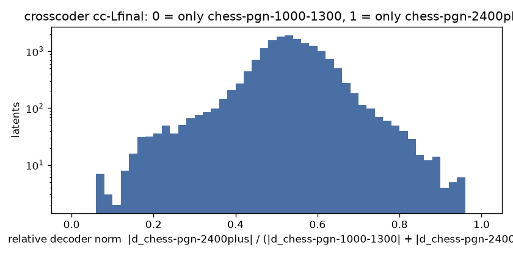

# Crosscoder chess-pgn-1000-1300 vs chess-pgn-2400plus, cc-Lfinal

BatchTopK crosscoder, 16384 latents, k = 64 (held-out L0 64.3), on 3000000 positions from 753032 games (pgn-everything).

| source | held-out FVU |
| --- | --- |
| chess-pgn-1000-1300-Lfinal | 0.058 |
| chess-pgn-2400plus-Lfinal | 0.069 |

Latents firing at least once: 16384 (100.0%). Only chess-pgn-1000-1300: **10**, only chess-pgn-2400plus: **15**, shared: **15528** .

Models trained separately share no basis, so the cosine between a latent's two decoder directions says nothing here (it would for a model and its fine-tune); latents.jsonl keeps it anyway.

Relative decoder norm, 10 bins from 0 (only chess-pgn-1000-1300) to 1 (only chess-pgn-2400plus): 10 89 240 614 4142 8062 2710 392 110 15

Each example: activation, folder, move and side to move, the last moves, **the move played**, then each model's top move at T = 1 (chess-pgn-1000-1300 / chess-pgn-2400plus).

## Only in chess-pgn-1000-1300 (r < 0.1)

### latent 12641: r = 0.10, fires on 0.69% (pgn-everything 0.69%)

- 7.73 | pgn-everything | move 13, black | `Bxf2+ 10.Kf1 Ng3+ 11.Kxf2 Qf6+ 12.Kxg3 Qf4+ 13.Kh4` -> **g5#** | g5# 57% / g5# 68% | [board](https://lichess.org/analysis/rn2k2r/pp3pp1/2p5/3Pp2p/2B2qbK/2NQ3P/PPPP2P1/R1B3NR_b_kq_-_2_13)
- 7.63 | pgn-everything | move 12, white | `c5 9.Bd3 c4 10.Bxh7+ Kxh7 11.Ng5+ Kg6 12.` -> **Nf3+** | Nxe6+ 45% / h4 63% | [board](https://lichess.org/analysis/rnb2r2/pp1nqpp1/4p1k1/3pP1N1/2pP2Q1/2N5/PPP2PPP/R3K2R_w_KQ_-_2_12)
- 7.53 | pgn-everything | move 23, black | `Kb8 20.Bc6 Rxh2+ 21.Kxh2 Ng4+ 22.Kg3 Qg5 23.Qxf3` -> **Rg8** | Ne5+ 58% / Ne5+ 34% | [board](https://lichess.org/analysis/1k1r4/Nbp2p1p/1pBpp3/6q1/4P1n1/2BP1QK1/1PP2P2/R4R2_b_-_-_0_23)
- 7.51 | pgn-everything | move 14, black | `c6 11.Qc5 d6 12.Qxd6 Nhg4 13.Nf3 Nxf3+ 14.gxf3` -> **Ne3+** | Ne3+ 41% / Ne5+ 51% | [board](https://lichess.org/analysis/r1b2rk1/pp3p1p/2pQ4/6q1/2B1P1n1/5P2/PPP2P1P/R4RK1_b_-_-_0_14)
- 7.46 | pgn-everything | move 25, white | `exd4 22.Rd1 Ke6 23.Rxd4 Qc5 24.Re4+ Kf5 25.` -> **Nd3** | Nd3 33% / Nd3 39% | [board](https://lichess.org/analysis/r1r5/p5pp/5p2/1pq2k2/4R3/4PP2/PN3P1P/RQ4K1_w_-_-_3_25)
- 7.41 | pgn-everything | move 19, black | `Nxh4 16.gxh4 gxh3 17.Bh1 Rg8+ 18.Kh2 Ng4+ 19.Kxh3` -> **Nxf2+** | Nxf2+ 57% / Ne3+ 30% | [board](https://lichess.org/analysis/2kr1br1/ppq2p2/2p1b2p/2P1p3/1P4nP/P6K/1B1NPP2/R1Q2R1B_b_-_-_0_19)
- 7.36 | pgn-everything | move 22, white | `gxh6 19.hxg6 fxg6 20.Rxg6+ Kh7 21.Qd3 Qf4 22.` -> **Rf6+** | Rg4+ 37% / Rag1 23% | [board](https://lichess.org/analysis/r4r2/pp1n3k/2p3Rp/3p4/3P1q2/1B1Q1P2/PPP2P2/R6K_w_-_-_3_22)
- 7.28 | pgn-everything | move 28, white | `Bxe2 25.Bxe2 Ka8 26.axb6 cxb6 27.Nxb6+ Kb8 28.` -> **Nd5+** | Nd5+ 62% / Nd5+ 40% | [board](https://lichess.org/analysis/1k1rr3/p3q1pp/QNn2n2/8/3P3P/2P3P1/1R2B3/4K3_w_-_-_1_28)
- 7.26 | pgn-everything | move 34, white | `Ke8 31.Rgg7 Qb6 32.Qa4+ Kd8 33.Rd7+ Ke8 34.` -> **Rhe7#** | Rde7+ 40% / Rde7+ 58% | [board](https://lichess.org/analysis/r1b1kr2/3R3R/1q2p3/p2p1p2/Q1pPnP2/2P5/P2NK3/1B6_w_-_-_9_34)
- 7.26 | pgn-everything | move 20, white | `Nc5 17.O-O Ng4 18.b4 Nd3 19.Qf5+ Kh5 20.` -> **h3** | Nf7+ 53% / Qxh7+ 36% | [board](https://lichess.org/analysis/r1q4r/p3b1pp/3p4/5QNk/1P2P1n1/2Nn4/P4PPP/R1B2RK1_w_-_-_3_20)
- 7.24 | pgn-everything | move 13, white | `Nf6 10.exf6 d5 11.fxg7+ Kxg7 12.Qf7+ Kh6 13.` -> **Ne6+** | Ne6+ 70% / Ne6+ 67% | [board](https://lichess.org/analysis/r1bq3r/ppp2Q1p/2n4k/2bp2N1/3p4/8/PPP2PPP/RNB2RK1_w_-_-_2_13)
- 7.22 | pgn-everything | move 17, white | `Kxh7 14.Ng5+ Kg6 15.Qd3+ f5 16.exf6+ Kh6 17.` -> **Qh7#** | Ne6+ 49% / fxg7 29% | [board](https://lichess.org/analysis/rnb2r2/pp4p1/2p2P1k/q2n2N1/8/P1pQ4/2P3PP/R1B2RK1_w_-_-_1_17)

### latent 14863: r = 0.07, fires on 2.46% (pgn-everything 2.46%)

- 6.06 | pgn-everything | move 12, white | `Ncd7 9.c4 dxc3 10.Qc2 h6 11.Bh4 g5 12.` -> **Bxg5** | Bxg5 61% / Bxg5 58% | [board](https://lichess.org/analysis/r1bqk2r/pppn1p2/5n1p/4p1p1/1P5B/2pP2P1/P1Q1PPBP/R3K1NR_w_KQkq_-_0_12)
- 5.98 | pgn-everything | move 11, black | `a4 8.Bxa4 bxa4 9.Be3 a3 10.Nxa3 Qe7 11.c3` -> **h5** | Rxa3 28% / Nf6 41% | [board](https://lichess.org/analysis/rnb1kbnr/4q1pp/2p1p3/3p1p2/4P3/N1PPBN2/PP3PPP/R2Q1RK1_b_kq_-_0_11)
- 5.69 | pgn-everything | move 23, white | `Rc8 20.c6 Rxc6 21.Qa7 Qd8 22.a3 bxa3 23.` -> **Rxa3** | Rxa3 85% / Rxa3 87% | [board](https://lichess.org/analysis/3qk1nr/Q2n1pp1/p1r1p1p1/3pP3/5PB1/pPp1B2P/2P3P1/R4RK1_w_k_-_0_23)
- 5.45 | pgn-everything | move 37, white | `Re3 34.Na4 b5 35.Nb6 Rxb6 36.cxb5 Rxb5 37.` -> **Ka4** | Ka4 86% / Ka4 58% | [board](https://lichess.org/analysis/8/5p2/p2p3k/1rpP4/7P/KP2r1n1/P7/8_w_-_-_0_37)
- 5.23 | pgn-everything | move 25, white | `Bc5 22.Kb1 a5 23.g3 Nf3 24.Rd7 Re2 25.` -> **Qf1** | Bc1 23% / Bc2 27% | [board](https://lichess.org/analysis/r6k/1p1R2p1/2p4p/p1b2Bq1/8/1PP2nPQ/PB2rP1P/1K1R4_w_-_-_3_25)
- 5.13 | pgn-everything | move 43, black | `Kg6 40.Qd6+ Kh7 41.Qb4 Nd3 42.Qb3 Qd2+ 43.Kb1` -> **Qc1+** | Qb2+ 34% / Qc1+ 42% | [board](https://lichess.org/analysis/8/5ppk/P7/3p4/2nPp3/PQPnP1P1/3q4/1K6_b_-_-_10_43)
- 5.12 | pgn-everything | move 23, white | `O-O 20.Nge2 b3 21.O-O Nd5 22.Ba3 Bxa3 23.` -> **Rxa3** | Rxa3 94% / Rxa3 100% | [board](https://lichess.org/analysis/r2q1rk1/5ppp/8/nP1n4/3Np3/bp2P3/4NPPP/RQ3RK1_w_-_-_0_23)
- 5.11 | pgn-everything | move 17, white | `Kb8 14.Nb3 hxg3 15.fxg3 Nd3+ 16.Kd2 Qxe4 17.` -> **Ne1** | Kc3 18% / Ne1 21% | [board](https://lichess.org/analysis/1k1r1bnr/pppb4/3p1p2/3P2p1/4q3/QN1n1NP1/PP1K2BP/R1B4R_w_-_-_0_17)
- 5.01 | pgn-everything | move 55, white | `d3 52.Rf1 Re4+ 53.Kh3 Rc2 54.Rd1 Rexc4 55.` -> **Rxd3** | Rxd3 88% / Rxd3 64% | [board](https://lichess.org/analysis/8/4k2p/1p6/2pP4/2r5/3p3K/2r5/3R4_w_-_-_0_55)
- 4.89 | pgn-everything | move 30, white | `Qd2+ 27.Kf3 h5 28.Rxg7 Kxg7 29.Qxh5 Qd1+ 30.` -> **Kf2** | Kg2 55% / Kg2 70% | [board](https://lichess.org/analysis/r4r2/pp4k1/2p3B1/4p2Q/4PP2/5KP1/P6P/3q4_w_-_-_1_30)
- 4.68 | pgn-everything | move 37, white | `c5 34.bxc5 Kc6 35.c3 d3 36.Ke3 Kxc5 37.` -> **Rxd3** | Rxd3 97% / Rxd3 94% | [board](https://lichess.org/analysis/8/7p/p5p1/2kr1p2/5P2/P1PpK1PP/8/3R4_w_-_-_0_37)
- 4.59 | pgn-everything | move 29, white | `Be4 26.Qh3 Rc2 27.f3 Bd3 28.Rd1 Rxb2 29.` -> **Nc1** | Qc8+ 32% / Qc8+ 31% | [board](https://lichess.org/analysis/6k1/pp3p2/6p1/3q4/8/1N1b1P1Q/Pr4PP/3R2K1_w_-_-_0_29)

### latent 7797: r = 0.07, fires on 1.15% (pgn-everything 1.15%)

- 6.01 | pgn-everything | move 11, black | `fxe4 8.Qf4 Rf8 9.d4 d6 10.Nc3 dxe5 11.dxe5` -> **Rxf7** | Rxf7 30% / Qd4+ 32% | [board](https://lichess.org/analysis/rnbq1r2/ppp1kBpp/5n2/4P3/4pQ2/2N5/PPP2KPP/R1B4R_b_-_-_0_11)
- 5.56 | pgn-everything | move 9, white | `g6 6.Bc4 Bg7 7.Qb3 Nh6 8.Bxh6 Bxh6 9.` -> **Bxf7+** | Bxf7+ 96% / Bxf7+ 98% | [board](https://lichess.org/analysis/r1bqk2r/pppp1p1p/2n3pb/8/2B1P3/1QN2N2/PP3PPP/R3K2R_w_KQkq_-_0_9)
- 5.03 | pgn-everything | move 21, black | `Rh8 18.Qg3 Be3 19.Kb1 Bf4 20.Qf2 Rh2 21.Qxa7` -> **Rxg2** | Rxg2 35% / Rxg2 59% | [board](https://lichess.org/analysis/2k5/Qpp2p2/3ppqp1/4n3/4Pb2/2P2P2/PP1NB1Pr/1K1R4_b_-_-_0_21)
- 4.47 | pgn-everything | move 10, white | `Nxd5 7.Bxd5 Bd6 8.Nxf7 Qe7+ 9.Ne2 Nxe2 10.` -> **Qxe2** | Qxe2 67% / Qxe2 68% | [board](https://lichess.org/analysis/r1b1k2r/ppp1qNpp/3b4/3B4/8/8/PPPPnPPP/R1BQK2R_w_KQkq_-_0_10)
- 4.37 | pgn-everything | move 13, white | `a5 10.Nf3 b5 11.Ng5 b4 12.Nxh7 Nxh7 13.` -> **Bxh7+** | Bxh7+ 79% / Bxh7+ 73% | [board](https://lichess.org/analysis/r2q1rk1/2p2ppn/2n1p3/p2p4/1p1P4/2PBP1P1/PP3PP1/RN1QK2R_w_KQ_-_0_13)
- 4.26 | pgn-everything | move 9, black | `Bd6 6.Bc4 Nf6 7.O-O c5 8.Qe3 Ng4 9.Qf3` -> **Ne5** | Nxh2 24% / Bxh2+ 37% | [board](https://lichess.org/analysis/r1bqk2r/pp1p1ppp/3b4/2p5/2B1P1n1/5Q2/PPP2PPP/RNB2RK1_b_kq_-_3_9)
- 4.16 | pgn-everything | move 13, white | `a5 10.Ne2 a4 11.Bh6 a3 12.Bxg7 axb2+ 13.` -> **Kb1** | Kxb2 51% / Kb1 76% | [board](https://lichess.org/analysis/rnbq1rk1/1p2ppBp/2p3p1/8/3PB3/8/PpPQNPPP/2KR3R_w_-_-_0_13)
- 4.09 | pgn-everything | move 15, white | `cxb2 12.Rb1 Bd6 13.f4 O-O 14.fxe5 Ba3 15.` -> **d4** | Bxb7 56% / Bxb7 32% | [board](https://lichess.org/analysis/r4rk1/pppq1ppp/8/4P3/8/b2P2P1/PpP2PBP/1R1QR1K1_w_-_-_1_15)
- 4.00 | pgn-everything | move 12, white | `O-O 9.a3 Re8+ 10.Be2 Bxc3 11.bxc3 Qe7 12.` -> **Ra2** | d5 22% / Kf1 31% | [board](https://lichess.org/analysis/r1b1r1k1/ppppqppp/2n5/8/2PP4/P1P2N2/3QBPPP/R3K2R_w_KQ_-_1_12)
- 4.00 | pgn-everything | move 17, black | `Qd7 14.g4 O-O-O 15.d5 Nxe5 16.Kb1 hxg4 17.Qxa7` -> **Qf5** | c6 49% / Qf5 62% | [board](https://lichess.org/analysis/2kr3r/Qppqpp2/3p2pb/3Pn3/5Pp1/2N4P/PPP1B3/1K1R3R_b_-_-_0_17)
- 3.96 | pgn-everything | move 13, black | `e5 10.dxe5 dxe5 11.Bg5 Re8 12.O-O-O e4 13.Bxf6` -> **exd3** | exd3 48% / Bxf6 57% | [board](https://lichess.org/analysis/1rbqr1k1/p1pn1pbp/1pB2Bp1/8/4p2P/2NQPN2/PPP2PP1/2KR3R_b_-_-_0_13)
- 3.87 | pgn-everything | move 17, white | `exf4 14.Be2 Be5 15.c3 a3 16.d4 axb2+ 17.` -> **Kxb2** | Kxb2 82% / Kxb2 66% | [board](https://lichess.org/analysis/rn2k2r/1p2qppp/2p5/3pb3/3PPp2/2P2P1P/Pp1NB2P/2KRQ2R_w_kq_-_0_17)

### latent 2044: r = 0.08, fires on 1.92% (pgn-everything 1.92%)

- 5.48 | pgn-everything | move 8, black | `Nf6 5.Nh3 Bd6 6.Ng5 O-O 7.Bd3 Na5 8.Qa4` -> **b6** | b6 54% / Nc6 46% | [board](https://lichess.org/analysis/r1bq1rk1/pppp1ppp/3b1n2/n5N1/Q3P3/3B4/PPP2PPP/RNB1K2R_b_KQ_-_10_8)
- 5.44 | pgn-everything | move 13, white | `Ng4 10.g3 e5 11.dxc6 Nxc6 12.Nd5 Qa5 13.` -> **Nc3** | Bxc6+ 29% / b4 38% | [board](https://lichess.org/analysis/r1b1k2r/pp3ppp/2nb4/q2Np3/B5n1/5NP1/PPP2P1P/R1BQ1RK1_w_kq_-_2_13)
- 5.21 | pgn-everything | move 25, white | `Nc5 22.b4 Qxe3+ 23.Kh1 Rd6 24.Qb5+ Rb6 25.` -> **Qxc5** | Qc4 51% / Qc4 73% | [board](https://lichess.org/analysis/1k5r/2p2pp1/1r5p/NQn5/1P6/2P1q3/P5PP/R4R1K_w_-_-_4_25)
- 5.21 | pgn-everything | move 11, white | `cxd4 8.Nxd4 Qb6 9.N2b3 Nf6 10.Be3 Bxe4 11.` -> **O-O** | O-O 39% / O-O 73% | [board](https://lichess.org/analysis/rn2kb1r/3p1ppp/1q2pn2/1B6/3Nb3/1N2B3/PP3PPP/R2QK2R_w_KQkq_-_0_11)
- 4.82 | pgn-everything | move 24, white | `a6 21.Ne5 b5 22.Qb3 b4 23.Be1 Na5 24.` -> **Qxd5** | Qxd5 71% / Qxd5 84% | [board](https://lichess.org/analysis/r1r3k1/5ppp/p2b4/n2pN3/1p1P1P2/1Q6/PPP5/2KRB3_w_-_-_2_24)
- 4.75 | pgn-everything | move 41, black | `Kf5 38.Qh3+ Ke4 39.Qh7+ f5 40.Qh4+ f4 41.Qh7+` -> **Ke3** | Ke3 100% / Ke3 100% | [board](https://lichess.org/analysis/8/3R3Q/p7/1p2p3/4kp2/8/2q3PP/7K_b_-_-_1_41)
- 4.46 | pgn-everything | move 17, black | `Ke7 14.Nbd5+ Kd7 15.Bf4 fxe4 16.fxe4 Ne7 17.Qg4+` -> **Ke8** | Kc6 67% / Kc6 56% | [board](https://lichess.org/analysis/rnbq1b1r/3kn2p/p2p2p1/2pN4/2B1PBQ1/2N5/PPP3PP/R4RK1_b_-_-_2_17)
- 4.45 | pgn-everything | move 6, white | `dxe4 3.Ng5 Nf6 4.d3 h6 5.Nxf7 Kxf7 6.` -> **Nc3** | Nc3 53% / Nc3 77% | [board](https://lichess.org/analysis/rnbq1b1r/ppp1pkp1/5n1p/8/4p3/3P4/PPP2PPP/RNBQKB1R_w_KQ_-_0_6)
- 4.45 | pgn-everything | move 6, white | `dxe4 3.Ng5 Nf6 4.d3 h6 5.Nxf7 Kxf7 6.` -> **Be3** | Nc3 53% / Nc3 77% | [board](https://lichess.org/analysis/rnbq1b1r/ppp1pkp1/5n1p/8/4p3/3P4/PPP2PPP/RNBQKB1R_w_KQ_-_0_6)
- 4.45 | pgn-everything | move 6, white | `dxe4 3.Ng5 Nf6 4.d3 h6 5.Nxf7 Kxf7 6.` -> **Nc3** | Nc3 53% / Nc3 77% | [board](https://lichess.org/analysis/rnbq1b1r/ppp1pkp1/5n1p/8/4p3/3P4/PPP2PPP/RNBQKB1R_w_KQ_-_0_6)
- 4.45 | pgn-everything | move 6, white | `dxe4 3.Ng5 Nf6 4.d3 h6 5.Nxf7 Kxf7 6.` -> **Nc3** | Nc3 53% / Nc3 77% | [board](https://lichess.org/analysis/rnbq1b1r/ppp1pkp1/5n1p/8/4p3/3P4/PPP2PPP/RNBQKB1R_w_KQ_-_0_6)
- 4.44 | pgn-everything | move 12, white | `Be7 9.a4 a5 10.Be3 Bb4 11.Nb5 cxb5 12.` -> **Bxb5** | axb5 54% / axb5 89% | [board](https://lichess.org/analysis/2kr2nr/1p1n1ppp/1q2p3/pp1pP3/Pb1P2b1/1P2BN2/2P1BPPP/R2Q1RK1_w_-_-_0_12)

### latent 3221: r = 0.08, fires on 1.72% (pgn-everything 1.72%)

- 5.37 | pgn-everything | move 9, black | `e6 6.b3 h6 7.Bb2 g6 8.Qe2 a6 9.h3` -> **a5** | e5 14% / Ra7 37% | [board](https://lichess.org/analysis/rnbqkbnr/8/pppppppp/8/4P3/1PN2NPP/PBPPQPB1/R3K2R_b_KQkq_-_0_9)
- 5.29 | pgn-everything | move 26, white | `Bc7 23.Nc3 a6 24.Kd2 b5 25.Na3 b4 26.` -> **Nc2** | Nc4 39% / Nc4 51% | [board](https://lichess.org/analysis/r6r/2b1k2p/p1n1p1p1/5p2/1p1P4/NPN1P3/1P1KP1R1/R7_w_-_-_0_26)
- 5.27 | pgn-everything | move 17, white | `b4 14.axb4 Bxb4 15.Na2 Ba3 16.bxa3 Qxa3+ 17.` -> **Kd2** | Kb1 68% / Kb1 59% | [board](https://lichess.org/analysis/r3k2r/2pn1ppp/p3pn2/7b/8/qB1PBP1N/N1P2QPP/2KR3R_w_kq_-_0_17)
- 5.24 | pgn-everything | move 17, white | `Nc4 14.Qb1 Bc5 15.b3 Bxd4 16.Bxd4 Nd2 17.` -> **Qb2** | Qd1 63% / Qb2 65% | [board](https://lichess.org/analysis/2kr2nr/pppq2pp/5p2/8/3B4/1PN5/P1Pn1PPP/RQ2R1K1_w_-_-_1_17)
- 4.66 | pgn-everything | move 9, white | `g6 6.c3 Bg7 7.b3 Nf6 8.a3 O-O 9.` -> **Ra2** | Ra2 17% / Ra2 53% | [board](https://lichess.org/analysis/r1bq1rk1/pp3pbp/2n1pnp1/2pp4/8/PPPPPPPP/8/RNBQKBNR_w_KQ_-_1_9)
- 4.47 | pgn-everything | move 17, white | `Qe7 14.Bd3 O-O-O 15.Qg4+ Qd7 16.Bf5 h5 17.` -> **Bxd7+** | Bxd7+ 82% / Bxd7+ 80% | [board](https://lichess.org/analysis/2kr3r/pppq2p1/2np4/3p1B1p/3P2QP/4P2R/PPP2P2/R3K3_w_Q_-_0_17)
- 4.35 | pgn-everything | move 13, white | `Nb6 10.b4 Bxb4 11.axb4 Qxb4 12.Na2 Qa3+ 13.` -> **Kb1** | Kb1 89% / Kb1 92% | [board](https://lichess.org/analysis/r1b2rk1/pp3ppp/1npp1n2/3Pp1B1/4P3/q6P/N1P1QPP1/2KR1BNR_w_-_-_2_13)
- 4.32 | pgn-everything | move 29, white | `Qd7 26.e6 Qa7 27.exf7+ Kxf7 28.Qh5+ g6 29.` -> **Qxh7+** | Qxh7+ 93% / Qxh7+ 71% | [board](https://lichess.org/analysis/r7/q4k1p/5pp1/2p4Q/8/P1B5/6PP/5RK1_w_-_-_0_29)
- 4.32 | pgn-everything | move 9, white | `h5 6.e5 dxe5 7.Nxe5 Nxe5 8.fxe5 h4 9.` -> **Bxf7#** | Bxf7# 59% / Bxf7# 30% | [board](https://lichess.org/analysis/r2qkbnr/pp1bppp1/8/2p1P3/2B4p/8/PPPP2PP/RNBQ1RK1_w_kq_-_0_9)
- 4.31 | pgn-everything | move 8, white | `Nf6 5.e3 Bd6 6.f3 O-O 7.g3 h6 8.` -> **h3** | h3 77% / h3 56% | [board](https://lichess.org/analysis/rnbq1rk1/pp3pp1/3b1n1p/2ppp3/8/PPPPPPP1/7P/RNBQKBNR_w_KQ_-_0_8)
- 4.31 | pgn-everything | move 16, white | `Ng6 13.Nh2 c6 14.f4 d5 15.exd5 cxd5 16.` -> **Bb6** | Bxd5 31% / fxe5 56% | [board](https://lichess.org/analysis/rbbq1rk1/1p3pp1/p4nnp/3pp3/P1B2P2/1QPPB2P/1PN3PN/R4RK1_w_-_-_0_16)
- 4.29 | pgn-everything | move 25, white | `Qc3 22.Nxd7 Bxd7 23.e6 Qf6 24.Qd2 Qxg6 25.` -> **Qxd7#** | Qxd7# 41% / Qxd7# 74% | [board](https://lichess.org/analysis/r2k1b1r/1p1bp1p1/2p1P1q1/p6p/8/7P/P2Q1PPB/R3R1K1_w_-_-_0_25)

### latent 16023: r = 0.09, fires on 0.79% (pgn-everything 0.79%)

- 5.17 | pgn-everything | move 30, white | `Nxg4 27.Qxg4 Rfe8 28.Rxe8 Rxe8 29.h3 Re1+ 30.` -> **Kh2** | Kh2 100% / Kh2 100% | [board](https://lichess.org/analysis/8/5p1k/pq4pp/1p6/6QN/7P/PP3PP1/4r1K1_w_-_-_1_30)
- 4.26 | pgn-everything | move 40, white | `Re5 37.Rc4 Rf5 38.Rxf5 Qxf5 39.Rxc5 Qf1+ 40.` -> **Kh2** | Kh2 100% / Kh2 100% | [board](https://lichess.org/analysis/8/6pk/7p/2R5/8/2Q4P/6P1/5q1K_w_-_-_1_40)
- 4.07 | pgn-everything | move 28, black | `Nxf1 25.Rxf1 d4 26.Na4 Qg6 27.Qa8+ Kh7 28.Kh1` -> **Re2** | Be4 47% / Be4 49% | [board](https://lichess.org/analysis/Q7/1p3ppk/6qp/4rb2/N2p4/7P/PPP3P1/5R1K_b_-_-_5_28)
- 3.98 | pgn-everything | move 39, black | `Qg1 36.Rxg8+ Kxg8 37.Qe8+ Kh7 38.Qh5+ Kg8 39.Qe8+` -> **Kh7** | Kh7 100% / Kh7 100% | [board](https://lichess.org/analysis/4Q1k1/1p4p1/p3pp2/3p4/8/P1r2P1K/6P1/6q1_b_-_-_5_39)
- 3.95 | pgn-everything | move 53, white | `Kxe6 50.Kh7 Kf7 51.g6+ Kf8 52.g7+ Ke7 53.` -> **g8=Q** | g8=Q 98% / g8=Q 98% | [board](https://lichess.org/analysis/8/4k1PK/8/8/8/8/8/8_w_-_-_1_53)
- 3.94 | pgn-everything | move 29, white | `Qb6 26.h4 gxh4 27.Bxh4 e6 28.Qg4 Kh8 29.` -> **Bf6** | Bf6 60% / Bf6 35% | [board](https://lichess.org/analysis/5r1k/5pb1/1q2p2p/p3P3/3P2QB/8/5PP1/2R3K1_w_-_-_2_29)
- 3.92 | pgn-everything | move 34, black | `Qe5 31.Rb1 Nf5+ 32.Kg1 Qe3+ 33.Kh1 Nh4 34.Qc3` -> **Qf2** | Qe4 21% / Qf2 31% | [board](https://lichess.org/analysis/4r2k/p5p1/7p/8/N6n/1PQ1q2P/P1P3P1/1R5K_b_-_-_10_34)
- 3.72 | pgn-everything | move 36, white | `Re6 33.Rc1 Rxd6 34.Rc8+ Kg7 35.Qb2+ Qd4 36.` -> **Qxd4+** | Qxd4+ 62% / Qxd4+ 55% | [board](https://lichess.org/analysis/2R5/5pk1/3r2p1/8/3q4/7P/1Q3PP1/6K1_w_-_-_4_36)
- 3.64 | pgn-everything | move 29, black | `Nh4 26.Qxd5 Qc8 27.Qxb7 Qxg4+ 28.Bg3 h6 29.Re8+` -> **Kh7** | Kh7 100% / Kh7 100% | [board](https://lichess.org/analysis/4R1k1/pQ3pp1/7p/1P6/3P2qn/2P3B1/r4P2/6K1_b_-_-_1_29)
- 3.64 | pgn-everything | move 33, black | `Kh8 30.Kxf1 f5 31.Qh4+ Kg8 32.Qe7 Rad8 33.Qg5+` -> **Kh8** | Kf7 60% / Kh7 44% | [board](https://lichess.org/analysis/3r1rk1/p2p4/2pP4/5pQ1/1p6/8/5PPP/5K2_b_-_-_5_33)
- 3.64 | pgn-everything | move 28, white | `Rxd1+ 25.Qxd1 Bxf6 26.Nd5 Bxb2 27.g3 Be5 28.` -> **Qf3** | Kg2 20% / Ne3 49% | [board](https://lichess.org/analysis/7k/5p1p/6p1/3Nb3/8/6P1/q4P1P/3Q2K1_w_-_-_1_28)
- 3.64 | pgn-everything | move 17, black | `Bb7 14.b4 Rc8 15.Bh3 Rc7 16.Qd2 g5 17.Nfe2` -> **h6** | g4 51% / Bc8 24% | [board](https://lichess.org/analysis/3q1rk1/1br1bp1p/p1n2n2/1p1p2p1/1P1Pp3/P1N1P1PB/1B1QNP1P/R4RK1_b_-_-_1_17)

### latent 9185: r = 0.07, fires on 2.49% (pgn-everything 2.49%)

- 5.07 | pgn-everything | move 67, white | `Bb7 64.b5 Bc8 65.a6 Bd7 66.b6 Bc6 67.` -> **b7** | a7 38% / Kxc6 40% | [board](https://lichess.org/analysis/8/8/PPb1k3/2Kp4/2p5/2P5/8/8_w_-_-_1_67)
- 4.88 | pgn-everything | move 25, white | `Ba5 22.Qe5 Re8 23.Qf4 Bc7 24.Qg5 h6 25.` -> **Qg6** | Qg6 59% / Qg6 68% | [board](https://lichess.org/analysis/r1q1r1k1/2b3p1/2p2n1p/1PPp1pQ1/p3p3/P3P3/1B2BPPP/2R2RK1_w_-_-_0_25)
- 4.48 | pgn-everything | move 30, white | `Qa5+ 27.Kd3 Qb5+ 28.Kd2 Qxb2 29.Rg1 d3 30.` -> **Rc1** | Kxd3 31% / Kxd3 41% | [board](https://lichess.org/analysis/2b4r/pp3k1p/2n2p2/3Npn2/6R1/3p1BB1/PqPK3P/6R1_w_-_-_0_30)
- 4.41 | pgn-everything | move 24, black | `g5 21.a5 b6 22.axb6 axb6 23.Nd3 Qg4 24.f3` -> **Bxf3** | Qxd4+ 37% / Bxf3 51% | [board](https://lichess.org/analysis/2kr3r/8/1pp1p3/3b1ppp/3P2q1/3N1P2/1PQ3PP/R3R1K1_b_-_-_0_24)
- 4.38 | pgn-everything | move 61, white | `Kc8 58.a4 Kb8 59.a5 Ka8 60.a6 Kb8 61.` -> **b5** | b5 64% / b5 73% | [board](https://lichess.org/analysis/1k6/8/PK6/8/1P6/8/8/8_w_-_-_1_61)
- 4.35 | pgn-everything | move 54, black | `d6 51.exd6 Kd7 52.Be5 Rc8 53.Bc3 f6 54.h4` -> **f5** | Kxd6 29% / Kxd6 32% | [board](https://lichess.org/analysis/2r5/3k4/3Ppppp/3b4/5PPP/1pB5/pK6/8_b_-_-_0_54)
- 4.33 | pgn-everything | move 38, black | `c4 35.Kd1 d4 36.Kc2 d3+ 37.Kc3 Rc8 38.Rd6` -> **d2** | Nc5 22% / Kf8 29% | [board](https://lichess.org/analysis/2r3k1/5pp1/3R3p/8/2p5/1nKp3P/5PP1/8_b_-_-_3_38)
- 4.27 | pgn-everything | move 20, white | `h6 17.Bf4 Nd5 18.Nxd5 Qxd5 19.f3 Bc5+ 20.` -> **Kh1** | Kh1 80% / Kh1 91% | [board](https://lichess.org/analysis/2kr3r/Q1p2pp1/1pb4p/2bqN3/5B2/5P2/PP4PP/R3R1K1_w_-_-_1_20)
- 4.26 | pgn-everything | move 18, black | `dxc4 15.Bxh6 Nxh6 16.Ng5 Qxg5 17.f4 Qg4 18.Bf3` -> **Bxf3** | Qxg3+ 72% / Bxf3 58% | [board](https://lichess.org/analysis/r4rk1/pbpn2b1/1p2p1pn/8/2pP1Pq1/2P2BP1/PPQ1P3/R3K2R_b_KQ_-_2_18)
- 4.08 | pgn-everything | move 36, white | `Kf6 33.f4 h6 34.Kf2 Ke6 35.g3 gxf4 36.` -> **gxf4** | gxf4 87% / gxf4 93% | [board](https://lichess.org/analysis/8/1p1n4/1n2k2p/1B1p1p2/pP1Ppp2/P3P1PP/R2N1K2/2r5_w_-_-_0_36)
- 4.05 | pgn-everything | move 9, black | `e6 6.Bb5 a6 7.Bxc6+ bxc6 8.Ne5 Qd6 9.Bxf6` -> **gxf6** | gxf6 99% / gxf6 100% | [board](https://lichess.org/analysis/r3kb1r/2p2ppp/p1pqpB2/3pNb2/3P4/2N1P3/PPP2PPP/R2QK2R_b_KQkq_-_0_9)
- 4.02 | pgn-everything | move 26, white | `exf6 23.h4 Bc4 24.h5 Bf7 25.h6 Bg6 26.` -> **Rh1** | Rd6 36% / Rd6 63% | [board](https://lichess.org/analysis/2k5/p7/2p2pbP/2p5/8/2P2P2/P1P2KP1/3R4_w_-_-_1_26)

### latent 4322: r = 0.07, fires on 2.27% (pgn-everything 2.27%)

- 4.96 | pgn-everything | move 14, black | `Nf6 11.Re1 a5 12.d5 c5 13.Nb5 Qd7 14.a4` -> **b6** | b6 40% / Ng6 34% | [board](https://lichess.org/analysis/r1b1k2r/1p1qnpp1/3p1n2/pNpPp3/P1P1P2p/5N1P/1P2BPP1/R2QR1K1_b_kq_-_0_14)
- 4.92 | pgn-everything | move 14, white | `b6 11.Re1 g5 12.Nh5 Bg4 13.Nxf6+ Bxf6 14.` -> **Qxg4** | Qxg4 97% / Qxg4 96% | [board](https://lichess.org/analysis/r2q1rk1/p4p1p/1p3b2/2pp2p1/6b1/3P1Q2/PPP1BPPP/RN2R1K1_w_-_-_0_14)
- 4.75 | pgn-everything | move 52, white | `e3 49.Kf3 e2 50.Kxe2 Kg4 51.Ke3 Kxh4 52.` -> **Ke4** | Ke4 84% / Ke4 84% | [board](https://lichess.org/analysis/8/8/8/p1p5/2P4k/1P2K3/8/8_w_-_-_0_52)
- 4.65 | pgn-everything | move 43, black | `g5 40.Ne4 Bxe4 41.Kxe4 Kc5 42.fxg5 fxg5 43.Kf5` -> **Kxc4** | Kxc4 93% / Kxc4 95% | [board](https://lichess.org/analysis/8/8/8/p1k2Kp1/2P3P1/P7/8/8_b_-_-_1_43)
- 4.59 | pgn-everything | move 60, white | `e1=Q 57.b7 Qe7+ 58.Ka4 Qxb7 59.a3 Kc4 60.` -> **Ka5** | Ka5 100% / Ka5 100% | [board](https://lichess.org/analysis/8/1q6/8/8/K1k5/P7/8/8_w_-_-_1_60)
- 4.57 | pgn-everything | move 34, white | `Ke7 31.Nf5+ Kf6 32.Nd6 Rd8 33.Nf5 Qxc4+ 34.` -> **Ke3** | Ke3 80% / Ke3 57% | [board](https://lichess.org/analysis/3r4/p4p2/5k2/4pN1p/2q1P3/5B2/4KPR1/8_w_-_-_0_34)
- 4.54 | pgn-everything | move 66, black | `Nxe6 63.Kxe6 Kd4 64.Kf6 Ke4 65.Kg6 Kf4 66.Kxh6` -> **Kxg4** | Kxg4 94% / Kxg4 96% | [board](https://lichess.org/analysis/8/8/7K/6pP/1p3kP1/p7/P7/8_b_-_-_0_66)
- 4.50 | pgn-everything | move 27, white | `Bc4 24.Rd2 Bc5 25.Re1 Rxd2 26.Qxd2 Rd8 27.` -> **Qc2** | Qc2 64% / Qc2 44% | [board](https://lichess.org/analysis/3r2k1/4q1pp/p4p2/1pb1p3/P1b1P1P1/2P4P/3Q1PBN/4R1K1_w_-_-_1_27)
- 4.46 | pgn-everything | move 12, black | `f5 9.g5 h5 10.Be2 g6 11.Bf4 Bg7 12.Nd2` -> **a6** | Nxd4 26% / Nxd4 28% | [board](https://lichess.org/analysis/r1bqk2r/ppp1n1b1/2n1p1p1/3pPpPp/3P1B1P/P1N5/1PPNBP2/R2QK2R_b_KQkq_-_3_12)
- 4.41 | pgn-everything | move 10, white | `e6 7.Nd2 Bd6 8.e4 O-O 9.e5 Rb8 10.` -> **Qa6** | Qa6 96% / Qa6 93% | [board](https://lichess.org/analysis/1r1q1rk1/pQpb1ppp/2nbpn2/3pP3/3P4/2P3P1/PP1N1PBP/R1B1K1NR_w_KQ_-_1_10)
- 4.40 | pgn-everything | move 11, black | `Bg4 8.h3 Bxf3 9.gxf3 a6 10.d5 Qb6 11.Be3` -> **c5** | Qa5+ 50% / Qa5+ 74% | [board](https://lichess.org/analysis/rn2kbnr/1pp1pppp/pq6/1N1P4/8/4BP1P/P1P2P2/R2QKB1R_b_KQkq_-_2_11)
- 4.37 | pgn-everything | move 25, white | `Nf4 22.Qf3 Ne7 23.Bc1 Neg6 24.Rg1 a6 25.` -> **Nf1** | Nf1 25% / Bf1 47% | [board](https://lichess.org/analysis/r2q3r/2b2bk1/pp3pn1/2p1p1p1/P1NpPnPp/1P1P1Q1P/2PN1PBK/2B1R1R1_w_-_-_0_25)

### latent 7825: r = 0.07, fires on 1.54% (pgn-everything 1.54%)

- 4.90 | pgn-everything | move 8, white | `g4 5.O-O gxf3 6.Qxf3 Qh4 7.d3 Bc5+ 8.` -> **Kh1** | Kh1 83% / Kh1 99% | [board](https://lichess.org/analysis/rnb1k1nr/pppp1p1p/8/2b5/2B1Pp1q/3P1Q2/PPP3PP/RNB2RK1_w_kq_-_1_8)
- 4.49 | pgn-everything | move 26, white | `Nxd6 23.exd6 Rd8 24.Ne2 Rxd6 25.Ng3 Rb1+ 26.` -> **Nf1** | Nf1 98% / Nf1 100% | [board](https://lichess.org/analysis/6k1/5ppp/p1prp3/3p4/3P4/3R2N1/P1P2PPP/1r4K1_w_-_-_2_26)
- 4.40 | pgn-everything | move 27, white | `Qc7 24.g3 Bf6 25.Rc1 Qb6 26.g4 Bd5+ 27.` -> **Rg2** | Rg2 93% / Rg2 98% | [board](https://lichess.org/analysis/r3r1k1/pp3ppp/1q3b2/3b4/5PP1/8/PP5P/2R2QRK_w_-_-_1_27)
- 4.38 | pgn-everything | move 18, black | `Nc5 15.Be3 a5 16.Qe2 Bd7 17.Qc4 Rf8 18.Bg8` -> **Rc8** | Rxg8 31% / O-O-O 27% | [board](https://lichess.org/analysis/r3krB1/1pqbb1pp/3p1p2/p1n1p3/2Q5/P1N1BNP1/1PP2P1P/R4RK1_b_q_-_5_18)
- 4.34 | pgn-everything | move 16, white | `Qf6 13.Rf1 Re8 14.h4 Qg6 15.Rg1 Qg3+ 16.` -> **Ke2** | Kf1 65% / Kf1 61% | [board](https://lichess.org/analysis/N1bkr3/pp1p1ppn/2n5/2b4p/2B1P2P/3P1Nq1/P1PB2P1/R2QK1R1_w_Q_-_3_16)
- 4.21 | pgn-everything | move 36, white | `Rc2 33.Rb7 f6 34.Rb3 Nd2 35.Nd4 Rc1+ 36.` -> **Kf2** | Kf2 100% / Kf2 100% | [board](https://lichess.org/analysis/8/6pk/5p1p/8/3NP3/1RP5/3n2PP/2r3K1_w_-_-_4_36)
- 4.05 | pgn-everything | move 10, white | `Ne5 7.Qc3 Nxc4 8.d3 Qxg2 9.Re1 Qf3+ 10.` -> **Re2** | Re2 100% / Re2 100% | [board](https://lichess.org/analysis/r1b1kbnr/1p1p1ppp/p3p3/2p5/2n1P3/2QP1q2/PPP2P1P/RNBKR3_w_kq_-_2_10)
- 4.01 | pgn-everything | move 15, black | `Qf8 12.Qf3 Qxh8 13.Qxc6+ Bd7 14.Qxa8+ Bc8 15.Qxc8+` -> **Kf7** | Kf7 62% / Kf7 53% | [board](https://lichess.org/analysis/2Q1k2q/p5pp/5n2/2b1p3/8/2N5/PPPP1PPP/R1B1K2R_b_KQ_-_0_15)
- 3.95 | pgn-everything | move 27, black | `exf2+ 24.Rxf2 Ne7 25.Qxa7 Rf8 26.Re1 Rf7 27.Qa8+` -> **Kd7** | Kd7 100% / Kd7 100% | [board](https://lichess.org/analysis/Q3k3/4nrpp/5pq1/8/8/P5P1/1PP2R1P/4R1K1_b_-_-_4_27)
- 3.94 | pgn-everything | move 21, black | `h6 18.Qb1 Bf8 19.Nd5 Bxd5 20.cxd5 Nb8 21.Nd2` -> **Nbd7** | Nbd7 34% / b5 38% | [board](https://lichess.org/analysis/1nrr1bk1/1q3pp1/pp1p1n1p/3Pp3/1P2P3/P3B2P/3NBPP1/1QR2RK1_b_-_-_2_21)
- 3.94 | pgn-everything | move 12, white | `exd4 9.cxd4 Bxf3 10.Qxf3 Qxd4 11.Rf1 Bb4+ 12.` -> **Nc3** | Nc3 52% / Nc3 81% | [board](https://lichess.org/analysis/r3k1nr/p1p2ppp/2p5/8/1b1qP3/5Q2/PP4PP/RNB1KR2_w_Qkq_-_2_12)
- 3.93 | pgn-everything | move 30, white | `Rxa2 27.Re2 Bb5 28.Rde1 Bxe2 29.Rxe2 Ra1+ 30.` -> **Bxa1** | Re1 91% / Re1 62% | [board](https://lichess.org/analysis/4r1k1/1p3pp1/7p/5q2/1p1Bp1n1/1P4Q1/2P1RPPP/r5K1_w_-_-_1_30)

### latent 4455: r = 0.10, fires on 0.82% (pgn-everything 0.82%)

- 4.67 | pgn-everything | move 14, white | `Bh5 11.Re1 Re8 12.Nf1 d5 13.Qe2 dxe4 14.` -> **dxe4** | dxe4 98% / dxe4 100% | [board](https://lichess.org/analysis/r2qr1k1/1pp1bppp/p1n2n2/4p2b/4p3/2PP1N1P/PPB1QPP1/R1B1RNK1_w_-_-_0_14)
- 4.33 | pgn-everything | move 41, black | `Bxf3 38.Kf2 Bd5 39.b3 Re4 40.Kg3 f5 41.gxf5` -> **gxf5** | gxf5 99% / gxf5 99% | [board](https://lichess.org/analysis/8/6k1/p1p3p1/2Bb1P2/3Pr3/1P4KP/P2R4/8_b_-_-_0_41)
- 4.23 | pgn-everything | move 33, white | `f3 30.Re3 h5 31.h3 Rg8 32.Kh2 f4 33.` -> **Ree1** | gxf4 82% / gxf4 71% | [board](https://lichess.org/analysis/6r1/5k2/p3p3/1p1b3p/3Ppp2/P1P1RpPP/1P3P1K/2R5_w_-_-_0_33)
- 4.03 | pgn-everything | move 19, black | `Na5 16.Qc2 Nc4 17.Bc1 c5 18.b3 Nb6 19.dxe5` -> **dxe5** | dxe5 97% / dxe5 100% | [board](https://lichess.org/analysis/r1q1rbk1/5pp1/pn1p1n1p/1pp1P3/4P3/1PP2NN1/P1Q2PPP/2BRR1K1_b_-_-_0_19)
- 4.03 | pgn-everything | move 27, white | `Raf8 24.g3 h6 25.a3 g5 26.Kg2 gxf4 27.` -> **Rxf4** | gxf4 73% / Rxf4 69% | [board](https://lichess.org/analysis/5rk1/p7/1pq1p2p/3pPr2/3B1p2/P1P1Q1P1/1P4KP/5R2_w_-_-_0_27)
- 4.00 | pgn-everything | move 15, white | `b6 12.Rfe1 Bb7 13.Qf4 e5 14.Bxf7+ Kxf7 15.` -> **Ne6** | Qf5 59% / Qf5 53% | [board](https://lichess.org/analysis/r4r2/1bqnbkpp/pp1p1n2/4p1B1/P2NPQ2/2N5/1PP2PPP/R3R1K1_w_-_-_0_15)
- 3.97 | pgn-everything | move 23, white | `Rae8 20.h4 Re5 21.g4 Nf6 22.g5 hxg5 23.` -> **hxg5** | hxg5 98% / hxg5 98% | [board](https://lichess.org/analysis/5rk1/1ppb1pp1/1p1p1n2/3Pr1p1/4PR1P/1B6/PPP4N/5RK1_w_-_-_0_23)
- 3.95 | pgn-everything | move 18, black | `Kh8 15.h4 Nh7 16.Nf3 f5 17.exf5 Rxf5 18.g4` -> **Rf4** | Rf4 51% / Rf4 76% | [board](https://lichess.org/analysis/r6k/1pp1q1pn/p1np3p/4pr2/PPB3PP/2PPQN2/5P2/R3K2R_b_KQ_-_0_18)
- 3.84 | pgn-everything | move 16, white | `Kxg7 13.Rb1 Bh3 14.b4 Bxg2 15.Kxg2 cxb4 16.` -> **axb4** | axb4 98% / axb4 100% | [board](https://lichess.org/analysis/r4r2/1p1qppk1/p1np1np1/8/1pP5/P1NP1NP1/4PPKP/1RQ2R2_w_-_-_0_16)
- 3.79 | pgn-everything | move 16, white | `Re8 13.Nh4 Bh7 14.Nf5 d5 15.Qf3 dxe4 16.` -> **dxe4** | dxe4 97% / dxe4 100% | [board](https://lichess.org/analysis/r2qr1k1/1pp2ppb/p1n2n1p/2b1pN2/4p1P1/1BPP1Q1P/PP3P2/R1B1RNK1_w_-_-_0_16)
- 3.79 | pgn-everything | move 24, white | `Qg6 21.Be6+ Kh8 22.Qe2 c6 23.Rae1 cxd5 24.` -> **cxd5** | cxd5 84% / cxd5 88% | [board](https://lichess.org/analysis/r4r1k/pb2p1bn/1p2B1q1/3pp1p1/1PP1N2p/P6P/4QPPB/4RRK1_w_-_-_0_24)
- 3.78 | pgn-everything | move 29, black | `Nd6 26.b5 cxb5 27.Qb3 Qf5 28.Ke2 Nc4 29.Nxc4` -> **dxc4** | dxc4 68% / dxc4 84% | [board](https://lichess.org/analysis/2k3rr/1p1n4/p4p2/Pp1p1q2/2NP3p/1QP1PN1R/4K1P1/6R1_b_-_-_0_29)

## Only in chess-pgn-2400plus (r > 0.9)

### latent 9122: r = 0.95, fires on 2.58% (pgn-everything 2.58%)

- 11.36 | pgn-everything | move 8, white | `Nf6 5.Nc3 Bb4 6.Nxc6 bxc6 7.Qf3 d5 8.` -> **e5** | e5 36% / exd5 25% | [board](https://lichess.org/analysis/r1bqk2r/p1p2ppp/2p2n2/3p4/1b2P3/2N2Q2/PPP2PPP/R1B1KB1R_w_KQkq_-_0_8)
- 11.35 | pgn-everything | move 6, white | `exd4 3.Qxd4 Nc6 4.Qa4 Bc5 5.Nf3 d6 6.` -> **Bg5** | Bb5 32% / Bb5 42% | [board](https://lichess.org/analysis/r1bqk1nr/ppp2ppp/2np4/2b5/Q3P3/5N2/PPP2PPP/RNB1KB1R_w_KQkq_-_0_6)
- 9.59 | pgn-everything | move 6, white | `exd4 3.Qxd4 Nc6 4.Qd3 Nf6 5.Nc3 Bb4 6.` -> **Be2** | Bd2 47% / Bd2 89% | [board](https://lichess.org/analysis/r1bqk2r/pppp1ppp/2n2n2/8/1b2P3/2NQ4/PPP2PPP/R1B1KBNR_w_KQkq_-_5_6)
- 9.59 | pgn-everything | move 6, white | `exd4 3.Qxd4 Nc6 4.Qd3 Nf6 5.Nc3 Bb4 6.` -> **Bf4** | Bd2 47% / Bd2 89% | [board](https://lichess.org/analysis/r1bqk2r/pppp1ppp/2n2n2/8/1b2P3/2NQ4/PPP2PPP/R1B1KBNR_w_KQkq_-_5_6)
- 9.13 | pgn-everything | move 8, white | `Nxd4 5.Qxd4 Ne7 6.Be3 Nc6 7.Qd2 Bb4 8.` -> **Nc3** | c3 69% / Nc3 67% | [board](https://lichess.org/analysis/r1bqk2r/pppp1ppp/2n5/8/1b2P3/4B3/PPPQ1PPP/RN2KB1R_w_KQkq_-_5_8)
- 8.60 | pgn-everything | move 6, white | `exd4 3.Qxd4 Nc6 4.Qa4 Bc5 5.Nf3 Nf6 6.` -> **Bd3** | Bg5 23% / Bb5 53% | [board](https://lichess.org/analysis/r1bqk2r/pppp1ppp/2n2n2/2b5/Q3P3/5N2/PPP2PPP/RNB1KB1R_w_KQkq_-_5_6)
- 8.29 | pgn-everything | move 6, white | `exd4 3.Qxd4 Nc6 4.Qd3 d6 5.Nc3 Nf6 6.` -> **Nf3** | Nf3 38% / Bf4 36% | [board](https://lichess.org/analysis/r1bqkb1r/ppp2ppp/2np1n2/8/4P3/2NQ4/PPP2PPP/R1B1KBNR_w_KQkq_-_2_6)
- 8.09 | pgn-everything | move 8, white | `exd4 5.Nxd4 Bb4 6.Qd3 Qe7 7.f3 d5 8.` -> **Qb5+** | Bd2 25% / Bg5 67% | [board](https://lichess.org/analysis/rnb1k2r/ppp1qppp/5n2/3p4/1b1NP3/2NQ1P2/PPP3PP/R1B1KB1R_w_KQkq_-_0_8)
- 8.07 | pgn-everything | move 6, white | `exd4 3.Qxd4 Nc6 4.Qa4 Nf6 5.Nf3 Bc5 6.` -> **Nc3** | Bg5 16% / Bb5 82% | [board](https://lichess.org/analysis/r1bqk2r/pppp1ppp/2n2n2/2b5/Q3P3/5N2/PPP2PPP/RNB1KB1R_w_KQkq_-_5_6)
- 8.03 | pgn-everything | move 6, white | `Nf6 3.d4 exd4 4.Qxd4 Nc6 5.Qd3 d6 6.` -> **Bg5** | Bg5 35% / Nc3 81% | [board](https://lichess.org/analysis/r1bqkb1r/ppp2ppp/2np1n2/8/4P3/3Q1N2/PPP2PPP/RNB1KB1R_w_KQkq_-_0_6)
- 7.97 | pgn-everything | move 7, white | `Nc6 4.Qd3 d6 5.Nc3 Be7 6.Nf3 Nf6 7.` -> **h3** | Bg5 36% / Bf4 39% | [board](https://lichess.org/analysis/r1bqk2r/ppp1bppp/2np1n2/8/4P3/2NQ1N2/PPP2PPP/R1B1KB1R_w_KQkq_-_4_7)
- 7.91 | pgn-everything | move 8, white | `Nf6 5.Nc3 Bb4 6.Bd3 Nxd4 7.Ne2 Nxe2 8.` -> **Qxe2** | Qxe2 80% / Qxe2 96% | [board](https://lichess.org/analysis/r1bqk2r/pppp1ppp/5n2/8/1b2P3/2NB4/PP2nPPP/R1BQK2R_w_KQkq_-_0_8)

### latent 665: r = 0.92, fires on 0.58% (pgn-everything 0.58%)

- 10.03 | pgn-everything | move 12, black | `Bc5 9.b3 Bd4 10.Nc3 Qf6 11.Nge2 Bxf2+ 12.Kxf2` -> **Ngh6** | Nd4+ 34% / e3+ 32% | [board](https://lichess.org/analysis/r3k1nr/pppb1ppp/5q2/3P1n2/2P1p3/1PN5/P2PNKPP/R1BQ1B1R_b_kq_-_0_12)
- 9.89 | pgn-everything | move 14, white | `Nd5 11.Nxd5 exd5 12.h4 Bxh4 13.Bxh7+ Kxh7 14.` -> **Qh5+** | Qh5+ 67% / Qh5+ 48% | [board](https://lichess.org/analysis/r2q1r2/pppb1ppk/2n5/3p4/3P3b/P3BQ2/1PP1N1P1/2KR3R_w_-_-_0_14)
- 9.45 | pgn-everything | move 10, black | `d6 7.h3 O-O 8.Nge2 fxe4 9.dxe4 Bxf2+ 10.Kxf2` -> **Nxe4+** | Nxe4+ 66% / Nxe4+ 88% | [board](https://lichess.org/analysis/r1bq1rk1/ppp3pp/2np1n2/4p3/2P1P3/2N3PP/PP2NKB1/R1BQ3R_b_-_-_0_10)
- 9.29 | pgn-everything | move 17, black | `Nf6 14.Nd2 O-O 15.Nc4 b5 16.Nxe5 Bxf2+ 17.Kxf2` -> **Nxe4+** | Nxe4+ 67% / Nxe4+ 88% | [board](https://lichess.org/analysis/r4rk1/2p3pp/p1p2n2/1p2N1B1/4P3/3P3P/PPP2K2/R3R3_b_-_-_0_17)
- 9.15 | pgn-everything | move 14, black | `hxg6 11.Bf4 Bd6 12.Qd2 Nh5 13.Be3 Bxh2+ 14.Kxh2` -> **Ng3+** | Qh4+ 71% / Qh4+ 83% | [board](https://lichess.org/analysis/rn1qk2r/pp3pp1/2p1p1p1/7n/2BP4/2N1BP2/PPPQ2PK/R4R2_b_kq_-_0_14)
- 8.93 | pgn-everything | move 10, black | `Qe7 7.Bb5 O-O-O 8.Bxc6 bxc6 9.O-O Bxh2+ 10.Kxh2` -> **Rxd1** | Rxd1 99% / Rxd1 88% | [board](https://lichess.org/analysis/2kr2nr/p1p1qppp/2p5/8/6b1/2N1PN2/PPP2PPK/R1BQ1R2_b_-_-_0_10)
- 8.91 | pgn-everything | move 9, white | `a6 6.Bxf7+ Kxf7 7.Bxf4 Qf6 8.O-O Qxf4 9.` -> **Ne5+** | Ne5+ 79% / Ne5+ 87% | [board](https://lichess.org/analysis/r1b2bnr/1ppp1kp1/p1n4p/8/3PPq2/5N2/PPP3PP/RN1Q1RK1_w_-_-_0_9)
- 8.90 | pgn-everything | move 15, black | `dxe4 12.dxe4 Bxe4 13.Bf3 Bxf3 14.Nxf3 Bh2+ 15.Nxh2` -> **Rxd1** | Rxd1 99% / Rxd1 100% | [board](https://lichess.org/analysis/2kr3r/ppp2ppp/2q1pn2/8/1n6/NP5P/PBP2PPN/R2Q1RK1_b_-_-_0_15)
- 8.84 | pgn-everything | move 23, white | `dxe5 20.Rad1 Bd7 21.Be6 Qxe6 22.Qxd7+ Qxd7 23.` -> **Rxd7+** | Rxd7+ 99% / Rxd7+ 100% | [board](https://lichess.org/analysis/r2k4/pp1qp3/8/4p2p/4P3/8/PPP2PPP/3R1RK1_w_-_-_0_23)
- 8.79 | pgn-everything | move 12, white | `Bb4 9.Ne5 Bxc3 10.Qxc3 O-O 11.Bxh7+ Kxh7 12.` -> **Rxd8** | Rxd8 99% / Rxd8 100% | [board](https://lichess.org/analysis/rnbq1r2/1p3ppk/p1p1pn2/4N3/8/2Q1B3/PPP2PPP/2KR3R_w_-_-_0_12)
- 8.74 | pgn-everything | move 13, white | `Qb6 10.Kh1 exd4 11.e5 Ng4 12.Bxf7+ Kxf7 13.` -> **Ng5+** | Nxd4+ 45% / Ng5+ 74% | [board](https://lichess.org/analysis/r1b4r/pp2bkpp/1qn5/4P3/3p2n1/5N2/PP4PP/RNBQ1R1K_w_-_-_0_13)
- 8.72 | pgn-everything | move 16, white | `Nd5 13.Nxd5 cxd5 14.O-O-O Nc6 15.Be4 dxe4 16.` -> **Rxd8** | Rxd8 98% / Rxd8 99% | [board](https://lichess.org/analysis/r2q1rk1/1b2ppb1/1pn3p1/p3P2p/4pB2/5N1P/PPP1QPP1/2KR3R_w_-_-_0_16)

### latent 4619: r = 0.94, fires on 1.92% (pgn-everything 1.92%)

- 8.75 | pgn-everything | move 8, white | `Nc6 5.d3 g6 6.c3 Bg7 7.Be2 Nge7 8.` -> **O-O** | O-O 75% / O-O 45% | [board](https://lichess.org/analysis/r1bqk2r/pp2npbp/2n1p1p1/2ppP3/5P2/2PP1N2/PP2B1PP/RNBQK2R_w_KQkq_-_3_8)
- 8.54 | pgn-everything | move 8, white | `c5 5.Bd3 cxd4 6.O-O Bc5 7.a3 a5 8.` -> **b3** | c3 23% / Re1 58% | [board](https://lichess.org/analysis/r1bqk1nr/1p1n1ppp/4p3/p1bpP3/3p4/P2B1N2/1PP2PPP/RNBQ1RK1_w_kq_-_0_8)
- 8.06 | pgn-everything | move 9, white | `Nf6 6.O-O Be7 7.c3 O-O 8.Re1 Re8 9.` -> **Nbd2** | d4 28% / d4 78% | [board](https://lichess.org/analysis/r1bqr1k1/pp2bppp/2nppn2/2p5/4P3/2PP1NP1/PP3PBP/RNBQR1K1_w_-_-_3_9)
- 7.81 | pgn-everything | move 6, white | `d5 3.e5 c5 4.d3 Nc6 5.c3 Nh6 6.` -> **Nf3** | h3 28% / Nf3 46% | [board](https://lichess.org/analysis/r1bqkb1r/pp3ppp/2n1p2n/2ppP3/5P2/2PP4/PP4PP/RNBQKBNR_w_KQkq_-_1_6)
- 7.69 | pgn-everything | move 7, white | `a6 4.Nf3 c5 5.c3 Nc6 6.Bd3 cxd4 7.` -> **cxd4** | cxd4 89% / cxd4 85% | [board](https://lichess.org/analysis/r1bqkbnr/1p3ppp/p1n1p3/3pP3/3p4/2PB1N2/PP3PPP/RNBQK2R_w_KQkq_-_0_7)
- 7.40 | pgn-everything | move 8, white | `Nc6 5.Nf3 Bd7 6.Bd3 cxd4 7.O-O Qb6 8.` -> **a4** | cxd4 44% / Re1 84% | [board](https://lichess.org/analysis/r3kbnr/pp1b1ppp/1qn1p3/3pP3/3p4/2PB1N2/PP3PPP/RNBQ1RK1_w_kq_-_2_8)
- 7.29 | pgn-everything | move 6, white | `d5 3.e5 c5 4.c3 Nc6 5.Be2 Nge7 6.` -> **O-O** | O-O 52% / O-O 50% | [board](https://lichess.org/analysis/r1bqkb1r/pp2nppp/2n1p3/2ppP3/8/2P2N2/PP1PBPPP/RNBQK2R_w_KQkq_-_3_6)
- 7.15 | pgn-everything | move 7, white | `c5 4.d3 Nc6 5.c3 Nh6 6.Nf3 Be7 7.` -> **Be2** | Be2 30% / g3 52% | [board](https://lichess.org/analysis/r1bqk2r/pp2bppp/2n1p2n/2ppP3/5P2/2PP1N2/PP4PP/RNBQKB1R_w_KQkq_-_3_7)
- 7.12 | pgn-everything | move 7, white | `c5 4.c3 Nc6 5.dxc5 Bxc5 6.Nf3 Nge7 7.` -> **Ng5** | Bb5 37% / Bd3 70% | [board](https://lichess.org/analysis/r1bqk2r/pp2nppp/2n1p3/2bpP3/8/2P2N2/PP3PPP/RNBQKB1R_w_KQkq_-_2_7)
- 7.06 | pgn-everything | move 8, white | `Nc6 5.c3 b6 6.d3 Bb7 7.Be2 Nge7 8.` -> **Be3** | O-O 75% / O-O 62% | [board](https://lichess.org/analysis/r2qkb1r/pb2nppp/1pn1p3/2ppP3/5P2/2PP1N2/PP2B1PP/RNBQK2R_w_KQkq_-_3_8)
- 6.96 | pgn-everything | move 7, white | `c5 4.c3 Nc6 5.Nf3 Nge7 6.Bd3 cxd4 7.` -> **cxd4** | cxd4 91% / cxd4 84% | [board](https://lichess.org/analysis/r1bqkb1r/pp2nppp/2n1p3/3pP3/3p4/2PB1N2/PP3PPP/RNBQK2R_w_KQkq_-_0_7)
- 6.96 | pgn-everything | move 7, white | `c5 4.c3 Nc6 5.Nf3 Nge7 6.Bd3 cxd4 7.` -> **cxd4** | cxd4 91% / cxd4 84% | [board](https://lichess.org/analysis/r1bqkb1r/pp2nppp/2n1p3/3pP3/3p4/2PB1N2/PP3PPP/RNBQK2R_w_KQkq_-_0_7)

### latent 7846: r = 0.95, fires on 4.51% (pgn-everything 4.51%)

- 8.37 | pgn-everything | move 6, white | `Nf6 3.d3 c6 4.Qf3 d5 5.exd5 cxd5 6.` -> **Bb3** | Bb3 54% / Bb3 69% | [board](https://lichess.org/analysis/rnbqkb1r/pp3ppp/5n2/3pp3/2B5/3P1Q2/PPP2PPP/RNB1K1NR_w_KQkq_-_0_6)
- 8.08 | pgn-everything | move 6, white | `Nf6 3.Bc4 c6 4.d3 d5 5.exd5 cxd5 6.` -> **Bb5+** | Bb3 49% / Bb5+ 54% | [board](https://lichess.org/analysis/rnbqkb1r/pp3ppp/5n2/3pp3/2B5/3P1Q2/PPP2PPP/RNB1K1NR_w_KQkq_-_0_6)
- 8.08 | pgn-everything | move 6, white | `Nf6 3.Bc4 c6 4.d3 d5 5.exd5 cxd5 6.` -> **Bb3** | Bb3 49% / Bb5+ 54% | [board](https://lichess.org/analysis/rnbqkb1r/pp3ppp/5n2/3pp3/2B5/3P1Q2/PPP2PPP/RNB1K1NR_w_KQkq_-_0_6)
- 8.08 | pgn-everything | move 6, white | `Nf6 3.Bc4 c6 4.d3 d5 5.exd5 cxd5 6.` -> **Bb3** | Bb3 49% / Bb5+ 54% | [board](https://lichess.org/analysis/rnbqkb1r/pp3ppp/5n2/3pp3/2B5/3P1Q2/PPP2PPP/RNB1K1NR_w_KQkq_-_0_6)
- 7.76 | pgn-everything | move 8, white | `Nf6 5.Bd3 Bd7 6.Nge2 e5 7.O-O e4 8.` -> **Bb5** | Bb5 75% / Bb5 70% | [board](https://lichess.org/analysis/r2qkb1r/pppb1ppp/2n2n2/3p4/3Pp3/2NBP3/PPPBNPPP/R2Q1RK1_w_kq_-_0_8)
- 7.49 | pgn-everything | move 6, white | `c5 3.c3 Bf5 4.d4 e6 5.Nf3 Nc6 6.` -> **Bb5** | Bb5 43% / Bd3 35% | [board](https://lichess.org/analysis/r2qkbnr/pp3ppp/2n1p3/2ppPb2/3P4/2P2N2/PP3PPP/RNBQKB1R_w_KQkq_-_2_6)
- 7.37 | pgn-everything | move 6, white | `d5 3.e5 Bf5 4.Nf3 e6 5.d4 Nc6 6.` -> **h3** | Bb5 45% / Bd3 35% | [board](https://lichess.org/analysis/r2qkbnr/pp3ppp/2n1p3/2ppPb2/3P4/2P2N2/PP3PPP/RNBQKB1R_w_KQkq_-_1_6)
- 7.07 | pgn-everything | move 6, white | `Nc6 3.e3 Nf6 4.Nc3 e6 5.Nb5 Bd6 6.` -> **Kd2** | Nxd6+ 45% / Nxd6+ 91% | [board](https://lichess.org/analysis/r1bqk2r/ppp2ppp/2nbpn2/1N1p4/3P1B2/4P3/PPP2PPP/R2QKBNR_w_KQkq_-_2_6)
- 7.07 | pgn-everything | move 6, white | `Nc6 3.e3 Nf6 4.Nc3 e6 5.Nb5 Bd6 6.` -> **Nxd6+** | Nxd6+ 45% / Nxd6+ 91% | [board](https://lichess.org/analysis/r1bqk2r/ppp2ppp/2nbpn2/1N1p4/3P1B2/4P3/PPP2PPP/R2QKBNR_w_KQkq_-_2_6)
- 6.97 | pgn-everything | move 6, white | `d5 3.e3 Nc6 4.Nc3 Nf6 5.Nb5 Bd6 6.` -> **Bg3** | Nxd6+ 45% / Nxd6+ 93% | [board](https://lichess.org/analysis/r1bqk2r/ppp2ppp/2nbpn2/1N1p4/3P1B2/4P3/PPP2PPP/R2QKBNR_w_KQkq_-_5_6)
- 6.95 | pgn-everything | move 7, white | `Bf5 4.c3 e6 5.a3 c5 6.Nf3 Nc6 7.` -> **Bg5** | Bb5 47% / b4 41% | [board](https://lichess.org/analysis/r2qkbnr/pp3ppp/2n1p3/2ppPb2/3P4/P1P2N2/1P3PPP/RNBQKB1R_w_KQkq_-_2_7)
- 6.92 | pgn-everything | move 8, white | `e6 5.Qf3 Nc6 6.Ne2 d5 7.exd5 exd5 8.` -> **Qe3+** | Bb3 90% / Bb3 98% | [board](https://lichess.org/analysis/r1bqkb1r/1p3ppp/p1n2n2/2pp4/2B5/3P1Q2/PPP1NPPP/RNB1K2R_w_KQkq_-_0_8)

### latent 15981: r = 0.95, fires on 3.72% (pgn-everything 3.72%)

- 8.33 | pgn-everything | move 6, white | `e5 3.Nf3 Bc5 4.d4 exd4 5.Nb5 a6 6.` -> **Nbxd4** | Nbxd4 80% / Nbxd4 98% | [board](https://lichess.org/analysis/r1bqk1nr/1ppp1ppp/p1n5/1Nb5/3pP3/5N2/PPP2PPP/R1BQKB1R_w_KQkq_-_0_6)
- 8.19 | pgn-everything | move 8, white | `Nf6 5.Nf3 O-O 6.Ne5 c5 7.c3 Nc6 8.` -> **Bb5** | Nd2 26% / Nd2 45% | [board](https://lichess.org/analysis/r1bq1rk1/pp3ppp/2nbpn2/2ppN3/3P4/2P1P1B1/PP3PPP/RN1QKB1R_w_KQ_-_1_8)
- 7.89 | pgn-everything | move 6, black | `d5 3.e5 c5 4.Be3 Nc6 5.dxc5 Qa5+ 6.Nc3` -> **Bxc5** | Bxc5 88% / Bxc5 62% | [board](https://lichess.org/analysis/r1b1kbnr/pp3ppp/2n1p3/q1PpP3/8/2N1B3/PPP2PPP/R2QKBNR_b_KQkq_-_2_6)
- 7.86 | pgn-everything | move 9, white | `Ne7 6.Nb5 Nc6 7.Nf3 Be7 8.b3 a6 9.` -> **Na3** | Nd6+ 54% / Nd6+ 93% | [board](https://lichess.org/analysis/r1bqk2r/1p1nbppp/p1n1p3/1NppP3/3P4/1PP2N2/P4PPP/R1BQKB1R_w_KQkq_-_0_9)
- 7.83 | pgn-everything | move 6, black | `Nc6 3.Bc4 f6 4.O-O Bc5 5.c3 b6 6.d4` -> **exd4** | exd4 75% / exd4 40% | [board](https://lichess.org/analysis/r1bqk1nr/p1pp2pp/1pn2p2/2b1p3/2BPP3/2P2N2/PP3PPP/RNBQ1RK1_b_kq_-_0_6)
- 7.76 | pgn-everything | move 9, black | `O-O 6.c3 a6 7.Ba4 b5 8.Bb3 d6 9.d4` -> **exd4** | exd4 83% / Bb6 89% | [board](https://lichess.org/analysis/r1bq1rk1/2p2ppp/p1np1n2/1pb1p3/3PP3/1BP2N2/PP3PPP/RNBQR1K1_b_-_-_0_9)
- 7.72 | pgn-everything | move 8, black | `Bc5 5.c3 a6 6.Ba4 b5 7.Bb3 d6 8.d4` -> **exd4** | exd4 82% / Bb6 90% | [board](https://lichess.org/analysis/r1bqk2r/2p2ppp/p1np1n2/1pb1p3/3PP3/1BP2N2/PP3PPP/RNBQ1RK1_b_kq_-_0_8)
- 7.67 | pgn-everything | move 6, white | `Nf6 3.Nf3 d5 4.O-O dxe4 5.Bb5+ c6 6.` -> **Ba4** | Bxc6+ 38% / Nxe5 49% | [board](https://lichess.org/analysis/rnbqkb1r/pp3ppp/2p2n2/1B2p3/4p3/5N2/PPPP1PPP/RNBQ1RK1_w_kq_-_0_6)
- 7.66 | pgn-everything | move 10, black | `O-O 7.Nc3 c6 8.a3 b5 9.Ba2 a5 10.d4` -> **exd4** | exd4 72% / exd4 76% | [board](https://lichess.org/analysis/r1bq1rk1/3n1ppp/2pp1n2/ppb1p1B1/3PP3/P1N2N2/BPP2PPP/R2Q1RK1_b_-_-_0_10)
- 7.52 | pgn-everything | move 8, black | `Nf6 5.d3 O-O 6.O-O d6 7.Bg5 a6 8.d4` -> **exd4** | exd4 80% / Ba7 82% | [board](https://lichess.org/analysis/r1bq1rk1/1pp2ppp/p1np1n2/2b1p1B1/2BPP3/2P2N2/PP3PPP/RN1Q1RK1_b_-_-_0_8)
- 7.51 | pgn-everything | move 8, black | `c5 5.c3 Nc6 6.a4 a6 7.Be3 f6 8.dxc5` -> **Bxc5** | fxe5 58% / fxe5 82% | [board](https://lichess.org/analysis/r2qkbnr/1p1b2pp/p1n1pp2/2PpP3/P7/2P1BN2/1P3PPP/RN1QKB1R_b_KQkq_-_0_8)
- 7.50 | pgn-everything | move 8, black | `c5 5.Bg5 Be7 6.Bxe7 Nxe7 7.dxc5 Qa5+ 8.Nc3` -> **Qxc5** | Qxc5 95% / Qxc5 92% | [board](https://lichess.org/analysis/rnb1k2r/1p2nppp/p3p3/q1PpP3/8/2N2N2/PPP2PPP/R2QKB1R_b_KQkq_-_2_8)

### latent 6307: r = 0.94, fires on 7.65% (pgn-everything 7.65%)

- 8.20 | pgn-everything | move 12, black | `O-O 9.Bf3 Qd7 10.Ne2 Bxd2+ 11.Bxd2 Nxd4 12.Nxd4` -> **Qxd4** | Qxd4 90% / Qxd4 99% | [board](https://lichess.org/analysis/r1b2rk1/pppq1ppp/5n2/8/3N4/5B2/PP1B1PPP/R2QK2R_b_KQ_-_0_12)
- 7.74 | pgn-everything | move 7, white | `Nf6 4.c3 Nh5 5.Be5 Nc6 6.Bxg7 Bxg7 7.` -> **Qa4** | e3 49% / e4 76% | [board](https://lichess.org/analysis/r1bqk2r/ppp1ppb1/2n4p/3p3n/3P4/2P5/PP2PPPP/RN1QKBNR_w_KQkq_-_0_7)
- 7.58 | pgn-everything | move 12, white | `c6 9.Ng5 Bg8 10.Qe2 Qa5 11.Ne6 Bxe6 12.` -> **Qxe6** | Qxe6 100% / Qxe6 98% | [board](https://lichess.org/analysis/rn2kb1r/pp2p1pp/2ppbn2/q7/3P2P1/3B3P/PPP1QP2/RNB2RK1_w_kq_-_0_12)
- 7.57 | pgn-everything | move 21, black | `c5 18.Rf1 Qd5 19.Nbc3 Qf7 20.Rxf2 Qxf2 21.Nxf2` -> **Bf3+** | Rxf2 88% / Rxf2 91% | [board](https://lichess.org/analysis/r4rk1/pb4pp/8/n1p1p3/3n2Q1/2N3P1/PPPP1N1P/R1BK4_b_-_-_0_21)
- 7.33 | pgn-everything | move 10, black | `d5 7.Nxc6 bxc6 8.Be3 dxe4 9.fxe4 Nxe4 10.Nxe4` -> **Qxe4** | Qxe4 99% / Qxe4 99% | [board](https://lichess.org/analysis/r1b1kb1r/p1p1qppp/2p5/8/4N3/4B3/PPP3PP/R2QKB1R_b_KQkq_-_0_10)
- 7.25 | pgn-everything | move 6, black | `dxc4 3.Nf3 Nf6 4.e3 Qd5 5.Nc3 Qc6 6.Ne5` -> **Qa6** | Qe6 48% / Qa6 48% | [board](https://lichess.org/analysis/rnb1kb1r/ppp1pppp/2q2n2/4N3/2pP4/2N1P3/PP3PPP/R1BQKB1R_b_KQkq_-_4_6)
- 7.21 | pgn-everything | move 9, white | `Bxc3+ 6.bxc3 cxd5 7.cxd5 Nxd5 8.Qe4 Nxc3 9.` -> **Qxe5+** | Qxe5+ 96% / Qxe5+ 96% | [board](https://lichess.org/analysis/rnbqk2r/pp1p1ppp/8/4p3/4Q3/2n5/P3PPPP/R1B1KBNR_w_KQkq_-_0_9)
- 7.11 | pgn-everything | move 14, white | `Bh5 11.Qe2 e6 12.Bf4 Nd5 13.Nxe6 fxe6 14.` -> **Qxe6+** | Qxe6+ 84% / Qxe6+ 97% | [board](https://lichess.org/analysis/r2qkb1r/2p3pp/p1p1p3/3n3b/5B2/2NP1P2/PPP1Q2P/R3K2R_w_KQkq_-_0_14)
- 7.03 | pgn-everything | move 10, white | `cxd4 7.Nxd4 Nxe5 8.Bb5+ Bd7 9.Nxe6 fxe6 10.` -> **Qh5+** | Qh5+ 55% / Qh5+ 97% | [board](https://lichess.org/analysis/r2qkbnr/pp1b2pp/4p3/1B1pn3/8/4B3/PPP2PPP/RN1QK2R_w_KQkq_-_0_10)
- 6.93 | pgn-everything | move 24, white | `Kd7 21.Qb7+ Ke6 22.Qe7+ Kf5 23.Qxh4 Nf3+ 24.` -> **Kf1** | Kg2 51% / Kg2 52% | [board](https://lichess.org/analysis/3r4/p4ppr/1p1P4/2p2k1p/7Q/4Bn2/PP3P1P/R3R1K1_w_-_-_1_24)
- 6.88 | pgn-everything | move 9, white | `Nxe5 6.Bf4 Bd6 7.Nf3 Nxf3+ 8.gxf3 Bxf4 9.` -> **e3** | e3 51% / Qa4+ 83% | [board](https://lichess.org/analysis/rnbqk2r/ppp2ppp/8/3P4/5b2/2N2P2/PP2PP1P/R2QKB1R_w_KQkq_-_0_9)
- 6.84 | pgn-everything | move 17, white | `Re8 14.e3 d6 15.O-O Nh6 16.Ne4 Qxe4 17.` -> **Nh4** | Ng5 49% / Qxc7 72% | [board](https://lichess.org/analysis/r1b1r1k1/ppp2ppp/3p3n/8/4q3/1PQ1PNP1/P4PBP/R4RK1_w_-_-_0_17)

### latent 13392: r = 0.95, fires on 3.46% (pgn-everything 3.46%)

- 7.93 | pgn-everything | move 8, white | `Nf6 5.Nc3 a6 6.f3 b5 7.a4 b4 8.` -> **Nd5** | Nd5 53% / Nd5 85% | [board](https://lichess.org/analysis/rnbqkb1r/4pppp/p2p1n2/8/Pp1NP3/2N2P2/1PP3PP/R1BQKB1R_w_KQkq_-_0_8)
- 7.65 | pgn-everything | move 6, white | `e6 3.d4 cxd4 4.Nxd4 Qb6 5.Nc3 Bc5 6.` -> **Be3** | Be3 75% / Na4 69% | [board](https://lichess.org/analysis/rnb1k1nr/pp1p1ppp/1q2p3/2b5/3NP3/2N5/PPP2PPP/R1BQKB1R_w_KQkq_-_3_6)
- 7.65 | pgn-everything | move 6, white | `e6 3.d4 cxd4 4.Nxd4 Qb6 5.Nc3 Bc5 6.` -> **Be3** | Be3 75% / Na4 69% | [board](https://lichess.org/analysis/rnb1k1nr/pp1p1ppp/1q2p3/2b5/3NP3/2N5/PPP2PPP/R1BQKB1R_w_KQkq_-_3_6)
- 7.65 | pgn-everything | move 6, white | `e6 3.d4 cxd4 4.Nxd4 Qb6 5.Nc3 Bc5 6.` -> **Nce2** | Be3 75% / Na4 69% | [board](https://lichess.org/analysis/rnb1k1nr/pp1p1ppp/1q2p3/2b5/3NP3/2N5/PPP2PPP/R1BQKB1R_w_KQkq_-_3_6)
- 7.28 | pgn-everything | move 6, white | `d5 3.Nc3 Bb4 4.Ne2 dxe4 5.a3 Ba5 6.` -> **b4** | b4 79% / b4 91% | [board](https://lichess.org/analysis/rnbqk1nr/ppp2ppp/4p3/b7/3Pp3/P1N5/1PP1NPPP/R1BQKB1R_w_KQkq_-_1_6)
- 7.03 | pgn-everything | move 10, white | `Nc6 7.a3 cxd4 8.Nxd4 Bc5 9.Be3 Qb6 10.` -> **Na4** | Na4 26% / Na4 68% | [board](https://lichess.org/analysis/r1b1k2r/pp1n1ppp/1qn1p3/2bpP3/3N1P2/P1N1B3/1PP3PP/R2QKB1R_w_KQkq_-_3_10)
- 7.03 | pgn-everything | move 6, white | `Nf6 3.f3 Bc5 4.Ne2 c6 5.Bc4 d5 6.` -> **exd5** | exd5 78% / exd5 71% | [board](https://lichess.org/analysis/rnbqk2r/pp3ppp/2p2n2/2bpp3/2B1P3/5P2/PPPPN1PP/RNBQK2R_w_KQkq_-_0_6)
- 6.96 | pgn-everything | move 10, white | `cxd4 7.Nxd4 Nc6 8.Be3 Qb6 9.a3 Bc5 10.` -> **Na4** | Na4 26% / Na4 77% | [board](https://lichess.org/analysis/r1b1k2r/pp1n1ppp/1qn1p3/2bpP3/3N1P2/P1N1B3/1PP3PP/R2QKB1R_w_KQkq_-_1_10)
- 6.93 | pgn-everything | move 6, black | `Nc6 3.Nc3 Nf6 4.d3 d5 5.exd5 Nb4 6.Bg5` -> **e4** | Be7 27% / Nbxd5 68% | [board](https://lichess.org/analysis/r1bqkb1r/ppp2ppp/5n2/3Pp1B1/1n6/2NP1N2/PPP2PPP/R2QKB1R_b_KQkq_-_2_6)
- 6.85 | pgn-everything | move 9, white | `Be4 6.Nxe4 dxe4 7.c3 Nd7 8.Ne2 h5 9.` -> **Ng3** | g5 50% / gxh5 65% | [board](https://lichess.org/analysis/r2qkbnr/pp1n1pp1/2p1p3/4P2p/3Pp1P1/2P5/PP2NP1P/R1BQKB1R_w_KQkq_-_0_9)
- 6.83 | pgn-everything | move 9, white | `e6 6.Be3 Bb4 7.f3 Qb6 8.a3 Bc5 9.` -> **Na4** | Na4 28% / Na4 79% | [board](https://lichess.org/analysis/r1b1k2r/pp1p1ppp/1qn1pn2/2b5/3NP3/P1N1BP2/1PP3PP/R2QKB1R_w_KQkq_-_1_9)
- 6.74 | pgn-everything | move 8, white | `Nf6 5.d4 exd4 6.cxd4 Nxe4 7.Qe2 d5 8.` -> **Bb5** | Bb5 42% / Bxd5 48% | [board](https://lichess.org/analysis/r1bqkb1r/ppp2pp1/2n4p/3p4/2BPn3/5N2/PP2QPPP/RNB1K2R_w_KQkq_-_0_8)

### latent 5028: r = 0.93, fires on 1.72% (pgn-everything 1.72%)

- 7.65 | pgn-everything | move 28, black | `g6 25.h5 Qxd4 26.hxg6 fxg6 27.Rf3 Qxe5 28.Qf8+` -> **Kh7** | Kh7 100% / Kh7 100% | [board](https://lichess.org/analysis/1r1rbQk1/1p6/4p1p1/p2pq3/P7/1P3R2/5PP1/5RK1_b_-_-_1_28)
- 6.11 | pgn-everything | move 16, black | `Bxe5 13.dxe5 Nc6 14.Bxc6 Qxc6 15.Bh6 Rf7 16.Qd8+` -> **Rf8** | Rf8 93% / Rf8 74% | [board](https://lichess.org/analysis/r1bQ2k1/ppp2r1p/2q1p1pB/4Pp2/8/6P1/PP2PP1P/R4RK1_b_-_-_3_16)
- 5.64 | pgn-everything | move 29, black | `Qe3+ 26.Kh1 Qxc1+ 27.Ng1 Qc8 28.Qxg6 Qc6 29.Qe8+` -> **Kh7** | Kh7 100% / Kh7 100% | [board](https://lichess.org/analysis/1r1nQ1k1/1b1p2p1/p1q5/1p6/1B6/P5P1/1P4PP/6NK_b_-_-_2_29)
- 5.59 | pgn-everything | move 22, white | `Nxe5 19.f4 Nc4 20.Rxe8+ Qxe8 21.Nxc4 Qe1+ 22.` -> **Kh2** | Kh2 100% / Kh2 100% | [board](https://lichess.org/analysis/1br3k1/pp3p1p/6p1/3p2P1/2N2P2/2P5/PPQ3P1/RB2q1K1_w_-_-_1_22)
- 5.47 | pgn-everything | move 33, white | `Qe5 30.h3 Qe1+ 31.Kh2 Qe5+ 32.Kh1 Rf1+ 33.` -> **Qxf1** | Qxf1 100% / Qxf1 100% | [board](https://lichess.org/analysis/6k1/1p4pp/p5n1/2pNq3/P1P5/3Q3P/1P4P1/5r1K_w_-_-_5_33)
- 5.37 | pgn-everything | move 70, white | `Kd7 67.Rh8 Kc6 68.Rb8 Rh1 69.Rc8+ Kd7 70.` -> **Kb8** | Kb7 31% / Rb8 29% | [board](https://lichess.org/analysis/K1R5/P2k4/8/8/8/8/8/7r_w_-_-_9_70)
- 5.33 | pgn-everything | move 27, white | `Qg3 24.Qxe7 Nc4 25.Qb4 Ne3 26.Rf2 Rd1+ 27.` -> **Ne1** | Ne1 60% / Rf1 49% | [board](https://lichess.org/analysis/5rk1/Bp3pbp/6p1/8/BQ6/4nNqP/PPP2RP1/3r2K1_w_-_-_5_27)
- 5.18 | pgn-everything | move 33, black | `h4 30.Be5 Qe7 31.Bc3 Nb3 32.Qe5 d6 33.Qh8+` -> **Kf7** | Kf7 100% / Kf7 100% | [board](https://lichess.org/analysis/6kQ/4q3/p2pp3/6p1/7p/PnBB3P/1P4PK/2r1N3_b_-_-_1_33)
- 5.17 | pgn-everything | move 30, black | `Qxd4+ 27.Kh1 Rc7 28.Ng6 Qc3 29.Rg1 Nd3 30.Qh8+` -> **Kf7** | Kf7 100% / Kf7 100% | [board](https://lichess.org/analysis/6kQ/ppr3p1/4ppN1/3p4/5P2/1Pqn4/P5PP/6RK_b_-_-_7_30)
- 5.13 | pgn-everything | move 24, black | `Qc5 21.Qc3 b5 22.Rxh7 Kxh7 23.Rh1+ Kg8 24.Qh8+` -> **Kf7** | Kf7 100% / Kf7 100% | [board](https://lichess.org/analysis/2r2rkQ/4p3/p2p2p1/1pq5/2P5/1P3PP1/P3P1K1/7R_b_-_-_3_24)
- 5.08 | pgn-everything | move 31, white | `Kd8 28.Rxc7 Kxc7 29.Qb5 Rf8 30.h3 Rf1+ 31.` -> **Kh2** | Kh2 100% / Kh2 100% | [board](https://lichess.org/analysis/8/2k5/1p1p2p1/pQpBp2p/2P1P3/3Pb2P/PP4P1/5r1K_w_-_-_1_31)
- 5.03 | pgn-everything | move 24, black | `Rf8 21.Nf4 Qb5 22.Ne6 Rf7 23.Nxc7 Rxc7 24.Re8+` -> **Qxe8** | Qxe8 100% / Qxe8 100% | [board](https://lichess.org/analysis/4R1k1/ppr3p1/5bQp/1q1p4/3P4/2P4P/PP3PP1/6K1_b_-_-_1_24)

### latent 13568: r = 0.94, fires on 1.84% (pgn-everything 1.84%)

- 6.51 | pgn-everything | move 9, white | `d6 6.e3 Nfd7 7.g4 e5 8.dxe5 dxe5 9.` -> **Bg3** | Bg3 91% / Bg3 100% | [board](https://lichess.org/analysis/rnbq1rk1/pppn1pbp/6p1/4p3/1PP2BP1/2N1P3/P4P1P/R2QKBNR_w_KQ_-_0_9)
- 6.10 | pgn-everything | move 6, black | `Nc6 3.d4 d6 4.d5 Nce7 5.Ng5 h6 6.Nxf7` -> **Kxf7** | Kxf7 99% / Kxf7 100% | [board](https://lichess.org/analysis/r1bqkbnr/ppp1nNp1/3p3p/3Pp3/4P3/8/PPP2PPP/RNBQKB1R_b_KQkq_-_0_6)
- 5.60 | pgn-everything | move 8, white | `Nd7 5.c3 e5 6.dxe5 dxe5 7.Bg3 Nh6 8.` -> **h3** | Nbd2 19% / e4 41% | [board](https://lichess.org/analysis/r1bqk2r/pppn1pbp/6pn/4p3/8/2P1PNB1/PP3PPP/RN1QKB1R_w_KQkq_-_2_8)
- 5.59 | pgn-everything | move 6, white | `Nc6 3.Bb5 a6 4.Ba4 Nf6 5.O-O Nxe4 6.` -> **Re1** | Re1 65% / d4 90% | [board](https://lichess.org/analysis/r1bqkb1r/1ppp1ppp/p1n5/4p3/B3n3/5N2/PPPP1PPP/RNBQ1RK1_w_kq_-_0_6)
- 5.59 | pgn-everything | move 6, white | `Nc6 3.Bb5 a6 4.Ba4 Nf6 5.O-O Nxe4 6.` -> **d4** | Re1 65% / d4 90% | [board](https://lichess.org/analysis/r1bqkb1r/1ppp1ppp/p1n5/4p3/B3n3/5N2/PPPP1PPP/RNBQ1RK1_w_kq_-_0_6)
- 5.59 | pgn-everything | move 6, white | `Nc6 3.Bb5 a6 4.Ba4 Nf6 5.O-O Nxe4 6.` -> **d4** | Re1 65% / d4 90% | [board](https://lichess.org/analysis/r1bqkb1r/1ppp1ppp/p1n5/4p3/B3n3/5N2/PPPP1PPP/RNBQ1RK1_w_kq_-_0_6)
- 5.59 | pgn-everything | move 6, white | `Nc6 3.Bb5 a6 4.Ba4 Nf6 5.O-O Nxe4 6.` -> **Re1** | Re1 65% / d4 90% | [board](https://lichess.org/analysis/r1bqkb1r/1ppp1ppp/p1n5/4p3/B3n3/5N2/PPPP1PPP/RNBQ1RK1_w_kq_-_0_6)
- 5.59 | pgn-everything | move 6, white | `Nc6 3.Bb5 a6 4.Ba4 Nf6 5.O-O Nxe4 6.` -> **Re1** | Re1 65% / d4 90% | [board](https://lichess.org/analysis/r1bqkb1r/1ppp1ppp/p1n5/4p3/B3n3/5N2/PPPP1PPP/RNBQ1RK1_w_kq_-_0_6)
- 5.59 | pgn-everything | move 6, white | `Nc6 3.Bb5 a6 4.Ba4 Nf6 5.O-O Nxe4 6.` -> **Re1** | Re1 65% / d4 90% | [board](https://lichess.org/analysis/r1bqkb1r/1ppp1ppp/p1n5/4p3/B3n3/5N2/PPPP1PPP/RNBQ1RK1_w_kq_-_0_6)
- 5.59 | pgn-everything | move 6, white | `Nc6 3.Bb5 a6 4.Ba4 Nf6 5.O-O Nxe4 6.` -> **Re1** | Re1 65% / d4 90% | [board](https://lichess.org/analysis/r1bqkb1r/1ppp1ppp/p1n5/4p3/B3n3/5N2/PPPP1PPP/RNBQ1RK1_w_kq_-_0_6)
- 5.59 | pgn-everything | move 6, white | `Nc6 3.Bb5 a6 4.Ba4 Nf6 5.O-O Nxe4 6.` -> **d4** | Re1 65% / d4 90% | [board](https://lichess.org/analysis/r1bqkb1r/1ppp1ppp/p1n5/4p3/B3n3/5N2/PPPP1PPP/RNBQ1RK1_w_kq_-_0_6)
- 5.59 | pgn-everything | move 6, white | `Nc6 3.Bb5 a6 4.Ba4 Nf6 5.O-O Nxe4 6.` -> **d4** | Re1 65% / d4 90% | [board](https://lichess.org/analysis/r1bqkb1r/1ppp1ppp/p1n5/4p3/B3n3/5N2/PPPP1PPP/RNBQ1RK1_w_kq_-_0_6)

### latent 9325: r = 0.93, fires on 3.61% (pgn-everything 3.61%)

- 6.43 | pgn-everything | move 8, white | `Nd7 5.c3 e5 6.dxe5 dxe5 7.Bg3 Nh6 8.` -> **h3** | Nbd2 19% / e4 41% | [board](https://lichess.org/analysis/r1bqk2r/pppn1pbp/6pn/4p3/8/2P1PNB1/PP3PPP/RN1QKB1R_w_KQkq_-_2_8)
- 6.21 | pgn-everything | move 8, white | `d6 5.c4 g6 6.Nxc6 bxc6 7.b3 Bg7 8.` -> **Nc3** | Nc3 33% / Bb2 49% | [board](https://lichess.org/analysis/r1bqk1nr/p3ppbp/2pp2p1/8/2P1P3/1P6/P4PPP/RNBQKB1R_w_KQkq_-_1_8)
- 6.17 | pgn-everything | move 11, white | `Nf5 8.Qxd8+ Kxd8 9.Nc3 Ke8 10.b3 h5 11.` -> **Bb2** | Bb2 65% / Bb2 81% | [board](https://lichess.org/analysis/r1b1kb1r/ppp2pp1/2p5/4Pn1p/8/1PN2N2/P1P2PPP/R1B2RK1_w_-_-_0_11)
- 5.89 | pgn-everything | move 7, white | `exd4 4.e5 Qe7 5.cxd4 Nc6 6.Nf3 d5 7.` -> **Be2** | Bb5 47% / Be2 36% | [board](https://lichess.org/analysis/r1b1kb1r/ppp1qppp/2n2n2/3pP3/3P4/5N2/PP3PPP/RNBQKB1R_w_KQkq_-_0_7)
- 5.82 | pgn-everything | move 8, white | `d6 5.Nc3 Be6 6.Nf3 h6 7.b3 g6 8.` -> **Bc4** | Bb2 56% / Bb2 94% | [board](https://lichess.org/analysis/r2qkbnr/ppp2p2/2npb1pp/8/4P3/1PN2N2/P1P2PPP/R1BQKB1R_w_KQkq_-_0_8)
- 5.81 | pgn-everything | move 8, white | `d6 5.Bd3 Nf6 6.Nf3 e6 7.b3 Be7 8.` -> **Bb2** | Bb2 79% / Bb2 92% | [board](https://lichess.org/analysis/r1bqk2r/pp2bppp/2nppn2/8/4P3/1P1BQN2/P1P2PPP/RNB1K2R_w_KQkq_-_1_8)
- 5.59 | pgn-everything | move 7, white | `Nc6 4.Bf4 e6 5.Qd3 Bb4 6.e4 dxe4 7.` -> **Qb5** | Qe3 29% / Qb5 60% | [board](https://lichess.org/analysis/r1bqk2r/ppp2ppp/2n1pn2/8/1b1PpB2/2NQ1N2/PPP2PPP/R3KB1R_w_KQkq_-_0_7)
- 5.53 | pgn-everything | move 10, white | `e5 7.Nb3 Be6 8.Nd2 Nc6 9.Nf1 Be7 10.` -> **Ne3** | Ng3 45% / Ne3 75% | [board](https://lichess.org/analysis/r2qk2r/1p2bppp/p1npbn2/4p3/4P3/2N5/PPP1BPPP/R1BQKN1R_w_KQkq_-_6_10)
- 5.48 | pgn-everything | move 11, white | `Na6 8.a3 Nc5 9.Qc2 Ba4 10.b3 Bxb3 11.` -> **Qxb3** | Qb2 58% / Qb2 61% | [board](https://lichess.org/analysis/r2qk2r/ppp2ppp/4p3/2nn4/1b6/PbNP1N2/2Q1PPPP/R1B1KB1R_w_KQkq_-_0_11)
- 5.41 | pgn-everything | move 8, black | `a6 5.c4 Bg7 6.Nc3 O-O 7.Qc2 b6 8.Bd3` -> **Bb7** | Bb7 63% / Bb7 82% | [board](https://lichess.org/analysis/rnbq1rk1/2p1ppbp/pp1p1np1/8/2PP1B2/2NBPN2/PPQ2PPP/R3K2R_b_KQ_-_1_8)
- 5.39 | pgn-everything | move 7, white | `Bb4+ 4.Bd2 Nc6 5.Bxb4 Nxb4 6.g3 O-O 7.` -> **Bg2** | Bg2 90% / Bg2 97% | [board](https://lichess.org/analysis/r1bq1rk1/pppp1ppp/4pn2/8/1nPP4/5NP1/PP2PP1P/RN1QKB1R_w_KQ_-_1_7)
- 5.36 | pgn-everything | move 12, white | `Nxg4 9.h3 Nxe5 10.Nxe5 d6 11.Ng4 Bg7 12.` -> **Nd2** | Nc3 24% / Nc3 56% | [board](https://lichess.org/analysis/rnbqkr2/pp3pbp/3p2p1/2pP4/2P3N1/1P5P/P3PP2/RN1QKB1R_w_KQq_-_2_12)

### latent 9440: r = 0.93, fires on 1.08% (pgn-everything 1.08%)

- 6.07 | pgn-everything | move 7, black | `Nc6 4.Qa4 Bc5 5.Nc3 Nf6 6.Bf4 d5 7.O-O-O` -> **dxe4** | d4 30% / d4 55% | [board](https://lichess.org/analysis/r1bqk2r/ppp2ppp/2n2n2/2bp4/Q3PB2/2N5/PPP2PPP/2KR1BNR_b_kq_-_1_7)
- 5.23 | pgn-everything | move 8, white | `Nd5 5.Nf3 Nc6 6.Bc4 e6 7.O-O d6 8.` -> **Re1** | cxd4 35% / cxd4 56% | [board](https://lichess.org/analysis/r1bqkb1r/pp3ppp/2npp3/3nP3/2Bp4/2P2N2/PP3PPP/RNBQ1RK1_w_kq_-_0_8)
- 5.17 | pgn-everything | move 7, white | `Nf6 4.Ng5 Nxe4 5.Bxf7+ Ke7 6.Qf3 Nxg5 7.` -> **Qf5** | Qf5 33% / Bd5 26% | [board](https://lichess.org/analysis/r1bq1b1r/ppppkBpp/2n5/4p1n1/8/5Q2/PPPP1PPP/RNB1K2R_w_KQ_-_0_7)
- 4.42 | pgn-everything | move 6, white | `d5 3.e5 d4 4.Nce2 c5 5.c3 Nc6 6.` -> **f4** | cxd4 65% / cxd4 41% | [board](https://lichess.org/analysis/r1bqkbnr/pp2pppp/2n5/2p1P3/3p4/2P5/PP1PNPPP/R1BQKBNR_w_KQkq_-_1_6)
- 4.32 | pgn-everything | move 7, black | `Bc5 4.Bc4 d5 5.Nxd5 Ng4 6.O-O Nxf2 7.Rxf2` -> **Bxf2+** | Bxf2+ 95% / Bxf2+ 98% | [board](https://lichess.org/analysis/rnbqk2r/ppp2ppp/8/2bNp3/2B1P3/5N2/PPPP1RPP/R1BQ2K1_b_kq_-_0_7)
- 4.27 | pgn-everything | move 6, white | `Nc6 3.Bc4 Bc5 4.c3 Qf6 5.d4 exd4 6.` -> **e5** | cxd4 85% / e5 47% | [board](https://lichess.org/analysis/r1b1k1nr/pppp1ppp/2n2q2/2b5/2BpP3/2P2N2/PP3PPP/RNBQK2R_w_KQkq_-_0_6)
- 4.23 | pgn-everything | move 6, white | `Nc6 3.Nf3 f5 4.Nxe5 Nxe5 5.Qh5+ Ke7 6.` -> **exf5** | Qxf5 62% / Qxf5 56% | [board](https://lichess.org/analysis/r1bq1bnr/ppppk1pp/8/4np1Q/2B1P3/8/PPPP1PPP/RNB1K2R_w_KQ_-_2_6)
- 4.23 | pgn-everything | move 10, black | `d5 7.exd5 cxd5 8.Bb3 e4 9.dxe4 Bxf2+ 10.Kxf2` -> **Qb6+** | Qb6+ 51% / Nxe4+ 67% | [board](https://lichess.org/analysis/rnbq1rk1/pp3ppp/5n2/3p4/4P3/1BN2N1P/PPP2KP1/R1BQ3R_b_-_-_0_10)
- 4.17 | pgn-everything | move 8, black | `Nc6 5.Qd2 Ne5 6.e4 Nf6 7.Nc3 g6 8.f4` -> **Bh6** | Neg4 37% / Ned7 70% | [board](https://lichess.org/analysis/r1bqkb1r/pp2pp1p/5np1/3Pn3/4PP2/2N5/PP1Q2PP/R1B1KBNR_b_KQkq_-_0_8)
- 4.14 | pgn-everything | move 6, black | `Nc6 3.Nf3 Nf6 4.d4 Nxe4 5.dxe5 f6 6.exf6` -> **Nxf6** | Qxf6 49% / Nxf6 51% | [board](https://lichess.org/analysis/r1bqkb1r/pppp2pp/2n2P2/8/2B1n3/5N2/PPP2PPP/RNBQK2R_b_KQkq_-_0_6)
- 4.08 | pgn-everything | move 32, black | `Rg2 29.Rf2 Qg7 30.Qe2 Qg4 31.Rxg2 Qxg2 32.Qxg2` -> **Nxe3+** | Nxe3+ 86% / Nxe3+ 100% | [board](https://lichess.org/analysis/k1b5/8/pp1p3p/2pPbn1P/2P1N3/1P2B3/P1KN2Q1/8_b_-_-_0_32)
- 4.07 | pgn-everything | move 8, white | `f6 5.fxe5 fxe5 6.c3 Qf6 7.d4 exd4 8.` -> **cxd4** | cxd4 77% / O-O 59% | [board](https://lichess.org/analysis/r1b1k1nr/pppp2pp/2n2q2/2b5/2BpP3/2P2N2/PP4PP/RNBQK2R_w_KQkq_-_0_8)

### latent 12537: r = 0.93, fires on 6.17% (pgn-everything 6.17%)

- 5.55 | pgn-everything | move 8, black | `cxd4 5.Nf3 Nc6 6.cxd4 d6 7.Bc4 Nb6 8.Bxf7+` -> **Kxf7** | Kxf7 99% / Kxf7 99% | [board](https://lichess.org/analysis/r1bqkb1r/pp2pBpp/1nnp4/4P3/3P4/5N2/PP3PPP/RNBQK2R_b_KQkq_-_0_8)
- 5.34 | pgn-everything | move 10, black | `cxd4 7.cxd4 Nxe4 8.d5 exd5 9.Bxd5 Nf6 10.Bxf7+` -> **Kxf7** | Kxf7 99% / Kxf7 100% | [board](https://lichess.org/analysis/r1bqkb1r/pp3Bpp/2np1n2/8/8/5N2/PP3PPP/RNBQ1RK1_b_kq_-_0_10)
- 5.31 | pgn-everything | move 6, black | `Nf6 3.d4 Nxd5 4.Bc4 Nc6 5.a3 Nb6 6.Bxf7+` -> **Kxf7** | Kxf7 99% / Kxf7 100% | [board](https://lichess.org/analysis/r1bqkb1r/ppp1pBpp/1nn5/8/3P4/P7/1PP2PPP/RNBQK1NR_b_KQkq_-_0_6)
- 5.12 | pgn-everything | move 7, black | `Nf6 4.d4 exd4 5.e5 Nd5 6.Bc4 Nb6 7.Bxf7+` -> **Kxf7** | Kxf7 99% / Kxf7 100% | [board](https://lichess.org/analysis/r1bqkb1r/pppp1Bpp/1nn5/4P3/3p1P2/5N2/PPP3PP/RNBQK2R_b_KQkq_-_0_7)
- 5.09 | pgn-everything | move 6, white | `Nf6 3.Bxb5 Nxe4 4.Qf3 Bb7 5.Nd2 Nd6 6.` -> **Qe2** | Bc4 17% / Bd3 38% | [board](https://lichess.org/analysis/rn1qkb1r/pbpppppp/3n4/1B6/3P4/5Q2/PPPN1PPP/R1B1K1NR_w_KQkq_-_4_6)
- 5.07 | pgn-everything | move 9, black | `e5 6.Bc4 h6 7.Qb3 Qf6 8.Nb5 Bd6 9.Nxd6+` -> **Qxd6** | Qxd6 98% / Qxd6 100% | [board](https://lichess.org/analysis/r1b1k1nr/pp1p1pp1/2nN1q1p/4p3/2B1P3/1Q3N2/PP3PPP/R1B1K2R_b_KQkq_-_0_9)
- 5.07 | pgn-everything | move 10, white | `Nxc4 7.dxc4 d6 8.b4 Bg4 9.Qd3 Bxf2+ 10.` -> **Kxf2** | Kxf2 98% / Kxf2 99% | [board](https://lichess.org/analysis/r2qk2r/ppp2ppp/3p1n2/4p3/1PP1P1b1/2PQ4/P3NbPP/RNB1K2R_w_KQkq_-_0_10)
- 4.98 | pgn-everything | move 8, black | `d6 5.c3 d3 6.Qxd3 Nf6 7.O-O g6 8.Bxf7+` -> **Kxf7** | Kxf7 99% / Kxf7 100% | [board](https://lichess.org/analysis/r1bqkb1r/pp2pB1p/2np1np1/8/4P3/2PQ1N2/PP3PPP/RNB2RK1_b_kq_-_0_8)
- 4.90 | pgn-everything | move 7, black | `Qd8 4.Nf3 Nf6 5.Bc4 Nc6 6.O-O Bg4 7.Bxf7+` -> **Kxf7** | Kxf7 98% / Kxf7 100% | [board](https://lichess.org/analysis/r2qkb1r/ppp1pBpp/2n2n2/8/6b1/2N2N2/PPPP1PPP/R1BQ1RK1_b_kq_-_0_7)
- 4.89 | pgn-everything | move 10, black | `Nxc6 7.d3 Nd4 8.Nxe5 O-O 9.Nxf7 Rxf7 10.Bxf7+` -> **Kxf7** | Kxf7 99% / Kxf7 98% | [board](https://lichess.org/analysis/r1bq2k1/pp3Bpp/5n2/2b5/3n4/2NP4/PPP2PPP/R1BQK2R_b_KQ_-_0_10)
- 4.88 | pgn-everything | move 7, black | `dxc4 4.e3 Na5 5.Qa4+ c6 6.Bxc4 b5 7.Bxf7+` -> **Kxf7** | Kxf7 99% / Kxf7 100% | [board](https://lichess.org/analysis/r1bqkbnr/p3pBpp/2p5/np6/Q2P4/2N1P3/PP3PPP/R1B1K1NR_b_KQkq_-_0_7)
- 4.86 | pgn-everything | move 7, black | `cxd5 4.d4 Nf6 5.c4 dxc4 6.Bxc4 Nc6 7.Bxf7+` -> **Kxf7** | Kxf7 99% / Kxf7 100% | [board](https://lichess.org/analysis/r1bqkb1r/pp2pBpp/2n2n2/8/3P4/5N2/PP3PPP/RNBQK2R_b_KQkq_-_0_7)

### latent 12598: r = 0.92, fires on 2.04% (pgn-everything 2.04%)

- 4.30 | pgn-everything | move 14, white | `Kxg7 11.h4 b4 12.axb4 a3 13.h5 a2 14.` -> **hxg6** | Nxa2 80% / hxg6 43% | [board](https://lichess.org/analysis/rnbq1r2/4ppkp/2pp1np1/7P/1P1PP3/2NB4/pPPQ1PP1/2KR2NR_w_-_-_0_14)
- 4.30 | pgn-everything | move 6, white | `Nf6 3.d4 Nxg4 4.Qxg4 d5 5.Qg3 exd4 6.` -> **Qe5+** | Qe5+ 40% / exd5 34% | [board](https://lichess.org/analysis/rnbqkb1r/ppp2ppp/8/3p4/3pP3/6Q1/PPP2P1P/RNB1KBNR_w_KQkq_-_0_6)
- 4.26 | pgn-everything | move 66, white | `Kb1 63.Ke3 Ka1 64.Qb4 Ka2 65.Kd2 Ka1 66.` -> **Kc2** | Kc2 57% / Kc2 76% | [board](https://lichess.org/analysis/3B4/8/6N1/8/1Q6/8/3K4/k7_w_-_-_17_66)
- 4.10 | pgn-everything | move 8, white | `Nd5 5.Bxd5 exd4 6.Ne5 Nxe5 7.Qh5 Nc6 8.` -> **Qxf7#** | Qxf7# 97% / Qxf7# 88% | [board](https://lichess.org/analysis/r1bqkb1r/pppp1ppp/2n5/3B3Q/3pP3/8/PPP2PPP/RNB1K2R_w_KQkq_-_2_8)
- 3.98 | pgn-everything | move 14, white | `Qc1+ 11.Ke2 Qb2+ 12.Nbd2 Nxc3+ 13.Ke1 Qxa1+ 14.` -> **Bb1** | Nb1 54% / Nb1 86% | [board](https://lichess.org/analysis/r3kb1r/pp1npppp/2pp4/5Q2/3P4/2nBPNB1/P2N1PPP/q3K2R_w_kq_-_0_14)
- 3.93 | pgn-everything | move 8, white | `e5 5.dxe5 dxe5 6.Qxd8+ Rxd8 7.Nxe5 Nxe5 8.` -> **Bxe5** | Bxe5 99% / Bxe5 100% | [board](https://lichess.org/analysis/3rkbnr/ppp2ppp/8/4n3/5Bb1/4P3/PPP2PPP/RN2KB1R_w_KQk_-_0_8)
- 3.91 | pgn-everything | move 56, black | `Qc6 53.Ka7 Bf1 54.Kb8 Bg3+ 55.Ka7 Qc7+ 56.Ka8` -> **Bg2#** | Bg2# 32% / Bg2# 56% | [board](https://lichess.org/analysis/K7/2q5/1p3kp1/p7/8/6b1/8/5b2_b_-_-_11_56)
- 3.90 | pgn-everything | move 10, white | `b6 7.Nb5 Kd7 8.Ne5+ Ke6 9.Nc7+ Kxe5 10.` -> **Nxa8** | Nxa8 94% / Nxa8 78% | [board](https://lichess.org/analysis/r1bn1bnr/p1N1pppp/1p6/2p1k3/4P3/8/PPP2PPP/R1B1KB1R_w_KQ_-_0_10)
- 3.87 | pgn-everything | move 9, white | `dxc3 6.Qd5 Nh6 7.Bxh6 Rf8 8.Bxg7 c2 9.` -> **Nc3** | Nc3 54% / Nc3 52% | [board](https://lichess.org/analysis/r1bqkr2/ppppbpBp/2n5/3Q4/2B1P3/5N2/PPp2PPP/RN2K2R_w_KQq_-_0_9)
- 3.85 | pgn-everything | move 24, black | `Kc8 21.Bc5 Ng6 22.Bxf8 Rdxf8 23.Bg4+ Kd8 24.Ra8+` -> **Ke7** | Ke7 100% / Ke7 100% | [board](https://lichess.org/analysis/R2k1r1r/1pp3p1/6np/1P2p3/4P1B1/2P4P/2K3P1/7R_b_-_-_3_24)
- 3.83 | pgn-everything | move 50, white | `Be5 47.d7 Qa4+ 48.Kxb6 Bd4+ 49.Kc7 Qa7+ 50.` -> **Kd8** | Kd6 42% / Kd6 55% | [board](https://lichess.org/analysis/5B2/q1KP1Q1p/6p1/6P1/3b1P2/4pk2/8/8_w_-_-_3_50)
- 3.81 | pgn-everything | move 26, black | `Bh6 23.Qa4 Ne3 24.Nbd4+ Kc7 25.Qc6+ Kd8 26.a8=Q+` -> **Bc8** | Bc8 100% / Bc8 100% | [board](https://lichess.org/analysis/Q2k3r/4qp1p/2Qp1n1b/2p2bp1/3N4/4nN2/1P2P1PP/R3KB1R_b_KQ_-_0_26)

### latent 4681: r = 0.90, fires on 0.59% (pgn-everything 0.59%)

- 4.24 | pgn-everything | move 6, white | `Nc6 3.Be2 Nf6 4.Nf3 d5 5.exd5 Nxd5 6.` -> **O-O** | O-O 59% / O-O 99% | [board](https://lichess.org/analysis/r1bqkb1r/ppp2ppp/2n5/3np3/8/3P1N2/PPP1BPPP/RNBQK2R_w_KQkq_-_0_6)
- 4.24 | pgn-everything | move 6, white | `Nc6 3.Be2 Nf6 4.Nf3 d5 5.exd5 Nxd5 6.` -> **O-O** | O-O 59% / O-O 99% | [board](https://lichess.org/analysis/r1bqkb1r/ppp2ppp/2n5/3np3/8/3P1N2/PPP1BPPP/RNBQK2R_w_KQkq_-_0_6)
- 4.17 | pgn-everything | move 7, white | `Nc6 4.Qc4 dxc4 5.Kd2 c3+ 6.Kd3 cxb2 7.` -> **Kc4** | Bxb2 46% / Kc3 19% | [board](https://lichess.org/analysis/r1bqkbnr/ppp1p1pp/2n5/5p2/3P1P2/3K4/PpP1P1PP/RNB2BNR_w_kq_-_0_7)
- 4.07 | pgn-everything | move 6, black | `Bb4 3.c3 Ba5 4.b4 Bb6 5.d4 exd4 6.cxd4` -> **h6** | Nf6 22% / d5 38% | [board](https://lichess.org/analysis/rnbqk1nr/pppp1ppp/1b6/8/1P1PP3/5N2/P4PPP/RNBQKB1R_b_KQkq_-_0_6)
- 4.07 | pgn-everything | move 6, black | `Bb4 3.c3 Ba5 4.b4 Bb6 5.d4 exd4 6.cxd4` -> **Nf6** | Nf6 22% / d5 38% | [board](https://lichess.org/analysis/rnbqk1nr/pppp1ppp/1b6/8/1P1PP3/5N2/P4PPP/RNBQKB1R_b_KQkq_-_0_6)
- 3.51 | pgn-everything | move 8, black | `Nf6 5.d4 Ne4 6.d5 Qf6 7.Nxe4 Qe5 8.Nc3` -> **h5** | e6 35% / c6 43% | [board](https://lichess.org/analysis/rnb1kb1r/ppp1pppp/8/3Pq3/8/2N5/PPP1BPPP/R1BQK1NR_b_KQkq_-_2_8)
- 3.44 | pgn-everything | move 7, white | `d5 4.Nc3 e5 5.Bb5+ c6 6.Ba4 Bd6 7.` -> **e4** | e4 19% / h3 24% | [board](https://lichess.org/analysis/rnbqk2r/pp3ppp/2pb1n2/3pp3/B7/2N1PQ2/PPPP1PPP/R1B1K1NR_w_KQkq_-_2_7)
- 3.41 | pgn-everything | move 7, white | `c6 4.O-O Nd7 5.d4 Ngf6 6.Nbd2 Qc7 7.` -> **c4** | c4 37% / Re1 86% | [board](https://lichess.org/analysis/r3kb1r/ppqnpppp/2p2n2/3p4/3P2b1/5NP1/PPPNPPBP/R1BQ1RK1_w_kq_-_3_7)
- 3.38 | pgn-everything | move 6, white | `dxe4 3.Nc3 e5 4.Nxe4 Qxd4 5.Be3 Qxe4 6.` -> **Nf3** | Nf3 30% / Nf3 40% | [board](https://lichess.org/analysis/rnb1kbnr/ppp2ppp/8/4p3/4q3/4B3/PPP2PPP/R2QKBNR_w_KQkq_-_0_6)
- 3.27 | pgn-everything | move 7, black | `Nc6 4.e3 Bb4+ 5.c3 Ba5 6.Bd3 g6 7.O-O` -> **Nf6** | Nf6 31% / f5 25% | [board](https://lichess.org/analysis/r1bqk1nr/ppp2p1p/2n1p1p1/b2p4/3P1P2/2PBPN2/PP4PP/RNBQ1RK1_b_kq_-_1_7)
- 3.26 | pgn-everything | move 6, white | `Nf6 3.Nxe5 Nxe4 4.Nc3 Qf6 5.Nxe4 Qxe5 6.` -> **Bd3** | d3 39% / Qe2 95% | [board](https://lichess.org/analysis/rnb1kb1r/pppp1ppp/8/4q3/4N3/8/PPPP1PPP/R1BQKB1R_w_KQkq_-_0_6)
- 3.20 | pgn-everything | move 6, white | `Nf6 3.Nxe5 Nxe4 4.Nc3 Qe7 5.Nxe4 Qxe5 6.` -> **Qe2** | d3 40% / Qe2 96% | [board](https://lichess.org/analysis/rnb1kb1r/pppp1ppp/8/4q3/4N3/8/PPPP1PPP/R1BQKB1R_w_KQkq_-_0_6)

### latent 12296: r = 0.90, fires on 0.44% (pgn-everything 0.44%)

- 3.00 | pgn-everything | move 7, black | `Nf6 4.Bg5 Be7 5.e3 O-O 6.Nf3 c5 7.Bxf6` -> **Bxf6** | Bxf6 99% / Bxf6 99% | [board](https://lichess.org/analysis/rnbq1rk1/pp2bppp/4pB2/2pp4/2PP4/2N1PN2/PP3PPP/R2QKB1R_b_KQ_-_0_7)
- 2.81 | pgn-everything | move 12, black | `Qe7 9.Qc2 Kh8 10.Rad1 Re8 11.d5 Ng4 12.Bg5` -> **f6** | f6 46% / f6 91% | [board](https://lichess.org/analysis/r1b1r2k/pppnqpbp/3p2p1/3Pp1B1/2P1P1n1/2N2N2/PPQ1BPPP/3R1RK1_b_-_-_2_12)
- 2.80 | pgn-everything | move 10, white | `g6 7.Nf3 Bg7 8.g3 d6 9.e4 Bxf1 10.` -> **Kxf1** | Rxf1 73% / Kxf1 100% | [board](https://lichess.org/analysis/rn1qk2r/4ppbp/3p1np1/2pP4/4P3/2N2NP1/PP3P1P/R1BQKb1R_w_KQkq_-_0_10)
- 2.71 | pgn-everything | move 6, white | `Nc6 3.e4 Nf6 4.d3 Bc5 5.g3 d6 6.` -> **Bg2** | Bg2 68% / h3 82% | [board](https://lichess.org/analysis/r1bqk2r/ppp2ppp/2np1n2/2b1p3/2P1P3/2NP2P1/PP3P1P/R1BQKBNR_w_KQkq_-_0_6)
- 2.70 | pgn-everything | move 6, black | `Nf6 3.Nc3 Be7 4.Nf3 c5 5.Bg5 d5 6.Bxf6` -> **Bxf6** | Bxf6 97% / Bxf6 95% | [board](https://lichess.org/analysis/rnbqk2r/pp2bppp/4pB2/2pp4/2PP4/2N2N2/PP2PPPP/R2QKB1R_b_KQkq_-_0_6)
- 2.69 | pgn-everything | move 6, white | `Nc6 3.Bc4 Bc5 4.Nc3 Nf6 5.a4 d6 6.` -> **d3** | d3 30% / d3 70% | [board](https://lichess.org/analysis/r1bqk2r/ppp2ppp/2np1n2/2b1p3/P1B1P3/2N2N2/1PPP1PPP/R1BQK2R_w_KQkq_-_0_6)
- 2.69 | pgn-everything | move 6, white | `Nc6 3.Bc4 Bc5 4.Nc3 Nf6 5.a4 d6 6.` -> **d3** | d3 30% / d3 70% | [board](https://lichess.org/analysis/r1bqk2r/ppp2ppp/2np1n2/2b1p3/P1B1P3/2N2N2/1PPP1PPP/R1BQK2R_w_KQkq_-_0_6)
- 2.69 | pgn-everything | move 6, black | `Nf6 3.g3 e6 4.Bg2 d5 5.O-O Be7 6.c4` -> **O-O** | O-O 43% / c6 37% | [board](https://lichess.org/analysis/rnbqk2r/ppp1b1pp/4pn2/3p1p2/2PP4/5NP1/PP2PPBP/RNBQ1RK1_b_kq_-_0_6)
- 2.68 | pgn-everything | move 7, black | `Nc6 4.Qd1 Nf6 5.Nc3 Bc5 6.Bc4 Bxf2+ 7.Kxf2` -> **Ng4+** | O-O 29% / Qe7 48% | [board](https://lichess.org/analysis/r1bqk2r/pppp1ppp/2n2n2/8/2B1P3/2N5/PPP2KPP/R1BQ2NR_b_kq_-_0_7)
- 2.65 | pgn-everything | move 6, white | `Nc6 3.Bc4 Bc5 4.Nc3 a6 5.a4 d6 6.` -> **h3** | d3 44% / d3 52% | [board](https://lichess.org/analysis/r1bqk1nr/1pp2ppp/p1np4/2b1p3/P1B1P3/2N2N2/1PPP1PPP/R1BQK2R_w_KQkq_-_0_6)
- 2.63 | pgn-everything | move 7, black | `Bg4 4.Be2 Bxe2 5.Nxe2 Qxd5 6.O-O Nc6 7.c4` -> **Qxc4** | Qxc4 65% / Qxc4 85% | [board](https://lichess.org/analysis/r3kb1r/ppp1pppp/2n2n2/3q4/2PP4/8/PP2NPPP/RNBQ1RK1_b_kq_-_0_7)
- 2.61 | pgn-everything | move 8, black | `Nf6 5.Nc3 e6 6.a3 Bc5 7.Bg5 Bxf2+ 8.Kxf2` -> **Ng4+** | Ng4+ 59% / Ng4+ 70% | [board](https://lichess.org/analysis/r1bqk2r/pp1p1ppp/2n1pn2/6B1/Q3P3/P1N5/1PP2KPP/R4BNR_b_kq_-_0_8)

## Shared (0.3 < r < 0.7), the strongest

### latent 10002: r = 0.48, fires on 0.96% (pgn-everything 0.96%)

- 17.02 | pgn-everything | move 19, black | `Nf6 16.Be3 Nc6 17.Nc3 O-O-O 18.Bg5 h6 19.Bxf6` -> **gxf6** | gxf6 100% / gxf6 100% | [board](https://lichess.org/analysis/2kr3r/pp3pp1/2n1pB1p/2Pp4/8/1PN3P1/P4PB1/R2K4_b_-_-_0_19)
- 16.34 | pgn-everything | move 19, white | `Rad8 16.Rad1 Rfe8 17.Rfe1 Bg4 18.h3 Bxf3 19.` -> **gxf3** | gxf3 100% / gxf3 100% | [board](https://lichess.org/analysis/3rr1k1/ppp2pp1/2np3p/2b5/4P3/P1B2b1P/1PB2PP1/3RR1K1_w_-_-_0_19)
- 15.96 | pgn-everything | move 15, black | `Bc5 12.Ne5 Bg6 13.Bg5 Rhe8 14.Nc3 h6 15.Bxf6` -> **gxf6** | gxf6 100% / gxf6 100% | [board](https://lichess.org/analysis/2krr3/1pp2pp1/p1p2Bbp/2b1N3/8/2NP4/PPP2PPP/R3RK2_b_-_-_0_15)
- 15.59 | pgn-everything | move 19, white | `Nb6 16.Bb3 Kh8 17.e4 Bg4 18.h3 Bxf3 19.` -> **gxf3** | gxf3 99% / gxf3 100% | [board](https://lichess.org/analysis/r4r1k/ppp3pp/1n2pp2/8/3PP3/1BP2b1P/P4PP1/R3R1K1_w_-_-_0_19)
- 15.51 | pgn-everything | move 14, white | `bxc6 11.fxe5 Nd7 12.Bf4 Nc5 13.h3 Bxf3 14.` -> **gxf3** | gxf3 100% / gxf3 100% | [board](https://lichess.org/analysis/r4rk1/p1p1bppp/2p5/2n1P3/4PB2/2N2b1P/PPP3P1/R2R2K1_w_-_-_0_14)
- 15.49 | pgn-everything | move 12, black | `Nf6 9.O-O e6 10.Re1 Bc5 11.Bg5 h6 12.Bxf6` -> **gxf6** | gxf6 100% / gxf6 100% | [board](https://lichess.org/analysis/rn2k2r/pp3pp1/2p1pB1p/2b5/8/2Nb2P1/PP2NPBP/R3R1K1_b_kq_-_0_12)
- 15.48 | pgn-everything | move 16, black | `Rxd5 13.Nb3 Bb6 14.Bg5 Rfd8 15.Rae1 a5 16.Bxf6` -> **gxf6** | gxf6 99% / gxf6 100% | [board](https://lichess.org/analysis/3r2k1/1p3ppp/1bn1pB2/p2r4/8/1NP2N2/PP3PPP/4RRK1_b_-_-_0_16)
- 15.38 | pgn-everything | move 14, black | `Bd6 11.Nxd6 cxd6 12.Qb3 Ng6 13.Bg5 h6 14.Bxf6` -> **Qxf6** | Qxf6 94% / Qxf6 100% | [board](https://lichess.org/analysis/r1bqr1k1/pp3pp1/3p1Bnp/3p4/8/1Q1P1NP1/PP2PPBP/R4RK1_b_-_-_0_14)
- 15.27 | pgn-everything | move 13, white | `O-O 10.Nc3 Bg4 11.Be3 Nc6 12.h3 Bxf3 13.` -> **Qxf3** | Qxf3 95% / Qxf3 100% | [board](https://lichess.org/analysis/r2q1rk1/pp2ppbp/1nn3p1/8/3P4/1BN1Bb1P/PP3PP1/R2Q1RK1_w_-_-_0_13)
- 15.22 | pgn-everything | move 22, black | `Bxf3 19.Bd1 Bxd1 20.Raxd1 Rfe8 21.Bg5 Red8 22.Bxf6` -> **gxf6** | gxf6 100% / gxf6 100% | [board](https://lichess.org/analysis/r2r2k1/p4ppp/1p1p1B2/8/8/2P5/PP3P1P/3R1RK1_b_-_-_0_22)
- 15.15 | pgn-everything | move 14, black | `Qb6 11.Kb1 Nxd4 12.Qxd4 Qxd4 13.Rxd4 h6 14.Bxf6` -> **gxf6** | gxf6 100% / gxf6 100% | [board](https://lichess.org/analysis/r3kb1r/3b1pp1/p2ppB1p/1p6/3RPP2/P1N5/1PP3PP/1K3B1R_b_kq_-_0_14)
- 15.12 | pgn-everything | move 14, black | `Bxf3+ 11.Nxf3 O-O-O 12.Ke2 Nf6 13.Bg5 h6 14.Bxf6` -> **gxf6** | gxf6 100% / gxf6 100% | [board](https://lichess.org/analysis/2kr3r/1p3pp1/p1pb1B1p/4p3/4P3/5N2/PPP1KPPP/R6R_b_-_-_0_14)

### latent 1469: r = 0.49, fires on 6.71% (pgn-everything 6.71%)

- 16.46 | pgn-everything | move 13, black | `Qc7 10.O-O Nxd4 11.Nxd4 Qxe5 12.N2f3 Qa5 13.Rb5` -> **Qxa2** | Qxa2 53% / Qc7 44% | [board](https://lichess.org/analysis/r1b1kbnr/pp1p1ppp/4p3/qR6/3N4/3B1N2/P1P2PPP/3Q1RK1_b_kq_-_3_13)
- 16.44 | pgn-everything | move 12, black | `O-O 9.Qe3 Qc7 10.Ba3 Re8 11.Bc5 d6 12.Bb6` -> **Qd7** | Qd7 75% / Qe7 78% | [board](https://lichess.org/analysis/rnb1r1k1/1pq2pbp/1Bpp1np1/p3p3/P1B1P1P1/1P1PQ2P/2P2P2/RN2K1NR_b_KQ_-_1_12)
- 16.24 | pgn-everything | move 17, black | `Qc7 14.O-O Nf5 15.a6 Qb6 16.axb7 Qxb7 17.Ba6` -> **Qb6** | Qb6 60% / Qb6 68% | [board](https://lichess.org/analysis/r3k2r/pq3ppp/B1n1p3/3pPn2/3Pb3/2B2N2/1P3PPP/R2Q1RK1_b_kq_-_1_17)
- 16.23 | pgn-everything | move 18, white | `Bxe5 15.Rad1 Bf6 16.Qf3 d5 17.Qf4 Bg5 18.` -> **Qg4** | Qf3 27% / Qf3 26% | [board](https://lichess.org/analysis/r2q1rk1/pp3ppn/2p4p/3p1Pb1/5Q2/1BN5/PPP2PPP/3RR1K1_w_-_-_2_18)
- 16.20 | pgn-everything | move 13, black | `Nbd7 10.Nfe5 Nxe5 11.Nxe5 Qc7 12.Nc4 b5 13.Bb6` -> **Qb7** | Qb7 65% / Qb8 55% | [board](https://lichess.org/analysis/r1b2rk1/2q1bppp/pBp1pn2/1p6/2N5/3P2P1/PP2PPBP/R2Q1RK1_b_-_-_1_13)
- 16.17 | pgn-everything | move 28, white | `Bb7 25.Qg5 Ne8 26.Ne2 Bf6 27.Qh6 Bg7 28.` -> **Qg5** | Qg5 45% / Qh4 33% | [board](https://lichess.org/analysis/3rn1k1/1bq2pbp/p5pQ/1pp1p3/P3P3/1PP2N1P/2B1NPP1/4R1K1_w_-_-_8_28)
- 16.12 | pgn-everything | move 24, black | `Qg6 21.Rc1 Be4 22.Bxe4 Qxe4 23.Re1 Qf5 24.Re5` -> **Qxh3** | Qxh3 80% / Qxh3 86% | [board](https://lichess.org/analysis/2r2rk1/p4ppn/2p4p/3pRq2/2P5/1P4PP/PB3P2/2RQ2K1_b_-_-_3_24)
- 16.11 | pgn-everything | move 9, white | `Be6 6.Bxe6 fxe6 7.Qxb7 Rb8 8.Qa6 Rb6 9.` -> **Qe2** | Qa4 32% / Qa4 61% | [board](https://lichess.org/analysis/3qkb1r/p1p1n1pp/Qrnpp3/4p3/4P3/2P2N2/PP1P1PPP/RNB1K2R_w_KQk_-_3_9)
- 16.08 | pgn-everything | move 21, white | `Qd7 18.Nb6 Qa7 19.Nxa8 Qxa8 20.Rae1 Bg5 21.` -> **Qxd6** | Qxd6 69% / Qxd6 49% | [board](https://lichess.org/analysis/q1b2rk1/5pp1/p2p3p/1pp3b1/4PQ2/2PP4/PP3PPP/4RRK1_w_-_-_2_21)
- 16.06 | pgn-everything | move 20, white | `a6 17.Bxc6+ bxc6 18.Qa4 O-O 19.Qxc6 Rb6 20.` -> **Qa4** | Qa4 76% / Qa4 66% | [board](https://lichess.org/analysis/3q1rk1/2p2pp1/prQ2b1p/3p4/3P1P2/2P1PN2/PP3P2/2KR3R_w_-_-_1_20)
- 16.05 | pgn-everything | move 22, black | `e5 19.Rg5 Qh3 20.dxe5 Qxh4 21.f4 Qh3 22.Rg3` -> **Qe6** | Qe6 55% / Qe6 77% | [board](https://lichess.org/analysis/1k1r3r/1p1n1pbp/p1p3p1/2PpP3/1P3P2/1N2P1Rq/PB2QP2/2KR4_b_-_-_2_22)
- 16.03 | pgn-everything | move 19, black | `Bg4 16.h3 Bxf3 17.Bxf3 Nd7 18.Ba3 b6 19.Bd6` -> **Qb7** | Qb7 50% / Qc8 51% | [board](https://lichess.org/analysis/3rr1k1/p1qn1pbp/1ppB2p1/4p3/2P1P3/1P3BPP/P1Q2P2/3R1RK1_b_-_-_1_19)

### latent 3109: r = 0.53, fires on 2.18% (pgn-everything 2.18%)

- 16.43 | pgn-everything | move 30, black | `g6 27.Rh1+ Kg7 28.Nd4 b5 29.b4 Rh8 30.Rxh8` -> **Kxh8** | Kxh8 100% / Kxh8 100% | [board](https://lichess.org/analysis/7R/2rbb1k1/p3p1p1/1p1pPpP1/1P1N1P2/2PBP3/2RK4/8_b_-_-_0_30)
- 15.97 | pgn-everything | move 48, white | `Kc5 45.Kg7 b5 46.h7 a5 47.h8=Q Rxh8 48.` -> **Kxh8** | Kxh8 100% / Kxh8 100% | [board](https://lichess.org/analysis/7r/6K1/8/ppk5/8/8/PP1R4/8_w_-_-_0_48)
- 15.70 | pgn-everything | move 55, black | `Kf3 52.Rf8+ Kg2 53.Kb3 h2 54.Rh8 h1=Q 55.Rxh1` -> **Kxh1** | Kxh1 100% / Kxh1 100% | [board](https://lichess.org/analysis/8/p1r5/Pp6/8/1P4p1/1K6/6k1/7R_b_-_-_0_55)
- 15.68 | pgn-everything | move 30, white | `Kf8 27.Kd2 Ke7 28.Rxc8 Rxc8 29.Rc1 Rxc1 30.` -> **Kxc1** | Kxc1 100% / Kxc1 100% | [board](https://lichess.org/analysis/8/1p2k1pp/p3p1p1/P2bN3/3Pp3/4P1P1/3K1PP1/2r5_w_-_-_0_30)
- 15.65 | pgn-everything | move 69, white | `h4 66.Rh3 Kg4 67.Rxh4+ Kxh4 68.c8=Q Rxc8 69.` -> **Kxc8** | Kxc8 100% / Kxc8 100% | [board](https://lichess.org/analysis/2r5/1K6/1P6/8/7k/8/5P2/8_w_-_-_0_69)
- 15.38 | pgn-everything | move 25, white | `Rxe3 22.Kf2 Rae8 23.Rfe1 Rxe1 24.Rxe1 Rxe1 25.` -> **Kxe1** | Kxe1 100% / Kxe1 100% | [board](https://lichess.org/analysis/6k1/pp1b1ppp/2p5/3p4/3P4/2P3NP/PP3KP1/4r3_w_-_-_0_25)
- 15.16 | pgn-everything | move 48, black | `Kf3 45.c7 Kg2 46.Rc1 Rc8 47.Kd6 h1=Q 48.Rxh1` -> **Kxh1** | Kxh1 100% / Kxh1 100% | [board](https://lichess.org/analysis/2r5/2P2p2/3K4/5p2/8/8/5Pk1/7R_b_-_-_0_48)
- 15.07 | pgn-everything | move 27, black | `Kh7 24.Rg1 Rg8 25.Rxg8 Rxg8 26.Rg1 Ne7 27.Rxg8` -> **Kxg8** | Nxg8 61% / Kxg8 76% | [board](https://lichess.org/analysis/6R1/4np1k/p3p2p/1p1p3P/1P1P4/P1NP1N2/8/7K_b_-_-_0_27)
- 15.04 | pgn-everything | move 23, black | `Bh3 20.Bc4 Rh7 21.Bb5+ Kf7 22.Rd7+ Kg6 23.Rxh7` -> **Kxh7** | Kxh7 99% / Kxh7 99% | [board](https://lichess.org/analysis/r7/ppp4R/5pkp/1B2p1p1/1B2Pn2/P4P1b/1PP2P1P/3R2K1_b_-_-_0_23)
- 15.03 | pgn-everything | move 28, black | `Bb6+ 25.Kh1 Nc7 26.Nxc7 Rxc7 27.Nc3 Rf7 28.Rxf7` -> **Kxf7** | Kxf7 100% / Kxf7 100% | [board](https://lichess.org/analysis/6k1/pp3Rpp/1bn5/4p3/8/2N4P/P2B2P1/7K_b_-_-_0_28)
- 15.02 | pgn-everything | move 18, black | `Bf5 15.Bf4 Bxc3 16.bxc3 b6 17.Rad1 Qg8 18.Qxg8+` -> **Kxg8** | Kxg8 100% / Kxg8 100% | [board](https://lichess.org/analysis/rn4Qk/p6p/1p1p2p1/5b2/5B2/2P5/P1P2PPP/3R1RK1_b_-_-_0_18)
- 14.97 | pgn-everything | move 47, white | `f6 44.a6 g5 45.a7 Ra4 46.a8=Q Rxa8 47.` -> **Kxa8** | Kxa8 99% / Kxa8 100% | [board](https://lichess.org/analysis/r7/1K6/1P2kp1p/6p1/5P1P/3R2P1/8/5n2_w_-_-_0_47)

### latent 6577: r = 0.47, fires on 0.44% (pgn-everything 0.44%)

- 16.33 | pgn-everything | move 16, black | `exf4 13.Bxf4 Nc6 14.Qd2 Bf6 15.e5 Bxg5 16.Bxg5` -> **f6** | f6 79% / Qc8 64% | [board](https://lichess.org/analysis/r2qk2r/pppb1pp1/2np4/4P1B1/3P3P/2N3P1/PPPQ4/R3K2R_b_KQkq_-_0_16)
- 15.62 | pgn-everything | move 12, black | `Ng4 9.h4 f6 10.d4 exd4 11.exd4 fxg5 12.Bxg5` -> **Be7** | Be7 70% / Be7 94% | [board](https://lichess.org/analysis/1rbqkb1r/ppp3pp/2np4/6B1/2PP2nP/2N5/PP3PB1/R2QK1NR_b_KQk_-_0_12)
- 15.56 | pgn-everything | move 11, white | `d5 8.exd5 Bxh3 9.dxc6 bxc6 10.Ng5 Bg4 11.` -> **f3** | f3 76% / f3 94% | [board](https://lichess.org/analysis/r2qk2r/p1p2ppp/1bp2n2/4p1N1/6b1/2NP2P1/PPPB1P1P/R2QK2R_w_KQkq_-_2_11)
- 15.31 | pgn-everything | move 9, black | `Bb4 6.O-O Bxc3 7.bxc3 Nxe4 8.Qd3 Nd6 9.Bg5` -> **f6** | f6 99% / f6 99% | [board](https://lichess.org/analysis/rnbqk2r/1ppp1ppp/3np3/6B1/p1BP4/2PQ1N2/P1P2PPP/R4RK1_b_kq_-_3_9)
- 15.26 | pgn-everything | move 10, white | `O-O 7.fxg6 hxg6 8.Ng5 Nb6 9.Bb3 Bg4 10.` -> **Ne2** | Nf3 52% / Nxf7 23% | [board](https://lichess.org/analysis/r2q1rk1/ppp1ppb1/1n1p1np1/6N1/4P1b1/1BN5/PPPP2PP/R1BQK2R_w_KQ_-_4_10)
- 15.17 | pgn-everything | move 8, black | `Nd7 5.Bc4 e6 6.c3 Ngf6 7.e5 Ng4 8.Bg5` -> **f6** | f6 76% / f6 85% | [board](https://lichess.org/analysis/r1bqk2r/pppn1pbp/3pp1p1/4P1B1/2BP2n1/2P2N2/PP3PPP/RN1QK2R_b_KQkq_-_2_8)
- 15.00 | pgn-everything | move 14, black | `e6 11.Qa4+ Bd7 12.Qc4 b5 13.Qe2 f5 14.Bg5` -> **Qc8** | Qb8 45% / Qc8 52% | [board](https://lichess.org/analysis/r2qk2r/2pb2bp/p2pp1p1/1p2PpBn/3P4/2P2N2/PP2QPPP/RN2R1K1_b_kq_-_1_14)
- 14.83 | pgn-everything | move 12, black | `Nc6 9.f3 Bh5 10.d3 Nd7 11.Nh3 Bxf3 12.Bg5` -> **Be7** | Be7 44% / Be7 60% | [board](https://lichess.org/analysis/r2qkb1r/pppn1p1p/2np2p1/4p1B1/Q1B1P3/2PP1b1N/PP5P/RN2K2R_b_KQkq_-_1_12)
- 14.81 | pgn-everything | move 10, black | `Nd7 7.f4 f6 8.Nf3 fxe5 9.fxe5 Bb4 10.Bg5` -> **Ne7** | Ne7 37% / Bxc3+ 33% | [board](https://lichess.org/analysis/r1bqk2r/pppn2pp/2n5/3pP1B1/1b1P4/2N2N2/PP4PP/R2QKB1R_b_KQkq_-_2_10)
- 14.72 | pgn-everything | move 9, black | `Bc5 6.Bg2 a6 7.O-O d6 8.Nc3 Ng4 9.Bg5` -> **Ne7** | Qd7 53% / Qd7 87% | [board](https://lichess.org/analysis/r1bqk2r/1pp3pp/p1np4/2b3B1/6n1/2N2NP1/PPP1PPBP/R2Q1RK1_b_kq_-_3_9)
- 14.69 | pgn-everything | move 9, black | `Ng4 6.O-O Nc6 7.d4 exd4 8.cxd4 Bb6 9.Bg5` -> **f6** | f6 73% / f6 70% | [board](https://lichess.org/analysis/r1bqk2r/ppp2ppp/1bnp4/6B1/2BPP1n1/5N2/PP3PPP/RN1Q1RK1_b_kq_-_2_9)
- 14.67 | pgn-everything | move 13, white | `Qd7 10.f4 Na6 11.Nf3 Nc7 12.Nd4 Bg4 13.` -> **Be2** | Be2 73% / Be2 74% | [board](https://lichess.org/analysis/r3kb1r/ppnqpp1p/2p2p2/8/3N1Pb1/2BP2P1/PPP4P/R2QKB1R_w_KQkq_-_5_13)

### latent 5949: r = 0.54, fires on 1.06% (pgn-everything 1.06%)

- 15.59 | pgn-everything | move 10, black | `Nce7 7.Bd3 Nf6 8.O-O c6 9.c4 b5 10.cxb5` -> **cxd5** | cxd5 43% / cxd5 97% | [board](https://lichess.org/analysis/r1bqk2r/p3nppp/2pp1n2/1P1Pp3/4P3/3B1N2/P1P2PPP/R1BQ1RK1_b_kq_-_0_10)
- 14.83 | pgn-everything | move 7, white | `Nf6 4.Ng5 d5 5.exd5 Nd4 6.c3 Bb4 7.` -> **cxb4** | cxb4 57% / cxb4 73% | [board](https://lichess.org/analysis/r1bqk2r/ppp2ppp/5n2/3Pp1N1/1bBn4/2P5/PP1P1PPP/RNBQK2R_w_KQkq_-_1_7)
- 14.55 | pgn-everything | move 12, black | `d6 9.Bd5 Nxd5 10.exd5 Ne7 11.c4 c6 12.b5` -> **cxb5** | cxd5 56% / cxd5 78% | [board](https://lichess.org/analysis/r1bq1rk1/pp2npp1/2pp3p/1P1Pp3/2P5/5N2/P1P2PPP/R1BQ1RK1_b_-_-_0_12)
- 14.51 | pgn-everything | move 15, black | `Nc5 12.b3 a5 13.Bb5 c6 14.Ba4 b5 15.Bxb5` -> **cxb5** | cxb5 100% / cxb5 99% | [board](https://lichess.org/analysis/r2qr3/3b1pkp/2pp1np1/pBnPp3/4P3/1PN2P2/P1PQ2PP/2KR2NR_b_-_-_0_15)
- 14.36 | pgn-everything | move 21, white | `b4 18.Na4 Be7 19.c3 Bg5+ 20.Kb1 Bxh6 21.` -> **cxd4** | cxd4 71% / cxd4 94% | [board](https://lichess.org/analysis/2kr3r/p1p4p/4p2b/4p2N/Np1nP3/2PP4/PP4PP/1K1R4_w_-_-_0_21)
- 14.28 | pgn-everything | move 19, black | `Be6 16.d5 Bg4 17.c4 Bxf3 18.Qxf3 c6 19.cxb5` -> **cxb5** | cxb5 70% / cxb5 69% | [board](https://lichess.org/analysis/r3k2r/1p2qp2/2pp1n1p/PP1Pp1p1/1P2P3/5Q2/3N1PPP/R4RK1_b_kq_-_0_19)
- 14.15 | pgn-everything | move 8, black | `Bd4 5.Nxd4 exd4 6.Nd5 Nxe4 7.d3 c6 8.dxe4` -> **cxd5** | cxd5 54% / cxd5 70% | [board](https://lichess.org/analysis/rnbqk2r/pp1p1ppp/2p5/1B1N4/3pP3/8/PPP2PPP/R1BQK2R_b_KQkq_-_0_8)
- 13.87 | pgn-everything | move 15, black | `Na6 12.Qe2 O-O-O 13.Be3 Kb8 14.b4 c6 15.b5` -> **cxd5** | cxd5 76% / cxd5 54% | [board](https://lichess.org/analysis/1k1r2nr/pp3pp1/n1p1q2p/1P1Np3/4P3/4BN2/P1P1Q1PP/R4RK1_b_-_-_0_15)
- 13.73 | pgn-everything | move 16, black | `Nxg3 13.hxg3 Bd7 14.b3 c6 15.Rh2 b5 16.axb5` -> **cxb5** | cxb5 82% / cxb5 80% | [board](https://lichess.org/analysis/r2qrnk1/3b1pbp/2pp2p1/pP1Pp3/4P3/1PP2NP1/2QNBPPR/2KR4_b_-_-_0_16)
- 13.42 | pgn-everything | move 15, white | `Bd7 12.Bc2 Re8 13.Re1 Rb8 14.d4 exd4 15.` -> **cxd4** | cxd4 94% / cxd4 99% | [board](https://lichess.org/analysis/1r1qr1k1/2pb1pp1/p1np1n1p/P1b5/1p1pP3/2P2N1P/1PB2PP1/RNBQR1K1_w_-_-_0_15)
- 13.40 | pgn-everything | move 14, black | `Qxg2 11.Rg1 Qxh2 12.Nb5 Nd5 13.c4 c6 14.cxd5` -> **cxb5** | cxb5 93% / cxb5 89% | [board](https://lichess.org/analysis/r3kbnr/pp2pppp/2p5/1N1P4/8/8/PP1BNP1q/R2QK1R1_b_Qkq_-_0_14)
- 13.30 | pgn-everything | move 7, black | `Bd6 4.d5 Nf6 5.Qa4 Nxe4 6.Bb5 c6 7.Qxe4` -> **Qh4** | cxb5 90% / cxb5 90% | [board](https://lichess.org/analysis/rnbqk2r/pp1p1ppp/2pb4/1B1Pp3/4Q3/2P5/PP3PPP/RNB1K1NR_b_KQkq_-_0_7)

### latent 13304: r = 0.46, fires on 1.00% (pgn-everything 1.00%)

- 15.57 | pgn-everything | move 19, black | `O-O 16.f4 Bf5 17.g4 Be4 18.Bg3 a6 19.Bxc6` -> **bxc6** | bxc6 100% / bxc6 100% | [board](https://lichess.org/analysis/r4rk1/1p3ppp/p1B5/2bpP3/2p1bPP1/2P3BP/P1P4K/R4R2_b_-_-_0_19)
- 15.36 | pgn-everything | move 13, white | `axb6 10.Nf3 h6 11.Bh4 c5 12.O-O Bxc3 13.` -> **bxc3** | bxc3 100% / bxc3 100% | [board](https://lichess.org/analysis/r1bq1rk1/3n1pp1/1p2pn1p/2pp4/3P1P1B/2bBPN2/PP4PP/R2Q1RK1_w_-_-_0_13)
- 15.17 | pgn-everything | move 11, white | `Qc7 8.Be2 cxd4 9.cxd4 Bb4+ 10.Nc3 Bxc3+ 11.` -> **bxc3** | bxc3 100% / bxc3 100% | [board](https://lichess.org/analysis/r1b1k2r/ppq2ppp/2n1p3/3pPnB1/3P4/2b2N2/PP2BPPP/R2QK2R_w_KQkq_-_0_11)
- 15.07 | pgn-everything | move 12, white | `Nxd4 9.cxd4 Nf6 10.Bd3 Bb4+ 11.Nc3 Bxc3+ 12.` -> **bxc3** | bxc3 100% / bxc3 100% | [board](https://lichess.org/analysis/r2qk2r/pp3ppp/4bn2/3p4/3P1P2/2bB1N2/PP4PP/R2QK2R_w_KQkq_-_0_12)
- 15.04 | pgn-everything | move 13, white | `Nc6 10.Bxf4 Bf5 11.Bxc7 Nf6 12.a3 Bxc3+ 13.` -> **bxc3** | bxc3 100% / bxc3 100% | [board](https://lichess.org/analysis/r3k2r/ppB2ppp/2n2n2/5b2/2PP4/P1b2N2/1P2B1PP/R3K2R_w_KQkq_-_0_13)
- 15.02 | pgn-everything | move 13, white | `exd5 10.cxd5 Nxd5 11.Qe4+ Nde7 12.Nd4 Bxc3+ 13.` -> **bxc3** | bxc3 100% / bxc3 100% | [board](https://lichess.org/analysis/r1bqk2r/ppp1np2/2np3p/8/3NQ1p1/2b3B1/PP2PPPP/R3KB1R_w_KQkq_-_0_13)
- 14.89 | pgn-everything | move 12, black | `O-O 9.Nb3 Qh5 10.Nbd4 d5 11.Re1 e5 12.Nxc6` -> **bxc6** | bxc6 98% / bxc6 100% | [board](https://lichess.org/analysis/r1b2rk1/pp2bppp/2N2n2/3pp2q/8/2P2NP1/PP2PPBP/R1BQR1K1_b_-_-_0_12)
- 14.82 | pgn-everything | move 15, white | `Nxd4 12.Bxd4 Bb4+ 13.Nc3 Qe7+ 14.Be3 Bxc3+ 15.` -> **bxc3** | bxc3 100% / bxc3 100% | [board](https://lichess.org/analysis/r1b1k2r/1p2qp1p/p4n2/3p2p1/8/2b1B1P1/PP3PBP/R2QK2R_w_KQkq_-_0_15)
- 14.78 | pgn-everything | move 13, white | `h6 10.Bh4 dxc4 11.Bxc4 Nd5 12.Bg3 Nxc3 13.` -> **bxc3** | bxc3 100% / bxc3 100% | [board](https://lichess.org/analysis/r1bq1rk1/1p1nbpp1/p1p1p2p/P7/2BP4/2n1PNB1/1P3PPP/R2QK2R_w_KQ_-_0_13)
- 14.76 | pgn-everything | move 15, white | `Qg4 12.exf6 Qxd1 13.Raxd1 gxf6 14.Bh6 Bxc3 15.` -> **bxc3** | bxc3 99% / bxc3 99% | [board](https://lichess.org/analysis/r1b1k2r/pppp1p1p/5p1B/8/3P4/2bB4/PP3PPP/3R1RK1_w_kq_-_0_15)
- 14.74 | pgn-everything | move 14, white | `Qxc3+ 11.Nxc3 Bb4 12.Bf4 O-O 13.O-O Bxc3 14.` -> **bxc3** | bxc3 100% / bxc3 100% | [board](https://lichess.org/analysis/r1b2rk1/ppp2ppp/1n2p3/4P3/5B2/1Bb5/PP3PPP/R4RK1_w_-_-_0_14)
- 14.67 | pgn-everything | move 15, white | `Qf7 12.d4 exd4 13.cxd4 Bb4+ 14.Nc3 Bxc3+ 15.` -> **bxc3** | bxc3 100% / bxc3 100% | [board](https://lichess.org/analysis/rnb2knr/5q1p/2pp2p1/1p4B1/p2PP3/2b2B1N/PP3PPP/R2QK2R_w_KQ_-_0_15)

### latent 4122: r = 0.41, fires on 0.85% (pgn-everything 0.85%)

- 14.50 | pgn-everything | move 18, black | `gxf6 15.h3 Kh8 16.f4 Rd8 17.f5 d5 18.exd5` -> **exd5** | exd5 87% / exd5 89% | [board](https://lichess.org/analysis/r1br3k/pp3p1p/4pp2/2pP1P2/2B5/3P3P/P1P3P1/1R3RK1_b_-_-_0_18)
- 13.52 | pgn-everything | move 17, black | `O-O 14.O-O Qc7 15.Bg4 d5 16.cxd5 Rd8 17.Bxf5` -> **exf5** | exf5 83% / exf5 99% | [board](https://lichess.org/analysis/r1br2k1/ppq2ppp/4p3/3P1B2/4N3/2PQ4/P4PPP/R4RK1_b_-_-_0_17)
- 12.15 | pgn-everything | move 9, black | `Qxd1+ 6.Rxd1 Bf5 7.Nd5 Rc8 8.Bd3 e6 9.Bxf5` -> **exf5** | exf5 90% / exd5 81% | [board](https://lichess.org/analysis/2r1kbnr/ppp2ppp/2n1p3/3N1B2/8/4B3/PPP2PPP/3RK1NR_b_Kk_-_0_9)
- 11.91 | pgn-everything | move 16, black | `Nh5 13.Bh2 Nf6 14.f4 d5 15.f5 Nf8 16.exd5` -> **exd5** | exd5 66% / exd5 81% | [board](https://lichess.org/analysis/r1bqrnk1/1p2bpp1/p3pn1p/2pP1P2/P7/2NP3P/BPP1N1PB/R2Q1RK1_b_-_-_0_16)
- 11.48 | pgn-everything | move 13, black | `e6 10.e4 Bxd1 11.exf5 Bxb4 12.Kxd1 Bxc3 13.bxc3` -> **Rxd5+** | Rxd5+ 89% / Rxd5+ 80% | [board](https://lichess.org/analysis/2kr2nr/ppp2ppp/4p3/3P1P2/8/2P5/P4PPP/R1BK1B1R_b_-_-_0_13)
- 11.42 | pgn-everything | move 17, black | `b5 14.Nc3 a6 15.f5 b4 16.Na4 c5 17.cxd5` -> **exd5** | exd5 44% / exd5 87% | [board](https://lichess.org/analysis/r4rk1/3n1ppb/p2bpn1p/2pP1P2/Np5N/1P1PB1P1/1P2P1BP/R4RK1_b_-_-_0_17)
- 11.37 | pgn-everything | move 13, black | `cxb5 10.Qxb5+ Qd7 11.e4 Qxb5 12.Bxb5+ Kd8 13.exf5` -> **Nf6** | exf5 43% / exd5 63% | [board](https://lichess.org/analysis/r2k1bnr/p4pp1/4p2p/1B1P1P2/3P4/5N2/PP3PPP/R3K2R_b_KQ_-_0_13)
- 11.33 | pgn-everything | move 38, black | `Kg7 35.Na4 Rbb8 36.Nc3 f5 37.exf5 gxf5 38.gxf5` -> **exf5** | exf5 91% / exf5 79% | [board](https://lichess.org/analysis/1r3r2/3b2k1/p2pp3/2pPbP2/2P5/2NB3P/RP1R2K1/8_b_-_-_0_38)
- 11.33 | pgn-everything | move 28, white | `h4 25.h3 Rhg8 26.Kh2 g5 27.e3 gxf4 28.` -> **exd4** | exf4 67% / exf4 74% | [board](https://lichess.org/analysis/2kr2r1/n1p2p2/N7/1P2Pq2/P2p1p1p/2n1P2P/3Q1PBK/R1R5_w_-_-_0_28)
- 11.26 | pgn-everything | move 9, black | `Ne7 6.d4 Nd7 7.c3 c6 8.f5 d5 9.exd5` -> **cxd5** | cxd5 73% / exd5 59% | [board](https://lichess.org/analysis/r1bqk2r/pp1nnpbp/2p1p1p1/3P1P2/2BP4/2P2N2/PP4PP/RNBQ1RK1_b_kq_-_0_9)
- 11.25 | pgn-everything | move 14, black | `O-O 11.f4 Bd4+ 12.Kh1 e6 13.f5 cxd5 14.exd5` -> **exf5** | exf5 49% / exf5 48% | [board](https://lichess.org/analysis/rn1q1rk1/pp1b1p1p/3pp1p1/3P1P2/2Bb4/2N4P/PPPB2P1/R2Q1R1K_b_-_-_0_14)
- 11.22 | pgn-everything | move 6, black | `Bb7 3.Qf3 e6 4.d4 f5 5.d5 Nf6 6.exf5` -> **exf5** | exd5 37% / exd5 82% | [board](https://lichess.org/analysis/rn1qkb1r/pbpp2pp/1p2pn2/3P1P2/2B5/5Q2/PPP2PPP/RNB1K1NR_b_KQkq_-_0_6)

### latent 10021: r = 0.65, fires on 0.85% (pgn-everything 0.85%)

- 14.03 | pgn-everything | move 22, white | `Nd5 19.Bg3 b5 20.a3 Rd7 21.c4 bxc4 22.` -> **Qxc4** | Qxc4 96% / Qxc4 96% | [board](https://lichess.org/analysis/5rk1/pq1rbpp1/4p2p/2pnP3/2p5/P4NB1/1P2QPPP/3RR1K1_w_-_-_0_22)
- 12.27 | pgn-everything | move 10, white | `a6 7.Be2 Be7 8.Nbd2 O-O 9.c4 dxc4 10.` -> **Nxc4** | Nxc4 61% / Nxc4 98% | [board](https://lichess.org/analysis/r2q1rk1/1ppbbppp/p1n1pn2/8/2pP1B2/4PN2/PP1NBPPP/R2Q1RK1_w_-_-_0_10)
- 12.21 | pgn-everything | move 11, black | `Bc5 8.b4 Bd6 9.Na3 a6 10.f3 c5 11.bxc5` -> **Bxc5** | Bxc5 100% / Bxc5 98% | [board](https://lichess.org/analysis/rnb1k2r/1p1pqp2/p2b1n1p/2P1p1pP/P3P3/N1PP1P2/3B2P1/R2QKBNR_b_KQkq_-_0_11)
- 12.12 | pgn-everything | move 15, black | `Bxf5 12.d4 Bb6 13.h3 Nf6 14.Nc3 c5 15.dxc5` -> **Bxc5** | Bxc5 88% / Bxc5 51% | [board](https://lichess.org/analysis/r4rk1/p1p3pp/1b1q1n2/2Pp1b2/8/2N2N1P/PPP1RPP1/R1BQ2K1_b_-_-_0_15)
- 12.10 | pgn-everything | move 18, white | `c5 15.Nd2 b5 16.Bb3 c4 17.Nxc4 bxc4 18.` -> **Bxc4** | Bxc4 77% / Bxc4 66% | [board](https://lichess.org/analysis/r2q1rk1/4bppp/p4n2/6B1/2pn4/1B1Q3P/PP3PP1/R3R1K1_w_-_-_0_18)
- 12.02 | pgn-everything | move 11, white | `c4 8.Nbd2 Be7 9.b3 cxb3 10.c4 bxc4 11.` -> **Bxc4** | Nxc4 62% / Nxc4 92% | [board](https://lichess.org/analysis/rnbqk2r/3pbppp/p3p3/3nP3/2pP4/1p3N2/P2NBPPP/R1BQ1RK1_w_kq_-_0_11)
- 11.97 | pgn-everything | move 20, white | `Rae8 17.Bf3 f5 18.Bd2 h6 19.Bd5+ Kh7 20.` -> **Bxc4** | Bxc4 89% / Bxc4 94% | [board](https://lichess.org/analysis/4rr2/pp4pk/2nb3p/3B1p2/2pP4/4P1PP/PP1B1P2/R4RK1_w_-_-_2_20)
- 11.96 | pgn-everything | move 10, white | `Bd6 7.Bxd6 cxd6 8.O-O O-O 9.c4 dxc4 10.` -> **Bxc4** | Bxc4 97% / Bxc4 98% | [board](https://lichess.org/analysis/rn1q1rk1/pb3ppp/1p1ppn2/8/2pP4/4PN1P/PP2BPP1/RN1Q1RK1_w_-_-_0_10)
- 11.96 | pgn-everything | move 15, black | `O-O 12.d4 cxd4 13.Bxc6 bxc6 14.cxd4 c5 15.dxc5` -> **Bxc5+** | Bxc5+ 99% / Bxc5+ 99% | [board](https://lichess.org/analysis/r1bq1rk1/p3bp1p/4pnp1/2Pp2N1/5P2/1Q6/PP4PP/RNB1R1K1_b_-_-_0_15)
- 11.95 | pgn-everything | move 23, white | `Nb6 20.Bd3 Nd5 21.Rac1 b5 22.c4 bxc4 23.` -> **Rxc4** | Bxc4 66% / Bxc4 80% | [board](https://lichess.org/analysis/3r1rk1/p1q1bppp/2p1p1b1/3n4/1PpPN3/P2B1PP1/3BQ1KP/2R2R2_w_-_-_0_23)
- 11.93 | pgn-everything | move 12, white | `Ng6 9.a3 c5 10.Na4 c4 11.Nxb6 axb6 12.` -> **Bxc4** | Bxc4 95% / Bxc4 85% | [board](https://lichess.org/analysis/r2qkb1r/1p1b1ppp/1p2p1n1/8/2pP4/PB2PN2/1P3PPP/R1BQ1RK1_w_kq_-_0_12)
- 11.81 | pgn-everything | move 14, white | `Nf6 11.Nbd2 Be7 12.O-O O-O 13.c4 dxc4 14.` -> **Nxc4** | Nxc4 63% / Nxc4 82% | [board](https://lichess.org/analysis/r2q1rk1/1p1bbpp1/p1n2n1p/8/P1pP1B2/3BPN2/3N1PPP/R2Q1RK1_w_-_-_0_14)

### latent 230: r = 0.54, fires on 4.39% (pgn-everything 4.39%)

- 13.86 | pgn-everything | move 25, white | `Qe4 22.b4 Rfe8 23.c5 c6 24.h4 Qxc2 25.` -> **Rxc2** | Rxc2 100% / Rxc2 100% | [board](https://lichess.org/analysis/3rr1k1/pp4b1/2p3pp/2P2p2/1P5P/P4NP1/2q1PRK1/2R5_w_-_-_0_25)
- 13.81 | pgn-everything | move 23, white | `Qd7 20.Ne5 Qd5 21.Qc2 Qe4 22.Rc1 Qxc2 23.` -> **R1xc2** | R1xc2 93% / R4xc2 54% | [board](https://lichess.org/analysis/r1b2rk1/2B2ppp/p3pn2/4N3/2RP4/4P3/P1q2PPP/2R3K1_w_-_-_0_23)
- 13.80 | pgn-everything | move 22, black | `Nf8 19.Nc4 Ng6 20.Na5 Bc8 21.Nc4 Ne7 22.Nxe7+` -> **Rexe7** | Rexe7 70% / Rfxe7 80% | [board](https://lichess.org/analysis/2b1r1k1/1pp1Nrp1/p4p1p/2p1p3/2N1P3/3PP2P/PPP3P1/R4RK1_b_-_-_0_22)
- 13.73 | pgn-everything | move 22, white | `Bxd4 19.Rb1 b6 20.Bd5 Rae8 21.Bb2 Bxb2 22.` -> **Rcxb2** | Rcxb2 72% / Rbxb2 60% | [board](https://lichess.org/analysis/4rr1k/p5pp/1p6/3B4/2P5/8/PbR2PPP/1R4K1_w_-_-_0_22)
- 13.21 | pgn-everything | move 31, white | `Rd8+ 28.Ke2 Nd6 29.Rfa1 Rc2 30.R3a2 Rxa2 31.` -> **Rxa2** | Rxa2 99% / Rxa2 100% | [board](https://lichess.org/analysis/3r4/2k3pp/3n4/p3pp2/8/5P2/r2NK1PP/R7_w_-_-_0_31)
- 13.08 | pgn-everything | move 36, white | `Ba4 33.Nc4 Rd4 34.f3 Ng3 35.Re1 Nxe2+ 36.` -> **Rexe2** | Rexe2 88% / Rbxe2 58% | [board](https://lichess.org/analysis/2r3k1/pp3ppp/4p3/2P5/bPNr4/P4P1P/1R2n1P1/4R1K1_w_-_-_0_36)
- 13.05 | pgn-everything | move 33, white | `Rb3 30.Ra7+ Kc6 31.Kf2 Rxc3 32.R7a3 Rxa3 33.` -> **Rxa3** | Rxa3 100% / Rxa3 100% | [board](https://lichess.org/analysis/4r3/2p2p2/1pk2n1p/5Pp1/4p1P1/r3P2P/5KB1/R7_w_-_-_0_33)
- 13.04 | pgn-everything | move 26, white | `bxc3 23.bxc3 Re7 24.Rf1 f6 25.Nxc4 Qxf4 26.` -> **R5xf4** | R1xf4 73% / R5xf4 79% | [board](https://lichess.org/analysis/5rk1/4r1pp/n4p2/p4R2/2NP1q2/P1P5/6PP/5RK1_w_-_-_0_26)
- 12.94 | pgn-everything | move 20, white | `d5 17.hxg6 f6 18.Rh1 Be6 19.Qh2 Qxh2 20.` -> **Rxh2** | Rxh2 100% / Rxh2 100% | [board](https://lichess.org/analysis/rn3rk1/4p1b1/2p1bpP1/p2p4/Np1PP3/4BP2/PPP4q/2KR3R_w_-_-_0_20)
- 12.92 | pgn-everything | move 25, white | `Qb5 22.Re1 d5 23.exd5 exd5 24.Ne5 Qxe2 25.` -> **Rxe2** | Rxe2 100% / Rxe2 100% | [board](https://lichess.org/analysis/4rrk1/bpp1n1p1/p6p/3pN3/1P4P1/2P4P/4qPB1/4R1K1_w_-_-_0_25)
- 12.92 | pgn-everything | move 15, white | `Nxf3+ 12.Qxf3 Be6 13.Qg3 Qf6 14.Kh1 Bxa2 15.` -> **Rxa2** | Rxa2 97% / Rxa2 98% | [board](https://lichess.org/analysis/r4rk1/pp3ppp/1bpp1q2/4p3/P3P3/3P2QP/bPP2PP1/R1B2R1K_w_-_-_0_15)
- 12.80 | pgn-everything | move 28, white | `Ne5 25.Bg5 Bb6+ 26.Nf2 Nfg4 27.Rc2 Nxf2 28.` -> **Rfxf2** | Rfxf2 79% / Rcxf2 66% | [board](https://lichess.org/analysis/r5k1/1p1b1ppp/1b1p4/3Pn1B1/1P2P3/2N5/2R2nPP/5RK1_w_-_-_0_28)

### latent 10234: r = 0.49, fires on 1.79% (pgn-everything 1.79%)

- 13.70 | pgn-everything | move 17, white | `f5 14.b4 Bg7 15.Qb3 b5 16.d5 cxd5 17.` -> **cxd5** | cxd5 76% / cxd5 59% | [board](https://lichess.org/analysis/r2qk2r/p2np1b1/4b1p1/1p1p1p1p/1PP1p3/1Q2P1BP/P2NBPP1/2R2RK1_w_kq_-_0_17)
- 13.20 | pgn-everything | move 41, white | `h5 38.Kg3 Kh6 39.Kh4 Kg6 40.c4 b5 41.` -> **cxd5** | cxb5 43% / c5 41% | [board](https://lichess.org/analysis/8/8/p1p3k1/1p1p1p1p/2PP1P1K/PP5P/8/8_w_-_-_0_41)
- 13.01 | pgn-everything | move 15, black | `Nc6 12.Rfe1 d5 13.b4 Nb8 14.Ne5 c5 15.Re3` -> **cxd4** | cxd4 38% / cxd4 39% | [board](https://lichess.org/analysis/rn1q1rk1/p3bppp/1p2p3/2ppN3/1P1P4/P1N1R2P/2PQ1PP1/R5K1_b_-_-_1_15)
- 12.88 | pgn-everything | move 19, white | `Qf7 16.Rac1 b6 17.e4 Ba6 18.b3 b5 19.` -> **exd5** | exd5 47% / exd5 57% | [board](https://lichess.org/analysis/r4rk1/p4qp1/b1p1p3/1p1p3p/2PPP1p1/1P1Q2P1/P4PBP/2R2RK1_w_-_-_0_19)
- 12.86 | pgn-everything | move 10, black | `Ng6 7.Bg5 Be7 8.Bxe7 Qxe7 9.Na3 a6 10.b4` -> **cxb4** | cxb4 39% / cxb4 56% | [board](https://lichess.org/analysis/r1b1k2r/1p2qppp/p1n1p1n1/2ppP3/1P1P4/N1PB1N2/P4PPP/R2QK2R_b_KQkq_-_0_10)
- 12.76 | pgn-everything | move 19, white | `h5 16.h4 a4 17.c4 b5 18.d5 cxd5 19.` -> **cxb5** | cxd5 65% / cxb5 45% | [board](https://lichess.org/analysis/r6r/2nk1pp1/4bp2/1p1p3p/p1P2N1P/3B4/PP3PP1/R3R1K1_w_-_-_0_19)
- 12.73 | pgn-everything | move 8, white | `a6 5.c4 b5 6.Nc3 d5 7.exd5 cxd5 8.` -> **cxd5** | cxb5 43% / cxb5 58% | [board](https://lichess.org/analysis/rnbqkbnr/5pp1/p3p2p/1p1p4/2PP1P2/2N2N2/PP4PP/R1BQKB1R_w_KQkq_-_0_8)
- 12.71 | pgn-everything | move 19, black | `O-O 16.Rb1 Bd4 17.Nfe2 Qxf1+ 18.Bxf1 c5 19.Nxd4` -> **cxd4** | cxd4 99% / cxd4 100% | [board](https://lichess.org/analysis/r1b2rk1/pp1n1ppp/3p4/2p5/1P1NP3/P1NP2P1/1BP4P/1R3B1K_b_-_-_0_19)
- 12.70 | pgn-everything | move 14, black | `fxe5 11.dxe5 c5 12.c3 O-O-O 13.b4 d4 14.cxd4` -> **cxd4** | cxd4 65% / cxd4 53% | [board](https://lichess.org/analysis/2kr2nr/pp1nb1p1/1q2p2p/2p1Pb2/1P1P1P2/4BN1P/P2Q2P1/RN2KB1R_b_KQ_-_0_14)
- 12.68 | pgn-everything | move 12, white | `Bb7 9.e4 Nbd7 10.Nxc6 Bxc6 11.exd5 exd5 12.` -> **cxd5** | cxd5 84% / cxd5 96% | [board](https://lichess.org/analysis/r2q1rk1/p2nbppp/1pb2n2/3p4/2PP4/2N3P1/PP3PBP/R1BQ1RK1_w_-_-_0_12)
- 12.67 | pgn-everything | move 11, black | `c6 8.b4 Ne7 9.Bb2 O-O 10.Rc1 c5 11.Qc2` -> **Nd7** | cxd4 40% / cxd4 52% | [board](https://lichess.org/analysis/rn1q1rk1/pb2npbp/1p2p1p1/2pp4/1PPP4/P3PN2/1BQNBPPP/2R1K2R_b_K_-_1_11)
- 12.55 | pgn-everything | move 16, black | `Kxd7 13.Qc2 Qe6 14.d4 g5 15.a4 b4 16.cxb4` -> **cxb4** | cxb4 62% / cxd4 59% | [board](https://lichess.org/analysis/r5nr/3kbp2/p2pq2p/2p1p1p1/PP1PP3/4BN2/1PQN1PPP/R4RK1_b_-_-_0_16)
